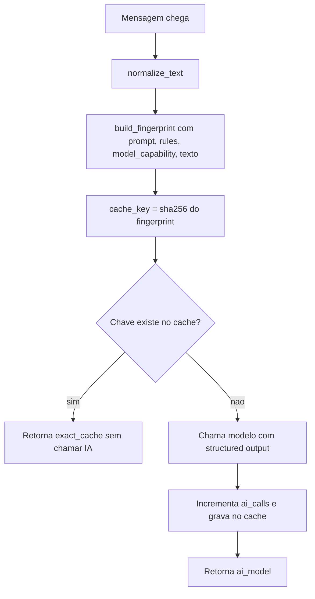

# Cache Exato e Fingerprint

> [!summary] TL;DR
> - Em IA a pergunta deixa de ser "como deixo mais rápido?" e vira "essa chamada para IA realmente precisa acontecer de novo?": cache é estratégia de performance, custo e resiliência.
> - Cache-aside: a aplicação olha o cache, usa se achou, senão chama o modelo, valida e grava.
> - Cache exato usa hash do texto normalizado; só reaproveita entradas idênticas após normalização.
> - Fingerprint: `cache_key = hash(prompt_version + rules_version + model_capability + normalized_text)`. Mudar qualquer versão muda a chave e invalida naturalmente.
> - Em IA, cache é decisão, não só armazenamento: a pergunta certa é "essa resposta ainda pode ser usada com segurança?".

## Conceitos-chave

- **Por que cache em IA é diferente**: cada chamada envolve latência, custo, limite de uso, instabilidade, variação de resposta e risco de reutilizar algo que não devia. Cache reduz pressão no provider e impacto de instabilidade externa (ver [[Resiliência e Fallback de LLMs]]).
- **Identidade de contexto**: a resposta cacheada foi produzida sobre uma versão específica de prompt, regra, modelo, parâmetros, contexto e formato esperado.
- **Cache hit**: resposta aproveitável encontrada; não chama o modelo, evitando tokens, latência de inferência e dependência do provedor. Precisa ser confiável, senão vira otimização perigosa.
- **Cache miss**: chama o modelo, valida o resultado e salva se fizer sentido. Dado existente que não deve ser usado (prompt mudou, regra mudou, resposta anterior com confiança baixa) também é miss.
- **Cache-aside**: a própria aplicação controla o fluxo de consulta, busca na fonte original e gravação.
- **Cache de resposta**: guarda o resultado final da chamada (a classificação do ticket), não tokens, embeddings, contexto ou pedaço de prompt. Pula montagem de prompt, envio, inferência, tokens, rede, timeout, retry, rate limit e validação de formato.
- **TTL (Time to Live)**: tempo de vida do item no cache (5 min, 1 h, 1 dia).
- **Resposta stale**: antiga, disponível, mas talvez não represente a melhor resposta atual. Aceitável em sugestão genérica de categoria, perigosa em decisão sensível ou dependente de regra recém alterada.
- **Invalidação**: decisão de tirar a resposta do jogo. Formas: por tempo (TTL), manual (alguém muda regra), por versão (prompt muda), por tipo de análise (fluxo que não aceita reutilização após certo período).
- **normalize_text**: `re.sub(r"\s+", " ", text).strip().lower()`; minúsculas e espaços colapsados.
- **build_cache_key**: SHA-256 do JSON do fingerprint com `sort_keys`; texto igual gera sempre o mesmo hash.
- **Fingerprint**: assinatura do contexto que gerou a resposta. A pergunta passa de "essa mensagem já apareceu?" para "já apareceu dentro do mesmo contexto de execução?".
  - `prompt_version`: versão do prompt que gerou a resposta.
  - `rules_version`: versão das regras da aplicação.
  - `model_capability`: tipo/capacidade de modelo esperado no fluxo.
  - `normalized_text`: entrada em formato previsível.
- **Invalidação por versão**: mudar a versão muda a chave; o item antigo fica armazenado mas não é usado, sem apagar cache manualmente. Voltar à versão anterior volta a dar hit.
- **Runtime config**: carregada ao subir a aplicação (`prompt_v1`, `rules_v1`, `fast_model`); `PUT /config` muda as versões sem reiniciar, pois reiniciar perderia o cache em memória.
- **Limite do cache exato**: textos diferentes com mesma intenção geram chaves diferentes; resolvido pelo [[Cache Semântico com pgvector]].

## Fluxograma / Processo



## Implementação no projeto

- **Baseline sem cache**: Python, LangChain e FastAPI; `init_chat_model` com provider OpenAI, temperature 0 (aula usa GPT-4.1; `.env.example` usa `gpt-4.1-mini`); `chain = prompt | llm.with_structured_output(TicketAnalysis)`; cada `invoke` é uma chamada ao modelo.
- **Modelos Pydantic**: `TicketAnalysis` (category, confidence 0 a 1, reason), `TicketRequest` (message), `TicketResponse` (source, ai_call_count, tempo, resultado), `Fingerprint`, `CacheInfo` (hit, key, fingerprint id), `ConfigUpdate`.
- **Endpoints**: `POST /tickets/analyze`, `GET /config`, `PUT /config`; servidor na porta 8000 com hot reload; testes em `test.http`.
- **Cache em memória**: dicionário hash -> TicketAnalysis, sem banco, Redis, embedding ou pgvector na primeira versão.
- **Demo sem cache**: "tenho dúvida sobre cobrança" -> billing 0.95; repetir chama a IA de novo.
- **Demo cache exato**: 1a chamada miss; repetição hit com `ai_calls` em 1 e tempo cerca de 0 ms; maiúsculas e espaços extras dão hit pela normalização; acrescentar um caractere ("a" na frente) muda o hash e gera nova chamada.
- **Demo fingerprint**: v1/v1/fast_model miss e depois hit; `PUT /config` para prompt v2 gera miss com a mesma mensagem (com o prompt novo a categoria poderia ser outra, ex: billing_special); voltar para v1 dá hit.

## Erros comuns / Cuidados

- Usar só a pergunta do usuário como chave: com prompt melhorado (separar billing de cancellation) ou regra nova (reembolso não cair em cobrança), a aplicação devolve resposta da versão anterior. "Tecnicamente o cache funcionou, arquiteturalmente ele errou."
- Achar que cache em IA é só pôr Redis, salvar JSON numa tabela ou TTL de 5 min: mal aplicado devolve resposta velha, fora de contexto ou errada.
- Cache não expira só porque o tempo passou; pode precisar ser invalidado porque o contexto mudou (ex: regra de cancelamento de assinatura mudou ontem).
- Trocar modelo simples por robusto sem refletir na chave mistura resultados.
- Não criar versionamento sofisticado no início: deixar versões explícitas no código (prompt v1, rules v1, fast_model).
- Perguntas de decisão: o que exatamente estou reutilizando? em quais condições continua correto? quando invalidar? quando aceito resposta antiga? quando prefiro chamar o modelo de novo?
- Ainda falta política do que pode ser cacheado (confiança mínima, dados sensíveis).

## Materiais complementares

### Prompts

**System prompt do classificador de tickets (main.py), seguido da mensagem humana `Mensagem:\n{message}`**
```text
Você é um classificador de tickets de suporte.
Classifique a mensagem em uma das categorias: billing, technical_support, account, cancellation, other.
Retorne uma confiança entre 0 e 1 e um motivo curto.
Não invente categorias fora da lista.
```

### Conteúdo extra

- Repositório: https://github.com/devfullcycle/mba-ia-cache (config.py, db.py, docker-compose.yml, log_helpers.py, main.py, models.py, test.http).
- Setup: `python -m venv .venv`, `pip install -r requirements.txt`, `cp .env.example .env`, `python main.py`.
- `.env.example`: `PROMPT_VERSION=prompt_v1`, `RULES_VERSION=rules_v1`, `MODEL_CAPABILITY=fast_model`, `MODEL_TEMPERATURE=0`.

## Tags de busca

`#arquitetura-era-ia` `#cache-exato` `#fingerprint` `#cache-aside` `#invalidacao`
