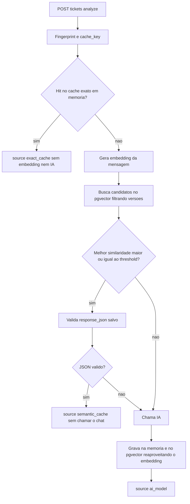

# Cache Semântico com pgvector

> [!summary] TL;DR
> - Cache semântico reaproveita a resposta de uma pergunta parecida o suficiente, comparando embeddings em vez de strings.
> - pgvector ordena por distância de cosseno (`<=>`); similaridade = `1 - distância`; threshold (ex: 0.9) decide se o melhor candidato é aceito.
> - Similaridade não é equivalência: "cancelar reunião" fica perto de "cancelar assinatura"; threshold baixo gera falso positivo.
> - Fluxo em cascata: exact_cache, depois semantic_cache, depois ai_model, gravando no pgvector só no caminho da IA.
> - Cache semântico pergunta "já respondi algo parecido?" e evita a chamada; RAG busca contexto e prepara a chamada.

## Conceitos-chave

- **Problema**: "como eu cancelo minha assinatura?", "quero cancelar meu plano" e "onde eu paro a minha cobrança?" geram chaves diferentes no [[Cache Exato e Fingerprint]].
- **Modelo de embedding**: não é modelo de chat; recebe texto e devolve vetor numérico grande, não interpretável posição a posição; textos de sentido próximo geram vetores próximos (ver [[Embeddings e Similaridade]]).
- **text-embedding-3-small**: modelo OpenAI usado, 1536 dimensões.
- **Distância**: quão longe um vetor está do outro (menor = mais próximo). **Similaridade**: sentido oposto (maior = mais parecido, 1 = vetores idênticos). Ferramentas variam entre ordenar por menor distância ou maior similaridade.
- **Métricas**: euclidiana, cosseno, produto interno; para texto normalmente cosseno.
- **pgvector**: extensão do Postgres para busca vetorial (alternativa de mercado: Pinecone).
- **Threshold**: limite mínimo de similaridade para aceitar reutilização. Não é número mágico: depende de domínio, tipo de resposta, risco do fluxo e testes; 0.85 pode servir em alguns cenários, 0.95+ em outros; decisões sensíveis podem exigir chamar IA mesmo com similaridade alta.
- **evaluate_best_match**: pega o candidato de maior similaridade e marca accepted (>= threshold) ou rejected (chama a IA).
- **Fingerprint como filtro**: a busca filtra por `prompt_version`, `rules_version` e `model_capability` no WHERE antes de ordenar por distância.
- **Cache semântico vs RAG**: mesma tecnologia (embeddings, busca vetorial, pgvector), intenção arquitetural diferente. Cache semântico pode evitar a chamada; [[Fundamentos de RAG]] busca trechos de documentos para montar contexto e gerar nova resposta, sem substituir a chamada.

| | Cache semântico | RAG |
|---|---|---|
| Pergunta | Eu já respondi algo parecido antes? | Quais informações preciso buscar para gerar uma nova resposta agora? |
| Exemplo | "quero cancelar meu plano" reaproveita "como eu cancelo a minha assinatura" | "qual é a política atual de cancelamento?" busca em documentos internos, páginas de ajuda, contratos |
| O que o banco guarda | mensagem original, embedding da mensagem, resposta gerada, versão do prompt, versão das regras, capacidade do modelo | chunks, embeddings dos chunks, metadados, fontes, versão do documento, permissão de acesso |

- Chunking, ingestão, re-ranking e montagem de contexto ficam em [[Ingestão, Chunking e Indexação]] e [[Retrieval e Montagem de Contexto]].

## Fluxograma / Processo



## Implementação no projeto

- **Infra**: `docker compose up -d` com imagem `pgvector/pgvector:pg16` (db, usuário e senha `ai_cache`); na inicialização `CREATE EXTENSION IF NOT EXISTS vector`, criação da tabela e índice de fingerprint.
- **Tabela `ai_response_cache`**: id UUID, prompt_version, rules_version, model_capability, input_text, normalized_text, response_json JSONB, embedding VECTOR(1536), created_at.
- **Geração de embeddings**: `create_embedding_model` (LangChain) com o modelo do `.env`; `embed_documents(textos_normalizados)` para lote, `embed_query(normalized_text)` para um item; helper `to_pgvector` formata o vetor. Poderia usar o SDK da OpenAI direto.
- **Busca SQL**:
```sql
WITH query_embedding AS (SELECT %s::vector AS value)
SELECT ..., c.embedding <=> q.value AS distance,
       1 - (c.embedding <=> q.value) AS similarity
FROM ai_response_cache c CROSS JOIN query_embedding q
WHERE prompt_version = ... AND rules_version = ... AND model_capability = ...
ORDER BY c.embedding <=> q.value
LIMIT %s
```
  - A CTE evita converter o vetor a cada linha.
- **Endpoints**:
  - `GET /db/status`: conexão, pgvector, tabela.
  - `POST /embeddings/generate`: devolve texto normalizado, dimensões e preview do vetor.
  - `POST /semantic-cache/items`: input_text + response_json simulando a IA; devolve id, dimensão, `embedding_preview` de 5 números, created true.
  - `POST /semantic-cache/search`: input_text, limit padrão 5, máximo 10; devolve distance e similarity.
  - `POST /semantic-cache/evaluate`: threshold; accepted se `best_match.similarity >= threshold`.
  - `PUT /config`: threshold ajustável em runtime (0 < t <= 1); padrão `SEMANTIC_CACHE_THRESHOLD=0.90`.
- **Resposta do /tickets/analyze**: source (exact_cache, semantic_cache, ai_model); bloco `semantic_cache` (attempted, hit, decision, reason, threshold, similarity, distance, item id, input_text, best_match); bloco `semantic_cache_write` (attempted, saved, reason, item_id, embedding_dimension).
- **Gravação**: só no caminho da IA, reaproveitando o embedding gerado na busca; se falhar, a resposta da IA volta mesmo assim (saved false, erro no log).
- **Versão LangChain**: tudo em um arquivo; `vector_store = PGVector(embeddings, collection_name, connection)`; `similarity_search_with_relevance_scores(normalized, k=1)`; se score >= threshold, resposta vem dos metadados; no miss, `analyzer.invoke` e `vector_store.add_texts([normalized], metadatas=[result.model_dump_json])`. Cerca de 4 linhas para o banco e 2 para o modelo. A collection funciona como namespace: mudá-la invalida tudo, como o fingerprint. Similarity 0 na resposta = nem passou pela busca vetorial.

## Resultados das demos

- 3 textos ("como cancelo minha assinatura", "quero cancelar meu plano", "não consigo acessar minha conta") geram vetores de 1536 dimensões.
- Busca "preciso cancelar meu plano", limit 5: "quero cancelar meu plano" 0.94; "como cancelo minha assinatura" 0.66; cobrança 0.46.
- Threshold 0.9: "preciso cancelar meu plano" aceito (0.94); "quero cancelar a minha reunião de amanhã" rejeitado (0.66). Com threshold 0.6 seria aceito: resposta de cancelamento de plano para quem quer cancelar reunião.
- "tenho dúvidas sobre cobrança": semântico rejeitado (0.4 vs 0.9), IA chamada; repetir: exact_cache. Mesma pergunta de plano com threshold 0.99: rejeitada, chama IA.
- Ciclo completo após `docker compose down -v`: 1a mensagem chama IA e grava; repetição dá exact hit sem busca nem gravação; "preciso cancelar meu plano" dá semantic hit 0.94 sem IA; "meu aplicativo está travando ao abrir" chama IA e grava (technical_support, 2 chamadas no total).
- LangChain: "estou com dúvida sobre a cobrança da minha fatura, você pode me ajudar?" semantic hit 0.93; "não estou conseguindo acessar minha conta" semantic hit após "não consigo acessar a minha conta".

## Erros comuns / Cuidados

- Busca por similaridade encontra candidatos, não decide; a aplicação precisa de política (threshold, versão de prompt, regra, capacidade do modelo). Embedding não substitui a arquitetura.
- Threshold baixo aumenta falsos positivos e o cache vira bug; quanto mais crítico o tipo de solicitação, mais restritivo. Calibragem é decisão de negócio.
- Mudar a régua do threshold muda se a IA é chamada ou não.
- Validar o response_json salvo: item corrompido no banco pode derrubar a API; se inválido, tratar como semantic miss.
- Primeira requisição pode dar timeout se o Postgres ainda não estiver pronto.
- `docker compose down -v` apaga os dados.

## Materiais complementares

### Conteúdo extra

- Repositório: https://github.com/devfullcycle/mba-ia-cache
- `.env.example`: `OPENAI_EMBEDDING_MODEL=text-embedding-3-small`, `OPENAI_EMBEDDING_DIMENSIONS=1536`, `SEMANTIC_CACHE_THRESHOLD=0.90`, `DATABASE_URL` local.

## Tags de busca

`#arquitetura-era-ia` `#cache-semantico` `#pgvector` `#embeddings` `#threshold`
