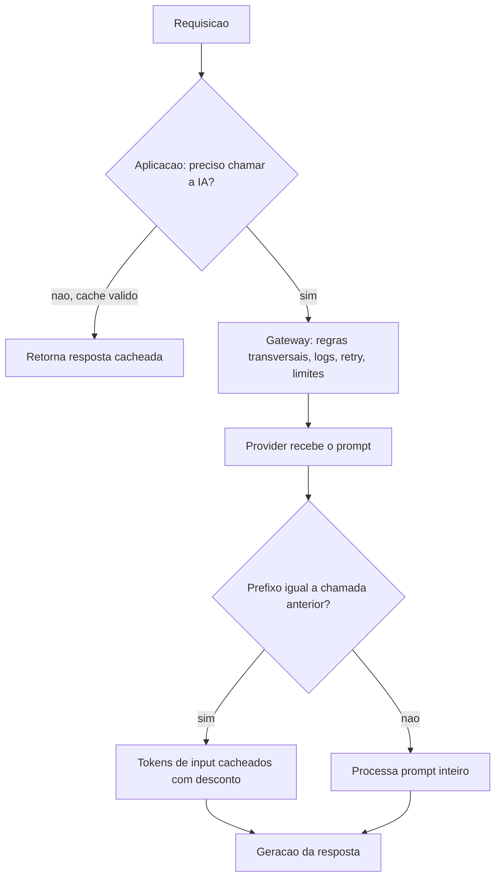

# Camadas de Cache e Prompt Caching dos Providers

> [!summary] TL;DR
> - Três camadas: aplicação ("preciso chamar a IA?"), gateway/proxy (controlar e padronizar chamadas) e provider ("já que vou chamar, alguma parte da entrada pode ser reaproveitada?").
> - Cache da aplicação decide se a chamada deve acontecer; cache do provedor otimiza a chamada que ainda vai acontecer.
> - Prompt caching reaproveita prefixo repetido do prompt, não a resposta: prefixo grande e estável no começo, parte variável no fim.
> - OpenAI é automático (>= 1024 tokens), Anthropic usa `cache_control` explícito, Gemini combina implícito e explícito.
> - Desconto em tokens cacheados pode chegar a cerca de 90%.

## Conceitos-chave

- **Camada de aplicação**: [[Cache Exato e Fingerprint]] e [[Cache Semântico com pgvector]]; conhece o significado da resposta, versão do prompt, regra, capacidade do modelo e política; participa da decisão do produto.
- **Camada de gateway/proxy**: [[AI Gateway]] (ex: [[LiteLLM SDK e Proxy]]) enxerga as chamadas passando e aplica regras transversais: limitar chamadas repetitivas, registrar uso, padronizar logs, controlar retry, evitar chamadas óbvias. Vê prompt, modelo, rota, headers, usuário, custo e latência, mas nem sempre conhece o domínio.
- **Camada de provider**: prompt caching, token caching, cache de conteúdo; reaproveita partes repetidas do prompt para reduzir custo e latência, mas a chamada acontece (ver [[Prompt Caching e Batch Prompting]]).
- **O framework**: também é uma camada de cache possível; todas podem ser usadas em conjunto.
- **Controle**: na aplicação você controla chave, fingerprint, versões, o que entra, invalidação, auditoria e origem no payload (exact_cache, semantic_cache, ai_model); no provider depende do comportamento, regras, modelo, tamanho do prompt e de como ele identifica repetição e expõe uso.
- **Custo residual do provider cache**: há menos latência e custo de input, mas rede, dependência externa e geração continuam.
- **Prompt cache-friendly**: prefixo fixo (instruções, regras, exemplos de classificação, schemas, ferramentas, regras de formato, contexto fixo) e variáveis no final (ver [[System, User e Assistant Prompts]] e [[Tokens e Tokenização]]).
- **Observabilidade**: cache da aplicação registra que não houve chamada, origem, chave e tempo; no provider é preciso ler metadados de uso da resposta (quando existem), e a métrica é "chamei, mas parte da entrada foi reaproveitada", não "evitei uma chamada" (ver [[Observabilidade com OpenTelemetry]]).

| Provider | Modo | Detalhes |
|---|---|---|
| OpenAI | Automático | Prompts com 1024 tokens ou mais; hit depende de match exato de prefixo; `usage` traz tokens cacheados; parâmetro `prompt_cache_key` |
| Anthropic | Explícito | `cache_control` marca blocos/breakpoints cacheáveis; TTL padrão 5 min, opção de 1 h; pode misturar TTLs desde que os de TTL maior venham antes dos de TTL menor; útil para system prompt grande, documentos estáticos, exemplos longos |
| Gemini | Implícito e explícito | Implícito habilitado por padrão no Gemini 2.5 ou mais novo, com mínimo de tokens por modelo; explícito via cached contents (modelo, conteúdo, TTL padrão 1 h) referenciado por ID nas chamadas seguintes |

- Em todos os providers, quanto mais estável o começo do prompt, maior o reuso.

## Fluxograma / Processo

## Prompt caching na prática (OpenAI)

- Mesmo classificador de tickets com system prompt de mais de 1024 tokens, temperature 0 e `prompt_cache_key`; resposta crua (raw) lida para obter `input_tokens`, `output_tokens`, `cached_tokens` e hit.
- 1a chamada ("tenho dúvidas sobre cobrança"): 1265 input tokens, cache read 0, 40 output, billing 0.95, cerca de 1,42 s.
- 2a chamada com mensagem diferente ("não consigo acessar a minha conta"): provider cache hit, 1256 input, 1152 cache read (cerca de 92% do input com desconto), 31 output, 822 ms.
- Mudar o início do system prompt (ex: "Você -") zera o cache read.
- Mudar trecho perto do final do prompt fixo (exclamação na parte de confiança) também invalidou.
- Testes em `provider_cache.http`.

## Erros comuns / Cuidados

- Não colocar cache em todo lugar nem tratar cache com IA "tudo no mesmo saco".
- Achar que o cache do provider resolve cache de resposta mantém chamadas desnecessárias.
- Cache no gateway sem considerar versão/regra do prompt reutiliza resposta em contexto errado.
- Tudo na aplicação sem provider caching perde otimização em prompts grandes e repetitivos.
- Inserir variável antes das instruções fixas ou alterar pequenas partes do prefixo reduz hits.
- Regras dos providers mudam: conferir sempre a documentação atual.
- Pergunta dupla: consigo evitar a chamada inteira? Se não, consigo estruturar a chamada para o provider reaproveitar a parte estática?
- Cache da aplicação (exato e semântico) somado a prompts bem organizados pode decidir se a conta de IA da empresa fecha (ver [[Custos, Budgets e Governança de IA]]).

## Tags de busca

`#arquitetura-era-ia` `#prompt-caching` `#camadas-de-cache` `#cache-control` `#custo-de-tokens`
