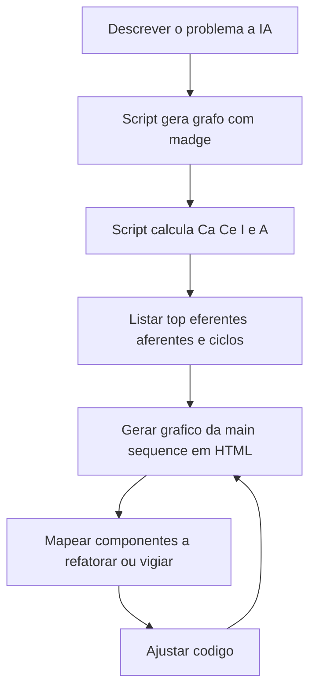

# Análise de Acoplamento com Scripts e IA

> [!summary] TL;DR
> - Com IA, calcular Ca, Ce, instabilidade, abstração e ciclos vira análise recorrente em vez de exercício teórico caro.
> - Pedir à IA scripts determinísticos sob medida para a base, não análise livre arquivo por arquivo.
> - Pipeline: grafo de dependências (madge) → métricas → gráfico da main sequence em HTML.
> - O gráfico localiza componentes na zona de dor e na zona de inutilidade e vira base do plano de refatoração.
> - Em projetos grandes, gerar por domínio e atacar os 10 piores pontos de dor primeiro.

## Conceitos-chave

- **Por que IA**: as [[Métricas de Acoplamento]] exigiam analisar código, extrair dependências, montar grafo, calcular, interpretar, visualizar e manter tudo atualizado enquanto o software muda. A IA lê código, identifica dependências, calcula, gera gráficos, detecta ciclos, aponta módulos críticos e explica por quê.
- **Mapa da aplicação**: mostra onde o sistema fica frágil, rígido e onde cresce o custo de mudança; IA serve não só para escrever código, mas para entender o estado do sistema.
- **Sem "script Deus"**: scripts de métricas devem ser customizados por base (estrutura, tamanho, linguagem). Entendidos os conceitos, basta descrever o problema à IA para gerar o script, sem prompt elaborado.
- **Projeto exemplo**: e-commerce simplificado em TypeScript, banco em memória, `index.ts` com seed, gerado com IA de propósito com acoplamento e alguns bugs (registrado no CLAUDE.md do projeto). Problemas plantados: PaymentGateway como classe concreta (PayPal), PaymentService instanciando Stripe direto, interface subutilizada perto da zona de inutilidade.
- **Grafo bruto**: o madge gera o grafo de dependências de TypeScript/JS, mas com informação demais e sem levar a decisão; seus dados alimentam o cálculo de Ca, Ce e `I = Ce / (Ce + Ca)`.
- **Saída do script de coupling**: top eferentes, top aferentes (Ca, Ce, I) e dependências circulares. Tops aferentes têm instabilidade próxima de 0.
- **Gráfico da main sequence**: cada ponto é um módulo (ou componente/classe, conforme a semântica adotada); eixo vertical = abstração A (concreto embaixo, abstrato em cima); eixo horizontal = instabilidade I (estável à esquerda, instável à direita); linha tracejada = `A + I = 1`; tamanho da bolinha = quantos dependem; borda preta = depende de muitos.
- **Threshold**: o gráfico da aula plotava só os ~12 módulos mais relevantes; componente saudável sai do gráfico.
- **Pasta de scripts do repositório**: cálculo de Ca/Ce, geração da main sequence, métricas principais e geração do HTML.
- **Skill de acompanhamento**: o script pode virar skill, ex: "gere o gráfico de acoplamentos e compare com o da semana passada de acordo com as mudanças no Git".

### Leituras do projeto exemplo

| Módulo | Métricas | Leitura |
|---|---|---|
| OrderService | Ca 3, Ce 15, I 0,83 | Instável, classe Deus; se mudar, "se autoquebra" sem derrubar o sistema |
| `server.ts` | Ca 0, Ce alto | Ninguém depende, importa tudo (handlers, controle, banco); praticamente classe Deus e frágil |
| `database.ts` | A 0, I 0,06, distância 0,94, 17 dependentes | Zona de dor: alvo forte de refatoração ou ponto onde não adicionar novos dependentes |
| Módulo equilibrado | A 0,33, I 0,75, distância 0,08 (Ce 3, Ca 1) | Perto da main sequence porque depende de uma interface |
| PaymentGateway | 100% abstrato, I e distância médias | Interface usada por um só componente e ignorada por outro gateway: perto da zona de inutilidade |
| Bolinhas pequenas na zona de dor | ex: Ce 1, Ca 2 | Menos expressivas |

- **Por que zona de dor é mais grave**: quebra de componente instável afeta só ele; quebra de componente da zona de dor afeta o sistema inteiro.
- **Interface e inutilidade**: interface para um arquivo pode ser overengineering; interface que ninguém usa é inutilidade total; usada por vários arquivos sai da zona.
- **Ciclos**: InventoryService importa Notification, que importa previousOrderCount, que importa OrderService, que importa InventoryService de novo; o projeto tinha 4 ciclos.

## Fluxograma / Processo

- Loop "vira um game": quanto mais bolinhas saírem da zona de dor, melhor a saúde de acoplamento.
- Para tirar da zona de dor: criar interface e migrar os dependentes aos poucos para ela (executado em [[Refatoração Guiada por Acoplamento com IA]]).
- Codebase grande (milhares de arquivos, milhões de linhas): gerar o gráfico por pasta, domínio ou subdomínio; com muitos pontos de dor (ex: 100), escolher um módulo (pagamento, clientes) e tratar os 10 piores primeiro; iterar.
- Empacotar os scripts numa skill de acoplamento.

## Erros comuns / Cuidados

- Pedir à IA para analisar tudo sem script funciona, mas não é determinístico, gasta muito token e demora, pois abre todos os arquivos. Preferir scripts determinísticos gerados pela IA.
- "Saúde" aqui é de acoplamento, não de qualidade de código em geral.
- Não ficar preso aos scripts do professor: com os conceitos entendidos, gerar scripts e gráficos melhores e com mais insights.
- Foco é a utilidade da visualização, não o script.

## Materiais complementares

### Conteúdo extra

- Ferramentas: Claude Code, madge, TypeScript, script `node scripts/coupling...`, arquivo `main-sequence.html`.

## Tags de busca

`#arquitetura-era-ia` `#acoplamento` `#main-sequence` `#scripts-deterministicos` `#madge`
