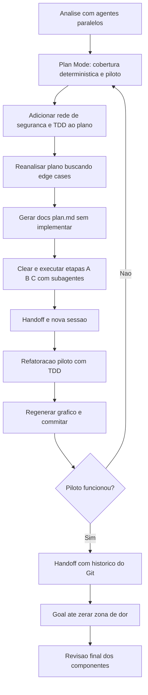

# Refatoração Guiada por Acoplamento com IA

> [!summary] TL;DR
> - Primeiro passo de qualquer refatoração de acoplamento: rede de segurança de testes de caracterização com cobertura determinística.
> - Refatorar um componente piloto, regenerar o gráfico da main sequence, e só depois partir para lote.
> - Ferramentas centrais: Dependency Inversion Principle, Interface Segregation (repositórios por agregado), SRP em arquivos, composition root com injeção via construtor.
> - Fluxo com IA: plano em `docs/plan.md`, `/clear`, handoff entre sessões, subagentes paralelos, TDD e goal em loop com revisão final.
> - Resultado: zona de dor zerada; teoria de acoplamento que era difícil de praticar fica tangível com IA.

## Conceitos-chave

- **Rede de segurança**: testes que permitem mudar sem medo. Código acoplado (com `new` dentro das classes) é difícil de testar.
- **Cobertura ilusória**: percentual alto não garante segurança; testes rasos que só verificam tipo de retorno dão falsa sensação. A cobertura deve ser medida de forma determinística via framework de teste.
- **Testes de caracterização**: travam o comportamento atual, inclusive os bugs, para que qualquer refatoração que os altere seja sinalizada (ver [[Testes Determinísticos e de Contrato]]).
- **TDD**: escrever o teste, vê-lo falhar, alterar o código e fazê-lo passar (RED/GREEN). Para o professor, uma das formas mais seguras de trabalhar com IA hoje por focar no negócio, não regra universal.
- **Idempotência**: operação repetida não duplica efeito (seed rodado duas vezes não duplica dados). Seeds não idempotentes exigem helper de reset/reseed por teste.
- **Dependency Inversion Principle (DIP)**: OrderService passa a receber a interface PaymentGateway em vez do Stripe concreto. Resolver dependência não significa menos imports: pode exigir nova dependência, na direção correta.
- **Interface Segregation Principle (ISP)**: em vez de uma interface "gorda" única para os 17 consumidores do database, repositórios por agregado (padrão repository), cada serviço dependendo só do que usa.
- **Consumidores-função**: módulos que eram funções sem construtor (ex: sales) precisam virar classes injetadas para o Ca migrar do concreto para a abstração.
- **SRP em arquivos**: Single Responsibility Principle (uma única razão para mudar) vale também para arquivos; `database.ts` com várias `InMemoryXRepository` tem objetos intercambiáveis mas acumula responsabilidades.
- **Composition root**: após o split, `database.ts` só compõe (Ce aproximadamente 9 inerente). `composition.ts` instancia serviços e bancos para o main não criar um a um; `createInMemoryDatabase` fabrica o objeto pronto. É classe Deus de propósito, aceitável porque é o objetivo dela.
- **Injeção via construtor**: InMemoryDatabase recebe interfaces no construtor e as classes concretas são instanciadas no `index.ts`; frameworks de DI fazem isso automaticamente.
- **Classe Deus como cheiro**: indica acúmulo de responsabilidade, não necessariamente erro (ex: classe que importa tudo para subir o servidor).
- **Main sequence como equilíbrio**: estar perto da linha é equilíbrio entre quem eu importo e quem me importa, não "o melhor do mundo" (ver [[Métricas de Acoplamento]]).
- **Skill handoff** (mesmo autor da skill "grill me"): compacta a sessão num arquivo para outro agente/sessão continuar sem começar do zero. Conteúdo gerado: objetivo da próxima sessão, princípio "rede de segurança trava o comportamento atual", estado atual, arquivos novos/alterados, plano RED/GREEN, armadilhas conhecidas, skills sugeridas, commits e comandos úteis.
- **Histórico do Git como padrão**: pedir à IA que leia commits e diffs de refatorações anteriores para replicar o padrão em outros componentes.
- **Goal**: comando do Claude Code (o Codex também tem) que fica em loop até atingir a condição (ver [[Goal]] e [[Loop]]).

### Linha do tempo das métricas

| Etapa | Antes | Depois |
|---|---|---|
| Diagnóstico | 11 arquivos de teste, 54 testes (53 passando), só 11 de 35 arquivos de src com teste, 5 módulos na zona de dor com A = 0 | Cobertura determinística instalada |
| DIP no OrderService | PaymentGateway perto da inutilidade | PaymentGateway usado por OrderService e StripeGateway, fora da inutilidade; cobertura 94% |
| StripeGateway | Distância 0,43 | Distância 0,20; sumiu do top 12 do gráfico (precisaria de 16 itens), sinal de sucesso |
| `database.ts` | 17 dependentes, estável e concreto, zona de dor | Depende de 10, 3 dependem dele, região instável e concreta; meta era distância < 0,3 |
| Novas interfaces | | A = 1 (PaymentGateway, StockRepository, CouponRepository, AuditLogRepository); OrderRepository com 5 dependentes perto da main sequence; as pouco usadas, perto da inutilidade |
| Refatoração geral | Logger com 15 dependentes, CustomerManager e `common.ts` na zona de dor | Zona de dor zerada; OrderService, Notification, Sales e Logger reequilibrados; helpers desnecessários removidos |

- **Resultado final**: `types` é interface "gordona" com muitos dependentes, mas abstrata (saudável); `composition.ts` é classe Deus intencional, alta instabilidade, perto da linha, com classes concretas por design; pontos pequenos com instabilidade média não contam como dor; 4 ciclos intencionais permaneceram até a refatoração geral, cujo handoff previa inverter uma aresta via porta.
- **Pontos de vigilância**: NotificationService (depende de 10, 3 dependem dele) é candidato a refatoração sem estar na zona de dor; `common.ts` (depende de 1, 4 dependem dele) é alerta leve.

## Fluxograma / Processo



1. Análise com agentes paralelos (plugin Superpowers, skill "dispatching parallel agents") em três domínios: cobertura, componentes na zona de dor e dificuldade de refatoração. A IA rodou `vitest --coverage` sem provider V8 nem script de coverage e declarou que qualquer percentual seria inventado.
2. Achados: três caminhos críticos sem teste (decremento de estoque, cupom sem asserção de valor, falha de pagamento com skip, intestável por falta de injeção de dependência); ranking por risco; insights sobre logger, duplicação e ciclos (ex: LegacyOrderProcessor).
3. Em [[Plan Mode]], plano com `npm run coverage`, instalação do `@vitest/coverage-v8`, ajuste do .gitignore, revalidação dos críticos e um único piloto (injetar PaymentGateway no OrderService).
4. Plano reescrito: parte C ("coração do plano") com C0 de isolamento (helper de reset), limpeza de 18 testes rasos, testes de desconto real, elegibilidade, estoque e multa; parte D com piloto via TDD; prova de sucesso = três testes críticos verdes, cobertura nova e `npm start` inalterado.
5. Reanálise disparou três agentes (fluxo de pedido; preço, promoção, frete e imposto; infraestrutura de teste) e achou os defeitos plantados: oversell com linha duplicada, três totais divergentes, frete do e-mail diferente do cobrado, imposto fora do total, arredondamento errando meio centavo.
6. Plano vira `docs/plan.md` (diagnóstico, cobertura ilusória, críticos, catálogo de edge cases, caracterização de defeitos, rede de segurança, limpeza, refatoração, verificação, baseline de métricas); `/clear`; execução de A, B e C com subagentes, fora do modo plan.
7. Handoff (gerado em pasta temporária do SO por estar com bypass permissions), commit de plano, testes e package.json, `/clear` e nova sessão com handoff + plan.md. A IA carrega a skill de TDD e transforma o skip em teste.
8. Piloto aplicado, gráfico regenerado, commit; DIP repetido no PaymentService e no Stripe.
9. `database.ts` (alto risco, 17 dependentes): handoff alertou que o suporte de DB dos testes quebra a rede inteira se o reset não for reescrito junto e sugeriu skills Superpowers (brainstorming, writing-plans, test-driven-development, verification-before-completion, commit). A IA fez brainstorming, perguntas, especificação e plano próprios.
10. Split do `database.ts` em um arquivo por classe com agentes paralelos e TDD, sem modo plan; depois DIP do InMemoryDatabase com concretos no `index.ts` e criação centralizada em `composition.ts`.
11. Handoff de refatoração geral apoiado no histórico do Git, goal até tirar tudo da zona de dor e revisão final. O goal também mexeu nos bugs plantados e fez code review.

## Erros comuns / Cuidados

- Pedir à IA que revalide as informações antes de gerar plano: ela tende a soltar muitos agentes.
- Testar uma refatoração piloto ("colocar o pé na água") antes de mandar refatorar tudo; refatorar tudo de uma vez é arriscado.
- Prompt raso pedindo para a IA decidir quais testes importam e remover testes é perigoso em sistemas grandes: definir antes a estratégia de testes do time, senão ela remove testes importantes ou cria testes demais.
- Ao escrever testes para software com bug conhecido, não corrigir o bug: manter o comportamento inalterado durante a refatoração.
- Mesmo com janela de 1 milhão de tokens, preferir fases com contexto limpo (ver [[Context Window em LLMs]]); economizar tokens sempre.
- Se o CLAUDE.md não manda rodar testes sempre, pedir explicitamente no prompt.
- Mexer em classes estáveis e concretas é complexo e arriscado: começar pela rede de segurança.
- Jamais instanciar uma classe dentro de outra (prejudica testabilidade); depender de abstrações, não de implementações.
- Não criar código extra só para aproximar componente da linha: módulo que depende de 2 interfaces e tem 4 dependentes num sistema pequeno está ok.
- Sem harness, guidelines ou padrões definidos, o Claude decide a implementação.
- Não há receita pronta: script e gráfico foram feitos para esse projeto; vale o entendimento de acoplamento, instabilidade e abstração.
- Pedir revisão final ao terminar muda muito o resultado.
- A aula é didática: branch main, processo manual e não determinístico, professor como "babá de IA" sem modos automáticos; SDD e harness automatizam depois.

## Materiais complementares

### Prompts

**Análise inicial de cobertura e zona de dor (narrado na aula)**
```text
Verifique qual é o nível de cobertura de testes desse software. Também verifique os componentes que estão em uma zona de dor (veja @main-sequence.html), principalmente, e também o grau de dificuldade que teríamos para fazer uma refatoração nesses componentes mais críticos.
```

**Plano em modo planejamento (narrado na aula)**
```text
Preciso que você crie um plano efetivo para instalar os componentes e bibliotecas para fazer a verificação de cobertura de código, mas determinística. Precisa revalidar os componentes mais críticos e crie um plano de refatoração para apenas um componente crítico para verificarmos se essa linha de refatoração pode ser seguida.
```

**Adicionar rede de segurança ao plano (narrado na aula)**
```text
Uma vez que você tem de forma determinística a cobertura nesse plano, quero adicionar uma das etapas mais importantes que não colocamos, que é uma rede de segurança de testes para os componentes; dessa forma teremos menos medo de refatorar. Logo, avalie profundamente os testes atuais, com um plano de criar os testes que realmente importam para o negócio, ou seja, que trabalham e mudam o comportamento do sistema, incluindo integrações e regras de negócio. E remova testes óbvios e rasos que não agregam valor. Se tiver que fazer alguma modificação em arquivos para refatoração, utilize TDD.
```

**Dica para qualquer plano gerado por IA (narrado na aula)**
```text
Reanalise todo o plano e, principalmente na parte de testes automatizados, busque por edge cases e pontos cegos que eventualmente não seriam testados.
```

**Transformar plano em documento (narrado na aula)**
```text
Faça com que esse plano gere um documento extremamente explicativo na pasta docs/plan.md. A implementação não deverá ser executada.
```

**Executar fases A, B e C (narrado na aula)**
```text
Baseado no @plan.md, implemente as etapas A, B e depois C. Eu não quero fazer refatoração por enquanto. Utilize subagentes de forma paralela à medida do possível para adiantar todo o processo.
```

**Objetivo do handoff para o piloto (narrado na aula)**
```text
Próxima sessão será usada para fazer a refatoração piloto conforme o @plan.md.
```

**Nova sessão da refatoração piloto (narrado na aula)**
```text
Baseado no <arquivo de handoff> e no @plan.md, realize a refatoração piloto. Após refatorar, verifique sempre todos os testes.
```

**DIP no PaymentService e Stripe (narrado na aula)**
```text
Aplique a mesma Dependency Inversion Principle no PaymentService e faça a refatoração do Stripe. Utilize TDD. E garanta que ele sairá da zona de perigo.
```

**Objetivo do handoff para o database (narrado na aula)**
```text
Refatorar o shared/database.ts usando o TDD e tirar completamente da zona de perigo.
```

**Nova sessão da refatoração do database (narrado na aula)**
```text
A partir do <handoff>, faça a refatoração do componente database conforme o documento.
```

**Split do database (narrado na aula)**
```text
O meu @database.ts saiu da zona de dor conforme o @main-sequence.html. Porém, ele está carregando muita coisa, ou seja, carregando muitas classes. Faça o split dessas classes e deixe apenas o necessário no database.ts. A separação dessas classes fará com que cada arquivo tenha apenas a sua responsabilidade e utilizará sua interface, o que já está acontecendo. Faça isso utilizando diversos agentes em paralelo. Qualquer refatoração e mudança nos testes, utilize TDD.
```

**Inversão de dependência no InMemoryDatabase (narrado na aula)**
```text
O database.ts está instanciando diretamente outras classes concretas. Logo, quero poder trabalhar com dependency inversion, onde ele receberá como parâmetros as interfaces, e depois, quando ele for instanciado, teremos então que passar as classes concretas. Realize essa refatoração, utilize múltiplos agentes, trabalhe com o TDD e garanta que o sistema continue em funcionamento. E no main, no @index.ts, você deverá instanciar as classes concretas no InMemoryDatabase.
```

**Objetivo do handoff para a refatoração geral (narrado na aula)**
```text
Refatoração geral, tirando todos os componentes da zona de perigo. Trabalhar com inversão de dependência, seguindo inclusive os padrões que utilizamos na refatoração do database.ts. Veja o histórico do git.
```

**Goal da refatoração geral (narrado na aula)**
```text
Baseado nesse meu arquivo e no @main-sequence.html, seu objetivo é fazer uma refatoração ao ponto de tirar todos os arquivos/classes/componentes da zona de perigo. Utilize o histórico do Git no passado para entender o padrão e trabalhe com múltiplos agentes e, no caso da refatoração, trabalhe com TDD. No final, quero garantir que meu software esteja devidamente saudável em relação ao acoplamento e suas proporções. Ao terminar, reveja todos os componentes para garantir que a refatoração atingiu o seu objetivo.
```

### Conteúdo extra

- Ferramentas: Claude Code (modo planejamento, `/clear`, goal), plugin Superpowers (dispatching parallel agents, subagent development, brainstorming, writing-plans, test-driven-development, verification-before-completion, commit), skill handoff, skill grill-me (citada), Vitest, `@vitest/coverage-v8`, `npm run coverage`, git log/diff, Codex.

## Tags de busca

`#arquitetura-era-ia` `#refatoracao` `#inversao-de-dependencia` `#tdd` `#rede-de-seguranca`
