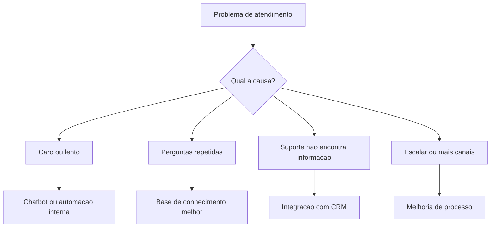

# Tipos de Arquitetura

> [!summary] TL;DR
> - Quatro perspectivas que se conectam: tecnológica, corporativa, de solução e de software.
> - O que define o tipo é a decisão tomada, não o cargo de quem decide.
> - Arquitetura não é o diagrama: são as decisões que estruturam o sistema para atender o negócio dentro das restrições, e a comunicação delas.
> - O módulo foca em arquitetura de software e de solução.

## Conceitos-chave

- **Decisão, não cargo**: tech lead, dev sênior, staff/principal engineer, CTO e time de plataforma também tomam decisões arquiteturais.
- **Arquitetura tecnológica**: profundidade numa tecnologia, plataforma ou ecossistema (Java, .NET, Cloud, dados, SAP, Oracle, Elastic), conhecendo limites, boas práticas, riscos e erros comuns em produção. Em algumas empresas abrange infra, rede, segurança e plataformas internas.
- **Arquitetura corporativa**: olha a empresa inteira conectando estratégia, processos, dados, aplicações e tecnologia. Define sistemas estratégicos, tecnologias adequadas, duplicidades, riscos, o que modernizar, padrões e evolução sem caos, considerando orçamento, risco, política e contratos com fornecedores.
- **Arquitetura de solução**: fica entre negócio e tecnologia e transforma necessidade de negócio em solução viável. Considera sistemas existentes, integrações, dados, pessoas, processos, fornecedores, custos, risco, operação e impacto.
- **Solução nem sempre é software novo**: pode ser integrar sistemas existentes, comprar SaaS, automatizar processo, mudar fluxo operacional ou combinar essas opções.
- **"Jogo de Legos"**: encaixar componentes (ex: software A, Kafka, filtro de dados e software B para não perder dados; orquestração de microsserviços; escolha de cloud provider e seus serviços). Aproxima-se de system design e muitos arquitetos de solução são especializados em um cloud provider (AWS, Google).
- **Requisitos não funcionais**: foco forte da arquitetura de solução (latência, carga, escala). 100, 1.000, 10.000 ou 1.000.000 usuários mudam a arquitetura.
- **Arquitetura de software**: estrutura fundamental do sistema (componentes, responsabilidades, comunicação, onde ficam regras de negócio, armazenamento, integração, escala, falhas, testes, evolução sem virar bola de neve), ligada a atributos de qualidade (performance, segurança, escalabilidade, resiliência, manutenção, observabilidade).
- **Exemplos de decisões de software**: modular vs serviços, eventos e processamento assíncrono, dados centralizados vs descentralizados, camada anticorrupção para isolar integração externa, fila para desacoplar partes críticas. Quanto mais micro a decisão, mais perto da arquitetura de software (design patterns, SOLID, arquitetura hexagonal), terreno de [[Métricas de Acoplamento]].
- **Influência mútua**: decisão corporativa limita tecnologias; solução pode exigir integração com legado; tecnológica influencia a construção; software impacta custo, operação e estratégia.

| Tipo | Pergunta central |
|---|---|
| Tecnológica | Como usar bem tecnologias e plataformas? |
| Corporativa | Como a empresa como um todo evolui sem caos? |
| Solução | Como a necessidade de negócio vira solução viável encaixando partes? |
| Software | Como estruturar o sistema para a solução funcionar, evoluir e se sustentar? |

## Fluxograma / Processo

Exemplo de solução para atendimento ao cliente: entender o problema antes de escolher a solução.

## Erros comuns / Cuidados

- Tecnologia excelente usada de forma péssima: Kafka perdendo mensagem, reprocessando errado, duplicando evento, travando consumer.
- Times decidindo tudo sozinhos geram "Frankenstein tecnológico" (autenticações próprias duplicadas, ferramentas de observabilidade diferentes); a liberdade inicial vira custo, risco e dificuldade de evolução.
- Arquitetura corporativa não é padronização de stack ("todo mundo usa Java/AWS").
- Avaliar lock-in ao usar serviços gerenciados do cloud provider.
- Projetos com IA falham ao tratar escolha de modelo, framework e banco vetorial como "a decisão"; a decisão anterior é se precisa de agente ou só de automação simples, fluxo ou aprovação humana (ver [[IA como Componente Arquitetural]]).

## Tags de busca

`#arquitetura-era-ia` `#tipos-de-arquitetura` `#arquitetura-de-solucao` `#arquitetura-de-software` `#arquitetura-corporativa`
