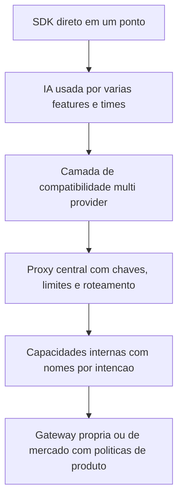

# AI Gateway

> [!summary] TL;DR
> - AI Gateway é a fronteira arquitetural que centraliza, padroniza e controla o acesso a modelos de IA; não é helper nem função que encapsula HTTP.
> - Surge quando a IA, chamada direto pelo SDK em vários pontos, se espalha como decisão técnica e cada ponto conhece provider, modelo, formato, timeout, retry e custo.
> - Primeira capacidade: compatibilidade (interface uniforme para vários providers); depois roteamento, governança, resiliência e observabilidade.
> - A aplicação deve pedir capacidades internas (resposta-suporte, extracao-documento), não modelos físicos.
> - A gateway aplica limites e registra uso, mas quem decide qual limite faz sentido é o produto.

## Conceitos-chave

- **Chamada direta ao SDK**: caminho mais produtivo para validar feature, MVP, automação interna ou ponto específico; não é errado, fica frágil quando a IA vira capacidade usada por várias partes.
- **IA espalhada na arquitetura**: com várias features, times com integrações próprias, outros providers, modelos mais baratos/rápidos/fortes e regras de fallback, trocar provider exige mexer em vários lugares, regra padrão fica difícil de aplicar, custo e saúde de cada fluxo ficam confusos e logs ficam espalhados. É o mesmo problema de dependência concreta tratado em [[Métricas de Acoplamento]].
- **AI Gateway**: camada entre casos de uso e providers, entre regra de negócio e a complexidade de executar chamadas em produção; a feature pede uma capacidade (resumir, classificar, gerar resposta, analisar intenção, enriquecer) e a camada decide como executar.
- **Decisões que a gateway concentra**: escolher modelo, timeout, retry, fallback, outro provider, resposta mais simples quando a completa não for possível, processamento assíncrono, bloquear operações, registrar custo, latência e uso; políticas diferentes por tipo de operação.
- **Compatibilidade**: primeira capacidade; a aplicação chama em formato padronizado e a camada entende o provider, traduz a request, adapta parâmetros, envia e devolve resposta consistente. Dá liberdade para testar modelos, comparar custos, medir qualidade e trocar opções. Implementação inicial típica: [[LiteLLM SDK e Proxy]].
- **Limite da compatibilidade**: não apaga diferenças entre modelos em tool calling, JSON, [[Context Window em LLMs|janela de contexto]], streaming, imagem, arquivos, embeddings e reasoning; só cria um ponto organizado para lidar com elas.
- **Níveis de maturidade**:
  1. Sair do SDK direto e usar camada de compatibilidade para vários providers (ex: LiteLLM).
  2. Gateway manual na própria arquitetura quando as regras são específicas do produto (timeout, retry, fallback, degradação, resposta parcial, revisão humana, processamento assíncrono).
  3. Solução pronta de mercado com roteamento, métricas, fallback, controle de uso e padronização operacional (ex: Vercel AI Gateway, Cloudflare AI Gateway).
- **Capacidades, não modelos físicos**: vocabulário interno de IA próximo da intenção do fluxo (classificador-simples, resposta-suporte, extracao-documento, analise-profunda, embedding-padrao); trocar o modelo de uma capacidade vira mudança de configuração (classificação mais barata, extração com modelo mais forte, provider caro ou instável trocado por trás). Salto pequeno no código, grande na arquitetura.
- **Governança mínima**: controle básico para produção não virar bagunça: chaves por aplicação, limites por ambiente, serviço restrito a modelo barato, capacidades separadas para uso interno e público, limites de requests, [[Tokens e Tokenização|tokens]] e custo. Aprofundado em [[Custos, Budgets e Governança de IA]].
- **Perguntas de governança**: qualquer aplicação pode usar modelo caro? Batch pode disparar milhares de chamadas sem limite? Feature experimental consome o mesmo orçamento da crítica? Usuário externo pode executar operação pesada como o interno?
- **Rastreabilidade de custo**: custo varia por modelo, tamanho do prompt, tamanho da resposta, tokens e volume; é preciso saber quem chamou, qual capacidade, qual modelo por trás, quanto consumiu e com que frequência.
- **Impacto arquitetural sem governança**: feature sem limite consome a cota do provider e afeta outras partes; fluxo mal desenhado gera custo sem valor; agente mal controlado faz chamadas demais; operação síncrona fica lenta por modelo pesado desnecessário.
- **Resiliência na gateway**: timeout, retry e fallback, detalhados em [[Resiliência e Fallback de LLMs]].
- **Componente novo**: AI Gateway entra na arquitetura de software e de solução como o API Gateway entrou; a escolha depende do provider e do contrato da empresa (AWS, Azure, GCP). Ver [[IA como Componente Arquitetural]].
- **Cache na gateway**: a camada vê prompt, modelo, rota, headers, usuário, custo e latência, mas nem sempre conhece o domínio; ver [[Camadas de Cache e Prompt Caching dos Providers]].

## Fluxograma / Processo

## Erros comuns / Cuidados

- Decorar ferramenta em vez de entender a progressão arquitetural; a pergunta deixa de ser "como chamo o modelo?" e passa a ser "como a arquitetura controla, padroniza, protege e evolui o uso de IA?".
- Colocar a gateway no meio e continuar passando nome físico do modelo, provider e detalhes de execução: muda a topologia, não a abstração.
- Criar nomes genéricos (modelo-1, modelo-2, modelo-rapido) que ninguém entende; o nome deve representar o uso esperado.
- Esperar que a gateway decida o limite certo: depende da aplicação, do produto e do risco do fluxo (classificação simples: modelo barato e limite alto; análise crítica: modelo mais caro).
- Travar a evolução ao controlar acesso e custo; o controle deve existir desde o início sem impedir mudanças.

## Tags de busca

`#arquitetura-era-ia` `#ai-gateway` `#compatibilidade` `#governanca` `#capacidades`
