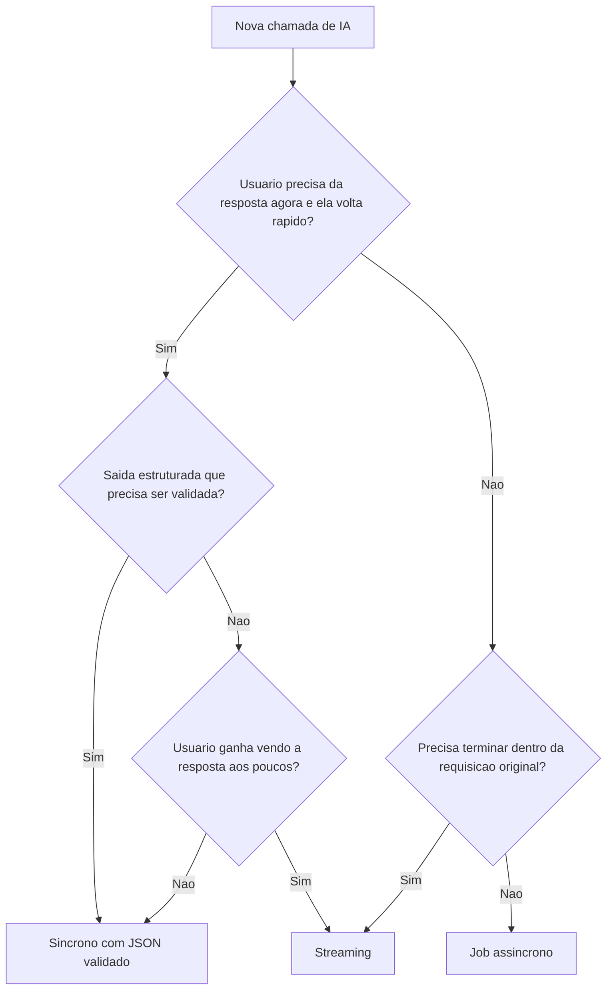
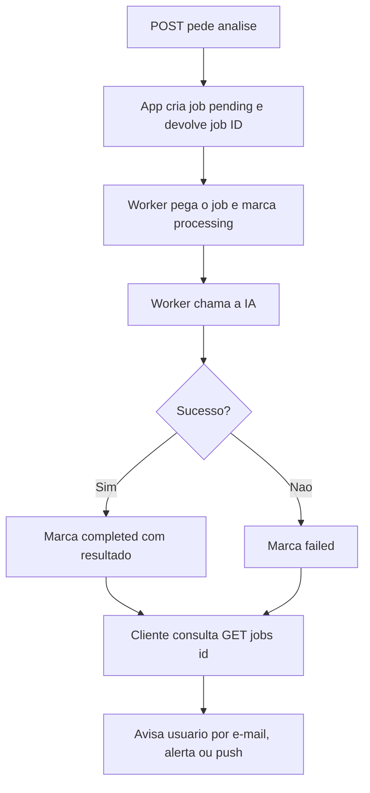

# Fluxos de Chamada Síncrono, Streaming e Assíncrono

> [!summary] TL;DR
> - Fluxo de execução decide como a chamada à IA entra no fluxo real do software; não trata de modelo, provider ou gateway (isso é [[AI Gateway]]).
> - Síncrono: entrada e saída pequenas, tarefa objetiva, resposta quase imediata (ex: classificar ticket e devolver JSON).
> - Streaming: reduz a latência percebida, não o tempo total; só vale para saída textual consumível aos poucos.
> - Assíncrono: cria job, devolve ID, processa em background; para tarefas que não precisam terminar dentro da requisição original.
> - Tratar tudo como chamada bloqueante gera tela sem feedback, timeout, reclique e tarefa duplicada.

## Conceitos-chave

- **Fluxo de execução**: request/response tradicional serve para cadastro, busca e regra de negócio direta; chamadas de IA variam (rápidas, lentas, em partes, textos grandes) e exigem escolher o fluxo.
- **Chamada síncrona**: usuário age, backend chama a IA, espera a resposta completa e devolve. Exemplo: POST de análise de ticket "fui cobrado duas vezes" devolvendo categoria billing, prioridade alta e resumo.
- **Quando síncrono funciona**: classificação curta, extração simples, validação rápida; esperar 2 s é aceitável, 20 a 40 s não.
- **Dependência total da IA no síncrono**: se a IA demora, a requisição inteira demora; se falha, a requisição falha.
- **Streaming**: a aplicação começa a entregar antes da resposta completa; reduz o tempo até o primeiro retorno visível. Chat é só o exemplo mais comum.
- **Quando usar streaming**: explicação, recomendação, resumo, conversa, relatório textual (ex: POST /tickets/explain).
- **Quando não usar streaming**: saída estruturada (JSON com categoria, prioridade, riscos, campos obrigatórios) que precisa ser validada antes de uma decisão; JSON parcial não tem valor e passa falsa impressão de resposta confiável.
- **Delta**: em cada chunk do stream vem só a diferença de conteúdo em relação ao já enviado; sem isso a mensagem inteira seria reenviada.
- **Processamento assíncrono**: tira a chamada de IA do caminho principal da requisição; não é invenção da IA, mas a IA aumenta a frequência de processos que demoram, custam dinheiro e falham de formas diferentes.
- **Estados do job**: pending, processing, completed, failed; opcionalmente logs, mensagens intermediárias e resultado parcial, o que permite retry e retomada.
- **Casos típicos de assíncrono**: relatório, análise de documentos, extração de PDF, enriquecimento de muitos registros, análise consolidada de vários tickets.
- **Regras práticas**:
  - Síncrono: o usuário precisa da resposta agora para continuar na tela e ela volta rápido.
  - Streaming: "o usuário ganha alguma coisa vendo a resposta aos poucos?"
  - Assíncrono: "essa tarefa precisa terminar dentro da requisição original?" Se não, é candidata a job.
- **Comparação medida na demo**: streaming levou 6 s no total contra 1 s do síncrono, mas o texto apareceu antes.

## Fluxograma / Processo



Fluxo do job assíncrono:



## Erros comuns / Cuidados

- Usar síncrono para tudo por ser o caminho mais fácil de implementar; timeout leva o usuário a clicar de novo e disparar a tarefa mais de uma vez.
- Uma feature pode funcionar tecnicamente e ser ruim para o usuário.
- Streaming muda responsabilidades: backend envia em partes, frontend exibe partes com clareza e a aplicação precisa lidar com falha no meio (resposta começa e quebra).
- Ler o primeiro chunk antes de abrir a resposta HTTP garante que a falha aconteça antes de começar a enviar.
- Assíncrono muda o desenho da feature, não é só "rodar depois".
- BackgroundTasks do FastAPI é exemplo simples; em produção usar fila como Redis, RabbitMQ ou Kafka.
- Na demo o status processing nem aparece porque a tarefa é rápida.

## Materiais complementares

### Prompts

**System prompt do analisador síncrono de tickets (narrado na aula)**
```text
Você é um assistente que analisa tickets de suporte. Sempre retorne um JSON válido com as chaves: categoria, prioridade, resumo.
```

### Conteúdo extra

- Demo em Python com FastAPI; o conceito vale para qualquer linguagem e SDK (recebe chunks e repassa, depende do protocolo, aqui HTTP).
- Resultados do endpoint síncrono: "fui cobrado duas vezes" virou billing/high; "app trava ao abrir relatório" virou technical/high; corpo vazio gerou erro de validação do Pydantic.

**Síncrono: POST /tickets/analyze**
- Schemas Pydantic `BaseModel` para request (mensagem do cliente) e response `TicketAnalysis` (categoria, prioridade, resumo).
- AI client com modelo padrão GPT-4.1 Mini e chave no `.env`; `analyze_ticket` chama a OpenAI com system prompt + mensagem, trata erro e retorna `TicketAnalysis`.
- Testes via `requests.http` (REST Client / HTTP Client no VS Code); `python main.py` sobe o servidor.

**Streaming: POST /tickets/explain** (estrutura narrada na aula)
```python
stream = <chamada da OpenAI com>(..., stream=True)

def chunks():
    for chunk in stream:
        yield <delta do chunk>

gen = chunks()
try:
    first = next(gen)          # falha antes de começar a resposta
except <erro>:
    <responder HTTP 500>

def body():
    yield first
    yield from gen

return StreamingResponse(body(), media_type="text/plain")
```

```bash
# -N desliga o buffer e mostra a resposta parcial; -w mede o tempo total
curl -N -X POST <url do servidor>/explain <corpo da requisição> -w <formato com time_total>
```

**Assíncrono: Full Analysis com job**
- `jobs.py`: `create_job` (gera ID, status pending), `get_job`, `mark_processing`, `mark_completed`, `mark_failed`.
- Endpoint chama `create_job` e `background_tasks.add_task(process_job)`, devolvendo só o job ID com status pending.
- `process_job` marca processing, chama o client de IA e marca completed ou failed.
- Cliente consulta `GET /jobs/{id}` até completed; no `requests.http` uma variável captura o job ID do primeiro request para usar no GET.

## Tags de busca

`#arquitetura-era-ia` `#streaming` `#processamento-assincrono` `#latencia-percebida` `#fastapi`
