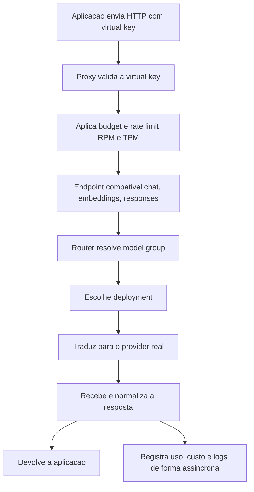

# LiteLLM SDK e Proxy

> [!summary] TL;DR
> - LiteLLM é o primeiro passo prático para tirar a aplicação do acoplamento direto com providers: interface comum que traduz para o provider real.
> - Modo SDK: biblioteca dentro da aplicação, uma única chamada `completion()` para todos os modelos, sem infraestrutura nova.
> - Modo proxy: serviço HTTP separado que vira fronteira central, guarda as chaves reais, emite virtual keys, aplica budget e rate limit e roteia.
> - A aplicação chama o proxy com o SDK da OpenAI e pede um apelido (model group), sem saber qual modelo real está por trás.
> - Regras específicas de produto (fallback semântico, degradação, revisão humana) exigem gateway própria.

## Conceitos-chave

- **Ponto de partida acoplado**: projeto Python chamando a OpenAI direto (`client.chat.completions.create` com modelo e máximo de tokens fixos no código).
- **Segundo provider sem camada comum**: adicionar Anthropic gerou dois SDKs, variáveis `AI_PROVIDER`/`AI_MODEL`/API keys e `if` por provider; OpenAI usa `client.chat.completions.create`, Anthropic usa `client.messages.create`.
- **Incompatibilidade no mesmo SDK**: GPT-5.x (ex: gpt-5.4-mini) não aceita `max_tokens`, exige `max_completion_tokens`, e a chamada quebra.
- **LiteLLM**: implementa a compatibilidade de um [[AI Gateway]]; não é só mais uma biblioteca nem resposta final.
- **Modo SDK**: camada local de compatibilidade; a aplicação ainda carrega a dependência e executa a chamada, mas não fala com cada SDK. `completion(model, messages, temperature, max_tokens)` serve a todos; adicionar Gemini é só mudar o modelo na variável de ambiente. Metade do código gerado era validação de chaves e input, removível.
- **Modo proxy**: LiteLLM roda como serviço separado; a aplicação faz HTTP ao proxy, que encaminha ao provider e devolve a resposta. O salto é de topologia: várias aplicações (API de suporte, pagamentos) chamam o mesmo ponto sem saber o provider. O ganho principal é a fronteira central, não menos código.
- **Responsabilidades do proxy**: esconder chaves reais, expor nomes de modelos controlados, padronizar acesso de várias aplicações, registrar uso, aplicar limites, rotear, centralizar configuração.
- **Virtual key**: Bearer token emitido pelo LiteLLM, não a chave real do provider (OpenAI, Anthropic, Google, AWS); pode ser por aplicação, time, ambiente, serviço interno ou agente. Validação: existe? ativa? dentro do budget? pode acessar o modelo? dentro dos limites?
- **Cache da validação**: memória, Redis ou banco; em produção evitar leitura pesada no banco a cada request.
- **Rate limits**: RPM (requests por minuto) e TPM ([[Tokens e Tokenização|tokens]] por minuto), em nível global, por virtual key, por usuário e por time. IA difere de API comum: além de latência, throughput e disponibilidade, importam custo, tokens, cota do provider e risco de uma feature consumir demais.
- **Endpoints compatíveis**: após validação, a requisição vai para chat completions, embeddings, responses etc. e segue ao router.
- **Router**: decide como a chamada é executada, separando o que a aplicação pede do que é chamado de verdade.
- **Model group**: nome lógico que a aplicação enxerga (chat-rapido, chat-forte, classificador-barato, extrator-de-documento).
- **Deployment**: configuração concreta para chamar um provider real, definida no config do proxy; um model group pode apontar para vários deployments (chat-rapido para GPT-5.x e Gemini; chat-forte para GPT-5.5).
- **Pós-processamento**: atualizar tokens, custos, métricas, logs e consumo por chave, usuário, tempo e modelo, parte de forma assíncrona para não prender a requisição no banco. Base para [[Custos, Budgets e Governança de IA]] e [[Observabilidade com OpenTelemetry]].
- **SDK da OpenAI como cliente**: é a base de compatibilidade do proxy, então chama qualquer modelo (Gemini, Claude) que o proxy converte. Alternativa: SDK do próprio LiteLLM, mas mudanças específicas de modelo exigem mais alterações no código.
- **Apelido na prática**: `model_name` developer-assistant aponta para `openai/gpt-4.1-mini`; a resposta volta com model = developer-assistant; a aplicação confia que o apelido é o melhor modelo para ela.
- **Troca por intenção de uso**: novo item architecture-advisor (Claude Sonnet 4.6); a aplicação troca de capacidade mudando só o nome do modelo em `AI_GATEWAY_MODEL`; chama-se assistente desenvolvedor, arquiteto, financeiro, não nome de modelo. Segue a regra de expor capacidades descrita em [[AI Gateway]].
- **Diferenças entre modelos**: tratadas no LiteLLM com drop de parâmetros ou parâmetros adicionais.
- **Resumo mental**: LiteLLM SDK melhora integração local; LiteLLM proxy cria camada compartilhada de acesso; regras de produto exigem gateway própria.

## Fluxograma / Processo



## Erros comuns / Cuidados

- Não há bala de prata: nem todo modelo é igual; o LiteLLM tenta padronizar entrada e saída ao máximo.
- Configurar no proxy parâmetros específicos de um modelo (ex: do Claude) faz o proxy "quase não ser proxy" e volta o acoplamento; camadas por intenção e camadas abstratas podem coexistir, com cuidado.
- Mudanças no `config.yaml` só valem após reiniciar o proxy.
- Na aula, a troca de modelo falhou porque a variável lida era `MODEL` em vez de `AI_GATEWAY_MODEL`.

## Materiais complementares

### Prompts

**Gerar o exemplo com SDK nativo da OpenAI (narrado na aula, prompt guardado em arquivo do projeto)**
```text
Criar um exemplo usando o SDK nativo em Python da OpenAI, com três arquivos: main.py, requirements.txt e .env.example. Não usar frameworks; dependências no requirements.txt: openai e python-dotenv (para carregar a variável de ambiente). A chamada vai direto ao modelo com o system prompt: "Você é um arquiteto que vai responder perguntas sobre AI Gateway".
```

**Adicionar Anthropic como segundo provider (narrado na aula, guardado como "prompt 2")**
```text
Implemente @prompt2: adicionar o modelo da Anthropic como opção, mantendo o suporte à OpenAI.
```

**Substituir os SDKs pelo LiteLLM (narrado na aula, guardado como "prompt 3")**
```text
Implemente @prompt3: substituir as chamadas diretas aos SDKs pelo LiteLLM, sem usar frameworks e sem usar o LiteLLM Proxy, usando o LiteLLM direto.
```

### Conteúdo extra

- O exemplo foi gerado com agente rápido (modelo Haiku); setup: copiar `.env.example` para `.env`, criar venv, `pip install -r requirements.txt`, `source .venv/bin/activate`, `python main.py`. Pedir "responda com dois parágrafos" reduz a latência da demo.
- LiteLLM tem outros recursos: agrupamento, categorias e permissões de usuários, keys por usuário.

**LiteLLM SDK (estrutura narrada na aula)**
```python
from litellm import completion

response = completion(
    model=<modelo vindo da variável de ambiente>,
    messages=<mensagens>,
    temperature=<temperatura>,
    max_tokens=<máximo de tokens>,
)
```

**docker-compose.yaml do proxy (reconstituído a partir da aula)**
```yaml
services:
  <serviço do proxy>:
    image: <imagem do LiteLLM>
    ports:
      - "4000:4000"          # porta padrão do proxy
    environment:
      OPENAI_API_KEY: <chave da OpenAI>
      LITELLM_MASTER_KEY: <master key do proxy>
    <montagem do config.yaml>
```

**config.yaml com apelidos por intenção (reconstituído a partir da aula)**
```yaml
model_list:
  - model_name: developer-assistant          # apelido que a aplicação conhece
    litellm_params:
      model: openai/gpt-4.1-mini              # modelo real
      api_key: <OPENAI_API_KEY>
  - model_name: architecture-advisor
    litellm_params:
      model: <modelo Claude Sonnet 4.6>
      api_key: <ANTHROPIC_API_KEY>
```

**Aplicação chamando o proxy com o SDK da OpenAI**
```python
from openai import OpenAI

client = OpenAI(base_url="http://localhost:4000", api_key=LITELLM_MASTER_KEY)
response = client.chat.completions.create(
    model=os.getenv("AI_GATEWAY_MODEL"),     # developer-assistant ou architecture-advisor
    messages=<system prompt e pergunta>,
)
```

**Comandos**
```bash
docker compose up -d            # sobe o proxy
docker compose down && docker compose up -d   # recarrega após mudar o config.yaml
python main.py
```

- O `.env` guarda a chave da OpenAI (usada pelo proxy) e a `LITELLM_MASTER_KEY` (usada pela aplicação); o proxy expõe endpoint de listagem de modelos.

## Tags de busca

`#arquitetura-era-ia` `#litellm` `#ai-gateway` `#virtual-keys` `#rate-limit`
