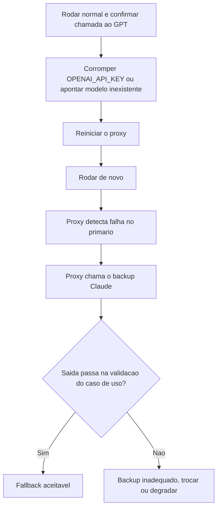

# Resiliência e Fallback de LLMs

> [!summary] TL;DR
> - Depender de modelos é depender de disponibilidade, latência e limites dos providers.
> - Timeout varia por caso de uso; retry precisa de limite de tentativas e intervalo; fallback técnico troca o caminho quando o principal falha.
> - Fallback técnico responde só "consegui tentar outro caminho?"; se a resposta ainda serve ao caso de uso é política arquitetural.
> - No LiteLLM Proxy o fallback fica em `router_settings.fallbacks`; a aplicação não sabe do backup.
> - Backup fraco devolve HTTP 200 com saída quebrada: redundância precisa ser equivalente em qualidade, custo e latência.

## Conceitos-chave

- **Timeout**: a aplicação não pode esperar indefinidamente; tela de atendimento exige resposta rápida, análise longa de documento pode demorar mais, lote vai para segundo plano (ver [[Fluxos de Chamada Síncrono, Streaming e Assíncrono]]).
- **Retry**: nova tentativa em falha temporária (oscilação de rede, erro transitório, limite momentâneo).
- **Fallback técnico**: outro modelo, deployment, provider ou configuração quando o principal falha; evita que uma falha pontual derrube tudo.
- **Equivalência não garantida**: trocar o caminho técnico em IA pode mudar qualidade, formato, estilo, comportamento, seguimento de instrução, JSON e o equilíbrio velocidade vs profundidade.
- **Fallback no proxy**: developer-assistant (GPT-4.1-mini, chave OpenAI) com developer-assistant-backup (Claude Sonnet 4.6, chave Anthropic) mapeados em `router_settings.fallbacks`; quem configura é o proxy de [[LiteLLM SDK e Proxy]] e a resposta continua com model = developer-assistant.
- **Fallback com modelo fraco**: classificador de tickets (ticket-classifier em GPT-4.1-mini, ticket-classifier-backup em Claude Haiku 4.5) com prompt exigindo JSON puro e função validando o JSON. Primário ok: `{category: billing, reason: cobrança duplicada da assinatura}`. Com o primário quebrado, o backup respondeu HTTP 200 com o JSON embrulhado em bloco Markdown com crases, quebrando o fluxo.
- **Trade-off da redundância**: modelo backup mais inteligente resolve, mas custa mais e demora mais.
- **Decisão de arquiteto**: para onde fazer fallback e se é possível degradar é o que diferencia desenvolvedor de arquiteto; em gateway própria entram degradação, resposta parcial e revisão humana ([[AI Gateway]]).
- **Validação de saída**: validar o JSON do classificador é o que detecta o fallback inadequado; testes desse tipo estão em [[Testes Determinísticos e de Contrato]].

## Fluxograma / Processo

Teste de fallback técnico feito na aula:



## Erros comuns / Cuidados

- Timeout como número aleatório igual para tudo.
- Retry sem critério aumenta latência, custo e pressão sobre um provider que já está falhando; valores não podem ser chutados.
- Ter fallback não significa que ele é aceitável: outro provider pode ter qualidade e comportamento diferentes; fallback para modelo que não resolve o problema é inútil.
- HTTP 200 do fallback não prova sucesso: só a validação da saída mostra se o fluxo continua funcionando.
- O cliente não se importa que o modelo caiu; modelos ficam fora do ar como qualquer API.

## Materiais complementares

### Prompts

**System prompt do classificador de tickets (narrado na aula)**
```text
Você é um classificador. Responda estritamente em JSON válido, sem texto fora do JSON, sem blocos de código Markdown, sem crases. Responda apenas com o objeto JSON puro, exatamente neste formato: {"category": "...", "reason": "..."}
```

### Conteúdo extra

**config.yaml com fallback técnico (reconstituído a partir da estrutura narrada)**
```yaml
model_list:
  - model_name: developer-assistant
    litellm_params:
      model: <modelo GPT-4.1-mini>
      api_key: <OPENAI_API_KEY>
  - model_name: developer-assistant-backup
    litellm_params:
      model: <modelo Claude Sonnet 4.6>
      api_key: <ANTHROPIC_API_KEY>

router_settings:
  fallbacks: [{developer-assistant: [developer-assistant-backup]}]
```

```bash
docker compose down && docker compose up -d   # recarrega o proxy após alterar chave ou config
```

## Tags de busca

`#arquitetura-era-ia` `#fallback` `#resiliencia` `#retry` `#litellm`
