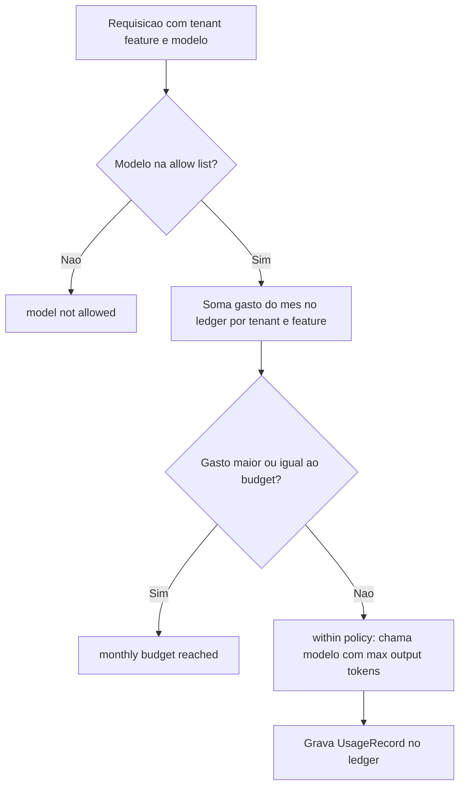

# Custos, Budgets e Governança de IA

> [!summary] TL;DR
> - Observabilidade diz o que aconteceu; governança decide o que ainda pode acontecer.
> - Governança operacional transforma decisões de arquitetura em regras executáveis: definir limites antes, acompanhar durante, reagir quando sai do esperado.
> - Ferramentas: allow list de modelos, budget por tenant/feature/modelo/período, limite de output tokens, ledger de consumo e degraded mode.
> - A checagem de política roda antes de tocar no modelo; cada chamada grava um registro de uso no ledger.
> - A pergunta certa é "essa chamada deveria poder custar isso?", não só "quanto custou?".

## Conceitos-chave

- **Custo como arquitetura**: mais contexto = mais tokens de entrada; respostas longas = mais tokens de saída; query planner + rerank + geração = ~3 chamadas por interação; agente em loop cresce custo sem o usuário perceber (ver [[Operação de Agentes e Tool Calling]]). Custo mostra a arquitetura: contexto grande, muitos passos, tool calls repetidas e respostas longas aparecem primeiro no consumo.
- **Dashboard não basta**: mostra o gasto, mas não impede gasto excessivo.
- **Budget**: limite por tenant, usuário, feature, modelo ou período. Exemplos: limite mensal por tenant, máximo por requisição por feature, modelo só em certos fluxos, chamadas por minuto por usuário, limite de output tokens.
- **Allow list de modelos**: política de modelos permitidos por feature e tenant; convenção comum em empresas, funciona como trava e evita que custo e comportamento virem decisões espalhadas no código.
- **Analogia com autorização**: "esta feature pode usar este modelo com budget X", "esta tool pode ser chamada 3 vezes", "este modelo, neste uso, até 1.200 output tokens".
- **Ledger**: registro do consumo (no lab, arquivo JSONL; em produção, banco de dados).
- **Matriz de permissões**: quais agentes, tools, etapas, pipelines e budgets por tipo de cliente (premium com budget e output maiores).
- **Degraded mode**: em vez de falhar, operar limitado e controlado: modelo mais barato perto do limite, menos chunks se o contexto for grande, resposta parcial se a tool estiver lenta, fluxo simples se o modelo premium não estiver autorizado (relaciona com [[Resiliência e Fallback de LLMs]]).
- **Limites por etapa**: custo aceitável para query planner, rerank e geração; máximo de passos em agente; limite de retries em tool calling; limite de tempo ou execução assíncrona em relatórios (ver [[Fluxos de Chamada Síncrono, Streaming e Assíncrono]]).
- **Governança no gateway**: virtual keys, budget e rate limit também podem ficar centralizados no proxy (ver [[AI Gateway]] e [[LiteLLM SDK e Proxy]]); no lab a política fica na própria aplicação.

## Implementação do lab (`app/governance.py`)

- **`AiPolicy`**: `tenant`, `feature`, `allowed_models`, `monthly_budget_usd`, `max_output_tokens`.
- **`check_policy`** roda antes de tocar no modelo:
  - modelo fora da allow list -> "model not allowed";
  - gasto do mês (somado no ledger por tenant + feature + mês) >= budget -> "monthly budget reached";
  - senão -> "within policy".
- **`UsageRecord`**: cada run que chamou o modelo grava `request_id`, `timestamp`, `tenant`, `feature`, `model`, tokens in/out/total e `estimated_cost_usd` no ledger JSONL.
- **Preços didáticos inventados**: 0.15 USD por milhão de tokens de input e 0.60 USD por milhão de output; não é billing.
- **Variáveis**: `AI_ALLOWED_MODELS=gpt-4.1-mini`, `AI_MONTHLY_BUDGET_USD=10.0`, `AI_MAX_OUTPUT_TOKENS=1200`, `AI_USAGE_LEDGER_PATH=data/ai_usage.jsonl`.

## Fluxograma / Processo

**Ao arquitetar:**

1. Mapear onde a IA será usada.
2. Definir onde ficam restrições e bloqueios.
3. Decidir a reação a cada estouro: bloquear, reduzir, trocar modelo, exigir aprovação, alertar, avisar o usuário, adicionar fallback ou desligar a feature temporariamente.

## Checklist de produção

1. Rastreabilidade: request ID, trace ou correlação em toda execução importante.
2. Qual fluxo rodou: chamada direta, RAG, tool calling, agente, cache, fallback, re-ranking, pedido de esclarecimento, recusa.
3. Qual modelo respondeu: modelo, provider, versão de prompt, configuração principal (metadados, não prompt completo).
4. Tokens in/out e custo aproximado (ver [[Tokens e Tokenização]]).
5. Latência por etapa: retrieval, re-ranking, tool externa, modelo, banco, passos do agente.
6. Captura de dados sob controle (ver [[Privacidade e Retenção de Telemetria]]).
7. Cardinalidade controlada: IDs, contagens, flags, nomes controlados, tempos, hashes.
8. Governança: allow list de modelos, limite de output tokens, budget por tenant/feature, limite de passos de agente, timeout de tools, regra de fallback, degraded mode, comportamento ao estourar orçamento (bloquear, reduzir modelo, pedir confirmação).
9. Retenção e acesso: quem vê traces, por quanto tempo, por ambiente, erros guardados por mais tempo, amostragem de chamadas normais.
10. Explicar operacionalmente por que a resposta foi gerada: pergunta, fluxo, modelo, contexto, tools, fontes, limites aplicados, recusou ou respondeu, custo, tempo.

## Erros comuns / Cuidados

- Sem telemetria não se sabe custo por feature; sem tokens não se entende consumo; sem request ID não se investiga execução; sem modelo não se compara; sem tenant/feature não se sabe quem gerou custo; sem traces não se sabe em qual etapa o custo apareceu (ver [[Observabilidade com OpenTelemetry]]).
- Se não dá para responder o item 10 do checklist, a feature está frágil demais para produção.
- A pergunta de produção é "se der problema, consigo entender o que aconteceu?", não "funcionou no meu ambiente?"; descobrir a causa tarde demais pode custar caro (financeiro, dados sensíveis).
- Preço do ledger do lab é ilustrativo; não usar como billing real.

## Materiais complementares

### Conteúdo extra

- Repositório do lab: https://github.com/devfullcycle/mba-ia-rag (`app/governance.py`, `data/current_usage.json`, `.env.example`).

## Tags de busca

`#arquitetura-era-ia` `#governanca` `#custos` `#budget` `#allow-list`
