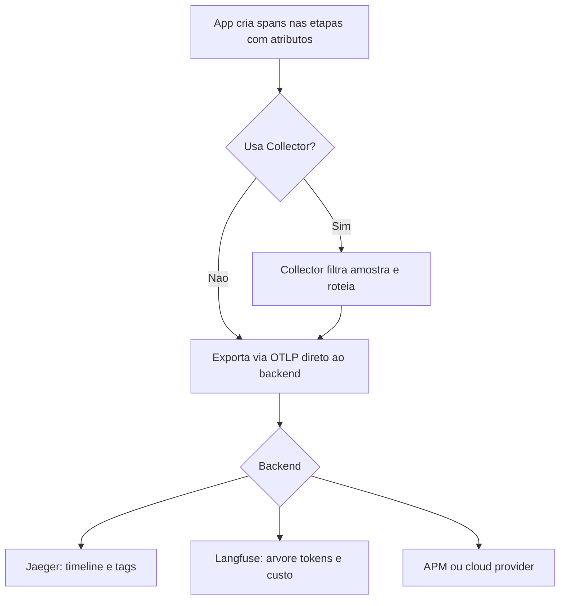

# Observabilidade com OpenTelemetry

> [!summary] TL;DR
> - IA não remove a operação tradicional (erro 500, latência, CPU, filas): adiciona incerteza, porque um status 200 pode esconder custo alto, modelo errado, contexto errado ou resposta sem evidência.
> - A pergunta muda de "a API respondeu?" para "como respondeu?": modelo, tokens, custo, latência, cache hit, fallback, chunks recuperados e fontes.
> - OpenTelemetry é padrão de instrumentação e transporte, não destino: a mesma instrumentação envia traces para Jaeger, Langfuse, Datadog ou outro backend.
> - Cada etapa relevante do pipeline vira um span com atributos seguindo as GenAI Semantic Conventions (`gen_ai.request.model`, `gen_ai.usage.input_tokens`).
> - O foco não é a ferramenta, é conseguir analisar a execução passo a passo.

## Conceitos-chave

- **Caixa preta**: sem observabilidade as decisões são tomadas no escuro: trocar modelo quando o problema era retrieval, aumentar top-k quando era chunking (ver [[Retrieval e Montagem de Contexto]] e [[Ingestão, Chunking e Indexação]]), cortar custo sem saber qual feature gasta, mudar prompt sem saber se era o gargalo.
- **Observabilidade como arquitetura**: não é só infra; operação se mistura com qualidade da experiência e custo do negócio. Sem ela em produção é "pilotar avião sem painel".
- **Log**: registro de que algo aconteceu (requisição recebida, modelo chamado, fallback aplicado, erro de structured output, recusa, limite de custo atingido); serve para investigar um caso específico via request ID.
- **Métrica**: número medido ao longo do tempo (nº de chamadas, latência, P95, tokens de input e output, custo estimado, nº de recusas, nº de fallbacks, falhas por output inválido); mostra que algo mudou, mas sozinha não explica.
- **Trace**: caminho de execução de uma requisição; mostra o fluxo, não só o resultado.
- **Span**: etapa do trace ("capítulo da história") com duração, status e atributos (model call, tool call, retrieval, re-ranking, answer generation).
- **Evento**: algo pontual dentro da execução que não precisa virar span (cache miss, fallback used, clarification requested, structured output failed, no context found, tool timeout).
- **Trace ID / Span ID / parent**: trace ID está em todos os spans da mesma requisição e permite agrupá-los; span ID é único por etapa; parent aponta o span pai.
- **Atributos**: informações da etapa definidas pela aplicação (instrumentação intencional), diferente da instrumentação automática que captura padrões da linguagem e das libs.
- **Resource**: atributos do processo (telemetry SDK language python, SDK name opentelemetry, versão, `service.instance.id`, `service.name`).
- **OpenTelemetry (OTel)**: padrão e conjunto de ferramentas para instrumentar, coletar e exportar telemetria, projeto da CNCF; não é dashboard. Sem padrão cada time nomeia diferente (`model` vs `llm_model` vs `deployment` vs `engine`; `input_tokens` vs `prompt_tokens`) e a correlação fica difícil.
- **GenAI Semantic Conventions**: nomes de mercado que as ferramentas já sabem ler: `gen_ai.request.model`, `gen_ai.response.model`, `gen_ai.usage.input_tokens`, `gen_ai.usage.output_tokens`.
- **OTLP**: protocolo padrão de exportação do OTel; path padrão de traces `/v1/traces`. O Langfuse usa caminho próprio `/api/public/otel` mais header de ingestion version (versão 4 na gravação).
- **OpenTelemetry Collector**: intermediário que recebe, processa, filtra, transforma, enriquece e encaminha para um ou mais destinos; roda como sidecar proxy ao lado da aplicação ou como servidor dedicado. Também aplica sampling e filtros (ver [[Privacidade e Retenção de Telemetria]]).
- **Span kind internal**: span executado dentro da própria aplicação.
- **Separação de responsabilidades**: a aplicação instrumenta o que importa; o Collector roteia, transforma e exporta; a ferramenta final faz visualização, busca, dashboards e alertas.

## Formato do trace por arquitetura

| Arquitetura | Spans típicos |
|---|---|
| Chatbot simples | entrada, chamada ao modelo, resposta |
| RAG | query planning, retrieval, re-ranking, montagem de contexto, modelo, resposta com fontes |
| Tool calling | decisão do modelo, chamada da ferramenta, retorno, nova chamada ao modelo |
| Agente | planejamento, tool calls, observação, nova decisão, condição de parada, resposta final ([[Operação de Agentes e Tool Calling]]) |

Atributos por tipo de span: model call (modelo, provider, tokens in/out, latência); tool (nome, tempo, status, erro); RAG (chunks recuperados, selecionados, resposta com fontes).

## Instrumentação do pipeline RAG no lab

- **Spans do pipeline** (pipeline descrito em [[Fundamentos de RAG]] e [[Query Planner e Reranking]]):
  - `ai.rag.query_planning`: pergunta normalizada, tipo de doc, plano (ex: enterprise), termos exatos, `need_clarification`, filtros, duração em ms.
  - `ai.rag.retrieval`: nº de chunks, filtros, duração.
  - `ai.rag.reranking`: chunks selecionados (ex: 4), duração.
  - `ai.rag.answer_generation`: atributos `gen_ai.*`, `has_answer`, duração da geração.
  - Span raiz `ai.rag.pipeline`: feature, tenant, produto, re-ranking usado, resposta, `need_clarification`, nº de sources, total em ms.
- **Span só existe se a etapa roda**: com a flag de desligar re-rank (`NO_RERANK`) o span de reranking some do trace.
- **Status error**: span com erro registra status ERROR e descrição (ex: chave OpenAI inválida) e o erro se propaga ao span pai: query planning falha e o span guarda-chuva do pipeline também fica com erro.
- **Módulo `observability`**: abstração sobre o SDK com constantes de nomes (tracer `app.rag`, exporter OTLP, nomes de spans) e atributos hierárquicos com pontos (`app.request_id`, `app.feature`, `app.tenant`, `app.product`, `app.use_rerank`).
- **`RagPipeline.run`**: gera `request_id` (UUID), `PipelineTimings` e `UsageMetadataCallbackHandler` do LangChain (captura uso de tokens); cada etapa fica dentro de `with _step(...)`, context manager que marca início, mede ms e abre o span; seta atributos de entrada (request_id, feature, tenant, product, use_rerank), executa, seta atributos de resultado (`has_answer`, `needs_clarification`, nº de sources) e, em exceção, registra o erro no span.
- **`setup_tracing`**: cria `TracerProvider` com service name, `SpanProcessor` e exporter; helper `with_span` recebe o nome, marca início, executa e trata erro; helpers de set attribute.
- **Build do exporter OTLP**: lê endpoint e headers; se houver `LANGFUSE_PUBLIC_KEY` e `LANGFUSE_SECRET_KEY`, usa o endpoint do Langfuse com header `Authorization: Basic` (base64 de `public:secret`); senão headers None e URL padrão (Jaeger).

## Fluxograma / Processo

**Demo do lab, passo a passo:**

1. Rodar o RAG chat com debug (ex: "Qual é a SLA para incidentes P1 no plano Enterprise?"): mostra query plan, chunks, seleção, tempos e modelo.
2. Ligar `OBSERVABILITY_ENABLED=true` com `OTEL_TRACES_EXPORTER=console`: spans saem como JSON no terminal.
3. Jaeger: comentar as chaves do Langfuse, apontar `OTEL_EXPORTER_OTLP_ENDPOINT` para o Jaeger e subir com `docker compose --profile jaeger --profile app up -d`. Exportação direta da app, sem Collector; só a URL muda.
4. No Jaeger, escolher o serviço, Find Traces: trace com 2 spans (pedido de clarificação) e com 5 spans; abrir para ver duração total de `ai.rag.pipeline`, timeline e tags de cada etapa.
5. Langfuse: comentar o endpoint do Jaeger (em branco cai no default do Langfuse), configurar public/secret key; a app envia para `http://localhost:3000/api/public/otel` com headers Authorization e ingestion version.
6. No projeto Langfuse: dashboard com modelo (gpt-4.1-mini), tokens, custo e gráficos; aba Tracing filtra por nome e tags; o trace aparece em árvore (ex: pipeline de 11 s), com ícone de geração nas chamadas a modelo e visão timeline equivalente à do Jaeger.

## Ferramentas e categorias de mercado

Classificação do professor, não formal:

| Categoria | Ferramentas | Ponto forte | Limite |
|---|---|---|---|
| Tracing tradicional | Jaeger, Grafana Tempo | traces, spans, latência, fluxo entre serviços | não nasceram para LLM: pouco suporte a prompts, gerações, custo, tokens, avaliação, datasets |
| AI-first / LLM-first | Langfuse, Phoenix, LangSmith | Langfuse (open source): token usage, cost tracking, prompt linking, scoring via OTel; Phoenix (open source): model calls, retrieval, tools, aceita OTel; LangSmith (proprietária): natural com LangChain/LangGraph | LangSmith pode confundir framework com estratégia de observabilidade |
| APM corporativo | Datadog, New Relic, Splunk | visão única de app, infra, banco, filas e agora LLM; Datadog LLM Observability (custo, tokens, breakdown por provider, modelo e prompt version); New Relic AI Monitoring (performance, custo, qualidade, LangChain) | contrato e stack existentes pesam |
| Cloud providers | AWS CloudWatch GenAI Observability, Google Cloud Observability, Azure AI Foundry + Application Insights | nativos para quem está fundo em uma nuvem; suporte LangChain/LangGraph e OTel | acoplamento ao provider |

- **Critério de escolha**: tracing aberto e simples -> Jaeger; app LLM com prompt, token e custo -> Langfuse, Phoenix ou LangSmith; empresa já em Datadog/New Relic -> integrar na stack existente; profundamente em AWS/GCP/Azure -> recursos nativos.
- **Fatores**: o que o time já usa, quais dados podem sair, retenção, governança, custo e contratos. Escolher ferramenta é decisão arquitetural e de negócio; OTel mantém a instrumentação aberta e o backend escolhido por maturidade, custo, governança e ecossistema (mesma lógica de desacoplar provider em [[AI Gateway]]).
- **Docker Compose profiles**: stacks de observabilidade opcionais sobem só quando pedidas, economizando memória. Profile `jaeger` (imagem simples, `ui-config.json` para alternar tema por bug do modo escuro); profile `observability` com Langfuse web e worker, Redis, MinIO (S3 local), ClickHouse e Postgres; pgvector sobe desde o início.

## Erros comuns / Cuidados

- Instrumentar só com API proprietária prende a uma ferramenta e dificulta trocar ou combinar backends depois.
- OTel não decide o que observar: quem decide é a arquitetura. Definir antes o que se quer medir.
- Span genérico "chat" não ajuda; granularidade segue a arquitetura: model call para chamada simples, span por tool call em workflow, cada ciclo de decisão em agente.
- Não criar span para cada pedacinho do software: cada etapa relevante, intencionalmente.
- Registrar informação como atributo de span em vez de texto solto no log.
- Observar não é logar tudo: prompt, contexto RAG e respostas podem ter dado sensível (ver [[Privacidade e Retenção de Telemetria]]).
- No exemplo, o erro de autenticação não é tratado com mensagem amigável ao usuário; o trace mostra, o usuário não.

## Materiais complementares

### Conteúdo extra

- Repositório do lab: https://github.com/devfullcycle/mba-ia-rag (branch observability; arquivos `app/observability.py`, `docs/pipeline.md`, `docker-compose` com profiles `jaeger` e `observability`).
- Variáveis do `.env.example`: `OBSERVABILITY_ENABLED`, `OTEL_SERVICE_NAME=fcai-rag-api`, `OTEL_TRACES_EXPORTER=console`, `OTEL_EXPORTER_OTLP_ENDPOINT`, `OTEL_EXPORTER_OTLP_HEADERS`, `LANGFUSE_PUBLIC_KEY`, `LANGFUSE_SECRET_KEY`, `LANGFUSE_HOST=http://localhost:3000`.
- Destinos OTLP citados: Langfuse, Phoenix, Datadog, New Relic, Azure Monitor, Google Cloud Observability, CloudWatch, Grafana Tempo, Jaeger.

## Tags de busca

`#arquitetura-era-ia` `#observabilidade` `#opentelemetry` `#tracing` `#langfuse`
