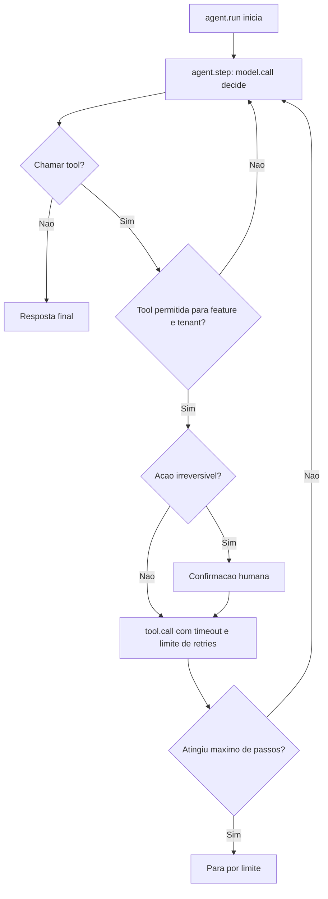

# Operação de Agentes e Tool Calling

> [!summary] TL;DR
> - Em tool calling o modelo decide chamar uma ferramenta (API, pedido, ticket, banco, workflow, ação controlada); a operação precisa enxergar qual tool, quanto tempo, se funcionou e se deveria ter sido chamada.
> - Em agentes observa-se o loop: passos, tools, retries, ações repetidas, condição de parada e onde o custo concentrou.
> - Registrar eventos operacionais, não raciocínio interno: auditar comportamento sem expor cadeia de pensamento.
> - Governança: máximo de passos, limite de retries, timeout por tool, allow list de tools por feature e tenant, confirmação humana antes de ação irreversível.
> - Quanto mais autonomia, mais observável e governado o fluxo precisa ser.

## Conceitos-chave

- **O que observar em tool calling**: qual tool, duração, sucesso, timeout, retry, payload grande demais, se o retorno foi usado na resposta final, se a tool deveria ter sido chamada.
- **Origens de falha**: modelo escolheu a tool errada, schema da tool, API chamada, permissão, timeout, retorno da tool. Avaliar essas falhas offline é tema de [[Evaluation de Agentes e Tool Calling]].
- **O que observar no loop do agente**: nº de passos, tools chamadas, falhas, retries, ação repetida, condição de parada clara vs limite atingido, etapa onde o custo concentrou, latência do modelo vs latência das tools externas.
- **Eventos operacionais**: etapa iniciada, tool escolhida, tool executada, tempo, erro, retry, status, nº de passos, custo acumulado, condição de parada, resultado final.
- **Auditar sem expor raciocínio**: a telemetria registra o comportamento do agente, não sua cadeia de pensamento; retornos de tool podem ser privados e seguem as regras de [[Privacidade e Retenção de Telemetria]].

## Spans sugeridos

| Span | Atributos seguros |
|---|---|
| `agent.run` | nº de passos, condição de parada, custo acumulado |
| `agent.step` | nº do passo, status |
| `model.call` | modelo, tokens, custo estimado, duração |
| `tool.call` | nome da tool, nº da tentativa, duração, status |
| `tool.result` | status, tipo de erro |

Segue a granularidade definida em [[Observabilidade com OpenTelemetry]]: um span por tool call em workflow e um por ciclo de decisão em agente.

## Fluxograma / Processo

## Governança do agente

- Máximo de passos por execução.
- Limite de retries por tool.
- Timeout por tool call.
- Allow list de tools por feature.
- Tools restritas a certos tenants.
- Confirmação humana antes de ação irreversível.
- Budget e allow list de modelos valem também para o agente (ver [[Custos, Budgets e Governança de IA]]).

## Erros comuns / Cuidados

- Agente sem limite entra em loop.
- Agente sem observabilidade gasta sem ninguém perceber.
- Agente sem rastreabilidade toma decisões que ninguém consegue explicar.
- Diferenciar no trace a parada por condição clara da parada por limite atingido.

## Materiais complementares

### Conteúdo extra

- Repositório do lab: https://github.com/devfullcycle/mba-ia-rag (branch evaluation-agent: `app/support_tools.py`, `app/support_agent.py`, `docs/agent.md`).

## Tags de busca

`#arquitetura-era-ia` `#agentes` `#tool-calling` `#observabilidade` `#governanca`
