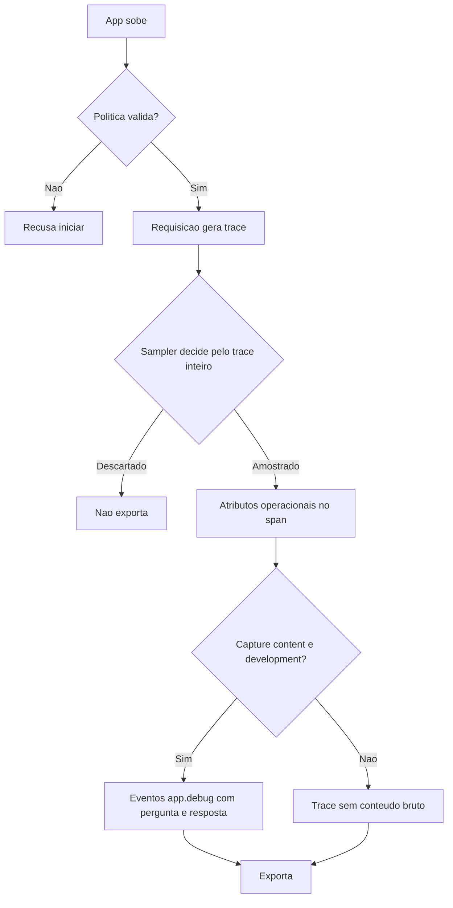

# Privacidade e Retenção de Telemetria

> [!summary] TL;DR
> - Decidir o que NÃO enviar é tão importante quanto instrumentar: a ferramenta de observabilidade não pode virar cópia paralela dos dados sensíveis.
> - Atributos levam sinais operacionais de baixa cardinalidade (IDs, contagens, flags, tempos, modelo, tokens); conteúdo bruto (pergunta, resposta) só como evento de debug, só em development.
> - A app recusa subir se `OBSERVABILITY_CAPTURE_CONTENT=true` fora de development.
> - Sampling por trace inteiro (`ParentBased(TraceIdRatioBased)`): % das requisições normais, 100% dos erros e casos caros ou lentos.
> - Retenção e acesso são decisões de arquitetura: por quanto tempo, quem vê, política por ambiente.

## Conceitos-chave

- **Risco específico de IA**: prompt com dados do usuário, contexto RAG com documentos internos, retorno de tool privado e resposta do modelo podem carregar dado sensível (ver [[Threat Model e OWASP para IA]]).
- **Decisão da aplicação**: a app define quais dados vão para logs, quais viram atributos de trace, quais ficam só em dev, quais são mascarados, quais são agregados e quais nunca saem do runtime.
- **Sinais seguros**: request ID, feature, tenant, produto, tempos, contagens, filtros, flags, nomes de etapas, modelo, tokens, nº de chunks, teve resposta / recusa / erro.
- **Evitar sem decisão explícita**: pergunta completa, prompt completo, chunks, documentos, resposta completa, API key, URL do banco.
- **Cardinalidade**: quantidade de valores distintos de um atributo. `feature=rag_chat` e `model` são baixa; pergunta inteira é altíssima. Alta cardinalidade dificulta consultas, aumenta custo, polui dashboards, prejudica o backend e costuma carregar dado sensível.
- **Atributo vs evento**: atributo (tag no Jaeger) é estável, de baixa cardinalidade, descreve a operação e serve para filtrar (`app.feature`, `app.total_ms`); evento (aparece como "log" no Jaeger) tem nome fixo e atributos muito variáveis, serve para consultar e não para filtrar. Log registra tudo com todos os dados; evento é o gatilho. A semântica varia por ferramenta.
- **Eventos de debug**: pergunta e resposta vão como `app.debug.question` e `app.debug.answer` no span raiz, nunca como atributo, porque atributo viaja em todo ambiente e conteúdo bruto é outra natureza: opcional e restrito a development.
- **Sampling**: decidir quais execuções armazenar e exportar para evitar overhead. O sampler `ParentBased(TraceIdRatioBased)` aplica a decisão ao trace inteiro: trace pela metade é pior que nenhum.
- **Retenção**: por quanto tempo guardar, com controle de acesso e política de limpeza.
- **Collector como filtro**: aplica em tempo real sampling (50%, 10%) e filtros (ex: excluir tudo que é `app.debug`) antes do backend (ver [[Observabilidade com OpenTelemetry]]).

## Substituições de conteúdo sensível

| Em vez de | Enviar |
|---|---|
| pergunta inteira | tamanho ou hash |
| chunk inteiro | chunk ID, arquivo de origem, quantidade |
| prompt completo | versão do prompt |
| resposta inteira | teve resposta / recusou + tokens gerados |

## Política por ambiente (lab)

| Ambiente | Exporter | Sample rate | Capture content |
|---|---|---|---|
| development | console | sempre 1.0 | pode ser true |
| staging | otlp | da variável (ex: 0.5) | precisa ser false |
| production | otlp | ex: 0.1 | false |

- Dev aceita mais detalhe; staging se aproxima de produção; produção é restrita: menos conteúdo bruto, mais controle de acesso, retenção curta.
- Em produção a telemetria operacional continua igual (request_id, tenant, product, feature, contagens, filtros, flags, tempos, modelo, tokens); muda o volume e a permissão de conteúdo.
- **Nunca sai em ambiente nenhum**: prompts (planner, reranker, resposta final), contexto montado, conteúdo dos chunks, documentos, `OPENAI_API_KEY`, `DATABASE_URL`, valores dos headers OTLP.
- **`validate_observability_policy()`** roda na subida: a app recusa iniciar se `APP_ENV` for inválido, sample rate estiver fora de 0.0 a 1.0 ou capture content for true fora de development. Mensagem: "Invalid observability policy: OBSERVABILITY_CAPTURE_CONTENT can only be true in development."
- `--show-prompt` é recurso local de terminal, não observabilidade.

## Fluxograma / Processo

**Demo do lab:**

1. Configurar `APP_ENV=development`, `OBSERVABILITY_SAMPLE_RATE=1.0`, `OBSERVABILITY_CAPTURE_CONTENT=true`, apontando para o Jaeger.
2. Perguntar "Me fale sobre a SLA do plano Enterprise": o span do pipeline mostra eventos com pergunta e resposta.
3. Trocar para production com capture content true: a app recusa pela regra explícita.
4. Com capture content false em produção: o trace continua igual, sem os eventos de conteúdo.

**Sampling em produção:** % das requisições normais e 100% dos erros, respostas sem fonte, chamadas caras, timeouts e execuções acima do limite de latência.

## Erros comuns / Cuidados

- Observar não é logar tudo; log precisa ser útil e controlado.
- Mesmo com Collector filtrando, controlar na própria aplicação: todo dado enviado é um dado a mais saindo da aplicação.
- A arquitetura de observabilidade define o que não capturar, quando, por quanto tempo e quem acessa; a decisão final é de governança de cada empresa.
- Checklist de produção: em dev, pergunta e resposta só como evento de debug explicitamente habilitado; em produção sem prompt, contexto, chunks, documentos internos, resposta inteira e dados sensíveis sem política clara; cardinalidade controlada (IDs, contagens, flags, nomes controlados, tempos, hashes); retenção e acesso definidos (quem vê traces, por quanto tempo, dev vs staging vs produção, erros guardados por mais tempo, amostragem de chamadas normais).
- A stack de observabilidade é um boundary: a seta aplicação -> OpenTelemetry também é superfície de ataque (ver [[Threat Model e OWASP para IA]]).

## Materiais complementares

### Conteúdo extra

- Repositório do lab: https://github.com/devfullcycle/mba-ia-rag (`docs/pipeline.md`, seção de telemetria por ambiente; `app/observability.py`).
- Variáveis: `APP_ENV=development`, `OBSERVABILITY_SAMPLE_RATE=1.0`, `OBSERVABILITY_CAPTURE_CONTENT=false` (default do `.env.example`).

## Tags de busca

`#arquitetura-era-ia` `#observabilidade` `#privacidade` `#sampling` `#cardinalidade`
