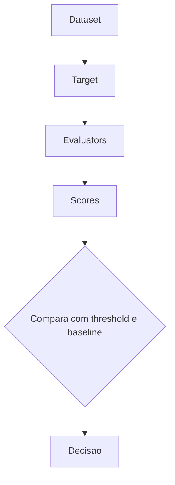

# Arquitetura de Evaluation e Experiments

> [!summary] TL;DR
> - Evaluation tem 7 peças: dataset, target, evaluator, score, threshold, baseline e experiment.
> - O dataset é a peça mais importante: intencional, versionado, validado antes de subir e sincronizado de forma idempotente no Langfuse.
> - Experimento compara uma versão contra a baseline no mesmo dataset; regressão em IA é sutil (nada quebra, a qualidade cai).
> - Melhor versão é a que atende ao objetivo dentro das restrições, não a de maior score numa métrica.

## Conceitos-chave

- **Evaluation (evals)**: processo para medir comportamento em diferentes cenários, não só true/false; não é perguntar ao modelo "está boa?".
- **Dataset**: casos representativos que carregam a intenção de teste (deve responder, pedir esclarecimento, arquivos esperados como fonte, termos obrigatórios, tags). Ex: SLA P1 Enterprise deve citar o doc de SLA e mencionar "1 hora" e "24x7"; contrato da empresa fictícia Acme (inexistente na base) deve ser recusado. Ver [[Evaluators e Datasets]].
- **Target**: o que está sendo avaliado (API inteira, pipeline RAG, query planner, retrieval, re-ranking, chamada simples, tool call, agente); nem toda eval roda ponta a ponta, ver [[Evaluation por Componente e Ragas]].
- **Evaluator**: quem avalia. Determinístico (`has_answer` true, fontes contêm `product/support/sla.md`, JSON com campos obrigatórios, recusou quando devia) é preferível sempre que possível; subjetivo é o [[LLM-as-a-Judge com Rubricas]].
- **Score**: resultado booleano, numérico (0 a 1) ou categórico (pass/fail/needs_review); torna execuções comparáveis.
- **Threshold**: mínimo aceitável (ex: fontes corretas >= 85%, recusa correta >= 90%, média do judge > 0.8); sem threshold a eval vira só relatório. É o que o [[Quality Gates no CI]] aplica.
- **Baseline**: versão de referência (comportamento atual, prompt/modelo/config anterior), não perfeita, só ponto de comparação; responde "ficou melhor ou pior do que antes?".
- **Experiment**: execução organizada de avaliação contra uma versão específica (prompt, modelo, pipeline, com/sem rerank, chunking, threshold).
- **Expected output**: fonte da verdade contra a qual os experimentos comparam a resposta da IA.
- **Regressão**: mudança que melhora um ponto e piora outro; em IA, API responde e JSON é válido, mas a fonte correta aparece menos, a recusa aumenta, o judge baixa groundedness, a resposta fica mais longa e cara ou o retrieval traz mais ruído.
- **Tracing vs eval**: tracing observa ([[Observabilidade com OpenTelemetry]]); eval testa o resultado contra o esperado.
- **Três ideias do repositório**: produzir não é pontuar (toda camada roda o sistema real e chama modelo; Ragas e judge pontuam com modelo; componente, experiments e agente pontuam por comparação de campo); não aplicável não é passou (evaluator devolve None em caso não aplicável, por isso os denominadores variam entre métricas); resposta certa não é caminho certo (ver [[Evaluation de Agentes e Tool Calling]]).

## Dataset do Knowledge Chat

- Formato JSONL, um caso por linha, com campos `id`, `question`, `should_answer`, `should_clarify`, `accepted_source_files`, `required_terms` (ex: "1 hora", "24x7"), `expected_doc_types` (ex: sla), `expected_plan` (enterprise) e `tags`.
- 37 itens: 29 respondíveis, 4 ambíguos (`should_clarify`), 5 recusas (`should_answer` e `should_clarify` false).
- Prefixos de ID por intenção: ambiguous, negative, company, product, billing, plan, sla.
- Gerado com IA a partir de casos que o autor definiu como importantes; cada caso é pensado para um comportamento, inclusive para falhar.
- Validação de integridade antes de subir: `python -m app.eval_dataset --validate-only` aplica regras (ex: `should_answer` false não deveria trazer fontes); arquivo inexistente em `accepted_source_files` gera erro "unknown source files".
- Sync idempotente: rodar várias vezes não duplica, atualiza itens existentes; o dataset cresce sem ser destruído.

## Fluxograma / Processo

- Sync (`python -m app.eval_dataset`): `load_cases` -> `validate` -> `sync_dataset` (autentica no Langfuse e falha se não conseguir; `create_dataset`; um item por caso com nome do dataset, id do caso, input, expected_output e metadata; `flush`). Com `--validate-only` não sincroniza. No Langfuse, menu Datasets mostra input, expected output e metadata.
- Experimento de componentes no Langfuse: `RUN_COMPONENT_EVALS=true python -m app.eval_components` (sem `--no-langfuse`) roda os 37 casos chamando o modelo (~5 min); menu Experiments mostra input, expected output, output e score por etapa; filtrar por score (ex: `plan_match = 0`), ver o motivo (missing policy, plan, sla) e abrir o trace do item.
- Comparação de versões (`app.eval_experiment`): o experimento chama o modelo, mas aplica critérios determinísticos (diferente de Ragas e judge); métricas `answer_shape`, `expected_behavior`, `accepted_source_match`, `required_terms_match`, latência média, tokens totais e custo estimado.

## Exemplo: baseline com rerank vs candidate sem rerank

| Métrica | baseline | no_rerank | Diferença |
|---|---|---|---|
| answer_shape | 37/37 | 37/37 | 0 |
| expected_behavior | 34/37 | 33/37 | -1 |
| accepted_source_match | 28/29 | 27/29 | -1 |
| required_terms_match | 27/29 | 24/29 | -3 |
| Latência média | ~4 s | não informado | cerca de 1 s a menos |
| Tokens | | | -49 mil (~40%) |

- Comandos: `python -m app.eval_experiment --variant baseline`, `--variant no_rerank` (flag `use_rerank`), `--compare baseline no_rerank`; resultados em `eval_runs` e no Langfuse.
- Custo da baseline: ~2 centavos; falhas em ambíguo, negativo e company (e-mail do financeiro).
- No Langfuse, abrir a baseline e comparar com outro experimento dá diff item a item de latência, custo e scores ("preço do plano enterprise" perde pontos sem rerank; "quanto custa o plano pro" mantém 1 e fica mais barato e rápido).
- Não há resposta certa: produto decide se aceita 4 regressões por ~1 s e ~40% menos tokens. Até então se assumia que rerank era melhor sem prova ([[Query Planner e Reranking]]).

## Trade-offs típicos

- Modelo mais barato perde completude.
- Top-k maior melhora recall, mas aumenta tokens e latência.
- Rerank melhora fonte, mas aumenta custo.
- Prompt restritivo reduz alucinação e aumenta recusas.
- Dimensões a comparar: contratos válidos, fontes aceitas, fundamentação, custo por caso, latência, recusa correta, ambíguos, negativos recusados; em agentes, tools, argumentos e trajetória.

## Erros comuns / Cuidados

- Dataset bem feito é tão importante quanto programar: o autor gasta até 80% do tempo nele (conversas com produto e vendas, histórico de CRM, respostas do suporte). Sem integridade do dataset, qualquer avaliação semântica fica comprometida.
- Mudar os casos a cada experimento é mudar a prova: manter o dataset estável entre versões comparadas e evoluí-lo com bugs reais e feedback de produção fora dessas comparações.
- Score mostra quem falhou, não necessariamente onde o problema surgiu.
- Sem dataset e comparações recorrentes, regressões (ex: ao trocar modelo) passam despercebidas.
- Trocar "acho que ficou melhor" por "nesse dataset melhorou source hit, piorou latência, manteve groundedness".

## Materiais complementares

### Conteúdo extra

- Repositório: https://github.com/devfullcycle/mba-ia-rag (branch evaluation-agent: `app/eval_dataset.py`, `app/eval_experiment.py`, `app/eval_runner.py`, `evals/fcai_knowledge_chat.jsonl`, `docs/evaluation.md`).

## Tags de busca

`#arquitetura-era-ia` `#evaluation` `#langfuse` `#baseline` `#regressao`
