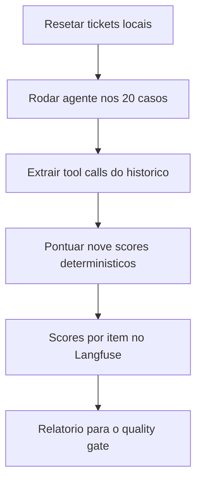

# Evaluation de Agentes e Tool Calling

> [!summary] TL;DR
> - IA só responde: avalia a resposta. Usa ferramentas: avalia decisão e execução. Vira agente: avalia a trajetória.
> - Quatro dimensões: tool selection, argument correctness, task success e trajectory.
> - Resposta certa não é caminho certo: "1.320 GB, 88% da cota" pode ser real ou inventada; só a trajetória separa.
> - Os nove scores do agente são determinísticos de propósito: o objeto medido já é não determinístico.
> - O Support Triage Agent é pequeno, controlado e avaliável: 3 tools, dataset de 20 casos.

## Conceitos-chave

- **Falhas além do texto**: explicar P1 sem abrir o chamado (tarefa não concluída); abrir como P3 em vez de P1 (tool certa, argumento errado); chamar a tool de uso atual para pergunta de documentação (custo, latência, acesso desnecessário).
- **Tool selection**: ferramenta certa para o pedido (base de conhecimento para política, API de uso para consumo, criar ticket para abertura de chamado).
- **Argument correctness**: severidade, resumo e tenant corretos, sem preencher campos importantes por suposição.
- **Task success**: objetivo do usuário cumprido; em fluxos críticos o caminho também importa.
- **Trajectory**: sequência de passos (tools esperadas chamadas, ordem certa, tool proibida usada, passos repetidos, loop, limite de iterações, esclarecimento quando faltava informação). Agente pode chegar a resposta razoável com trajetória ruim: passos demais, tool errada e recuperação, dados desnecessários, ação sem confirmação, gasto alto para algo simples. Ver [[Operação de Agentes e Tool Calling]].
- **RAG vs agente**: em RAG o pipeline é fixo e a ordem não importa; em agente interações e ordem importam.
- **Ferramenta existir não significa que deve ser chamada**: parte da qualidade é saber quando agir e quando pedir esclarecimento.
- **`@tool` (LangChain)**: a docstring é lida pelo agente para decidir se chama a ferramenta, por isso é crítica; a ferramenta deve sempre retornar resultado legível, mesmo em erro (exceção estourando quebra o agente).
- **Ferramentas pequenas são avaliáveis**: `search_knowledge_base` devolve só resposta e metadados das fontes; prompts, chunks e debug ficam no pipeline.

## Support Triage Agent

- Agente de triagem da FCIA AI Cloud no mesmo projeto do Knowledge Chat (reaproveita contexto, configurações, LangChain, Langfuse e datasets).
- `search_knowledge_base`: perguntas de documentação; chama o pipeline RAG com rerank e debug false e retorna resposta e sources (ex: SLA P1 Enterprise "até 1 hora").
- `get_current_usage`: dado vivo (lê `data/current_usage.json` por tenant; só o tenant fcia existe; tenant desconhecido como Acme retorna "unknown tenant"). Ex: 1.320 GB, 88% da cota de 1.500, sem projeção de estouro.
- `create_support_ticket`: severity P1/P2/P3 (P4 dá erro), summary obrigatório (vazio dá erro), grava em `support_tickets.json` simulando banco; o `ticket_id` vem da ferramenta, não do modelo.
- `SupportAgentResult` (structured output): answer, needs_clarification, ticket_created, ticket_id, task_completed, reason; `AgentToolCall` (nome, argumentos); `AgentRunDebug`.
- `get_agent` cria o agente com modelo, tools, system prompt e response format; `extract_tool_calls` extrai do histórico LangChain as chamadas; `run_support_agent` executa.
- Comportamentos observados (`python -m app.support_agent --debug`): "Abra um chamado P1 porque o painel está fora do ar para todos os usuários" gera `create_support_ticket(severity P1, summary, tenant)` com task_completed true; "Abre um chamado urgente aí" gera needs_clarification true com 0 passos; "estamos perto do limite de logs? Se acima de 70% abra um chamado P2" gera `get_current_usage` (88%) e depois `create_support_ticket` P2, com ordem obrigatória.
- Ajuste testado no prompt: "se severidade, impacto ou resumo estiver faltando, faça pergunta de esclarecimento"; "o painel está fora do ar, abra um chamado" passa a pedir P1 parada total, P2 degradado ou P3 outros.

## Dataset do agente (`evals/support_triage_agent.jsonl`)

- Campos: should_answer, should_clarify, should_create_ticket, should_refuse, expected_tools, forbidden_tools, expected_args, expected_trajectory, trajectory_match_type, max_steps, expected_terms, tags.
- `expected_tools` é conjunto; `expected_trajectory` é ordem de chamada (ex: primeiro `get_current_usage`, depois `create_support_ticket`).
- 20 casos (3 should_refuse, 3 should_clarify). Ex: abertura P1 tem expected `create_support_ticket`, severity P1 e forbidden `get_current_usage`.
- `python -m app.eval_agent_dataset` valida regras de negócio com ifs (ex: should_create_ticket sem `create_support_ticket` esperado é erro) e sincroniza no Langfuse como dataset `support-triage-agent`.

## Os nove scores

| Score | O que mede |
|---|---|
| agent_tool_selection | as esperadas foram chamadas |
| agent_forbidden_tools | as proibidas não foram; chamar demais é erro |
| agent_argument_match | por subset: o dataset fixa só o que importa, ex: `{"create_support_ticket": {"severity": "P2"}}`; cobra a decisão, não a redação do summary |
| agent_trajectory_match | conforme trajectory_match_type |
| agent_max_steps | dentro do limite de passos |
| agent_clarification | pediu esclarecimento quando devia |
| agent_refusal | recusou sem chamar nada |
| agent_ticket_creation | ticket_created true + ticket_id não vazio + `create_support_ticket` na trajetória; pega o modelo que diz "abri o chamado TCK-12345" sem chamar a tool |
| agent_expected_terms | termos esperados presentes |

- **trajectory_match_type**: `exact` (sequência idêntica), `in_order` (esperadas na ordem, extras tolerados; `remaining = iter(actual); return all(name in remaining for name in expected)`), `any_order` (ordem livre).
- Sem Ragas nem judge: um medidor com variação própria tornaria rodadas incomparáveis.

## Fluxograma / Processo



## Resultados e leitura das falhas

| Score | Aula | Documentado no repo |
|---|---|---|
| tool selection | 18/20 | 19/20 |
| forbidden tools | 20/20 | 20/20 |
| argument match | 3/5 | 4/5 |
| trajectory | 18/20 | 19/20 |
| max steps | 20/20 | 20/20 |
| clarification | 18/20 | 18/20 |
| refusal | 0/3 | 0/3 |
| ticket creation | 18/20 | 19/20 |
| expected terms | 8/8 | 8/8 |

- Três falhas, só uma é do agente:
  - refusal 0/3 é critério errado: exige task_completed false, mas recusar é tratar o pedido por inteiro; corrigir numa v2 do critério, não ajustar depois de ver o resultado.
  - `agent_doc_billing_email` é falha herdada do retrieval (`company_email_financeiro`, ver [[Evaluation por Componente e Ragas]]); a tool devolve só prosa, sem campo indicando busca vazia.
  - `agent_ticket_p3_config_question` é caso de dataset discutível: reescrever o caso, não consertar o agente.

## Erros comuns / Cuidados

- Mudanças de prompt podem melhorar ou piorar: medir em vez de supor.
- O objetivo é um agente pequeno, controlado e avaliável, não o mais poderoso.
- `--include-rag-tool` no script `python -m app.support_tools` chama o pipeline RAG de verdade e tem custo.
- A mesma infraestrutura de avaliação de trajetória serve para medir ataques ao agente ([[Prompt Injection e Ataques Diretos]]).

## Materiais complementares

### Prompts

**System prompt do Support Triage Agent (`app/support_agent.py`, `SYSTEM_PROMPT`)**
```text
You are a support triage agent for FCAI Cloud. Always answer in Portuguese.

Use tools only when they are needed, and never more than the question requires.

- search_knowledge_base: questions about documentation, plans, SLA, billing, the product, the company and its policies.
- get_current_usage: live usage only - quota consumption, current ingestion, projected overage.
- create_support_ticket: only when the user clearly asks to open a ticket.

Never answer a live usage question from the documentation, and never answer a policy question from the usage tool. One reports the numbers; the other explains the rules.

To open a ticket you need two things: a severity, and what is broken. When the user gives you both - 'abra um chamado P1, o painel está fora do ar' - that is enough: write the summary yourself from what they told you and open it. Do not ask for detail they already gave.

Ask one clarification question only when you genuinely cannot fill those two. 'Abre um chamado urgente aí' names no severity and no problem, so it needs one.

Never invent live usage numbers and never invent a ticket id: both come from tools, or they do not exist.

If the request has nothing to do with FCAI Cloud, say so plainly instead of answering it. Keep the final response short.
```

**Descrições dos campos do `SupportAgentResult` (response format)**
```text
answer: "The reply to the user, in Portuguese."
needs_clarification: "True when you asked a question back."
ticket_created: "True only if create_support_ticket ran."
ticket_id: "The id the tool returned. Never invent one."
task_completed: "True when the request was fully handled."
reason: "One short sentence, in Portuguese, on why you did that."
```

**Docstring da tool `search_knowledge_base`**
```text
search_knowledge_base(question):
"""Search the FCAI Cloud internal documentation.

Use for questions about plans, SLA, billing, the product, the company and its
policies. Do not use it for a tenant's live consumption or to open a ticket.

Args:
    question: The user's question, in the language they asked it.
"""
```

**Docstring da tool `get_current_usage`**
```text
get_current_usage(tenant_id="fcai"):
"""Read the tenant's current ingestion usage for this billing cycle.

Use for questions about how much was consumed, how close the tenant is to its quota,
or whether there is projected overage. It reports the live numbers; it does not
explain the policy behind them.

Args:
    tenant_id: Which tenant to read. Defaults to the only one this install has.
"""
```

**Docstring da tool `create_support_ticket`**
```text
create_support_ticket(severity: Literal["P1", "P2", "P3"], summary: str, tenant_id="fcai"):
"""Open a support ticket.

Use ONLY when the user clearly asks to open one. Answering a question, however
urgent it sounds, is not a request for a ticket.

Args:
    severity: P1 for a service outage, P2 for degraded service, P3 for everything else.
    summary: One line describing what is happening.
    tenant_id: Which tenant the ticket belongs to.
"""
```

### Conteúdo extra

- Repositório: https://github.com/devfullcycle/mba-ia-rag (branch evaluation-agent: `app/support_tools.py`, `app/support_agent.py`, `app/eval_agent_dataset.py`, `app/eval_agent.py`, `docs/agent.md`).

## Tags de busca

`#arquitetura-era-ia` `#agentes` `#tool-calling` `#trajetoria` `#support-triage-agent`
