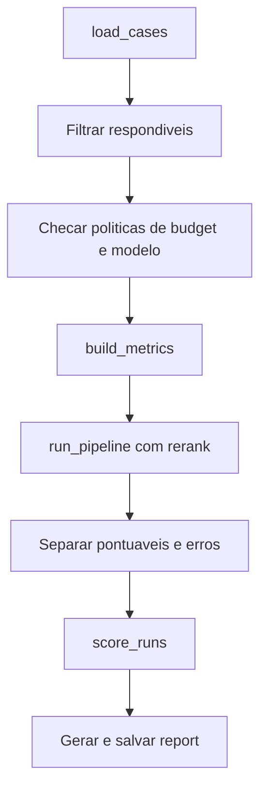

# Evaluation por Componente e Ragas

> [!summary] TL;DR
> - Avaliar só a resposta final diz que falhou, mas não onde: eval por componente dá um score por etapa do pipeline RAG.
> - A etapa que registra zero ("quem") pode não ser a origem da falha ("onde"): analisar a cadeia antes de mexer.
> - A resposta final é avaliada em 6 dimensões: relevância, completude, groundedness, atribuição de fonte, recusa correta e clareza.
> - Ragas transforma dimensões de RAG em métricas executáveis (faithfulness, response relevancy, context precision); só entra em casos respondíveis.

## Conceitos-chave

- **Pipeline avaliado**: query planner -> retrieval -> re-ranking -> montagem de contexto -> geração ([[Query Planner e Reranking]], [[Retrieval e Montagem de Contexto]]).
- **Critérios por componente**: query planner identifica o doc_type esperado; retrieval traz os documentos aceitos do caso entre os chunks; re-ranking preserva as fontes; geração respeita o contexto, traz fontes e não inventa.
- **Evaluators de componente**: `planner_clarification_match`, `planner_plan_match`, `planner_doc_type_coverage`, `retrieval_source_hit`, `rerank_source_kept`, `clarification_skips_retrieval`.
- **N/A (não aplicável)**: score que não é erro. Em pergunta ambígua todos os demais ficam N/A e `clarification_skips_retrieval` deve ser 1; em caso sem clarificação, `clarification_skips_retrieval` é N/A.
- **Falha limpa**: "onde" e "quem" coincidem. Ex: "abrir chamado urgente" com `planner_clarification_match` 0 e `clarification_skips_retrieval` 0 em efeito dominó; corrigir o prompt do planner.
- **Falha em cascata**: a etapa que acusa zero é consequência de falha anterior.
- **Avaliar o pipeline de produção, não uma cópia**: avaliar cópia é avaliar um sistema que ninguém usa.
- **Ragas**: framework de avaliação para apps com IA com foco em RAG (também workflows de agentes); mede qualidade do contexto recuperado, fidelidade ao contexto e relevância para a pergunta. Não é observabilidade: Langfuse organiza datasets, experiments, traces e scores; Ragas calcula métricas.
- **Métricas com vs sem referência**: Context Precision pode comparar contexto com resposta de referência; sem referência, Context Utilization ou `ContextPrecisionWithoutReference` usam a resposta gerada.

## Caso "onde vs quem": e-mail do financeiro

- Pergunta "qual o e-mail do financeiro?": clarification 1, doc_type_coverage 1, plan_match 0 (irrelevante, a pergunta não depende de plano), retrieval 0 e rerank 0.
- O reranker não errou: recebeu 8 chunks de billing policy (billing parece financeiro, mas o e-mail está em company info).
- O score de `similarity_search_with_score` do LangChain/PGVector é distância, não similaridade: quanto menor, mais perto (0,0 = igual); o Postgres ordena pelos menores e o código pega os top-k na ordem do banco, sem comparar score ([[Embeddings e Similaridade]]).
- Diagnóstico: `grep "financeiro@"` confirma o dado em company info; `app.retrieve` com o e-mail retorna 2 chunks; consulta absurda ("receita de cobertura de bolo de cenoura", top-k 2, sem filtro) retorna billing policy com distância 0,77; filtrando `doc_type=company` vêm chunks com 0,51 contendo a resposta; com `doc_type=policy` nunca acha; sem filtro e top-k 8, os 8 primeiros são policy e company nunca entra.
- Origem: classificação e busca semântica com top-k pequeno, não o rerank. Correções possíveis: aumentar top-k, melhorar prompt e classificação.

## Avaliando a resposta final

A pergunta muda de "é igual à esperada?" para "cumpre o papel dela?".

| Dimensão | O que verifica | Erro típico |
|---|---|---|
| Relevância | responde exatamente à pergunta | falar de suporte, canais e SLA sem dar o tempo de P1 Enterprise |
| Completude | cobre o que a pergunta exige | "SLA reduzido" sem tempo de resposta e 24x7 |
| Groundedness | sustentada pelo contexto recebido | conhecimento geral, suposição ou lacuna preenchida ([[Alucinação em LLMs]]) |
| Atribuição de fonte | a fonte sustenta o que foi dito, não só existe | crédito de SLA citado sem trecho sobre crédito |
| Recusa correta | não responde ou pede esclarecimento quando falta informação ou depende de dado transacional | resposta confiante e errada |
| Clareza | compreensível e objetiva conforme o produto | suporte prolixo (assistente interno de analista pode detalhar) |

- Diagnóstico: resposta ruim com contexto errado indica problema antes do modelo final; contexto certo e resposta ruim indica prompt, modelo, rubrica ou formato.

## Métricas do Ragas

- A pergunta "a resposta afirma só o que os documentos sustentam?" não tem `if`: precisa de modelo lendo resposta vs material.
- Três métricas porque a resposta erra de três jeitos; nota única esconderia qual falhou:
  - **Faithfulness**: o modelo inventou? Cai se afirma algo fora do material. Fica em 1.0 por causa do system prompt "responda só com o contexto abaixo": é o alarme que deve ficar quieto e dispara se alguém afrouxar o prompt.
  - **Response relevancy**: respondeu o que foi perguntado? Funciona de trás para frente: esconde a pergunta, pede ao modelo gerar ~3 perguntas que a resposta responderia e compara com a real. Ex: P1 plano Pro "até 8 horas úteis em horário comercial de segunda a sexta" está correta, mas dá 0.9 porque o trecho extra gera a pergunta reconstruída "qual o horário de atendimento Pro?". Mede se responde o perguntado, não se está certa.
  - **Context precision**: o material entregue prestava? Trechos irrelevantes são ruído.
- **Precision vs recall** (analogia do estagiário): do que trouxe, quanto prestava vs do que prestava, quanto trouxe. Recall exige gabarito; `required_terms` é checklist, não resposta modelo. Ver [[Precision, Recall e F1]].
- Caso sem resposta aparece como "failed before Ragas"/no cases scored, não como zero: zero misturaria "resposta ruim" com "não houve resposta".

## Camadas e ferramentas

| Pergunta | Ferramenta |
|---|---|
| A API está correta? | [[Testes Determinísticos e de Contrato]] |
| Qual etapa falhou? | eval por componente |
| A resposta é fiel ao contexto e relevante? | Ragas |
| A resposta atende à definição de "boa" do time? | [[LLM-as-a-Judge com Rubricas]] |
| O que aconteceu na execução? | trace ([[Observabilidade com OpenTelemetry]]) |
| Como comparar versões? | experiments e scores no Langfuse ([[Arquitetura de Evaluation e Experiments]]) |

## Fluxograma / Processo

- Componentes no console: `RUN_COMPONENT_EVALS=true python -m app.eval_components --no-langfuse --case-id sla_p1_enterprise` (chama o modelo de verdade).
- Ragas: `OBSERVABILITY_ENABLED=... python -m app.eval_ragas --limit 5`; dos 37 casos só os 29 respondíveis entram (medir fidelidade de recusa correta daria 0 e puniria acerto); summary JSON com total, respondíveis, avaliados, falhas, médias e lowest scoring cases; roda por case-id; resultados em `eval_runs`.
- `build_metrics`: cliente OpenAI, modelo LLM avaliador, modelo de embedding, métricas Faithfulness, AnswerRelevancy e ContextPrecisionWithoutReference.
- `run_for_evaluation`: roda a pergunta normal com callback `on_context` que faz `context.extend(...)` para capturar o texto dos chunks sem vazar para API, trace ou log (`RagPipelineResult` nem tem esse campo).
- Batch score: se uma métrica falha vira None e as outras continuam (perder uma métrica é melhor que perder a rodada de ~6 min).
- `CaseRun`: dataclass com caso, result do pipeline, contexto, erro e scores, uma linha por caso; só os `scoreable` (com resposta) entram na média.

## Erros comuns / Cuidados

- Sem separação por componente o time conserta no lugar errado: troca modelo, muda prompt final, aumenta top-k, mexe em chunking. Retrieval ruim não se resolve reescrevendo o prompt final.
- Nem todo zero é falha; interpretar se o 0/1 faz sentido para o caso.
- Avaliar resposta final não é comparar texto com texto: é verificar intenção do usuário e fidelidade às evidências.
- A métrica serve ao objetivo da avaliação: não inventar resposta de referência para caber na métrica. Negativos e ambíguos ficam com outros mecanismos.
- Ragas precisa do texto dos chunks, não dos IDs; esse conteúdo não sai do pipeline nem entra na telemetria ([[Privacidade e Retenção de Telemetria]]).
- Ragas é o eval mais demorado: 3 chamadas por item para reconstruir perguntas.

## Materiais complementares

### Conteúdo extra

- Repositório: https://github.com/devfullcycle/mba-ia-rag (branch evaluation-agent: `app/eval_components.py`, `app/eval_ragas.py`).

## Tags de busca

`#arquitetura-era-ia` `#ragas` `#eval-por-componente` `#faithfulness` `#groundedness`
