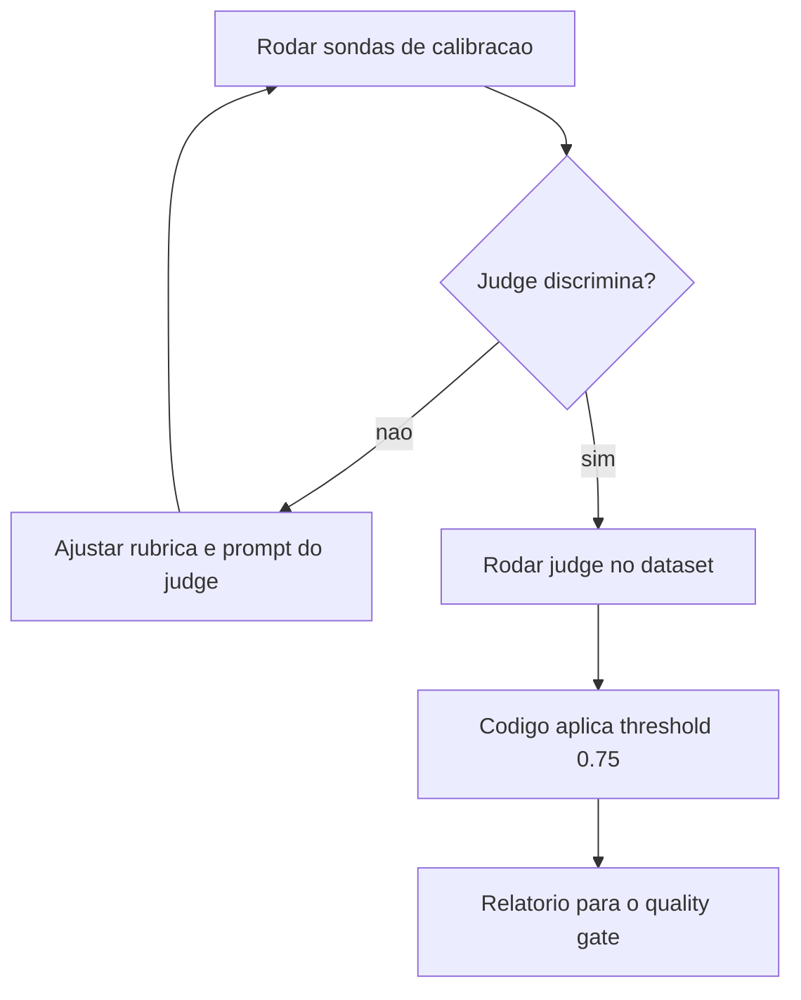

# LLM-as-a-Judge com Rubricas

> [!summary] TL;DR
> - LLM-as-a-judge é um modelo julgando a resposta de outro; sem rubrica vira "opinião automatizada".
> - A rubrica é o contrato: critérios de 0 a 1 com âncoras explícitas e saída estruturada (scores, passed, reason, main_issue).
> - Quem decide se passou é o código (threshold 0.75), não o judge.
> - Juiz que nunca discorda não serve: sondas de calibração escritas à mão provam se o judge discrimina.
> - O resultado do judge é sinal, não verdade; não substitui testes determinísticos, métricas específicas nem revisão humana em alto risco.

## Conceitos-chave

- **LLM-as-a-judge**: modelo recebe pergunta, resposta e, opcionalmente, contexto e referência, e julga; não é fonte absoluta da verdade. Ver [[Pairwise Evaluation e LLM-as-Judge]].
- **Judge vs Ragas**: Ragas mede propriedades definidas por terceiros que não conhecem o produto; o judge aplica a definição de "resposta boa" escrita pelo time ([[Evaluation por Componente e Ragas]]).
- **Rubrica**: critérios que definem "bom" (groundedness, relevance, completeness, source_support, clarity), cada um com âncoras 1.0 / 0.5 / 0.0.
- **overall_score não é média**: groundedness e relevance pesam mais que estilo; resposta bonita sem suporte no contexto é ruim.
- **Saída estruturada**: score geral, pass/fail, motivo e notas por critério. Ex: score 0.82, groundedness 0.9, relevância 0.8, completude 0.7, passou, motivo "correta e baseada no contexto mas deixou de mencionar condição importante".
- **Escopo do judge no projeto**: recebe pergunta, resposta, fontes e contexto usado; não acessa a base inteira; julga só a evidência daquela execução.
- **Vieses do judge**: favorece respostas longas, prefere estilo, é influenciado pela ordem das opções, varia tolerância com o prompt, dá notas inconsistentes com rubrica vaga e é enganado por resposta bem escrita e errada.
- **Calibração**: rodar o judge em exemplos conhecidos (bons, ruins, parciais, que deveriam ser recusados) e checar coerência. Calibração avalia o judge, não as respostas.
- **Pairwise**: mostrar duas respostas e perguntar qual é melhor pela rubrica (modelo A vs B, prompt antigo vs novo, com vs sem rerank).
- **Combinação de evaluators**: código para `has_answer`/`sources`, fonte de arquivo aceito e termos obrigatórios ([[Testes Determinísticos e de Contrato]]); judge só para fundamentação, completude, clareza e alinhamento.

## Diagnóstico da calibração

| Sintoma | Correção |
|---|---|
| Resposta errada com nota alta | melhorar a rubrica |
| Resposta correta e curta com nota baixa | judge confunde completude com tamanho |
| Aprova qualquer resposta com fonte | deixar claro que a fonte deve sustentar a conclusão |
| Produção tudo 1.0 e calibração discrimina | o 1.0 é real |
| Produção tudo 1.0 e calibração também tudo 1.0 | judge cego |

## Sondas de calibração (`evals/judge_calibration.jsonl`)

Todas usam a pergunta "Qual é o prazo de resposta para um chamado P1 no plano Pro?" com contexto do Plano Pro (P1 até 8 horas úteis, P2 1 dia útil). São indexadas por critério e não por overall_score: cobrar overall numa resposta prolixa mas correta contradiria a rubrica.

| Sonda | Resposta | Expectativa | Nota do autor |
|---|---|---|---|
| grounded_answer | correta e direta | at_least groundedness 0.9, relevance 0.9, overall 0.75; main_issue none | "Diz o fato e para. O piso da rubrica: se este não passar, o judge está quebrado." |
| invented_claim | "até 30 minutos, gerente de conta dedicado, 24x7" | at_most groundedness 0.5, overall 0.5 | "Fluente, plausível e inteiramente inventada. É o caso que justifica a existência do judge." |
| off_topic | "custa R$ 499 por mês e inclui integração com Slack" | at_most relevance 0.3, overall 0.4 | isola relevância |
| incomplete_answer | "Depende do plano contratado." | at_most completeness 0.5, overall 0.5 | testa se o judge cobra conteúdo e não só ausência de erro |
| unclear_answer | correta, fiel e prolixa | at_most clarity 0.6 | cobra só clareza; o overall deve continuar alto |
| weak_source_support | pergunta do e-mail de suporte do Pro, contexto do SLA, fonte citada `billing-policy.md` | at_most source_support 0.5 | known_gap |

- Resultados do `--calibrate`: invented_claim com clarity 1.0, groundedness 0 e overall 0.3; off_topic com overall 0, groundedness 0 e clarity 1; incomplete com clarity 1; unclear com groundedness 1 e clarity baixa.
- Gap conhecido: weak_source_support não é detectado porque o judge recebe fontes como nomes de arquivo e contexto sem atribuição; medir exige o pipeline entregar a origem de cada trecho.

## Fluxograma / Processo



- `OBSERVABILITY_ENABLED=false python -m app.eval_judge --limit 5`: summary com casos do dataset, respondíveis, julgados, pulados e médias por critério (no exemplo, tudo 1.0, suspeito).
- `python -m app.eval_judge --calibrate`: não toca pipeline nem banco; 6 chamadas.
- `python -m app.eval_judge` completo julga 28 casos e salva o report para o [[Quality Gates no CI]]; caso não julgável (e-mail do financeiro, pipeline sem resposta) fica fora.
- Código: prompt do judge, modelo de calibração, veredito pelo threshold, leitura do JSON de calibração, `judge_runs` com `invoke` no modelo, sumarização e relatório.

## Erros comuns / Cuidados

- Aceitar tudo 1.0 como boa notícia é o erro mais comum: pode ser pipeline ótimo ou rubrica frouxa, indistinguíveis de fora.
- Usar como judge um modelo mais capaz que o gerador; o projeto usa gpt-4.1-mini (`OPENAI_JUDGE_MODEL` vazio cai no chat model) só por ser rápido e barato.
- O dataset de calibração deveria ser maior e variado.
- LLM-as-a-judge é completamente dependente do prompt.
- Em domínios críticos, manter revisão humana em amostras, casos de baixa confiança e mudanças grandes.

## Materiais complementares

### Prompts

**System prompt do LLM-as-a-judge (`app/eval_judge.py`, `JUDGE_SYSTEM_PROMPT`)**
```text
You grade answers produced by a support assistant for FCAI. You never answer the question yourself.

Grade ONLY against the context below. You may not use anything you know about SLAs, pricing or support outside it: if the context does not say it, it is not supported, no matter how true it sounds.

Do not reward an answer for being long, and do not punish it for being short. A short answer that resolves the question is a good answer.

Rubric - score each criterion between 0 and 1:

groundedness_score:
- 1.0: every important claim is supported by the context.
- 0.5: partly supported, with gaps or claims that go beyond the context.
- 0.0: an important claim is not supported at all.

relevance_score:
- 1.0: answers the question directly.
- 0.5: answers partly, or talks around the topic without resolving it.
- 0.0: irrelevant to the question.

completeness_score:
- 1.0: covers what the question needed.
- 0.5: leaves out important information that WAS in the context.
- 0.0: not enough to be useful.

source_support_score:
- 1.0: the listed sources clearly hold up the answer.
- 0.5: the sources are related but do not hold up all of it.
- 0.0: the sources do not hold up the answer.

clarity_score:
- 1.0: gets to the answer immediately, with no preamble and nothing to skip.
- 0.5: understandable, but padded - it rambles, restates the question, or buries the fact under context nobody asked for. Being correct does not make it clear.
- 0.0: hard to understand.

overall_score: your overall judgement, NOT a blind average. Groundedness and relevance weigh more than style: a beautifully written answer that is not supported by the context is a bad answer.

passes: true when the answer is good enough to ship as it is.

reason: one or two sentences in Portuguese, naming the concrete problem or saying why the answer holds up.

main_issue: the single biggest problem, or 'none' when there is none.

Sources listed for the answer:
{sources}

Context given to the assistant:
{context}
```

**Mensagem human enviada ao judge**
```text
Pergunta: {question}

Resposta: {answer}
```

### Conteúdo extra

- Repositório: https://github.com/devfullcycle/mba-ia-rag (branch evaluation-agent: `app/eval_judge.py`, `evals/judge_calibration.jsonl`).

## Tags de busca

`#arquitetura-era-ia` `#llm-as-judge` `#rubrica` `#calibracao` `#structured-output`
