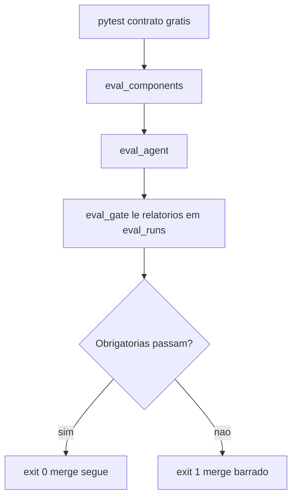

# Quality Gates no CI

> [!summary] TL;DR
> - Gate é uma barreira de aprovação: a avaliação mostra o estado da qualidade, o gate decide se a mudança continua.
> - Dois tipos: threshold fixo e regressão contra baseline.
> - O gate só lê relatórios já gerados e devolve exit code; não chama modelo, Langfuse nem banco, então roda em CI sem credencial.
> - Separar métricas obrigatórias (bloqueantes) de informativas; bloquear tudo faz o time perder confiança e desligar o gate.
> - Thresholds versionados ao lado dos datasets: "uma barra que você abaixa depois de ver o resultado não é barra".

## Conceitos-chave

- **Gate**: pergunta "essa mudança pode avançar?", como testes, build e lint no CI tradicional; em IA a mudança pode não quebrar nada tecnicamente e piorar o comportamento.
- **Gates bloqueantes**: teste de contrato da API ([[Testes Determinísticos e de Contrato]]), dataset inválido (casos duplicados, fonte inexistente, expectativa impossível), ferramenta proibida, queda forte de retrieval, regressão grande em comportamento crítico.
- **Thresholds de qualidade**: ex: retrieval source hit >= 85%, tool selection >= 80%, forbidden tools 100% (crítico), judge score com mínimo não perfeito.
- **Métricas informativas**: Ragas em calibração e trajetória ainda instável ficam como relatório até amadurecerem.
- **Regressão vs baseline**: "não pode piorar mais que X"; ex: source hit de 90% para 70% é regressão ([[Arquitetura de Evaluation e Experiments]]).
- **Origem dos thresholds**: normalmente de uma baseline aprovada; evoluem com a maturidade do software.
- **Independência da stack**: o gate não importa nada do resto da app (sem modelo, Langfuse, Postgres, `.env`): "um portão que precisa da stack inteira para dizer não é um portão que ninguém coloca na frente de um merge". Avaliação completa é cara, lenta e variável; o gate é previsível.

## Configuração (`evals/quality_gates.json`)

| Suíte | Tipo | Thresholds |
|---|---|---|
| component_eval | required | planner_clarification_match 0.85, planner_plan_match 0.8, planner_doc_type_coverage 0.6, retrieval_source_hit 0.85, rerank_source_kept 0.85, clarification_skips_retrieval 0.75 |
| ragas_eval | opcional | faithfulness 0.75, response_relevancy 0.75, context_precision 0.7 |
| judge_eval | opcional | average_groundedness_score 0.75, average_relevance_score 0.75, average_overall_score 0.75, pass_rate 0.7 |
| agent_eval | required | tool_selection 0.8, forbidden_tools 1.0, argument_match 0.6, trajectory_match 0.75, max_steps 0.9, clarification 0.75, refusal 0.0, ticket_creation 0.9 |

- `forbidden_tools` 1.00 é a única métrica sem tolerância ([[Evaluation de Agentes e Tool Calling]]).
- Suíte required sem relatório reprova; opcional sem relatório vira SKIPPED.
- Adaptadores de nomes entre relatórios (ex: `name.removeprefix("agent_")`; Ragas usa `metrics_summary`, os outros `summary`).

## Estados e exit code

| Estado | Significado |
|---|---|
| PASS | métrica acima do threshold |
| FAIL | métrica abaixo do threshold |
| MISSING | métrica configurada ausente num relatório presente (rodada degenerada ou nome mudou); exige ação humana, não significa queda de qualidade |
| SKIPPED | suíte opcional sem relatório |

- Exit code 0 quando as obrigatórias passam; 1 quando métrica reprova, fica MISSING, relatório obrigatório falta ou o JSON é inválido. No código: `sys.exit(0)` ou `sys.exit(1)`; a CI olha o exit code, não o texto.
- Plugável em GitHub Actions, GitLab CI, Jenkins, Buildkite.

## Fluxograma / Processo

- Comandos: `python -m app.eval_gate --list-reports`; `python -m app.eval_gate`; `python -m app.eval_gate --component-report data/eval_runs/component_<ts>.json --agent-report data/eval_runs/agent_<ts>.json`; `--judge-report data/eval_runs/judge_<ts>.json`.
- Demonstração: primeira execução falhou com component eval e judge eval missing (último run era de um único case-id); após `python -m app.eval_judge` (28 casos) e `RUN_COMPONENT_EVALS=true python -m app.eval_components`, judge e Ragas passaram, `clarification_skips_retrieval` ficou absent e métricas do agente falharam; thresholds ajustados didaticamente (component 0.62 vs 0.65 para 0.6; argument_match 0.6 vs 0.8 para 0.6; refusal_rate 0) até PASSED.
- Maturidade: medir, entender, calibrar thresholds, separar obrigatório de informativo e só então bloquear nos sinais confiáveis.

## Checklist de qualidade e evaluation

1. Sei exatamente o que estou avaliando? Definir o target (API, planner, retrieval, re-ranking, resposta final, tool call, latência) para não misturar sinais.
2. Dataset versionado no repositório, revisado, evoluindo com o produto, com casos respondíveis, negativos, ambíguos, termos exatos e multidocumento (em agentes, além de pergunta/resposta).
3. Testes determinísticos separados da evaluation (contrato sem LLM, banco vetorial ou provider externo).
4. Consigo descobrir onde o erro aconteceu? Eval por componente evita ajustar no lugar errado ([[Evaluation por Componente e Ragas]]).
5. Métricas adequadas ao sistema: RAG (contexto correto, fidelidade, relevância, atribuição de fonte); tool calling (ferramenta, argumentos, execução); agente (trajetória, nº de passos, parada, sucesso); multi-turn (mantém contexto, esclarecimento ajuda, resposta seguinte usa informação nova, não repete tools).
6. [[LLM-as-a-Judge com Rubricas]] com rubrica e saída estruturada (score, pass/fail, motivo, categoria do problema), calibrado e combinado com determinísticos.
7. Comparo versões contra baseline (modelo, prompt, chunking, rerank, tools, planner).
8. Gates bem definidos; demais métricas informativas no início.
9. Produção alimenta o dataset (perguntas reais, falhas, feedback, traces com erro, recusas indevidas, tools chamadas errado): dataset é memória de qualidade.
10. Sei explicar por que uma resposta ou ação foi aceita (base da resposta, motivo da recusa, tool e argumentos, trajetória até o ticket, critérios que aprovaram no gate).

- Cadeia: comportamento -> dataset -> avaliação -> score -> comparação -> decisão. Testar garante contrato, avaliação mede comportamento, experiments comparam versões, gates protegem o processo de mudança.

## Erros comuns / Cuidados

- Transformar todas as métricas em bloqueio faz variações pequenas quebrarem o CI; o time perde confiança e desliga tudo.
- Sem gate a avaliação vira relatório que ninguém olha.
- O gate pega o relatório mais recente, que pode ser de um `--case-id`: "uma rodada de fumaça de um caso pode gatear um merge".
- `refusal_pass_rate` 0 reprova por definição ruim do critério, não por regressão: argumento para não ligar no CI antes de acertar os critérios.
- Baixar threshold "na marra" foi só demonstração; em uso real o gate barra regressões no PR.

## Materiais complementares

### Conteúdo extra

- Repositório: https://github.com/devfullcycle/mba-ia-rag (branch evaluation-agent: `app/eval_gate.py`, `evals/quality_gates.json`, `docs/quality-gates.md`).

## Tags de busca

`#arquitetura-era-ia` `#quality-gate` `#ci` `#threshold` `#exit-code`
