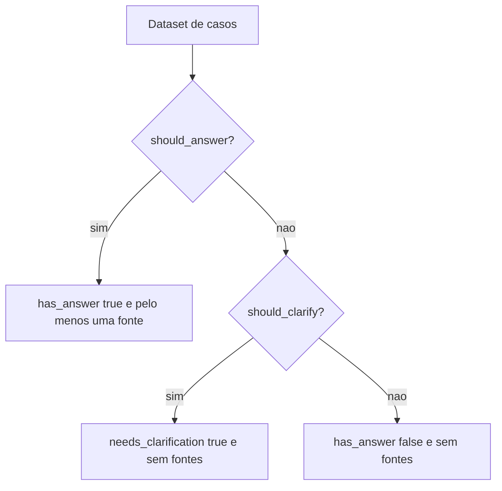

# Testes Determinísticos e de Contrato

> [!summary] TL;DR
> - Teste tradicional continua necessário (até mais importante) em sistemas com IA, mas não basta sozinho: o texto varia, o contrato não.
> - Testes determinísticos são a primeira linha de defesa: validam schema, campos obrigatórios, flags, fontes e erros controlados sem julgamento semântico.
> - Testes de contrato rodam com pipeline fake: sem LLM, sem banco, sem Docker; economizam tempo e dinheiro.
> - Ordem saudável: primeiro garantir o contrato, depois avaliar a qualidade. Contrato quebrado contamina toda avaliação posterior.

## Conceitos-chave

- **Software tradicional vs LLM**: no tradicional, mesma entrada gera mesma saída esperada (regra de desconto, status code, schema JSON, função pura). Com LLM, a mesma pergunta gera respostas diferentes; a resposta pode estar correta com outras palavras, bem escrita e errada, no formato certo com fonte ruim, parcial, com detalhe inventado plausível ou ser uma recusa correta por falta de contexto.
- **Teste vs evaluation**: teste pergunta "cumpriu o contrato?"; evaluation pergunta "o comportamento foi bom?". A evaluation complementa, não substitui; ver [[Arquitetura de Evaluation e Experiments]].
- **Contrato do Knowledge Chat**: campos `answer`, `has_answer`, `needs_clarification`, `sources` e `debug` devem existir; pergunta sem resposta na base gera recusa controlada; `has_answer` false implica sem fontes; `has_answer` true implica pelo menos uma fonte; `debug` false implica sem debug; `debug` true implica estrutura válida.
- **Texto varia, contrato não**: duas formulações corretas sobre SLA P1 Enterprise ("até 1 hora, 24x7") passam no mesmo contrato.
- **Teste de contrato com pipeline fake**: o pipeline fake simula resposta, recusa e clarificação baseadas no dataset; testa regras de negócio, não qualidade ou relevância.
- **IA continua sendo software**: API, contrato, tipo, schema, política, erro, status, limite, fonte, permissão e observabilidade seguem valendo.

## O que testar por arquitetura

| Arquitetura | Checagens determinísticas |
|---|---|
| Chamada simples | JSON válido, campos obrigatórios, formato, escopo, limites de tokens |
| RAG | fontes presentes quando há resposta, recusa sem fontes, flags coerentes |
| Tool calling | ferramenta existe, argumentos respeitam schema, ação perigosa exige confirmação, falha gera erro controlado |
| Agente | máximo de passos, ferramenta proibida não chamada, parou quando devia, estrutura final esperada |

## Falhas que a avaliação semântica deixaria passar

- Texto bom com `sources` vazio: resposta RAG precisa ser rastreável.
- Resposta perfeita, mas o structured output falha e a API retorna erro: problema de integração.
- "Não encontrei informação suficiente" com `has_answer` true: contamina métricas posteriores.

## Fluxograma / Processo

- Suíte do projeto (`python -m pytest -v`): 13 testes com intenção no nome: dataset sem erros; dataset cobre casos answerable, refusal e clarification; health; answer possui sources; refusal sem sources; clarification sem sources; debug retornado quando pedido e ausente quando não solicitado; `use_rerank` false respeitado no pipeline; pergunta em branco tratada.
- O diretório `tests/` cobre contrato, validação do dataset e relatórios de componente e experimento.
- Na sequência de CI, `pytest` roda primeiro por ser grátis; ver [[Quality Gates no CI]].

## Erros comuns / Cuidados

- Só testar contrato deixa resposta ruim passar; só avaliação subjetiva deixa a aplicação quebrar em coisas básicas.
- Não transformar a avaliação em camada nebulosa onde tudo depende de interpretação.
- Se os contratos falham, avaliações no Langfuse ou com [[LLM-as-a-Judge com Rubricas]] ficam contaminadas.
- Qualquer framework de teste serve; pytest é só a escolha do projeto.

## Materiais complementares

### Conteúdo extra

- Repositório: https://github.com/devfullcycle/mba-ia-rag (branch evaluation-agent, pasta `tests/`).

## Tags de busca

`#arquitetura-era-ia` `#testes-de-contrato` `#pytest` `#pipeline-fake`
