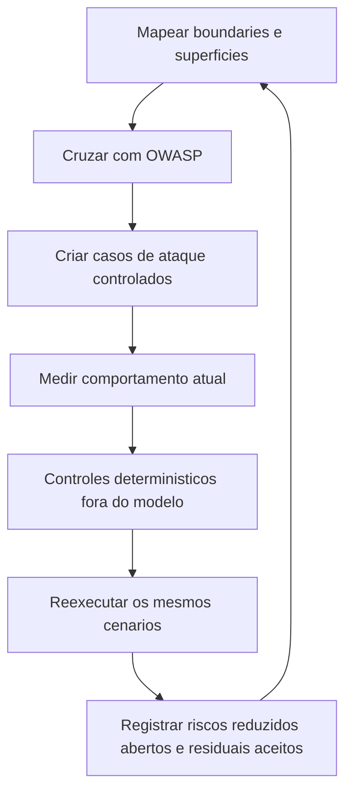

# Threat Model e OWASP para IA

> [!summary] TL;DR
> - LLM não é só mais uma API: interpreta conteúdo, decide de forma probabilística e influencia o resto do sistema; texto passa a influenciar decisões.
> - O modelo não é fronteira de segurança: autorização de documentos, ferramentas e ações críticas fica em código confiável, determinístico e auditável.
> - Threat model mapeia quatro boundaries (input, context/data, model output, action), assets e superfícies de ataque.
> - OWASP Top 10 para LLM/GenAI e para Agentic Applications é lente sobre o threat model, não checklist de 10 caixinhas.
> - Segurança é conhecer riscos, limitar impacto, medir e decidir conscientemente, não tornar o sistema impossível de atacar.

## Conceitos-chave

- **O que proteger**: o fluxo inteiro: entrada do usuário, prompts, contexto recuperado, documentos indexados, modelo, resposta, ferramentas, ações executadas e cópias secundárias (logs, traces, datasets de avaliação). Não é só a chave de API ou um endpoint.
- **Superfície de ataque**: qualquer ponto que recebe algo capaz de influenciar o comportamento: API pública, formulário, upload, integração externa e, em IA, pergunta ao modelo, documento recuperado, resposta de ferramenta, histórico da conversa, memória persistente, página da internet, registro de outro sistema. Entrada é qualquer conteúdo que chega ao contexto do modelo.
- **Trust boundary**: ponto onde informação passa de uma região com um nível de confiança para outra; implica mudança de confiança, não atacante.
- **Saída da IA é entrada não confiável**: em HTML é entrada para o rendering, em consulta é entrada para o banco, em argumento de ferramenta é entrada para operação, em novo prompt é entrada para outro modelo; cada transição precisa de política clara.
- **Confiar no banco não é confiar em todo o conteúdo dele**: perguntar quem criou o documento, se foi aprovado, se pertence ao tenant, se está publicado, se vem de integração externa, se alguém com permissão menor pode tê-lo alterado ([[RAG Poisoning e Provenance]]).
- **Não assumir system prompt secreto**: informação sensível não deve estar no contexto ([[System, User e Assistant Prompts]]).
- **Guardrails**: prompts, classificadores e guardrails detectam conteúdo suspeito, reduzem ataques, aplicam políticas e interrompem fluxos, mas falham (falso positivo, ataque inesperado, atualização do modelo).
- **Threat modeling em IA**: observar fluxo de dados, de decisão e de ação; perguntar de onde o conteúdo veio, quem o controla, para onde vai e o que consegue provocar.

## Quatro boundaries

| Boundary | O que cruza | Risco principal |
|---|---|---|
| Input | usuário de fora envia conteúdo não confiável que influencia um modelo que decide | prompt injection ([[Prompt Injection e Ataques Diretos]]) |
| Context/data | retrieval do PgVector põe chunks no contexto; alguém criou, pôs metadado, passou por ingestão | injection indireta, data and model poisoning, vector and embedding weakness, sensitive information disclosure |
| Model output | modelo devolve resposta ou decisão ao código; Structured Output + Pydantic garantem formato, não conteúdo correto | improper output handling (URL bem formada para destino proibido; string válida representando operação não permitida) |
| Action | agente chama `create_support_ticket`; decisão probabilística vira efeito real; schema valida severidade, mas escolher a ferramenta não é estar autorizado | excessive agency |

- Uma boundary relaciona vários riscos e um risco aparece em vários pontos.
- Boundaries listadas no projeto: usuário para FastAPI; usuário para query planner; knowledge base para ingestion; ingestion para vector store; vector store para modelo; model output para aplicação; usuário para suporte; agente para decisão de ferramenta; output para contexto; aplicação para OpenTelemetry; aplicação para evaluation; dataset para evaluation runner.
- Observabilidade também é boundary: CPF, e-mail e contrato copiados para traces ou datasets de avaliação ([[Privacidade e Retenção de Telemetria]]).

## Threat model do projeto

- Fotografia da arquitetura atual, sem corrigir nada: onde a confiança muda, controles existentes, pontos de atenção. Documento gerado a partir do código, com diagrama, legenda de zonas de confiança, assets, boundaries, superfícies cruzadas com OWASP e riscos abertos (SEC-001, SEC-002...).
- **Zonas do diagrama**: Trusted Application Code (execução determinística); boundary de modelos (agente, query planner, re-ranker, answer model); persistência e dados (PgVector, arquivo JSON, current usage); Knowledge Pipeline; sistemas externos (Langfuse, API da OpenAI); stack de observabilidade (gera dados que podem voltar ao modelo ou à aplicação). Cada seta cruzando boundary é superfície de ataque; determinístico para determinístico (ex: `app/index.py` para pipeline) é mais seguro.
- **Assets**: entrada do usuário, system prompt, documentos da knowledge base, metadados, embeddings, tenant identity, respostas; cada um pode ser lido, alterado ou forjado por quem não deveria.
- **Cenários no Knowledge Chat**: usuário pede para ignorar regras e revelar instruções internas; documento na base manda desconsiderar o system prompt; pergunta induz o planner a buscar documento de outro tenant; resposta sensível registrada em trace ou dataset.
- **Cenários no Support Triage Agent**: ferramenta errada, argumentos incorretos, dados de outro tenant, ticket não pedido, severidade não autorizada ([[Evaluation de Agentes e Tool Calling]]).
- **Riscos mapeados**: LLM01 direct prompt injection, jailbreaking, query manipulation, query planner manipulation, indirect prompt injection, RAG poisoning, document provenance, cross-tenant retrieval, hidden context exposure.
- **Controles existentes**: safe filters forçando tenant e status publicado; structured output com Pydantic; validação de parâmetros; hints nas tools restringindo o que o modelo lê; max output tokens; observabilidade; policy por ambiente ([[Custos, Budgets e Governança de IA]]).
- **Controles faltando**: autorização e aprovação para acesso externo; human in the loop (ex: ticket P1 para revisão humana).

## OWASP como mapa de cobertura

- **Categorias do OWASP GenAI Security Project**: prompt injection, sensitive information disclosure, excessive agency, supply chain, data and model poisoning, unbounded consumption, misinformation, (hidden) context exposure, vector and embedding weaknesses, improper output handling.
- Knowledge Chat usa o OWASP GenAI LLM Top 10 como referência principal; o Support Triage Agent soma o Top 10 for Agentic Applications (seleção de ferramentas, argumentos, permissões, ações).
- Códigos LLM01, LLM02, LLM09, ASI01, ASI06 são referências externas; riscos próprios mantêm ID do projeto (ex: SEC-008 ausência de autorização antes da execução de ferramenta). Se a classificação OWASP mudar, o threat model continua válido.
- Excessive agency está entre os maiores riscos em 2026.
- Orientação 2026: não projetar esperando que o modelo nunca seja enganado, e sim limitar impacto; prompt injection é estrutural porque instruções e dados chegam ao modelo no mesmo fluxo de tokens.

## Defesa em profundidade

- Se prompt injection funcionar, limitar os dados acessíveis.
- Política externa bloqueia ferramenta indevida.
- Validar argumentos de ferramenta permitida.
- Aprovação humana para ação crítica.
- Conteúdo sensível fora de logs, traces e datasets.

## Fluxograma / Processo

## Erros comuns / Cuidados

- Depender de instrução "não faça isso" no prompt como controle de segurança.
- Usar OWASP como checklist de 10 caixinhas em vez de lente sobre o threat model.
- Buscar o prompt perfeito em vez de atacar limites e medir.
- Alguns ataques serão bloqueados, outros só terão impacto reduzido: o que sobra é risco residual a ser registrado.

## Materiais complementares

### Conteúdo extra

- Dica: usar IA para gerar o relatório de threat model do próprio codebase (skill, prompts) e pedir para cruzar com o OWASP GenAI/LLM Top 10 e o Top 10 for Agentic Applications.
- OWASP Top 10 for LLM and GenAI 2026 (PDF de 122 páginas, com diferenças 2025/2026; ex: LLM01:2026 prompt injection com cenários direct, indirect, unintentional injection e RAG repository poisoning).
- OWASP Top 10 for Agentic Applications 2026 (links prometidos na aula, não presentes na página).
- Repositório: https://github.com/devfullcycle/mba-ia-rag (branch security, documento de threat model).

## Tags de busca

`#arquitetura-era-ia` `#threat-model` `#owasp` `#trust-boundary` `#seguranca-ia`
