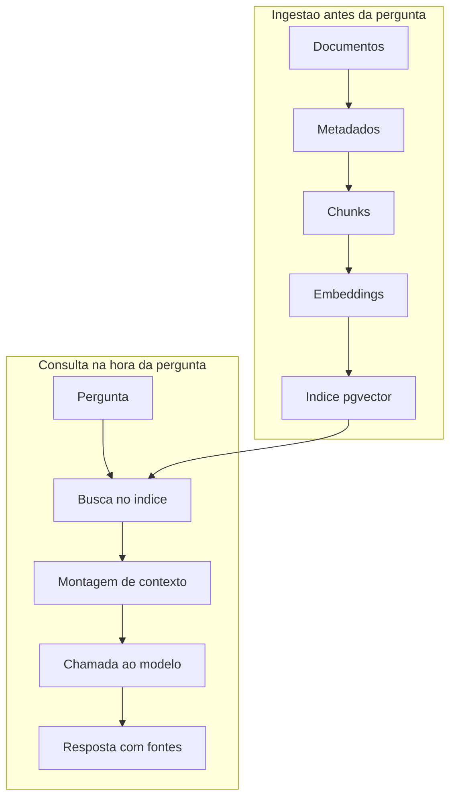

# Fundamentos de RAG

> [!summary] TL;DR
> - RAG (Retrieval Augmented Generation) busca contexto em base externa a cada pergunta e o injeta no prompt; o modelo não aprende nada.
> - É pipeline em duas fases (ingestão antes da pergunta, consulta na hora da pergunta), não uma chamada ao modelo; banco vetorial é só uma peça.
> - Serve para conhecimento textual externo, atualizável e que precisa ser recuperado; não serve para estado atual do sistema nem para executar ações.
> - Não garante verdade, não conserta base ruim e não resolve permissão: controle fica na arquitetura, não no prompt.
> - Build vs buy depende de controle, tempo, maturidade do time, risco do domínio, debug e customização; muitas vezes a resposta é híbrida.

## Conceitos-chave

- **Retrieval**: antes de chamar o modelo, a aplicação busca na base externa os trechos relevantes à pergunta. Detalhado em [[Retrieval e Montagem de Contexto]].
- **Augmented**: o prompt é aumentado com esse contexto externo.
- **Generation**: o modelo gera a resposta a partir do contexto injetado, não do treinamento. O professor chama de "uma espécie de gambiarra": concatena contexto com a pergunta.
- **Não é fine tuning**: o contexto é montado em tempo real a cada pergunta. Ver [[Prompt Engineering vs RAG vs Fine-Tuning]].
- **Motivação**: regra de negócio da empresa (ex: prazo de reembolso do plano Enterprise) está fora do modelo, em doc interno, FAQ, banco, Notion.
- **Ingestão**: roda antes da pergunta: ler documentos, extrair metadados, quebrar em chunks, gerar embeddings, indexar. Ver [[Ingestão, Chunking e Indexação]].
- **Índice**: estrutura para achar trechos relevantes rápido; no projeto, Postgres + pgvector com embeddings, conteúdo e metadados dos chunks.
- **Chunk**: pedaço de um documento, unidade de recuperação.
- **Retrieval não é resposta**: só encontra candidatos de contexto por similaridade entre o embedding da pergunta e o dos chunks (ver [[Embeddings e Similaridade]]).
- **Montagem do contexto**: decide o que entra no prompt final, preservando fontes.
- **Geração**: o modelo entra só no final do fluxo.
- **Fonte da verdade**: é o documento, banco, API ou sistema oficial; nem o modelo nem o vector store. O índice vetorial é cópia derivada preparada para busca.
- **Objetivo do RAG**: contexto certo, para o usuário certo, no momento certo, com rastreabilidade suficiente para confiar na resposta.
- **RAG é arquitetura de recuperação de contexto**: fonte da verdade, ingestão, metadados, permissões, retrieval, seleção de contexto, resposta, fontes, observabilidade e custo. Não é "banco vetorial + LLM".

### O que RAG não resolve

- **Estado atual do sistema**: "último pagamento do aluno João" vem de banco, API ou ferramenta do financeiro.
- **Executar ações**: "cancele a matrícula" é workflow, tool calling, automação, regras de negócio e autorização (ver [[Operação de Agentes e Tool Calling]]). Já "política de cancelamento do plano Enterprise" é caso de RAG.
- **Verdade**: doc errado ou antigo, ou trecho recuperado errado, gera resposta bonita e errada. RAG reduz alucinação só quando o contexto certo é recuperado e usado (ver [[Alucinação em LLMs]]).
- **Base ruim**: docs bagunçados, duplicados, contraditórios, sem versão, sem metadados, sem dono ou sem processo de atualização continuam ruins, e o RAG pode ficar mais perigoso por parecer inteligente.
- **Permissão**: filtro por produto, tenant e plano é aplicado antes do contexto chegar ao modelo. Nunca recuperar doc privado e pedir no prompt para não usar.

### Custo

- Custos: gerar embeddings, armazenar vetores, busca, infraestrutura e principalmente input tokens dos chunks no prompt. Mais contexto = mais custo e latência (ver [[Tokens e Tokenização]]).
- RAG bem desenhado reduz custo por mandar só o que importa; mal desenhado busca contexto demais e manda tokens demais.
- Às vezes bastam alternativas: base pequena no contexto, cache, consulta SQL, chamada de API.

### RAG vs outras estratégias

Pergunta-guia: onde está a informação que preciso para responder ou agir?

| Necessidade | Estratégia |
|---|---|
| Recuperar conhecimento textual | RAG |
| Consultar estado atual, dado estruturado, transacional | Banco/SQL/API |
| Executar ação | Tool calling / workflow |
| Reaproveitar resposta | Cache |
| Base cabe no contexto | Long context |
| Mudar comportamento, estilo, formato, classificação | Fine tuning |

- **SQL/API**: ex: alunos ativos na turma. IA pode explicar o resultado depois, mas a origem é o sistema correto.
- **Long context**: funciona para base pequena (doc de 2 páginas, contrato curto, política simples) com menos componentes e "moving parts". Limite quando a base cresce, muda com frequência, tem permissões diferentes, precisa buscar parte específica, citar fonte ou controlar custo/latência. Reduz casos de RAG, não o elimina. Demonstração em [[Retrieval e Montagem de Contexto]].
- **Cache**: reaproveita algo já calculado; RAG recupera contexto antes da geração. Aparecem juntos: cache evita acionar o RAG em toda requisição (ver [[Cache Semântico com pgvector]] e [[Camadas de Cache e Prompt Caching dos Providers]]).
- **Fine tuning**: não serve para colocar base de conhecimento que muda; conhecimento que muda toda semana é RAG.

### Build vs buy

- **Google Cloud RAG Engine** (Gemini Enterprise Agent Platform / Vertex AI): ingestão, transformação, embedding, indexação, retrieval e geração; fontes arquivos locais, Cloud Storage, Google Drive.
- **Amazon Bedrock Knowledge Bases**: opção gerenciada e customer managed. Na gerenciada a AWS cuida de ingestão, indexação, armazenamento, retrieval, embedding, reranking e conectores (S3, SharePoint, Confluence, Google Drive, OneDrive, web crawlers).
- **Azure AI Search**: RAG clássico (busca híbrida + semantic ranking) e agentic retrieval (query planning com LLM, múltiplas fontes, respostas estruturadas, citações, metadados); base do Foundry IQ, camada gerenciada de conhecimento para agentes.
- **OpenAI File Search** (Responses API): ferramenta hospedada, vector stores com busca semântica e keyword sobre arquivos enviados.
- **Gerenciado ganha** velocidade: validar ideia, empresa já no ecossistema AWS/Azure/GCP, time que não quer operar vector store, ingestão, parsing, reindexação, conectores.
- **Gerenciado perde** controle: chunking, lógica de [[Query Planner e Reranking]], debug limitado, custo menos previsível, lock-in. São soluções "80/20": domínio muito específico fica nos 20%.
- **Critérios**: RAG como feature auxiliar, pronto pode bastar; RAG como coração do produto, mais controle. Base simples, provider acelera; muitas regras de permissão, versionamento, metadados e aprovação, próprio ou híbrido.
- **Híbrido**: search gerenciado com prompt final próprio; conectores prontos com camada de autorização própria; vector store gerenciado com logs e métricas na aplicação.
- Construir o pipeline uma vez serve para avaliar soluções prontas: sem isso a ferramenta parece mágica e não se sabe se o erro está em ingestão, chunking, índice, retrieval, reranking, prompt ou modelo.

## Fluxograma / Processo

**Checklist arquitetural antes de produção**

1. O problema é recuperação de conhecimento? Documentos, políticas, manuais, FAQs, contratos sim; último pagamento, status de assinatura, uso em tempo real vão para SQL, API, tool calling.
2. Qual a fonte da verdade? Documento, banco, API, sistema oficial.
3. A base cabe no contexto? Pequena, estável e barata: long context ou cache. RAG quando cresce, muda, exige busca seletiva, filtros, versões, permissões.
4. Quem pode acessar o quê? Tenant, produto, plano, status, visibilidade e permissão aplicados pela aplicação antes do retrieval; similaridade não é autorização.
5. Como a base muda? Reindexação, hash, versão, manifest; ingestão faz parte da arquitetura, não é script esquecido.
6. Como medir se o retrieval está bom? Pergunta normalizada, filtros, chunks recuperados, scores, selecionados, fontes e prompt final em debug (ver [[Evaluation por Componente e Ragas]]).
7. O sistema sabe não responder? Recusa clara é melhor que resposta inventada com confiança.
8. Qual o custo? Embedding, armazenamento, retrieval, reranking, tokens de contexto e geração, latência, modelo.
9. Construir ou comprar? Caso padrão: gerenciado; controle fino de chunking, permissões, metadados, indexação e prompt final: construir; muitas vezes híbrido.
10. Consigo explicar por que a resposta foi dada? Sem rastreabilidade até os documentos não está maduro.

## Erros comuns / Cuidados

- Ingestão ruim gera busca ruim, que gera contexto ruim, que gera resposta errada mesmo com modelo excelente.
- Ingestão não deve rodar a cada pergunta.
- Usar RAG por moda aumenta custo, latência e complexidade sem ganho; o papel do arquiteto é entender a natureza do problema, não escolher a tecnologia mais famosa.
- Vazamentos de informação em grandes empresas vieram de falha no escopo do que o usuário podia acessar no retrieval.
- Pergunta certa sobre ferramenta pronta: não "ela faz RAG?", e sim "quais partes do pipeline ela resolve, quais esconde e quais eu ainda preciso controlar?". A escolha também é de negócio (contratos com provedor).

## Materiais complementares

### Conteúdo extra

- Repositório do projeto Knowledge Chat: https://github.com/devfullcycle/mba-ia-rag
- Estrutura do repo: `app/` com config.py, db.py, main.py, chat.py (sem RAG), context_chat.py (documento inteiro no prompt), ingest.py, index.py, manifest.py, retrieve.py, query_planner.py, rerank.py, rag_pipeline.py, rag_chat.py, api.py; `knowledge_base/` com 8 Markdown da empresa fictícia FCAI (billing-policy, commercial-policy, company-info, enterprise-plan, pro-plan, product-overview, product-support-sla, starter-plan); `test.http`, docker-compose.yml, requirements.txt, .env.example.
- Evoluções não implementadas no repo: busca híbrida (BM25), frontend, histórico, streaming.

## Tags de busca

`#arquitetura-era-ia` `#rag` `#build-vs-buy` `#long-context` `#fonte-da-verdade`
