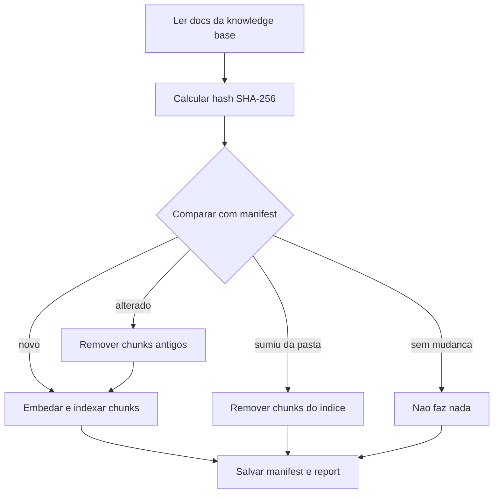

# Ingestão, Chunking e Indexação

> [!summary] TL;DR
> - Metadados bem planejados (tenant, product, plan, doc_type, version, status, visibility) são o que mais melhora um RAG: viram colunas filtráveis em cada chunk.
> - Chunking é decisão arquitetural: o teste é "esse pedaço ainda carrega sentido sozinho?"; no projeto, split por headings Markdown e depois 900 caracteres com overlap de 150.
> - Context header (título, tipo, produto, plano, versão, seção) prefixado no texto faz a busca semântica enxergar o que antes só existia como filtro.
> - O índice vetorial é derivado; indexação idempotente com hash SHA-256 e manifest trata documentos novos, alterados, removidos e sem mudança.
> - Errar a estrutura de metadados no começo obriga a reindexar tudo e regerar embeddings.

## Conceitos-chave

- **Knowledge base**: pasta `knowledge_base` com Markdown e front matter YAML; no mundo real viria de banco, Google Drive, Notion, Confluence. PDF e crawler ficaram de fora para focar na arquitetura.
- **Metadados obrigatórios**: title, tenant, product, plan, doc_type (policy, plan, company, product, sla), version, status (published), visibility (internal). Sem algum deles a ingestão falha com erro claro.
- **Metadado como coluna filtrável**: permite `WHERE doc_type = product`, `status = published`, visibilidade usuário final vs admin, `tenant_id` em SaaS multi-tenant, em vez de buscar no banco inteiro. Uso nos filtros em [[Retrieval e Montagem de Contexto]].
- **Metadado `source`**: comum quando docs vêm de vários lugares (site, Google Docs, PDF).
- **Chunking**: transforma documentos em unidades menores de recuperação. Documento inteiro como bloco único acha o doc, não o trecho; quebrar demais perde sentido (frase solta, regra sem título da seção, tabela sem contexto). Chunk disputa espaço na busca.
- **Chunking por estrutura**: dividir por H2/H3 do Markdown costuma ser melhor que só por caracteres; seções grandes são subdivididas.
- **Overlap**: repete pequena parte entre chunks vizinhos para não perder informação na fronteira (ex: "o preço é 50" sem dizer de quê; a linha anterior com "produto X" vem no overlap). Overlap grande gera duplicação gravada no banco, custo de embedding, armazenamento e duplicidade na resposta; pequeno perde contexto na fronteira.
- **O que cada chunk precisa**: identificador, arquivo de origem, seção, metadados do documento, referência de versão ou hash.
- **Context header**: metadados não entram no embedding, só no filtro. Prefixar o conteúdo com título do documento, tipo, produto, plano, versão e seção faz a busca semântica bater nesses termos. Aumenta dados no chunk (custo), mas melhora muito o resultado. Ataca a falha "chunk sem contexto" de [[Query Planner e Reranking]].
- **Versionamento**: política, SLA e preço mudam; índice com chunks antigos responde desatualizado com fonte aparentemente correta, um dos erros mais perigosos.
- **Índice derivado**: vector store não é fonte da verdade, o documento é (ver [[Fundamentos de RAG]]).
- **Indexação idempotente**: rodar várias vezes dá resultado consistente: nada mudou não duplica; mudou atualiza só o necessário; removido limpa o índice.
- **Manifest**: arquivo ou tabela com o estado dos documentos processados (caminho, hash, versão, status, quantidade de chunks). Mesmo princípio de fingerprint de [[Cache Exato e Fingerprint]].
- **Hash do documento**: SHA-256 do conteúdo detecta mudança e define o que reprocessar.
- **Cenários de mudança**: documento alterado (SLA P1 Enterprise de 1h para 30min); saiu de published para draft (chunks antigos ainda encontráveis); removido (conhecimento órfão); nova versão (2026-01 para 2028-01: deixar claro qual está ativa).
- **Reindexação é decisão de produto e operação**: atualização imediata, processo de aprovação, job periódico ou eventos (documento publicado, política mudou, arquivo novo no storage dispara o pipeline). No projeto, comando manual mas idempotente; o chat nunca reindexa em runtime.

### Implementação no projeto (Python + LangChain + Postgres/pgvector)

- **Ambiente**: Postgres com extensão pgvector via `docker compose up -d`; `.env.example` com URL do banco, modelo de embedding OpenAI, chat model OpenAI (GPT-4.1 mini, rápido para testes) e API key; `config.py` com classe `Settings` em Pydantic lendo env; `db.py` com 3 funções (conectar, testar conexão, habilitar extensão `vector`); `main.py` valida o ambiente.
- **`ingest.py`**: `REQUIRED_METADATA`; `parse_document` lê o front matter (lib `python-frontmatter`) e devolve caminho, nome, metadados, conteúdo e tamanho; `load_documents` faz parse de todos os .md; `print_summary` resume cada doc.
- **`chunk_document`**: (1) `MarkdownHeaderTextSplitter` divide por headings (`HEADERS_TO_SPLIT_ON`: `#` h1, `##` h2, `###` h3); (2) `RecursiveCharacterTextSplitter` quebra seções grandes com `CHUNK_SIZE = 900` e `CHUNK_OVERLAP = 150` (combinação comum); (3) cada piece copia todos os metadados do documento e ganha `chunk_id`, `source_file`, `chunk_index`, `section` (montada por `section_of` a partir dos headers), `content_length` e `document_hash`.
- **Saída intermediária**: `data/chunks.jsonl` (um JSON por linha, `{content, metadata}`); `print_sample` mostra 5. Seção pequena gera chunk menor que 900 (ex: 349 caracteres).
- **`chunk_id` determinístico**: arquivo + prefixo do hash + posição (ex: `product-support-sla-8f3a91c2b4d0-0001`). Legível ajuda debug; UUID também funciona, com chunk_id só no metadata.
- **`index.py`**: (1) carrega o modelo de embedding OpenAI; (2) faz query de teste para descobrir a dimensão do vetor (varia por modelo); (3) `PGEngine` (substitui o PGVector antigo) com `init_vectorstore_table` (nome da tabela, `vector_size`, `id_column`, overwrite); (4) `PGVectorStore` com `add_documents(docs, ids=[d.metadata["chunk_id"] ...])`. `id_column = Column(name="chunk_id", data_type="TEXT", nullable=False)` troca o UUID padrão pelo chunk_id.
- **Tabela `fcai_knowledge_base`**: `chunk_id`, `content` (texto puro), `embedding` (~1500 posições) e `langchain_metadata` (title, tenant, product, plan, doc_type, version, status, chunk_id, source_file, chunk_index, section, content_length). `chunk_index` preserva a ordem do documento.
- **`manifest.py`**: `PIPELINE_NAME` (pode haver vários pipelines com estratégias diferentes; ex: `rag-pipeline-v1`), `MANIFEST_PATH`, `document_hash`, `load_manifest`, `save_manifest`.
- **Indexação incremental**: carrega chunks, agrupa por `source_file`, `classify_sources(current, manifest)` separa new, changed (hash diferente), unchanged, removed; `manifest_entry` guarda document_hash, title, tenant, product, version, status e chunk_ids. Tabela inexistente ou manifest vazio recria tudo; `--force` reindexa tudo; unchanged não gasta embedding.

## Fluxograma / Processo

**Demonstração com manifest** (`data/index_manifest.json`):

1. `python -m app.index`: 8 documentos, 8 sem mudança.
2. Editar `pro_plan.md` (adicionar "!"), `python -m app.ingest` (8 docs, 134 chunks) e `python -m app.index`: 0 novos, 1 alterado, 7 sem mudança, 0 removidos; deletou 15 chunks e indexou 15.
3. Mover `pro_plan.md` para fora da `knowledge_base`: 1 removido, 15 chunks deletados.
4. Voltar o arquivo: 1 novo, 15 indexados. Rodar de novo: nada muda.

**Demonstração do context header**: `python -m app.ingest --no-context-header`, `python -m app.index`, `python -m app.retrieve "quais são os limites do plano Pro" --top-k 3` trouxe só chunks de cobrança (consumo excedente, cálculo fictício, cartão de crédito). Reingerindo com header (padrão) e reindexando, trouxe a tabela de planos com diferenças Starter/Pro/Enterprise.

## Erros comuns / Cuidados

- "Fazer RAG é fácil; fazer o resultado sair do jeito que você quer, com informação correta, é muito difícil."
- Metadados mal estruturados levam a consultas demais e dados errados; definir metadados exige entender o negócio e o que será buscado.
- Loaders do LangChain (PDF etc.) trazem metadados automáticos com muito lixo; cada formato tem metadados diferentes e nem todo documento terá todos preenchidos.
- Precisar de metadado novo depois obriga a reindexar tudo, regerar embeddings e regravar.
- Chunk com "30 minutos" sem dizer que é P1 Enterprise é ruim; chunk misturando P1, P2, canais, créditos e manutenção também confunde.
- Chunk de draft, regra antiga ou de outro tenant é problema de segurança, governança e confiança, não só de qualidade (ver [[RAG Poisoning e Provenance]]).
- Documento alterado com índice antigo gera resposta com fonte e documento certos, mas chunk antigo.
- No mundo real o manifest fica em banco, não em JSON; em escala a ingestão é disparada por cron jobs, eventos ou streaming (Kafka, RabbitMQ) em pipeline dedicado. O JSON intermediário de chunks é só didático.

## Materiais complementares

### Conteúdo extra

- Comandos do repo: `cp .env.example .env`; `docker compose up -d`; `python3 -m venv .venv && source .venv/bin/activate && pip install -r requirements.txt`; `python -m app.main`; `python -m app.ingest` (`--no-context-header`); `python -m app.index` (`--force`).
- Repositório: https://github.com/devfullcycle/mba-ia-rag

## Tags de busca

`#arquitetura-era-ia` `#rag` `#chunking` `#metadados` `#pgvector` `#reindexacao`
