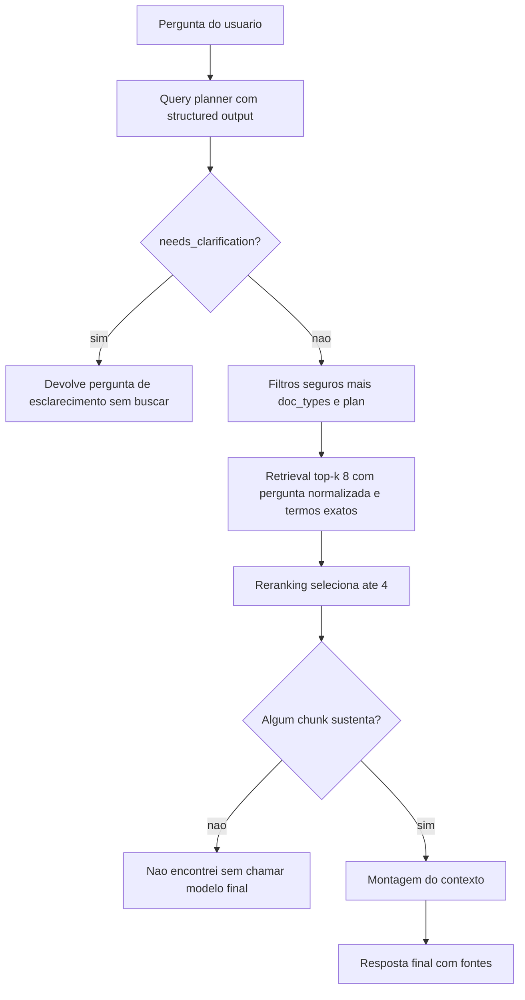

# Query Planner e Reranking

> [!summary] TL;DR
> - RAG simples (chunk, embed, busca, manda ao modelo) funciona em demo e falha em produção por chunk sem contexto, termos exatos, conflito de versões, ambiguidade e fonte que não sustenta a resposta.
> - Query planner: etapa antes do retrieval que normaliza a pergunta, infere doc_types, plano e termos exatos, e pede esclarecimento quando há mais de uma leitura.
> - Reranking: buscar mais candidatos (top-k 8, recall) e selecionar menos para o prompt (máximo 4, precisão); reduz ruído, tokens e melhora rastreabilidade.
> - O modelo interpreta a pergunta e ordena relevância, mas não decide autorização: tenant, produto, status e permissão são filtros fixos da aplicação.
> - LLM no planner e no reranker significa 3 chamadas por pergunta; alternativas sem modelo: classificação léxica, MMR, full text, busca híbrida com RRF, boosts por metadados, cross-encoder.

## Conceitos-chave

### Por que RAG simples falha

1. **Chunk sem contexto**: "tempo de resposta 30 minutos" sem dizer se é P1/P2, Enterprise, horário comercial; pedaço verdadeiro fora de contexto gera resposta errada. Mitigado pelo context header de [[Ingestão, Chunking e Indexação]].
2. **Termos exatos**: embeddings são bons em similaridade semântica, mas siglas, códigos, nomes de produto, versões e identificadores (P1, SOC2, FCAI Cloud, endpoint X) podem não ter o peso correto (ver [[Embeddings e Similaridade]]).
3. **Documentos conflitantes**: política antiga e nova recuperadas juntas; o modelo "monta uma resposta no meio".
4. **Documento antigo vence o novo**: o banco vetorial só calcula proximidade, não sabe o que é atual, aprovado ou válido; versão, status e filtros são essenciais.
5. **Pergunta ambígua**: "plano da empresa" pode ser Enterprise, corporativo ou contrato customizado; sem contexto do usuário ou esclarecimento busca o doc errado.
6. **Contexto certo mal usado**: chunk correto junto a genéricos; verificar se apareceu em boa posição, foi enviado claramente e o prompt direcionou.
7. **Fonte não sustenta a resposta**: fonte do tema, mas sem provar a conclusão; a fonte deve ser o trecho que sustenta o que foi dito.

### Query planner

- **Suposição perigosa**: a pergunta do usuário estar pronta para a busca. Usuário usa palavra genérica, sigla, mistura intenções, presume contexto ("e se der algum problema grave no enterprise?" = SLA de incidentes P1 no Enterprise). Relaciona-se com [[Query Reformulation e Prompt Enrichment]] e [[Query2Doc e HyDE]].
- **Query plan**: etapa intermediária simples (não precisa ser agente) com structured output: `normalized_question`, `doc_types`, `plan`, `exact_terms`, `needs_clarification`, `clarification_question`. Prepara busca híbrida, reranking e query rewriting.
- **Exemplo**: "Qual o tempo de resposta para P1 no Enterprise?" vira "Qual é o SLA de resposta para incidentes P1 no plano Enterprise?", doc_type sla, plan enterprise, exact terms P1 e Enterprise, sem esclarecimento.
- **`normalized_question`**: é o texto da busca; o modelo final responde a pergunta original.
- **`build_search_query`**: pergunta normalizada + `exact_terms` concatenados no texto embedado (ex: "Qual é a capital da França? capital França").
- **`build_filters`**: `doc_types` vira `doc_type IN (...)`; `plan` vira `plan IN [plano, "all"]`; plano None usa "all" e não exclui (`ALL_PLANS`).
- **`SAFE_FILTERS`**: `{"tenant": "fcai", "product": "fcai-cloud", "status": "published"}` fixos na aplicação; no real viriam do login/sessão. São autorização, não busca.
- **Filtro é eliminatório**: é WHERE antes da busca semântica, então `doc_types` deve ser lista generosa e vazia na dúvida: "filtro aumenta a precisão e derruba o recall" (ver [[Precision, Recall e F1]]).
- **Catálogo no prompt**: descreve o que cada tipo realmente contém (sla cobre canais e janelas de manutenção; company cobre e-mails de todos os departamentos).
- **Tipos fechados**: `DocType` e `Plan` são `Literal` (planner nunca inventa tipo); `ensure_planner_covers_index()` falha na largada se o índice tiver doc_type ou plan desconhecido (doc_type "privacidade" fora da lista nunca seria buscado). As listas `DOC_TYPES` e `PLANS` devem bater com a ingestão, ou ser consultadas no banco.
- **`temperature=0`** no planner: classificador determinístico.
- **Esclarecimento**: se `needs_clarification`, imprime `clarification_question` e não busca no banco. Em ambiguidade a melhor resposta pode ser perguntar de volta em vez de fingir certeza.

### Reranking

- **Retrieval devolve candidatos**, não o contexto final; top-k subiu de 5 para 8 porque o chunk certo ficava 2 ou mais posições fora. Mais top-k aumenta a chance do trecho certo e também ruído, tokens, custo, latência e competição no prompt.
- **Pergunta de cada etapa**: busca vetorial responde "quais trechos são semanticamente parecidos?"; reranking responde "quais realmente ajudam a responder?" (P1 Enterprise traz chunks de P1, Enterprise, canais, crédito SLA, disponibilidade; priorizar o do tempo de resposta P1 Enterprise).
- **Duas vertentes**: escolher os melhores resultados e reduzir a quantidade enviada ao modelo. Em base pequena a melhora de qualidade é discreta, mas a redução é clara.
- **Benefícios**: qualidade (menos ruído), custo (menos input tokens), rastreabilidade (fontes finais mais próximas da resposta real).
- **Reranker como portão de segurança**: lista vazia quando nenhum chunk sustenta a resposta faz o pipeline devolver "não encontrei" sem chamar o modelo final.
- **Contextual compression**: selecionar e comprimir só as partes que importam dos chunks.

**Formas de rerank**

| Forma | Como funciona | Trade-off |
|---|---|---|
| LLM com structured output | modelo de chat escolhe chunk_ids | simples e visível; custo, latência, risco de caixa preta |
| Score da busca vetorial | buscar 20, pegar 4 primeiros | fácil, barato, rápido; confia no ranking inicial |
| MMR (Maximal Marginal Relevance) | equilibra relevância e diversidade | evita 4 chunks quase iguais; bom para perguntas amplas |
| Rerank lexical | full text search (ex: Postgres) | valoriza P1, SSO, SCIM, OpenTelemetry, 99%, Pro |
| Busca híbrida com RRF | vetorial + textual, Reciprocal Rank Fusion premia quem pontua bem em várias buscas | muito forte em RAG real: significado + precisão do termo |
| Boosts por metadados | planner achou SLA e Enterprise, prioriza doc_type sla e plan enterprise/all | regra arquitetural sem modelo |
| Cross-encoder | modelo especializado (não chat) pontua pergunta + cada chunk | mais preciso; custo e latência, API externa ou local |

### Implementação no projeto

- **`query_planner.py`**: `TOP_K = 8`; Pydantic `QueryPlan`; `SAFE_FILTERS`; `build_filters`; `build_search_query`; busca `similarity_search_with_score` com search query, k e filtros; debug imprime o plano.
- **`rerank.py`**: `RERANK_TOP_N = 4`; human com pergunta original, normalizada, termos exatos; `RerankResult` só com os IDs selecionados; `format_candidates` (chunk_id, source, title, section, version, content); `select_documents_by_ids(docs, ids)` limitado a top N.
- **Chamadas ao modelo de chat**: exatamente 3 (planner, reranker, resposta); ingestão e indexação só usam embeddings. O prompt de resposta está em [[Retrieval e Montagem de Contexto]].

## Fluxograma / Processo



**Demonstrações com `python -m app.rag_chat --debug`**

- Filtro errado: `retrieve "quais são as janelas de manutenção?" --doc-type company --top-k 3` traz horário de atendimento, consolidação de plataformas, time de engenharia; com `--doc-type sla` traz manutenção programada comunicada com antecedência.
- "e se der problema grave no enterprise?": normalizada "O que acontece se ocorrer um problema grave no plano Enterprise?", doc_types [sla, plan], plan enterprise, exact_terms [problema grave, enterprise]; filtros tenant fcai, product FCAI Cloud, status published, doc_type in (sla, plan), plan in (enterprise, all); responde P1 24x7 com fonte.
- "como funciona o suporte no plano da empresa?": plan None, needs_clarification true, responde "Você poderia especificar a qual plano da empresa se refere? Starter, Pro ou Enterprise?".
- "o que acontece se eu ultrapassar a cota de ingestão?": doc_types product/policy/plan, sem plano, sem esclarecimento.
- "qual a capital da França?": sem doc_type nem plano, busca não acha nada e recusa.
- "qual é o e-mail de suporte?": 8 recuperados, rerank selecionou 3 (company-info, product-support-sla, company-info-20), só 3 enviados.
- "como funciona o programa de indicação?": 8 recuperados (company info, segurança e conformidade, FAQ), rerank selecionou 0 e respondeu "Não encontrei informação suficiente" sem a chamada final; com `--no-rerank` o ruído vai ao modelo e a recusa é a mesma (desperdício).
- `--show-prompt` com "quanto custa o plano pro?": mostra os 3 prompts (planner, reranker com candidatos, resposta final só com 2 de 8 chunks).

## Erros comuns / Cuidados

- O modelo não decide o que o usuário pode acessar: tenant, produto, status, visibilidade e permissão vêm do sistema. Camada de intenção melhora a busca, não substitui segurança.
- Reranking só opera sobre chunks que a aplicação já pode usar; ordena relevância, não decide autorização.
- Planner = 2 chamadas por pergunta; com rerank, 3: tempo e dinheiro. Rerank foi o gargalo de latência medido (~4 a 5 s com, ~2 s sem).
- Alternativa ao planner com LLM: classificação léxica/determinística (regex, palavras-chave, ifs: "enterprise" vira plan enterprise; "SLA" vira doc_type sla/plan), mais rápida e barata; ou híbrido com léxico primeiro e modelo como fallback quando o plano ficou com buracos; cache para perguntas repetidas ou parecidas (ver [[Cache Semântico com pgvector]]).
- O system prompt do planner roda sempre: vale enxugar e usar cache de prompt.
- Rerank com LLM no projeto é didático; em produção pode ser MMR, lexical, híbrida, boosts ou reranker especializado. "Buscar mais, selecionar melhor, mandar menos contexto."
- Debug precisa mostrar pergunta original, filtros aplicados, chunks retornados, scores, contexto enviado e resposta final; cada decisão do pipeline pode introduzir erro. Medição sistemática em [[Evaluation por Componente e Ragas]].
- O código do planner é específico de cada sistema; o importante é a ideia.

## Materiais complementares

### Prompts

**System prompt do query planner (query_planner.py; human: `{question}`; structured output `QueryPlan`)**
```text
You plan the retrieval step of a RAG assistant for FCAI. You never answer the question.

The knowledge base has these document types:
- sla: support SLA - severities (P1/P2/P3), response times per plan, support channels (support e-mail, ticket portal, emergency phone), escalation, maintenance windows, availability targets, SLA credits.
- policy: billing (payment methods, invoices, overage, billing failures, suspension) and commercial policy (prices, contract, trial, discounts, upgrade/downgrade, renewal, cancellation, refunds).
- product: what the platform does - metrics, logs, traces, alerts, dashboards, integrations, plan limits and ingestion quotas.
- plan: one document per plan (Starter, Pro, Enterprise). Careful: each of them ALSO covers the plan's price, its support channels, its security (SSO, SCIM, RBAC) and its limits.
- company: the company itself - legal data, offices, history, business hours, data residency, and the contact e-mails of every department (support, sales, billing, security, press, privacy).

Rules, in order:
1. needs_clarification FIRST: does the question have more than one reasonable reading, each leading to a different answer? Then it is true - ask instead of guessing, writing clarification_question in Portuguese. Words that point to one specific plan without naming it ('o plano da empresa', 'o meu plano') are exactly this case. A question that mentions no plan at all is NOT this case: it has one reading, whose answer just varies per plan.
2. normalized_question: rewrite the question in Portuguese, self-contained and specific, so it retrieves better.
3. doc_types: EVERY document type that could hold the answer - the search only looks inside the types you list, so a missing type hides the answer. The price of a plan is in 'policy' AND in 'plan'; SSO is in 'plan' AND in 'product'; the support e-mail is in 'sla', 'company' AND 'plan'. List all of them, and leave the list empty when unsure.
4. plan: fill it only when the question is about ONE plan. A comparison between plans, or a question that names no plan, leaves it null.
5. exact_terms: literal terms worth matching, like P1, SSO, Enterprise, 99,9%. They are appended to the search text.

Examples:
'E se der problema grave no Enterprise?' → one reading only (a P1 incident): doc_types=['sla', 'plan'], plan='enterprise', needs_clarification=false.
'Como funciona o suporte no plano da empresa?' → 'plano da empresa' reads both as the Enterprise plan and as whichever plan the company signed, and each reading answers differently: needs_clarification=true.
'O que acontece se eu ultrapassar a cota?' → no plan named, one reading, the answer covers every plan: doc_types=['product', 'policy', 'plan'], plan=null, needs_clarification=false.
```

**System prompt do reranker (rerank.py; structured output `RerankResult`: selected_chunk_ids)**
```text
You rerank retrieved chunks for a RAG assistant. You never answer the question.

Analyze only the candidate chunks below and select the ones worth sending to the answer model.

Rules:
- Select at most 4 chunk_ids, best first.
- Choose only chunks that directly help answer the question.
- Prefer specific chunks over generic ones.
- Prefer chunks that contain the exact terms, when given.
- Return an empty list if no chunk supports the answer.
- Use only Chunk IDs present in the candidates.

Candidates:
{candidates}
```

**Human prompt do reranker (candidatos formatados como `[Chunk ID: ...]`, Source, Title, Section, Version, Content)**
```text
Question: {question}
Normalized question: {normalized_question}
Exact terms: {exact_terms}
```

### Conteúdo extra

- Repositório: https://github.com/devfullcycle/mba-ia-rag (`app/query_planner.py`, `app/rerank.py`, `app/rag_pipeline.py`).

## Tags de busca

`#arquitetura-era-ia` `#rag` `#query-planner` `#reranking` `#busca-hibrida` `#structured-output`
