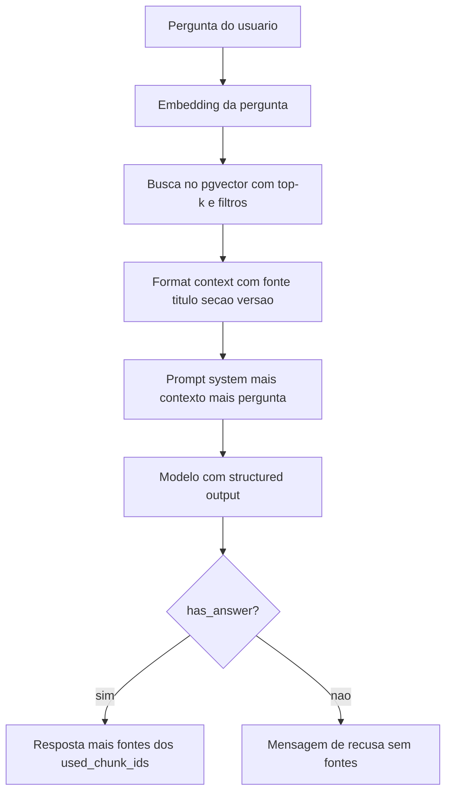

# Retrieval e Montagem de Contexto

> [!summary] TL;DR
> - Retrieval é onde o RAG ganha ou perde: top-k, threshold e filtros por metadados são decisões arquiteturais; similaridade não significa verdade.
> - Testar o retrieval isolado (chunks, metadados, scores) antes de ligar ao modelo: "o modelo gera a resposta, mas o retrieval escolhe a evidência".
> - Montar contexto não é concatenar texto: cada trecho delimitado e identificado (documento, título, seção, versão), com ordem e limite definidos.
> - Prompt final em 4 partes: instrução de sistema, contexto, pergunta, orientação de saída; recusa correta é sucesso em produção.
> - Structured output com `has_answer` e IDs dos chunks usados dá grounding; observabilidade por etapa (tempos, tokens, `request_id`) torna a resposta auditável.

## Conceitos-chave

- **Linha de base sem RAG**: o modelo responde só com o treinamento (ex: capital do Brasil) e nada sabe da empresa fictícia FCAI.
- **Documento inteiro no prompt (long context)**: com 1 ou 2 documentos que mudam pouco, mesmo grandes, funciona e é recomendável. O custo de tokens é mitigado pelo cache do provider (ver [[Prompt Caching e Batch Prompting]] e [[Camadas de Cache e Prompt Caching dos Providers]]). Limites: manter atualizado, documento crescendo, problemas de cache e atualização, estouro da janela (ex: Bíblia inteira, ver [[Context Window em LLMs]]), ler tudo para achar uma coisinha.
- **Retrieval**: recuperação dos chunks mais relevantes; indexar não significa RAG pronto.
- **Top-k**: quantos chunks trazer (3, 5, 10). Poucos falta contexto; muitos traz ruído. São candidatos, não necessariamente todos usados.
- **Threshold**: limite mínimo de similaridade, porque sempre existe um "melhor" resultado mesmo se todos forem ruins.
- **Filtros por metadados**: produto, tenant, plano, excluir draft, priorizar versão publicada, visibilidade, permissão, até data de validade. Evitam percorrer o banco inteiro, tornam a busca mais rápida e específica e são o que mais produz resultado decente. Metadados definidos em [[Ingestão, Chunking e Indexação]].
- **Retrieval = similaridade + filtro + contexto de negócio**.
- **Similaridade não é verdade**: trecho próximo pode ser antigo, fora do escopo, de outro plano ou não responder exatamente (ver [[Embeddings e Similaridade]]).
- **Score de `similarity_search_with_score`**: é distância, ordem "invertida": menor = mais próximo (ex: 0.51, 0.56... 0.64).
- **Filtro e intenção**: com `--plan enterprise` a busca roda só em docs com plan = enterprise, então a pergunta não precisa conter "Enterprise"; inferir o filtro da intenção é o papel do [[Query Planner e Reranking]]. `--plan starter` sem docs com esse metadado não traz nada.
- **Montagem do contexto**: camada que separa encontrar candidatos de transformá-los em resposta. Riscos de concatenar: trechos fora de ordem, duplicados, metadados perdidos, fontes sem identificação, contexto demais.
- **Rastreabilidade**: preservar conteúdo, documento de origem, título, seção, versão; texto bruto perde rastreabilidade, estruturado facilita citar fonte e debugar.
- **Delimitação**: cada trecho separado evita misturar regras de SLA, política comercial e plano Enterprise.
- **Ordem**: por relevância, agrupada por documento, ou específica antes da geral; ter alguma estratégia.
- **Limite de contexto**: top 5/10 não precisa ir todo; cada chunk vira token, custo, latência e piora da resposta. Montagem também é camada de seleção.
- **Prompt em 4 partes**: (1) instrução de sistema (papel e regras: responder com base no contexto, não inventar, idioma, formato); (2) contexto recuperado organizado e identificado; (3) pergunta do usuário; (4) orientação de saída (objetiva, só esse contexto, dizer que não encontrou se faltar informação). Ver [[System, User e Assistant Prompts]].
- **"Contrato com o modelo"**: trechos que pode usar, pergunta, formato, não invente. Reduz risco, não garante.
- **Recusa**: em produção comemora-se também quando o sistema recusa corretamente; recusa clara é melhor que resposta inventada com confiança.
- **Grounding**: resposta acompanhada dos IDs dos chunks que a sustentam. Ex: "vocês têm fornecedores de planos odontológicos?" recupera chunks de plano, mas o modelo recusa e zera as fontes; sem a regra provavelmente alucinaria (ver [[Alucinação em LLMs]]).
- **Fontes montadas pela aplicação**: a aplicação cruza `used_chunk_ids` com os metadados dos chunks recuperados; IDs inventados pelo modelo são descartados.
- **Pipeline como service único**: classe `RagPipeline` orquestra planejar, buscar, rerank e responder; CLI e API chamam o mesmo `run(question, use_rerank, include_debug...)`, sem duplicar regra de negócio. Pode ser exposto por HTTP, gRPC etc.
- **Observabilidade do pipeline**: entender quanto cada etapa demora e custa para achar gargalos; junta tempos da aplicação com metadados de tokens que o LangChain devolve. Ferramentas de mercado: LangSmith, OpenTelemetry (ver [[Observabilidade com OpenTelemetry]]). O novo com IA: decidir quais etapas observar e registrar tokens.

### Implementação no projeto

- **`chat.py`**: `init_chat_model` do LangChain com modelo e provider vindos do env; loop `while True` com `model.stream(...)`; `exit`/`quit` sai.
- **`context_chat.py`**: system message = instruções + "Document:" + conteúdo inteiro de `product_support_sla`. "Qual é o SLA de vocês?" responde certo (SLA por plano Starter/Pro/Enterprise e severidade P1/P2/P3).
- **`retrieve.py`**: `DEFAULT_TOP_K = 5`, `FILTER_FIELDS`, `PREVIEW_LIMIT`; args `--top-k`, `--status`, `--tenant`, `--product`, `--plan`, `--doc-type`, `--version`; núcleo `store.similarity_search_with_score(query, k=top_k, filter=filters)`, que embeda a pergunta e compara com os vetores; imprime score, chunk_id, source, title, section, plan, doc_type, version, status e preview. LangChain tem VectorStore para os bancos de mercado (ex: Pinecone).
- **`rag_chat.py`**: top_k 5, filtros, `format_context(docs)` monta por doc as linhas Document (source_file), Title, Section, Version e "Content:"; `similarity_search` e depois `prompt.invoke` + modelo (primeira chamada real ao LLM; antes só embedding). `--show-prompt` exibe System + Context + Human.
- **Resposta estruturada**: Pydantic `RagAnswer` (answer, has_answer, used_chunk_ids) via `model.with_structured_output(RagAnswer)`; `NO_ANSWER_MESSAGE` = "Não encontrei informação suficiente na base de conhecimento para responder com segurança."; `--debug` mostra chunks com score, resposta e fontes.
- **API (FastAPI)**: `ChatRequest` (question, debug, use_rerank); `GET /health` e `POST /chat`, retorna answer, has_answer, needs_clarification, sources. `debug: true` acrescenta query_plan, search query, filtros e chunks recuperados; `use_rerank: false` pula o rerank; pergunta em branco retorna 400; erro gera `error_type`/`error_message` no log e 500 genérico na API. Testes em `test.http` (REST Client do VS Code). Rodar com `uvicorn app.api:app --reload`.
- **Trace por resposta**: `request_id` UUID (essencial para recuperar a requisição depois), has_answer, needs_clarification, use_rerank, retrieved_count (8), selected chunks, source files, `query_planning_ms`, `retrieval_ms`, `reranking_ms`, `answer_generation_ms`, `total_ms`, modelo, input/output/total tokens via `UsageMetadataCallbackHandler`. Custo não é calculado (LangChain não fornece preços); com tabela de preços atualizada estima-se custo por requisição.
- **Log estruturado**: JSON por execução sem prompts, contexto, documentos ou credenciais (ver [[Privacidade e Retenção de Telemetria]]).

## Fluxograma / Processo



## Erros comuns / Cuidados

- Antes de perguntar por que o modelo errou, perguntar se a aplicação encontrou o contexto certo. Retrieval como caixa preta faz o time ajustar prompt, trocar modelo e mudar temperatura enquanto o problema é contexto errado chegando.
- Contexto demais aumenta custo e confunde; de menos deixa incompleto; contexto errado faz o modelo responder bem sobre evidência errada.
- "Quais planos disponíveis" trouxe pedaços de Starter, Pro, Enterprise e política comercial, mas nenhum chunk com a lista de planos.
- Resposta "o documento menciona três planos" indica prompt mal feito; deveria responder direto.
- Guardrails reais são maiores que o prompt: "me fale do plano Enterprise como uma poesia" responde em verso com fontes. Instruir o modelo a não mudar de comportamento a pedido do usuário; prompt injection em [[Prompt Injection e Ataques Diretos]].
- Total de ~4 a 5 s por resposta é alto; com `use_rerank: false` caiu para ~2 s. Medir por etapa orienta decisões (ajustar prompt, remover etapa); custos em [[Custos, Budgets e Governança de IA]].

## Materiais complementares

### Prompts

**System prompt do context_chat (documento inteiro no prompt)**
```text
You are a support assistant for FCAI. Answer the user's question using ONLY the document provided below. Do not use prior knowledge and do not invent information. If the document does not contain enough information to answer, say clearly that the document does not have enough information. Always answer in Portuguese.

Document:
{document}
```

**System prompt de resposta do RAG (rag_pipeline.py; human: `{question}`; structured output `RagAnswer`: answer, has_answer, used_chunk_ids)**
```text
You are a support assistant for FCAI. Answer the user's question using ONLY the context below. Do not use prior knowledge and do not invent information or sources.

Rules:
- Write 'answer' in Portuguese, objective and clear.
- Set 'has_answer' to true only if the context supports the answer.
- 'used_chunk_ids' must contain only Chunk IDs present in the context.
- If the context is not enough, set 'has_answer' to false, set 'answer' to 'Não encontrei informação suficiente na base de conhecimento para responder com segurança.' and leave 'used_chunk_ids' empty.

Context:
{context}
```

### Conteúdo extra

- Comandos: `python -m app.chat`; `python -m app.context_chat`; `python -m app.retrieve "me fale sobre SLA" --top-k 5 --doc-type sla --plan all`; `python -m app.rag_chat` (`--debug`, `--show-prompt`, `--no-rerank`); `uvicorn app.api:app --reload`.
- Repositório: https://github.com/devfullcycle/mba-ia-rag

## Tags de busca

`#arquitetura-era-ia` `#rag` `#retrieval` `#montagem-de-contexto` `#grounding` `#structured-output`
