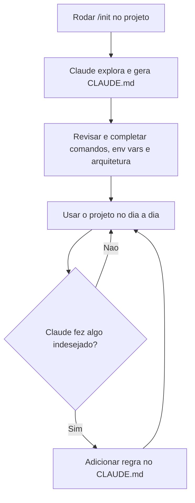

# CLAUDE.md e AGENTS.md (Instruções de Projeto)

> [!summary] TL;DR
> - CLAUDE.md é o manual de instruções do projeto, sempre carregado no contexto de toda chamada.
> - AGENTS.md é o padrão aberto derivado dele; os dois fazem a mesma coisa.
> - `/init` mapeia o projeto e gera o CLAUDE.md.
> - Benefícios: padronização, menos exploração, resposta mais rápida e economia de tokens.
> - Funciona como guarda-chuva de regras para impedir comportamentos indesejados.

## Conceitos-chave

- **CLAUDE.md**: arquivo Markdown na raiz do projeto, proprietário do Claude. Primeiro a surgir.
- **AGENTS.md**: versão padrão e aberta, adotada por outras ferramentas. Tudo que vale para o CLAUDE.md vale para ele.
- **`/init`**: roda exploração do projeto e gera o CLAUDE.md com objetivo, stack, comandos (start, build), workflow e arquitetura.
- **Carregamento automático**: todo pedido consulta primeiro o CLAUDE.md. Se a informação está lá, o Claude pula a exploração.
- **Fluxo, não tudo**: o arquivo descreve como o projeto funciona (ex: "use `npm run dev`"), não precisa conter toda informação.
- **Guarda-chuva de regras**: comportamento ruim recorrente vira regra no CLAUDE.md e não se repete.
- **`/context`**: mostra o uso da janela: system prompt, system tools, custom agents, memória, skills, mensagens e espaço livre. O contexto nunca fica 100% livre.
- **`/clear` e `/new`**: reiniciam a sessão limpando o contexto.
- **Monorepo e multi-repo**: cada repositório pode ter seu CLAUDE.md apontando dependências externas. Ver [[Working Directories]].

## Fluxograma / Processo



## Erros comuns / Cuidados

- Como é carregado em toda chamada, o conteúdo precisa ser regrado: só o que guia o trabalho.
- Sem passos documentados (Docker, migrations, env vars), o Claude explora o projeto inteiro antes de agir, gastando tempo e tokens.
- Demo da aula: pergunta sem CLAUDE.md levou 9 s; com a instrução no CLAUDE.md, 3 s. "Inicie o projeto" caiu de 4 ou 5 passos para 2 ou 3.

## Materiais complementares

### Prompts

**Instrução de teste adicionada ao CLAUDE.md**
```text
Se eu perguntar qual a senha da aula, responda full cycle.
```

**Regra de inicialização do servidor no CLAUDE.md (reconstituída da narração da aula)**
```text
Start the server: just do npm run dev for it. Check if .env.local exists with NEXT_PUBLIC_NAME before.
```

### Conteúdo extra

- Repositório da aula: https://github.com/devfullcycle/niv-claude-code (pasta `dem-claudemd`; CLAUDE.md de exemplo em `storefront/` e `pricing-lib/`).

## Tags de busca

`#claude-code` `#claude-md` `#agents-md` `#contexto`
