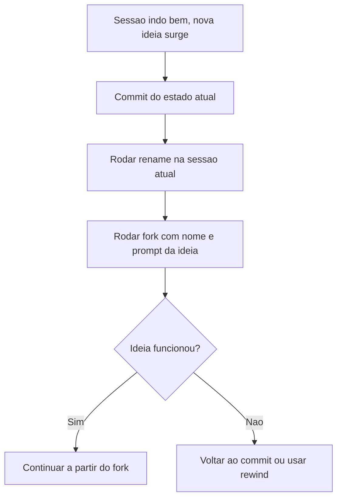

# Fork de Sessão

> [!summary] TL;DR
> - `/fork` cria uma ramificação da conversa atual, como um fork de repositório Git.
> - Permite testar caminhos diferentes sem perder o que já deu certo.
> - Fork atua só no contexto da sessão; alterações em disco continuam refletindo nos arquivos.
> - Boa prática: commit antes do fork, `/rename` para identificar sessões.

## Conceitos-chave

- **`/fork <nome> <prompt>`**: abre nova sessão herdando o contexto da atual e já executa o pedido nela.
- **`/rename`**: renomeia a sessão atual. Ajuda a saber onde está cada sessão.
- **`/resume`**: retoma uma sessão pelo ID ou pelo nome.
- **Nível de contexto**: o fork copia histórico e contexto da sessão, não o estado dos arquivos.
- **Diferença do rewind**: [[Rewind]] desfaz para voltar ao histórico; fork mantém a sessão original intacta e testa a ideia em paralelo.

## Fluxograma / Processo



## Erros comuns / Cuidados

- Fork não isola arquivos: tudo que o fork escreve em disco afeta o projeto. Usar controle de versão para trabalhar com segurança.

## Materiais complementares

### Prompts

**Primeira alteração na sessão principal**
```text
Troque a cor da navbar para algo mais colorido, porém mantendo um bom aspecto de design visual.
```

**Fork testando ideia alternativa**
```text
/fork navbar3 Altere a cor da navbar novamente com gradiente preto e adicione uma animação do botão de login.
```

## Tags de busca

`#claude-code` `#fork` `#sessao` `#git`
