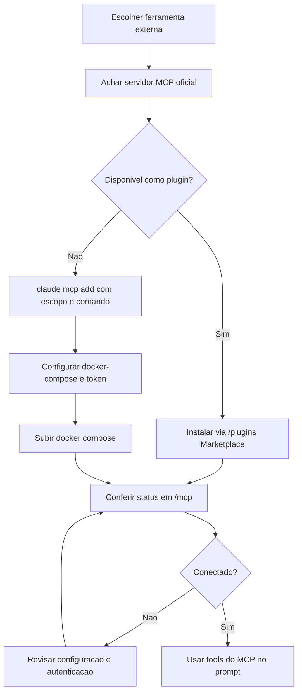

# MCP no Claude Code

> [!summary] TL;DR
> - MCP (Model Context Protocol) é um padrão aberto que conecta modelos a dados externos: arquivos, bancos, APIs.
> - `/mcp` lista os servidores disponíveis e o status de conexão.
> - No terminal: `claude mcp add | list | get | remove`.
> - Escopo de projeto grava em `.mcp.json`; escopo global vale para todas as sessões.
> - Alternativa: instalar MCP como plugin pelo Marketplace (`/plugins`).

## Conceitos-chave

- **MCP**: protocolo que padroniza como LLMs falam com o mundo externo. Dá para criar servidores próprios.
- **Built-in**: MCPs já prontos e instalados no Claude Code, listados no `/mcp`.
- **`claude mcp add <nome>`**: adiciona servidor. Parâmetros de escopo (projeto ou global) e de transporte.
- **`.mcp.json`**: criado com escopo de projeto, guarda a especificação passada no terminal em `mcpServers`.
- **Docker como gerenciador**: o servidor roda via `docker compose`; o nome do serviço no compose deve bater com o do `.mcp.json`.
- **Token do GitHub**: gerado em Settings > Developer Settings do GitHub, exportado como variável de ambiente ou em `.env`.
- **`claude mcp get <nome>`**: detalhes de um servidor. **`claude mcp list`**: todos, com checagem de conexão. **`claude mcp remove <nome>`**: remove.
- **Plugins / Marketplace**: em `/plugins` > Discover, buscar "MCP", selecionar com espaço e instalar para todos os usuários, colaboradores ou só para você. Pede reload de plugins.
- **Playwright MCP**: testes end-to-end e de UI; abre página, tira print e gera logs.
- **Contexto ocupado**: MCPs instalados consomem parte da janela de contexto. Ver [[CLAUDE.md e AGENTS.md (Instruções de Projeto)]].

## Fluxograma / Processo



## Erros comuns / Cuidados

- Status "needs authentication" ou "failed" quase sempre é configuração: arquivo do MCP ou token gerado errado ou incompleto.
- Nunca expor token em tela ou repositório.
- Alguns MCPs ainda não existem como plugin; aí só pelo caminho manual.

## Materiais complementares

### Prompts

**Usar MCP do GitHub para listar issues**
```text
Utilize o MCP do GitHub e busque as issues deste repositório e me traga uma listagem no chat.
```

**Usar MCP do Playwright para screenshot**
```text
Utilize o MCP do Playwright, acesse o localhost:4000 e tire um print do resultado após o load. Salve no projeto.
```

### Conteúdo extra

- Configuração usada na aula (`.mcp.json`):
```json
{
  "mcpServers": {
    "github": {
      "type": "stdio",
      "command": "docker",
      "args": ["compose", "run", "--rm", "-T", "gh-mcp"],
      "env": {}
    }
  }
}
```
- `docker-compose.yaml` com imagem `ghcr.io/github/github-mcp-server` e variável `GITHUB_PERSONAL_ACCESS_TOKEN`.
- Plugin habilitado no repositório: `playwright@claude-plugins-official` em `.claude/settings.json`.
- Repositório: https://github.com/devfullcycle/niv-claude-code

## Tags de busca

`#claude-code` `#mcp` `#plugins` `#playwright`
