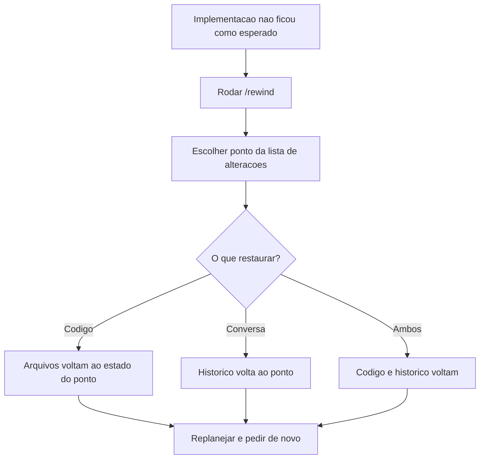

# Rewind

> [!summary] TL;DR
> - `/rewind` cria pontos de restauração da sessão, como um histórico navegável.
> - Restaura só o código, só a conversa ou os dois.
> - Uso típico: o modelo perdeu contexto e fez algo fora do planejado; volta ao ponto da falha e replaneja.

## Conceitos-chave

- **`/rewind`**: lista as alterações feitas na sessão e permite escolher para qual ponto voltar.
- **Escopo da restauração**: código, conversa ou ambos. Restaurando a conversa, o prompt volta para ser reeditado.
- **Quando usar**: implementação que saiu diferente do esperado, por falta de contexto ou decisão ruim.
- **Relação com fork**: para testar ideia alternativa sem desfazer o caminho atual, usar [[Fork de Sessão]] em vez de rewind.

## Fluxograma / Processo



## Erros comuns / Cuidados

- Mudança em variável de ambiente só reflete após reiniciar o servidor (`npm run dev`).

## Materiais complementares

### Prompts

**Gerar uma alteração para depois desfazer com rewind**
```text
Altere o valor na página, modificando o valor da env var para Full Cycle.
```

## Tags de busca

`#claude-code` `#rewind` `#checkpoint` `#sessao`
