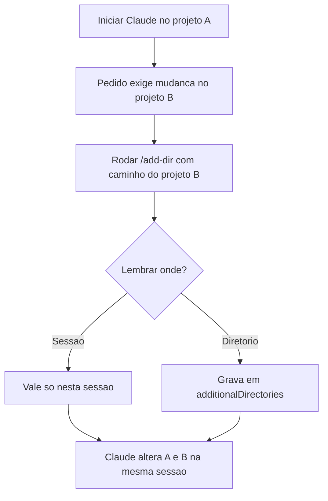

# Working Directories

> [!summary] TL;DR
> - `/add-dir <caminho>` traz o contexto de outro projeto para a mesma sessão, mesmo em diretório físico diferente.
> - Resolve features que exigem mudança em vários repositórios (ex: back-end e front-end separados).
> - Pode ser lembrado só na sessão ou gravado em `additionalDirectories` do `settings.local.json`.
> - Evita liberar o Claude para buscar em qualquer pasta, o que fere políticas de segurança e gasta token.

## Conceitos-chave

- **Problema**: sessão iniciada no front-end não enxerga a API em outra pasta. O Claude não acha o arquivo e para.
- **`/add-dir`**: adiciona o diretório extra à sessão. O Claude lê e altera os dois projetos em paralelo.
- **Persistência**: ao adicionar, escolher entre lembrar só nesta sessão ou salvar no settings local do projeto.
- **`additionalDirectories`**: chave do `.claude/settings.local.json` com os diretórios extras; toda sessão naquele projeto já carrega o contexto.
- **Documentar no CLAUDE.md**: avisar que a dependência mora em outro repositório e como adicioná-la. Ver [[CLAUDE.md e AGENTS.md (Instruções de Projeto)]].

## Fluxograma / Processo

## Erros comuns / Cuidados

- Pacote local referenciado como `file:../pasta` pode falhar no type check se tratado como módulo. Ajuste de prompt ou configuração resolve.

## Materiais complementares

### Conteúdo extra

- Exemplo no repositório da aula: `storefront/CLAUDE.md` instrui `/add-dir ../pricing-lib` para mexer em preço, moeda ou tipo Product. https://github.com/devfullcycle/niv-claude-code

## Tags de busca

`#claude-code` `#add-dir` `#multi-repo` `#settings`
