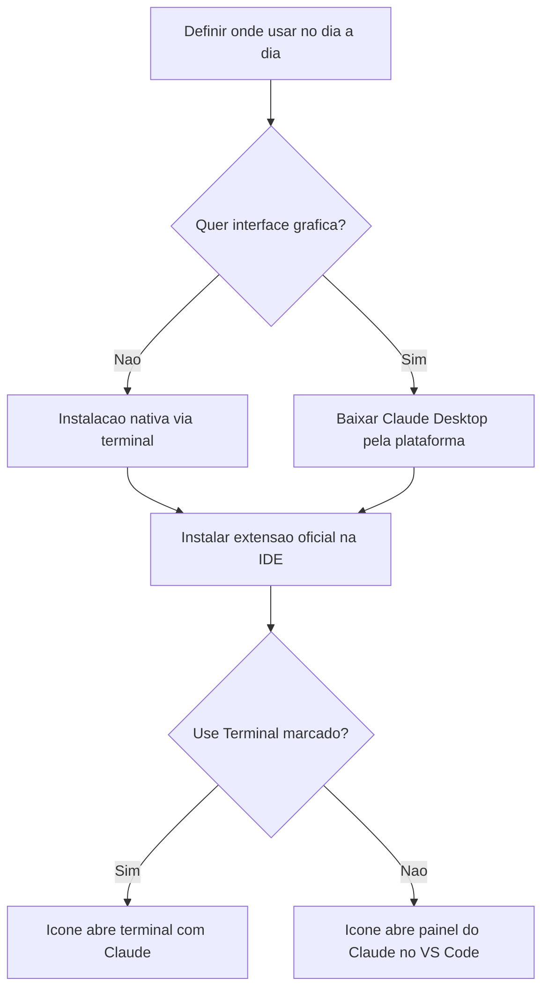

# Instalação e Extensões do Claude Code

> [!summary] TL;DR
> - Claude Code é separado do ambiente Claude web/desktop, mas roda no terminal, na IDE, na web e dentro do app desktop.
> - Instalação recomendada: a nativa (curl no Mac/Linux/WSL, PowerShell ou CMD no Windows).
> - Download pela plataforma instala o Claude Desktop (com UI); instalação via terminal instala só o Claude Code. Funcionalidades iguais.
> - Na IDE, a extensão oficial da Anthropic abre o Claude Code em painel próprio ou no terminal, conforme a opção "Use Terminal".
> - Bypass de permissões na extensão vem desabilitado por padrão e deve continuar assim em ambiente que exige segurança.

## Conceitos-chave

- **Onde usar**: terminal (recomendado, com apoio da IDE), extensão da IDE (VS Code, JetBrains e outras), interface web ou Claude Desktop.
- **Instalação nativa**: evita problemas de compatibilidade e versão. Opções no site oficial por plataforma.
- **Desktop x terminal**: o download pela plataforma instala o app com interface; a instalação pelo terminal instala só o Claude Code, sem UI. Resultado final igual.
- **Extensão da IDE**: buscar "Claude Code" nas extensões do VS Code e instalar a oficial da Anthropic. Após o restart, aparece o ícone do Claude Code no topo do editor.
- **Teste da extensão**: `Ctrl+Shift+P` (ou `Shift+P`), digitar "Claude" e iniciar nova sessão.
- **Claude Code: Use Terminal**: setting da extensão. Marcada, o ícone abre um terminal com o Claude rodando; desmarcada, abre o painel do Claude dentro do VS Code.
- **Bypass de permissões**: opção da extensão que libera o Claude para executar tudo sem pedir autorização. Ver [[Permissões, Modos e Settings]].
- **Login automático**: com sessão já autenticada, qualquer formato (painel ou terminal) entra logado. Ver [[Planos e Login do Claude Code]].

## Fluxograma / Processo

## Erros comuns / Cuidados

- Preferir sempre as formas de instalação recomendadas para não ter conflito de versão.
- Bypass de permissões dá liberdade total ao Claude. Só ativar para testes, sabendo dos riscos.

## Tags de busca

`#claude-code` `#instalacao` `#extensao-ide` `#vscode`
