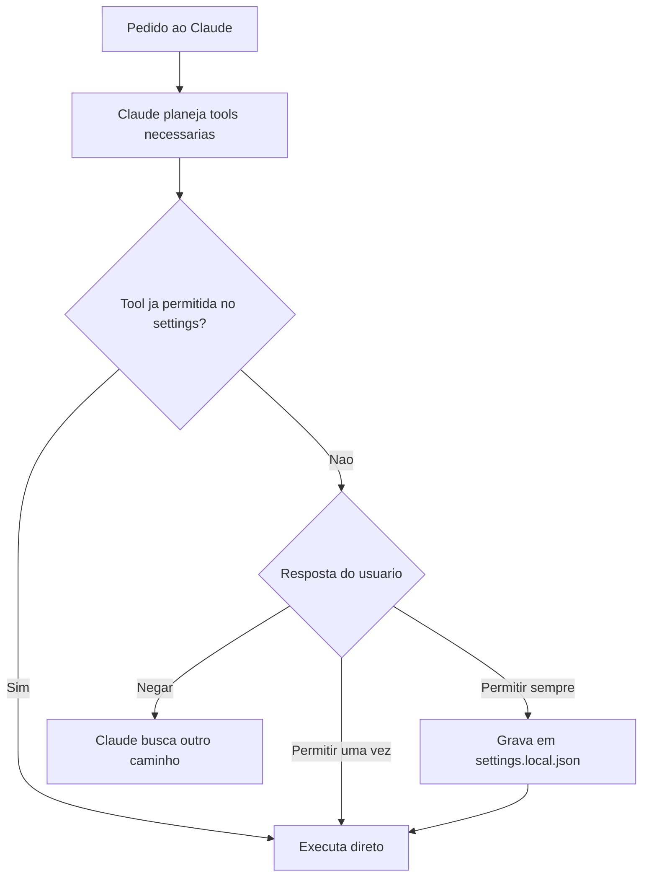

# Permissões, Modos e Settings

> [!summary] TL;DR
> - Sem bypass, o Claude pede autorização para cada tool (bash, WebSearch, escrita). "Sempre permitir" grava em `.claude/settings.local.json`.
> - `Shift+Tab` alterna os modos: default, accept edits, plan e auto.
> - Settings em três níveis: local do projeto, compartilhado entre projetos e global.
> - `/config` concentra auto compact, thinking mode, verbose output e default permission mode.

## Conceitos-chave

- **Usos além de código**: explicações, pesquisas (research), implementações, arquitetura.
- **Tools**: comandos bash (grep, ls, cp) e ferramentas externas (WebSearch) que o Claude planeja e executa para gerar o resultado.
- **Pedido de permissão**: cada tool nova pede autorização. Permitir uma vez não grava nada; permitir sempre grava a regra.
- **`.claude/settings.local.json`**: guarda permissões e negações do projeto para não perguntar de novo. Pasta `.claude` em repositórios é normal.
- **Níveis de settings**: local (projeto), compartilhado entre projetos e global (pasta de instalação do Claude Code). Escolher o nível conforme a segurança desejada.
- **Default**: pede permissão para executar e editar.
- **Accept edits on**: o Claude edita arquivos livremente no diretório; comandos bash ainda pedem permissão.
- **Plan mode on**: ambiente fechado focado em planejamento. Ver [[Plan Mode]].
- **Auto mode on**: o Claude verifica e decide sozinho o que pode ser feito.
- **Auto Compact**: ligado por padrão. Compacta o contexto ao atingir um percentual da janela.
- **Thinking Mode**: ligado por padrão. Permite raciocínio interno antes da resposta.
- **Verbose output**: false mostra saída resumida; true mostra o raw de tudo que rodou.
- **Default permission mode**: define em que modo o Claude inicia, em nível global.

## Fluxograma / Processo



## Erros comuns / Cuidados

- Bypass de permissões libera tudo. Em ambiente seguro, deixar desmarcado ([[Instalação e Extensões do Claude Code]]).
- Planejar, executar comandos e escrever em arquivo são permissões distintas.

## Materiais complementares

### Prompts

**Testar pedido de permissão de WebSearch**
```text
Busque rapidamente as formas de autenticação que estão sendo utilizadas em 2026.
```

**Criar projeto demo para exercitar modos e permissões (reconstituído da narração da aula)**
```text
Crie um projeto Next.js chamado demo-claude-md usando npm, configure o script de dev para rodar em uma porta específica, uma variável de ambiente obrigatória NEXT_PUBLIC_NAME lida na página inicial, com um .env.example de referência e uma página inicial colorida escrita Hello from Claude Code. Não gere AGENTS.md e o CLAUDE.md.
```

## Tags de busca

`#claude-code` `#permissoes` `#settings` `#modos`
