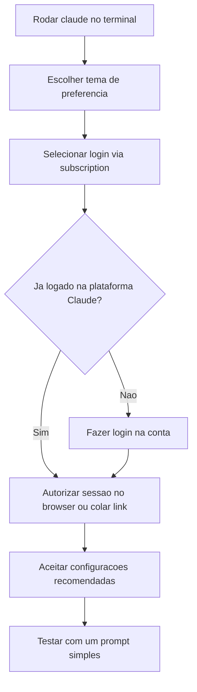

# Planos e Login do Claude Code

> [!summary] TL;DR
> - Para uso diário, subscription é recomendada no lugar de API Key, que sai muito cara.
> - API (Enterprise, AWS Bedrock, Microsoft Foundry) só quando há exigência de compliance e segurança.
> - Free e Pro não sustentam desenvolvimento; para código, mínimo Max 5x. Max 20x tem limite de tokens bem maior.
> - Login: rodar `claude`, escolher subscription e autorizar a sessão no browser.

## Conceitos-chave

- **Subscription x API Key**: API Key tem custo muito alto para o dia a dia. Subscription é o padrão recomendado.
- **Providers com compliance**: plano Enterprise, AWS Bedrock e Microsoft Foundry, sempre via API, para ambientes que exigem compliance.
- **Free**: serve para testar comandos e entender o funcionamento. Inviável para desenvolvimento.
- **Pro**: difícil de usar para programação; atende pesquisas e uso geral.
- **Max 5x**: atende código no dia a dia. Pode bater limite eventualmente e exigir espera até recompor.
- **Max 20x**: limite de tokens muito maior; dificilmente trava, dependendo do modelo usado ([[Modelos e Effort]]).
- **Valores**: preços e planos mudam com o tempo.

## Fluxograma / Processo

## Erros comuns / Cuidados

- As duas opções abaixo de subscription no login são API (direta ou via provider externo). Para uso pessoal, escolher subscription.
- Pesquisa sem código, design ou outras funcionalidades: Pro resolve. Desenvolvimento: Max.

## Tags de busca

`#claude-code` `#planos` `#login` `#subscription`
