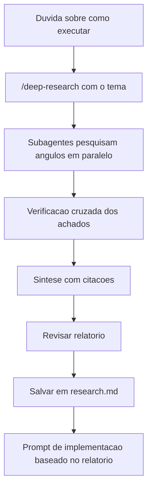

# Deep Research

> [!summary] TL;DR
> - `/deep-research` dispara subagentes em paralelo, cada um pesquisando um ângulo do zero, e sintetiza tudo com citações.
> - A sessão principal atua como orquestradora; achados são cruzados para checar contradições.
> - Consome muito limite do plano e demora (13 minutos na aula). Usar com cautela.
> - Fechar o ciclo: pesquisa, decisão, implementação.

## Conceitos-chave

- **Quando usar**: dúvida real sobre como atuar numa feature ou tarefa, quando é preciso comparar caminhos.
- **Diferença do prompt comum**: prompt comum dá resposta sequencial, mesmo com WebSearch. Deep research paraleliza.
- **Fases**: escopo, busca, coleta (gather), verificação e síntese.
- **Verificação cruzada**: cada achado confere os outros para eliminar contradições.
- **Relatório**: resumo executivo, recomendações consolidadas, fluxo mínimo, caveats e perguntas em aberto para aprofundar.
- **Revisão humana**: o resultado ainda precisa ser revisado.
- **Por baixo**: roda como [[Dynamic Workflows]].
- **Alternativa barata**: prompt simples com WebSearch, mais rápido, para dúvidas menores.

## Fluxograma / Processo



## Erros comuns / Cuidados

- Custo alto em API e na subscription; não usar para toda dúvida.
- Tempo de execução atrapalha o dia a dia se usado com frequência.

## Materiais complementares

### Prompts

**Persistir o resultado da pesquisa**
```text
Salve em um .md dentro do projeto com o nome research.md.
```

### Conteúdo extra

- Tema pesquisado na aula: estratégias de design system em 2026 (tokens semânticos x primitivos, formato, build tools, versionamento, recomendações para times pequenos). Próximo passo sugerido: gerar estrutura de pastas e tokens no projeto Next.js a partir do relatório.

## Tags de busca

`#claude-code` `#deep-research` `#subagentes` `#pesquisa`
