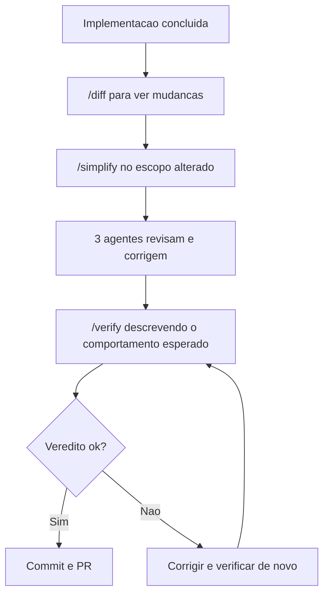

# Simplify e Verify

> [!summary] TL;DR
> - `/simplify <arquivo|pasta>`: mini code review do que mudou recentemente, com 3 agentes em paralelo, e aplica as correções sozinho.
> - `/verify <comportamento>`: prova que a funcionalidade funciona executando de verdade, inclusive em browser real.
> - Dois gates de qualidade antes de PR ou commit.
> - Combatem alucinação de LLM: smells no código e testes falsamente verdes.

## Conceitos-chave

- **`/diff`**: mostra o que mudou na sessão (adicionado e removido).
- **`/simplify`**: aponta para arquivo, pasta ou conjunto de arquivos; cada agente revisa por um ângulo e as correções são aplicadas.
- **Smells corrigidos na demo**: import não usado (`crypto`), variável temporária redundante, ifs aninhados que dava para achatar, dead code.
- **Por que simplificar**: mesmo com skills, convenções e bom prompt, a LLM não é determinística e alucina conforme o contexto enche.
- **Armadilha dos testes**: a LLM pode marcar testes com `skip` ou fazer retornar `true` só para ficar verde.
- **`/verify`**: executa o fluxo real (servidor, requests, curl, browser), checa caso feliz e casos extras (senha errada, campos vazios) e entrega veredito com o que testou.
- **Complemento**: restrições de teste no [[Goal]] e verificação por iteração no [[Loop]] seguem a mesma ideia de autoverificação.

## Fluxograma / Processo



## Erros comuns / Cuidados

- Teste verde gerado por LLM não prova funcionamento; usar verify antes de commit.

## Materiais complementares

### Prompts

**Simplificar uma pasta**
```text
/simplify src-alpha
```

**Verificar fluxo de login**
```text
/verify O formulário de login envia e redireciona para o dashboard. Dados a serem utilizados: <usuário e senha de teste>
```

### Conteúdo extra

- Demo na pasta `demo-sv` do repositório (`archive/auth.js` refatorado e `server.js` com login). https://github.com/devfullcycle/niv-claude-code

## Tags de busca

`#claude-code` `#simplify` `#verify` `#code-review`
