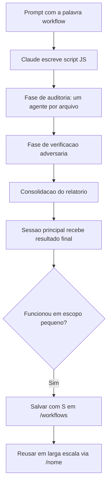

# Dynamic Workflows

> [!summary] TL;DR
> - Script JavaScript, escrito pelo próprio Claude a partir do prompt, que orquestra muitos subagentes em escala.
> - Disparado com a palavra "workflow" no prompt; acompanhado em `/workflows`.
> - O plano vira código: loops, ramos e resultados intermediários ficam em variáveis do script, não no contexto.
> - A sessão principal recebe só a resposta final e fica livre enquanto roda.
> - Workflow validado pode ser salvo (`S` em `/workflows`) e reusado como comando.

## Conceitos-chave

- **Problema resolvido**: tarefas grandes (auditar base inteira, migrar dezenas de arquivos) estouram o contexto quando feitas uma a uma.
- **Diferença de subagente comum**: no subagente comum o Claude decide turno a turno e tudo passa pelo contexto dele. No workflow, quem segura o plano é o script.
- **Escala**: permite dezenas ou centenas de agentes numa execução.
- **Uso interno**: features como [[Deep Research]] já rodam como workflow.
- **Verificação adversária**: fase em que um agente cético tenta refutar cada achado antes do relatório.
- **Salvar**: em `/workflows`, `S` grava o script em `.claude/workflows/` do projeto. Reusar com `/<nome-do-workflow>`; se não aparecer, recarregar skills ou plugins.
- **Ultracode**: com effort em ultracode, o Claude decide sozinho quando usar workflows. Ver [[Modelos e Effort]].

## Fluxograma / Processo



## Erros comuns / Cuidados

- Custo: múltiplos agentes gastam mais tokens que tarefas comuns. Testar numa fatia pequena e controlada antes de aplicar em larga escala.
- Runtime tem teto máximo de agentes, como proteção contra loop descontrolado.
- Subagentes rodam com a allow list de tools do `settings.json`.
- `Ctrl+C` no meio faz a próxima sessão começar do zero; usar `/resume` para voltar.
- Não limpar a sessão antes de salvar o workflow.

## Materiais complementares

### Prompts

**Auditoria de rotas sem autenticação**
```text
Use um workflow para auditar todas as rotas presentes no projeto que estão dentro de src/routes, encontrar rotas com falta de autenticação e verifique de forma adversária cada ocorrência antes de relatá-la.
```

### Conteúdo extra

- Script salvo na aula: `demo-workflow/.claude/workflows/audit-auth-routes.js`, com fases Audit (um agente por arquivo de rota) e Verify (cético adversário). https://github.com/devfullcycle/niv-claude-code
- Resultado da aula: 6 rotas sem auth encontradas; rotas públicas legítimas (catálogo, health check, webhook) reconhecidas como intencionais.

## Tags de busca

`#claude-code` `#workflow` `#subagentes` `#auditoria`
