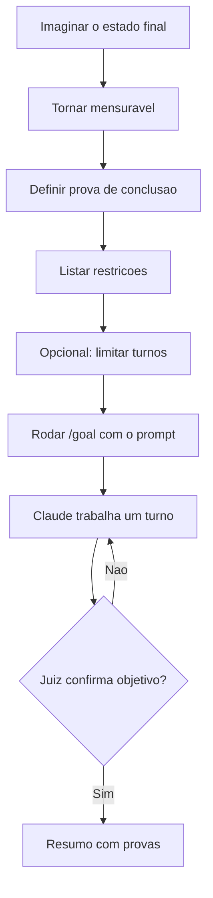

# Goal

> [!summary] TL;DR
> - `/goal` define uma linha de chegada; o Claude trabalha em turnos até atingi-la, sem devolver o controle.
> - Quebra o ciclo pedir, revisar, digitar "continua".
> - Prompt de goal: 3 itens obrigatórios (estado final mensurável, prova, restrições) e 1 opcional (limitador de turnos).
> - Quem julga se terminou é um segundo modelo menor que lê a sessão, evitando vitória declarada cedo.
> - Exige Claude Code atualizado (comando introduzido por volta da versão 2.1/2.2).

## Conceitos-chave

- **Ciclo vicioso**: pedir, receber, revisar, pedir para continuar, repetir. O goal elimina essa dependência humana.
- **Estado final mensurável**: algo que dá para apontar e dizer "está feito" (ex: arquivo X exporta função Y).
- **Prova**: como demonstrar que o objetivo foi atingido (ex: testes rodando com exit code 0 e saída mostrada).
- **Restrições**: regras do caminho (ex: sem `any`, sem desligar strict do TypeScript, sem `skip` em teste, lógica real em vez de valores hardcoded).
- **Limitador (opcional)**: número máximo de turnos.
- **Juiz separado**: um modelo menor avalia se a condição foi cumprida, não o modelo que executa.
- **Uso em projeto real**: depois do [[Plan Mode]] granular, o goal executa o plano até o fim.
- **Com loop**: goal como critério de saída de um [[Loop]] evita loop travado.

## Fluxograma / Processo



## Erros comuns / Cuidados

- Objetivo vago gera conclusão precoce ou loop sem fim. Condição precisa ser verificável e verdadeira.
- Sem restrição explícita, o modelo pode marcar teste com `skip` ou devolver valor fixo para passar.

## Materiais complementares

### Prompts

**Goal para formatador de moeda com testes (reconstituído da narração da aula)**
```text
/goal Existe um arquivo src/lib/format.ts que exporta uma função formatPrice(cents: number, currency: string): string. Rodar npx vitest run sai com código 0 com todos os testes passando; prove rodando npx vitest run e mostrando a saída. Configure o vitest se for necessário. Não use any e nem desabilite o strict do TypeScript. Não marque testes com skip. As funções devem conter lógica real de formatação e não valores hardcoded para cada caso.
```

### Conteúdo extra

- Resultado da aula na pasta `format-money` do repositório: https://github.com/devfullcycle/niv-claude-code

## Tags de busca

`#claude-code` `#goal` `#autonomia` `#testes`
