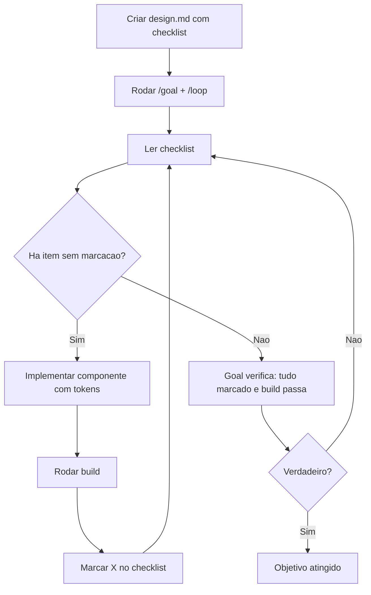

# Loop

> [!summary] TL;DR
> - `/loop` reexecuta um prompt em ciclo dentro da sessão, contínuo ou com intervalo.
> - Tira o humano do papel de "looping humano" (pedir, verificar, pedir de novo).
> - Diferença do goal: loop não tem critério de pronto embutido; repete até `Esc` ou até a instrução sinalizar fim.
> - Prompt de loop: o que cada iteração faz, como verifica, e condição de parada.
> - Combinar `/goal` + `/loop` dá saída verificável e evita loop travado.

## Conceitos-chave

- **Ciclo interno do Claude**: reunir contexto, agir, verificar. O loop automatiza esse ciclo até uma condição.
- **Escrever loops, não prompts**: um dos criadores do Claude Code diz que não escreve mais prompts, escreve loops que escrevem prompts.
- **Autoverificação**: dar ao Claude uma forma de checar o próprio trabalho. Segundo a Anthropic, melhora resultados em 2 a 3 vezes. Vale para qualquer prompt.
- **Checklist em arquivo**: um `design.md` com itens marcáveis vira a fila de trabalho do loop.
- **Modo dinâmico**: sem intervalo definido, o Claude se autorregula, com pequeno delay entre iterações.
- **Trecho 1, iteração**: a ação de cada ciclo (pegar o próximo item não marcado e implementar seguindo os tokens).
- **Trecho 2, verificação**: rodar build e marcar o item com X.
- **Trecho 3, condição**: se tudo estiver marcado, responder "concluído" e parar.
- **[[Goal]] x Loop**: goal trabalha até condição verificável, julgada por outro modelo; loop só repete.
- **Goal + loop**: goal define o critério de aceite final (todos marcados e build passando); loop define o trabalho de cada iteração.

## Fluxograma / Processo



## Erros comuns / Cuidados

- Loop puro depende de `Esc` ou da palavra "concluído"; se o modelo nunca concluir, roda indefinidamente.
- Escolher entre goal e loop (ou os dois) pode economizar metade do trabalho.

## Materiais complementares

### Prompts

**Prompt de ciclo verificável (antes do /loop)**
```text
Veja qual o próximo componente pendente do arquivo designsystem.md, implemente-o, marque no checklist e repita.
```

**Loop de implementação do design system (reconstituído da narração da aula)**
```text
/loop Leia o checklist em design.md, pegue o primeiro componente ainda sem marcação, implemente-o seguindo os tokens do design.md, rode o build e marque com X. Quando todos estiverem marcados, responda concluído.
```

**Goal combinado com loop**
```text
/goal Todos os itens do checklist em design.md estão marcados com X e o build passa.
/loop Implementa o próximo componente do design.md usando só tokens, roda build e marca X ao concluir.
```

## Tags de busca

`#claude-code` `#loop` `#goal` `#autonomia`
