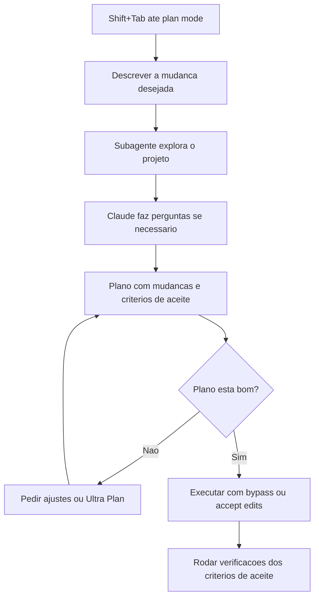

# Plan Mode

> [!summary] TL;DR
> - Acessado com `Shift+Tab`; troca "cuspir código" por planejar antes de implementar.
> - Usa subagente para explorar o projeto, pode fazer perguntas e então escreve o plano.
> - Plano traz contexto, stack, mudanças, arquivos afetados e critérios de aceite verificáveis.
> - Cada plano vira arquivo editável; aprovado, executa com bypass ou accept edits.
> - Features reais: planejar por etapa (dados, back-end, regra de negócio, front-end, UI, design).

## Conceitos-chave

- **Objetivo**: garantir qualidade do resultado final definindo o que e como executar antes de escrever código.
- **Exploração via subagente**: o Claude mapeia estrutura e páginas do projeto. Seta para baixo entra no subagente para acompanhar.
- **Perguntas de esclarecimento**: o plano pode pausar para tirar dúvidas antes de ser escrito.
- **Estrutura do plano**: contexto, stack, mudanças e onde afetam, lista de itens afetados e critérios de aceite.
- **Critérios de aceite**: checagens objetivas (env existe, servidor rodando, elementos visuais presentes, responsividade). O plano pode incluir edge cases não pedidos.
- **Arquivo do plano**: o Claude Code escreve cada plano como arquivo na pasta do Claude; dá para editar direto no VS Code.
- **Opções ao aprovar**: executar com bypass (sem perguntas), executar com accept edits (aprovar cada edição), refinar com Ultra Plan, ou pedir ajustes e gerar novo plano.
- **Modelo indicado**: Opus para planejar. Ver [[Modelos e Effort]].
- **Execução até o fim**: um plano pronto pode virar condição de [[Goal]].

## Fluxograma / Processo



## Erros comuns / Cuidados

- Planejar a feature inteira de uma vez reduz a assertividade. Trabalhar de forma granular, etapa por etapa.

## Materiais complementares

### Prompts

**Pedido de mudança visual no plan mode**
```text
Eu quero deixar a página mais bonita com um background futurístico. Também preciso de uma barra superior com um botão de login. Juntamente com um rodapé ao final da página escrito Full Cycle.
```

## Tags de busca

`#claude-code` `#plan-mode` `#planejamento` `#criterios-de-aceite`
