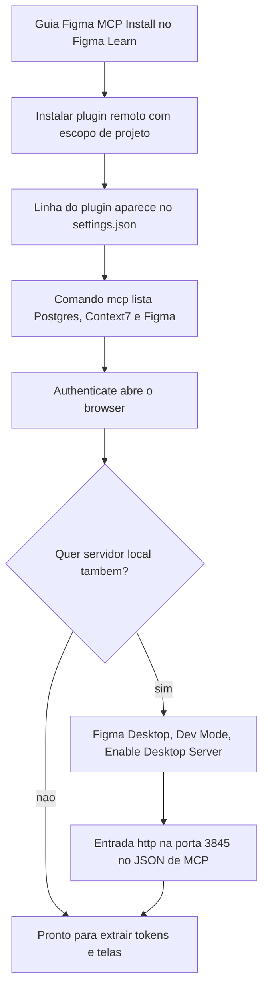
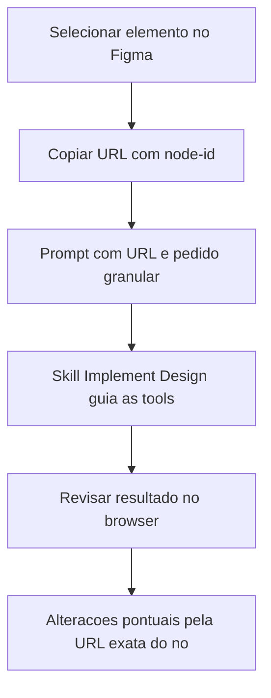

# Figma MCP

> [!summary] TL;DR
> - Dois servidores: remoto (leitura e escrita via `use_figma`, autenticação Figma, padrão do projeto) e local (Figma Desktop, porta 3845, só leitura, mais responsivo, não roda em Linux).
> - Instalar como plugin do Claude Code com escopo de projeto: traz MCP + skills + prompts; o comando isolado do servidor local não traz as skills.
> - Plano mínimo Professional com Dev Seat; limite diário de tool calls (200/dia Professional, 60/dia Enterprise) incide sobre leitura.
> - Sempre referenciar o alvo pela URL com Node ID; sem isso o modelo gasta tool calls procurando o nó.
> - Tools do Figma enchem o contexto rápido: uma tela ou bloco por vez, acima de ~60% da janela a precisão degrada.

## Conceitos-chave

- **MCP do Figma**: camada de comunicação entre ferramenta de design e agente (criação/modificação e captura de contexto); base do agente de primeira classe descrito em [[Front-end na Era da IA]]. Configuração geral de MCPs em [[MCP no Claude Code]].
- **MCP remoto**: leitura e escrita (escrita via "Use Figma"), arquivo associado à nuvem e autenticação Figma; o Figma otimizou o servidor, então o Figma Desktop não é obrigatório. Expõe 19 tools no exemplo da aula.
- **MCP local**: via Figma Desktop (Mac e Windows, NÃO Linux), somente leitura, mais responsivo porque o arquivo está aberto na máquina; expõe poucas tools, incluindo `create_design_system_rules`.
- **Plugin no Claude Code**: entrega MCP + prompts + skills + configurações (pacote operacional completo). O `claude mcp add` do servidor local sugerido no guia oficial é uma "cilada" porque não traz as skills.
- **Escopo de projeto vs global**: projeto registra no `settings.json` do projeto (menos poluição); global deixa recursos desnecessários ativos em todo projeto.
- **Skills do Figma**: acionadas implicitamente pelo prompt ou explicitamente pelo usuário; invocação explícita dá previsibilidade. Digitar "figma" no prompt lista as skills do plugin. Podem ser instaladas manualmente do repositório oficial do Figma ou do skills.sh (útil para inspecionar/adaptar, mas assume manutenção; ver [[Ecossistema de Skills]]).
- **Skill Implement Design**: guia oficial de alto nível com a sequência adequada de tools e critérios de tradução layout -> código; sem ela o modelo decide sozinho ordem e tools (omissões, perda de ícones e espaçamentos).
- **Planos**: Starter só para experimentação (poucas tool calls mensais); Professional é o mínimo; Organization/Enterprise para empresa. Dev Seat é o mínimo viável (libera Dev Mode: inspeção técnica de frame, CSS, cores, dados de MCP); Full Seat adiciona Figma Make e demais ferramentas.
- **Tool calls**: operações do servidor (buscar design system, componentes, tokens). Limite: Enterprise 60/dia; Professional (Dev ou Full) ou em organização 200/dia; uso real em dev ativo fica abaixo de 100/dia. O limite incide sobre LEITURA, não sobre escrita via Use Figma.
- **URL do Figma**: contém ID do documento (estável), nome exibido e Node ID (muda conforme a seleção). No remoto, selecionar o elemento já atualiza a URL com Node ID; no Desktop, a âncora copia o link do palco. O ID do documento pode ficar em configuração (CLAUDE.md) para não repetir em cada prompt.
- **Extração de contexto**: `get_design_context` ou composição de chamadas (propriedades, `get_variable_defs`, screenshot). Screenshot preserva fidelidade visual; variáveis/propriedades preservam intenção estrutural.
- **Custo de contexto**: `use_figma` carrega trechos grandes de JavaScript para criar/alterar/estilizar; `get_design_context` retorna árvores de nós (nomes, cores, subelementos, variáveis, screenshots). O custo está na operação e na resposta, mesmo com tool carregada sob demanda (ver [[Context Window em LLMs]]).
- **Histórico útil vs saturado**: manter respostas evita novas consultas mas pressiona o contexto e aumenta drift. Início do trabalho (do zero) é o pico de tokens; iterações posteriores são mais baratas.
- **Modelos**: melhor assertividade com Opus; bons resultados com Sonnet, especialmente em configurações de 1 milhão de tokens; usar esforço/thinking mais alto em tarefas híbridas design + código. Sempre o modelo mais poderoso para gerar design (muitas inferências).
- **Pipeline reproduzível**: fundação de IA + regras de design system + MCP remoto geram HTML, CSS, React etc. com consistência (ver [[shadcn e Componentes do Design System]]).

## Fluxograma / Processo

**Configuração**



- Tabela de compatibilidade do guia oficial: Claude Code, Claude Desktop, Codex, Copilot CLI (não o Copilot padrão do VS Code), Cursor via plugin.
- Remoto vira a configuração padrão do projeto; o exemplo de MCP local fica claramente desativado. Cada MCP tem estado próprio (Postgres falhando por container parado não afeta o Figma; ver [[MCPs do Projeto Context7 e Postgres]]). A autenticação do remoto é reaproveitada entre projetos até expirar.
- Manter os dois configurados e alternar com `/mcp` (desabilitar um, habilitar o outro, reiniciar sessão): remoto para editar, local para consultar.

**Uso no dia a dia**



**Piloto: criar tela no Figma a partir de print**

1. Prompt + print de referência (canal Full Cycle no YouTube, arrastado para o Claude Code) + URL do arquivo Figma de destino ("YouTube Test"); sem URL o agente não sabe onde aplicar.
2. Agente chama MCP e a skill de operações (Opus acionou Figma Use de cara), detecta arquivo vazio e monta o layout do zero com primitivas, variáveis e tokens (variáveis do modo dark ligadas aos elementos).
3. Revisar: ~6 a 10 minutos e ~10% da janela de contexto; estrutura certa, mas ícones, logos, banners e fontes falharam (rascunho operacional).
4. Pedir espelho em HTML+CSS (`youtube-mock.html`): não houve chamada MCP porque o design estava no histórico; em sessão limpa o agente relê o arquivo via MCP.

## Erros comuns / Cuidados

- Desabilitar o MCP do Figma quando não estiver em uso no projeto (economiza janela de contexto e tokens).
- Conflito local x plugin remoto: o cliente prioriza a integração instalada se continuar habilitada; desabilitar uma ao testar a outra.
- Descrever o alvo só por nome ou contexto visual aumenta ambiguidade e custo; sem Node ID o modelo fez 2 chamadas extras para achar o frame.
- O MCP local não chamou a skill Implement Design espontaneamente (o modelo decide); o remoto via plugin chamou e o resultado ficou bem mais fiel (ícones idênticos).
- Dividir o trabalho: uma tela ou bloco por vez; step dedicado no workflow para primeiro puxar os elementos necessários e depois fazer alterações pontuais; passar a URL exata do nó para alterações localizadas (ex: trocar imagem) em vez de reenviar a tela inteira.
- ~60% da janela de contexto é a zona de perda de eficiência (degrada precisão, coerência e aderência visual); controlar contexto cedo custa menos que corrigir drift depois (ver [[Gestão de Context Window em Prompts]]).
- Estabilizar a integração antes de consumir tokens, para não misturar problema de infraestrutura com problema de modelagem.
- O drift design <-> código (tipografia, espaçamento) depende da qualidade da fundação do design system e dos ativos.

## Materiais complementares

### Prompts

**Criar design no Figma a partir de print (narrado na aula)**
```text
Eu quero criar um design do YouTube no Figma utilizando esta imagem [imagem anexada]. Use esta URL [URL do arquivo Figma].
```

**Gerar HTML a partir do design recém-criado (narrado na aula)**
```text
Eu quero implementar o design recém-construído, criando um arquivo HTML com o CSS já embutido.
```

**Implementar página via MCP local com link do palco (narrado na aula)**
```text
Quero implementar o design desta página [nome da página] que está no link [URL] no HTML + CSS.
```

**Pedido granular com node-id (narrado na aula)**
```text
Eu quero colocar um botão no sidebar da esquerda que fica nesse endereço desse frame [URL com node-id]
```

### Conteúdo extra

- Guia "Figma MCP Install" no Figma Learn (citado, buscar no Google).
- skills.sh: buscar "Figma"; skills oficiais marcadas "Figma MCP Server Guide" (prefixo `figma/`). O repositório do servidor tem pasta de skills instaláveis manualmente.

**Plugin do Figma habilitado no projeto (literal de `.claude/settings.json`)**
```json
  "enabledPlugins": {
    "figma@claude-plugins-official": true
  }
```

**Entrada do servidor local no `.mcp.json.example` (literal)**
```json
    "figma": {
      "type": "http",
      "url": "http://127.0.0.1:3845/mcp"
    }
```

## Tags de busca

`#dev-software-ia` `#figma-mcp` `#mcp` `#design-to-code` `#context-window`
