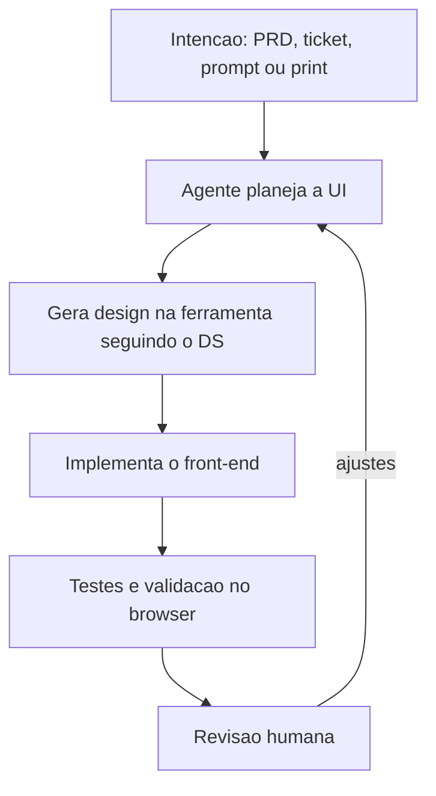
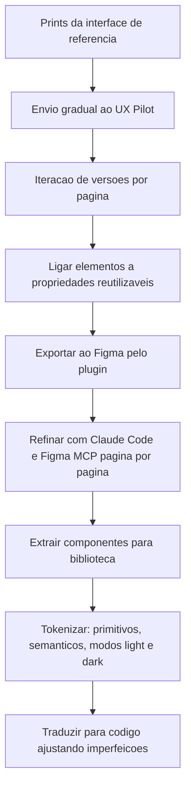

# Front-end na Era da IA

> [!summary] TL;DR
> - O fluxo se inverte: a entrada deixa de ser o mockup e passa a ser a intenção humana (PRD, ticket, prompt, print); o agente planeja a UI, gera o design na ferramenta e implementa.
> - Design tokens e componentes bem estruturados são o que torna um design implementável por agente; visualmente bonito pode ser estruturalmente ruim.
> - Hierarquia de tokens: primitivos -> semânticos -> de componente; light/dark são duas resoluções dos mesmos semânticos.
> - Ferramentas com MCP (Figma, Paper, PencilDev, Sketch) aumentam interoperabilidade; a escolha vira decisão tática porque o agente migra designs entre elas.
> - O ganho é reduzir o custo de chegar a uma versão revisável, não eliminar a revisão humana.

## Conceitos-chave

- **Front-end pré-IA**: designer entrega mockup estático (Figma, screenshot, HTML+CSS básico), dev traduz manualmente medindo espaçamentos e cores; resultado é perda de fidelidade e ciclo caro de QA visual e retrabalho.
- **Primeira onda com IA**: Figma continua ponto de partida; a IA lê contexto via MCP (`GetDesignContext`, `GetScreenshot`) e gera HTML/componentes; dev valida no browser. Detalhes em [[Figma MCP]].
- **Agente de segunda classe**: só lê as ferramentas de design, não escreve no Figma; o centro do processo continua sendo a ferramenta.
- **Terceira era (inversão do fluxo)**: agente planeja a UI, gera o design seguindo o design system e implementa; design system vira convenção operacional.
- **Agente de primeira classe (first-class citizen)**: lê, escreve, cria documentos e executa o fluxo completo; o Figma vira plugin/interface substituível.
- **Design como documentação operacional**: o mesmo contexto visual gera código, testes e validação no browser, com revisão humana a cada iteração.
- **Papel do dev**: orquestrar ferramentas, validar e conduzir o processo; produz design estruturado sem ser especialista em Figma, reduzindo a separação front/back/design (ver [[Papel do Dev e Workflows com IA]]).
- **Design tokens**: não é conceito de IA; base estruturada do design system (cores, tipografia, espaçamentos como variáveis reutilizáveis). Custo inicial maior, ganho em consistência, manutenção e temas.
- **Hierarquia de tokens**: primitivos (`blue-100` ... `blue-500`) -> semânticos (`btn-primary`, função de UI) -> de componente (`button-primary-background`). Tela consome componentes, componentes consomem semânticos, semânticos consomem primitivos.
- **Temas por modo**: o mesmo semântico resolve diferente por modo (no StreamTube, `primary` -> Almost Black 1000 no light e Neutral 100 no dark; espaçamento e radius iguais nos dois).
- **Componente**: definição central + instâncias; botão duplicado não tem vínculo com o original. Contorno púrpura no Figma indica componente.
- **Variantes**: estados/opções do mesmo componente com propriedades semânticas (`color=primary`, `color=secondary`); orientam a API do componente em código (ver [[shadcn e Componentes do Design System]]).
- **Hardcode no fill**: cor fixa no elemento quebra reuso; usar variável (análogo a CSS custom properties). Background deve referenciar variável semântica (`primary`), não hex.
- **Layout livre vs auto layout**: freeform com coordenadas fixas gera posicionamento frágil; Flex Layout/Grid (auto layout horizontal) declara relações espaciais e a conversão responsiva fica mais segura.
- **Styles**: agrupam decisões (tipografia, cores de erro) mas não substituem tokens; estilos tipográficos (display, heading) são difíceis de capturar por tool calls, mas úteis como convenção.
- **Screenshot vs leitura estruturada**: screenshot entrega pixels; leitura estruturada expõe hierarquia, limites, componentes e propriedades.
- **Mapa de tradução**: ensinar à IA como tokens e componentes do Figma viram classes e componentes reais na stack local (Next.js + Tailwind); executado em [[Sincronização de Design Tokens]] e nas regras do design system.
- **Interoperabilidade**: agente central reduz o custo de trocar de ferramenta (interpreta e migra designs).
- **Drift**: layout correto no design que exige rodadas de ajuste no código.
- **Prototipação com ferramenta especializada**: sem tela pronta, agente de código nem sempre é o melhor ponto de partida; ferramentas de UI compõem melhor layout e hierarquia. UX Pilot recebe prompt, imagens, PDF e referências e exporta para o Figma via plugin, podendo reutilizar componentes existentes no arquivo.
- **Iteração por versões**: mesma página com várias versões; a IA infere elementos não pedidos, então revisar o que melhora vs o que só parece plausível.
- **DS AI-implementável (docs do repositório)**: um DS que cumpre 6 pilares (Tokens em camadas, Nomeação por intenção, Contrato de componente, Fonte única Figma <-> código, Política explícita de theming, Decisões versionadas; mnemônico T-N-C-F-T-D) é implementável por agente por construção, sem regras extras.
- **O teste último**: dada só a documentação do DS, um agente competente implementa uma feature com componentes, tokens, estados e theming corretos? Se não, há pilar fraco.

### Comparação de ferramentas de design

| Ferramenta | Tipo | Característica |
|---|---|---|
| Figma | Tradicional | Edição visual madura + MCP; gera elementos a partir de texto, print ou HTML |
| Figma Make | Camada conversacional no Figma | Descreve, recebe protótipo, refina no ambiente; exporta para edição |
| Sketch | Tradicional | Sem equivalente ao Make; automação só via MCP com agentes externos (Claude Code, GitHub Copilot) |
| Paper Design | IA Native | Interação essencialmente via MCP, sem chat embutido; app desktop + servidor local; viés web (HTML/CSS) |
| PencilDev | IA Native | MCP + chat lateral; usa modelos OpenAI ou Anthropic aproveitando assinaturas (Codex, Claude Code) |
| Google Stitch | IA Native | Design a partir de prompt, contexto web ou app; modelos Google; exporta para Figma; bom para ideação |
| Claude Design | IA Native | Telas, apresentações e artefatos via painel + chat; NÃO expõe servidor MCP; handoff direto para Claude Code; menos portabilidade |
| Magic Patterns | IA Native | Alta fidelidade design -> código, menos drift, responsividade mais consistente |
| UX Pilot | Prototipação | Camada inicial de protótipo; não substitui o Figma |

## Fluxograma / Processo

**Fluxo invertido com agente de primeira classe**



**Como o StreamTube chegou ao design final**



- Biblioteca de componentes em frame separado: botões (variações com loading), text field, text area, checkbox, search, controles de privacidade, indicadores de progresso, ícones.
- Telas geradas e refinadas com Claude Code + Figma MCP sem edição manual direta como processo principal; o foco humano é direção, revisão e organização.
- Custo: ~13 milhões de tokens em 2 dias para o design completo (ainda mais barato que o processo tradicional), em sessões de ~300 mil a 400 mil tokens cada, página por página, às vezes em batch para extrair componentes.

## Erros comuns / Cuidados

- Tokenizar exige esforço inicial; a primeira onda ainda dependia de revisão humana.
- Acesso real a IA/MCP costuma exigir plano pago (tradicionais e parte das IA Native); avaliar o custo do fluxo completo, não só a interface. Critério: testar o free tier no fluxo real considerando integração IA, suporte MCP, handoff, custo e aderência ao produto; ferramentas voltadas a web aproximam design de código.
- Na prototipação o risco é gastar muitas interações sem convergir; protótipo rápido não substitui estrutura e padrões de design system.
- Exemplo real de design mal estruturado: bloco "Liked Video" com texto e ícone posicionados livremente; design assim gera HTML sem fidelidade mesmo com acesso ao arquivo.
- Não pedir "o sistema inteiro" de uma vez; usar múltiplas sessões para evitar saturação e alucinação (ver [[Gestão de Context Window em Prompts]]).
- Design não vira código perfeito sem mediação; não copiar layout cegamente quando há incompatibilidade com a stack.
- Com design já existente o foco muda para padronizar, corrigir e extrair para código.

## Materiais complementares

### Conteúdo extra

- Referências de tokens citadas: Design Tokens Community Group (DTCG) e Material Design; export JSON padronizado de tokens.
- DTCG Format Module: https://www.designtokens.org/tr/2025.10/format/ (citado em `docs/design-system-pillars.md`).
- Repositório do projeto: `docs/design-system-pillars.md` (vocabulário, foundations, 6 pilares com smell/fix e checklist, smells de layout, estudo de caso "Primary flip", bootstrap em 8 passos) e `docs/design-system-ai-implementable.md` (por que os 6 pilares tornam o DS implementável por agente).
- Ferramentas de prototipação alternativas ao UX Pilot: Figma Make, Google Stitch, Magic Patterns.

**O que um agente precisa, em ordem (literal de `docs/design-system-ai-implementable.md`)**
```text
1. Identificar qual componente do código corresponde ao componente Figma. **(resolvido por: pilar 4 - Code Connect mapping)**
2. Saber qual valor usar onde - texto na cor do quê? **(resolvido por: pilar 1 - camadas, e pilar 2 - nomes semânticos)**
3. Não sobrescrever variants existentes nem inventar novas. **(resolvido por: pilar 3 - contrato)**
4. Saber se uma cor responde a Light/Dark. **(resolvido por: pilar 5 - política de theming)**
5. Não recriar tokens já existentes. **(resolvido por: pilar 4 - drift detection acusa hardcoded)**
6. Saber por que um token existe quando precisa decidir manter ou substituir. **(resolvido por: pilar 6 - decisões)**
```

**Bootstrap de DS em 8 passos (literal de `docs/design-system-pillars.md`)**
```text
1. **Foundations: cor + tipografia primeiro.** Neutral ramp + 1 primary ramp (~22 primitives) + ~10 Text Styles (Display/Headline/Title/Body/Label, 2-3 sizes cada). Resista a forma/elevação/movimento antes de cor+tipo firmes.
2. **Theme como segunda camada.** 8-12 aliases iniciais - `surface-default`, `surface-raised`, `text-default`, `text-muted`, `border-default`, `primary`, `primary-foreground`, `destructive`, `destructive-foreground`. Light + Dark como duas resoluções.
3. **Componente piloto: Button.** Variants `size` + `variant`, states default/hover/focus/active/disabled. Figma + código + catálogo de stories com todas as combinações. Esse componente é o modelo mental pros próximos 30.
4. **Drift detection mínima.** Hardcoded scanner em CI: rejeita `#XXX` em arquivos de componente. Whitelist documentada. ~1 dia de implementação.
5. **Política de theming explícita.** 1 página: zonas tematizadas (todas) + theme-independent (provavelmente nenhuma no início). Revisar quando alguma zona migrar.
6. **Decision log.** 1 doc que cresce. Cada token novo: 5 linhas. Modelo Revision/Supersede. Ler em ordem cronológica dá conta da história.
7. **Adicionar foundations restantes sob demanda.** Forma quando o terceiro componente repetir o mesmo radius. Elevação quando o segundo overlay for criado. Movimento quando a segunda transição compartilhada. Não no dia 1.
8. **Code Connect só depois do DS estabilizado.** Mappings consomem tempo de manutenção; só vale a pena quando o componente está estável.
```

## Tags de busca

`#dev-software-ia` `#design-system` `#design-tokens` `#ferramentas-de-design` `#front-end`
