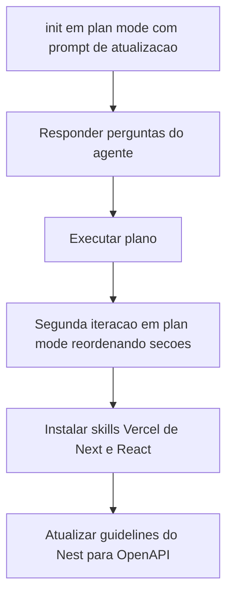
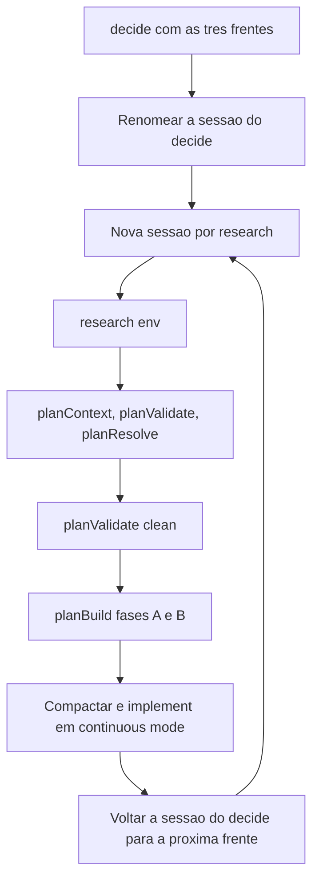

# Fundação de IA do Next.js

> [!summary] TL;DR
> - O CLAUDE.md do Next começou só com regras de design system; foi expandido via `/init` em plan mode com ambiente Docker, comandos, processos longos e arquitetura, usando o CLAUDE.md do Nest como referência.
> - Regras-chave: Server Components por padrão, Client Components só com API do browser; BFF estrito (o browser nunca chama o Nest); OpenAPI como fonte única dos shapes.
> - A base do front (env, tipagem OpenAPI, MSW) foi feita como três tasks ad hoc separadas pelo pipeline `/decide` -> `/research` -> plan -> `/implement`.
> - Instruções que afetam só arquivos de certos paths saem do CLAUDE.md e viram Claude Rules; guia geral fica no CLAUDE.md.
> - A fundação acompanha toda mudança estrutural (Docker, OpenAPI, integração Nest/Next), senão a IA trabalha sobre um mapa antigo.

## Conceitos-chave

- **CLAUDE.md do Next evolui com o projeto**: só com regras de DS o agente infere ambiente, execução e arquitetura; a fundação precisa de Docker, variáveis de ambiente, comandos de dev e restrições arquiteturais (ver [[Arquivos de Inicialização do Agente]] e [[CLAUDE.md e AGENTS.md (Instruções de Projeto)]]).
- **Placeholder é melhor que omissão**: tema reconhecido mas em aberto (ex: seção de testes "TBD") evita o agente inventar.
- **Separar regras globais da seção Figma/DS**: estrutura de pastas e convenções gerais ficam fora da seção específica; na dúvida, fora (regras do DS em [[shadcn e Componentes do Design System]]).
- **Server Components por padrão**: render no servidor, cache de páginas/componentes, menos JS no browser. Client Components só quando depende de API do navegador; sem essa regra o agente abusa de Client Components e o Next vira SPA ("era melhor ter usado Vite").
- **Estrutura de projeto como regra viva**: declarar a função de cada pasta (components, icons etc.) e atualizar a cada mudança.
- **Button como canonical primitive**: referência concreta para comparar novas peças de UI (revisar quando o sistema amadurecer).
- **`/init` tardio**: rodar depois de já ter shadcn, Figma e Docker dá um panorama mais visível.
- **Skills de boas práticas da Vercel** (`vercel-react-best-practices` e a de Next): composição de componentes, uso de memória, `useEffect` (ver [[Curadoria de Skills]]).
- **Base do front fora da fase 2**: como a fase 1 fez no Nest, env, integração OpenAPI e base do MSW entram antes, cada uma como decisão independente. O `/decide` é single select por design e recomendou 3 researchs; IA é muito boa em tarefa específica e misturar tudo aumenta risco (ver [[Subagentes e Tasks Ad Hoc]]).
- **Validação de env**: validar no carregamento e crashar se inválido (como o Nest); research comparou Zod, Valibot, Joi e class-validator, escolhido Zod. Cuidado com `NEXT_PUBLIC_` (vaza variável para o browser); no projeto `API_URL` é server-only via `lib/env.ts` (`@t3-oss/env-nextjs` + Zod 4).
- **Front-end runtime**: nova área para lógica do front que não é HTML/componente (env, cliente HTTP); cada SI ligado a uma área (ex: application-logic-only, front-end runtime) para o `/implement` olhar só o contexto relevante.
- **openapi-typescript + openapi-fetch**: tipos estáticos (`types.gen.ts` com paths, operations, schemas) e cliente "upstream" via `createClient` alinhado ao schema com `API_URL` validada; layer de contrato (`contracts.ts`) compartilhada entre BFF e componentes. Qualidade depende do spec do back: DTO sem propriedades gera tipos sem precisão.
- **Limite de filesystem no Docker**: o container do front não acessa arquivos do Nest; usar cópia local do `openapi.json` dentro do Next, sincronizada por script na raiz (`scripts/`) com `cp` (sem Docker); a decisão foi corrigida por revisão humana.
- **MSW incremental**: infraestrutura pronta (handlers por domínio como `auth.ts`, factories, seeds, server que agrega handlers, setup no Vitest com `listen` e `resetHandlers`), cada fase adiciona handlers. Detalhes em [[Testes no Front-end com MSW]].
- **CLAUDE.md x Claude Rules**: só vira rule a instrução que afeta leitura/escrita de arquivos que batem com um path; guia geral fica no CLAUDE.md. Proposta de 8 rules consolidada em cerca de 5 (qualidade de código, BFF, testes, mocks MSW, UI com tokens, shadcn, ícones e imagens). Ver [[Rules do Claude Code]].
- **Stack**: Next 16 + React 19, App Router, TypeScript, Tailwind v4; CLAUDE.md do Next um pouco maior que o do Nest, dentro do recomendado.

## Fluxograma / Processo

**Atualizar o CLAUDE.md do Next**



- Respostas dadas ao agente (sessão 13 do repositório): novas seções antes do bloco Figma (topo); mencionar a integração com a API de forma leve; seção de testes como placeholder TBD.
- Seção Environment Startup Verification: container `next-frontend` copiado do compose do Nest, Dockerfile de dev, porta interna 3000 e externa 3001 (3000 já usada localmente), container mantido com `tail -f /dev/null`.
- Comandos: `npm run dev`, `npm run build`, `npm run start`, `npm run lint`, `tsc --noEmit` (checa tipagem sem gerar artefatos), shadcn `add`; seção de long running processes (ver [[Ambiente e Scripts de Inicialização]]).
- Guidelines do Nest: todo controller documentado com comentários e decorators do Swagger, erros personalizados de response, como autenticar no Swagger (token); DTOs sem decorators de documentação (comentário por campo basta).

**Base do front: env, OpenAPI e MSW**



- Env: 2 SIs; resolve decidiu Zod, env Next recomendado e estratégia de `API_URL`.
- OpenAPI: opção A openapi-typescript + openapi-fetch; questões de codegen execution time, output commit policy, CI freshness check, type sharing BFF/componente. Validate trouxe 5 questões (escolhas pendentes, não erros); resolve escolheu committed local copy + script de sync e MSW handler typing via paths. planBuild com 6 SIs (script de cópia com `chmod +x`, instalar openapi-typescript, openapi-fetch etc.; sem testes). Script npm `openapi-types` gera o arquivo de tipos.
- MSW: research (handlers modulares por arquivo, MSW node para testes vs browser dev, com/sem faker.js) e planBuild com 5 SIs (instalar MSW, configurar Vitest, deps de teste, mock handlers, atualizar CLAUDE.md).
- Task ad hoc com TDs de escopo front-end dispara UI scope signal; marcar que é só lógica para não puxar [[Inventário de Telas]].
- Depois do OpenAPI: atualizar CLAUDE.md (seção "Talking to NestJS API": via browser com Client Components e via server com route handlers e server actions) e refatorar trechos para Claude Rules.

## Erros comuns / Cuidados

- Revisar o que a IA escreve no CLAUDE.md (ex: referência à TD poderia sair; trechos podem ser resumidos). "Você como projetista da funcionalidade pega situações que a IA não pega."
- A IA criou uma GitHub Action de CI sem pedido; foi removida.
- A IA tende a entender errado o que vai para rules: dar exemplos (linha sobre lidar com assets fica no CLAUDE.md; detalhe de import do `next/image` vai para rule; fluxo Figma-to-code fica no CLAUDE.md). Tirar do CLAUDE.md ponteiros para docs, menções excessivas ao nestjs-project, código de Route Handler e imports.
- Cuidar para as rules não atrapalharem a dinâmica de design tokens.
- Porta: o Next rodou em 3002 porque 3000 e 3001 estavam em uso (3001 pelo Docker).
- Sessão chegou a 36% (360 mil tokens) no Opus e foi compactada antes do implement; manter abaixo de cerca de 300 mil tokens de sessão (ver [[Higiene do Workflow com IA]]).

## Materiais complementares

### Prompts

**Atualizar o CLAUDE.md do Next com /init (literal de `_claude-sessions/13-criando-fundacao-ia-nextjs-e-atualizando-a-do-nestjs.txt`)**
```text
/init quero atualizar o @next-frontend/CLAUDE.md, mas ele já tem muitas coisas do projeto Next.js e design system, queria adicionar informações de ambiente, execução e arquitetura como o @nestjs-project/CLAUDE.md, vamos planejar isto
```

**Reordenar seções fora do bloco Figma (literal da mesma sessão)**
```text
um trecho como o Project Structure & Path Aliases está dentro do Figma MCP, acho que deveria estar fora, analise este trecho e outros que você vê que deveriam ser reordenados
```

**Guideline de controllers do Nest (narrado na aula)**
```text
Toda vez que eu tiver um controller, eu quero documentá-lo.
```

**Triagem das 3 frentes da base do front (narrado na aula)**
```text
/decide Eu quero adicionar uma base de configuração do next-frontend para organizar variáveis de ambiente, tipo como fizemos para o nestjs-project. Eu quero integrar OpenAPI com o next-frontend, permitindo que o next-frontend trabalhe fortemente tipado nas chamadas HTTP do BFF para o NestJS. E também tipar as chamadas dos componentes para o BFF. Quero criar toda a base do MSW, handlers e pilares para permitir que a cada fase seja incluído as partes pertinentes da API fake e os testes no front-end possam ter a mesma experiência de fazer as chamadas para a API do NestJS.
```

**Corrigir a decisão do OpenAPI por causa do Docker (narrado na aula)**
```text
/research Eu quero que a decisão recém criada mencione que nós vamos pegar uma cópia do OpenAPI JSON do nestjs-project. Ou seja, vamos usar o arquivo local porque estamos usando Docker. Faça as mudanças.
```

**Atualizar o CLAUDE.md após integrar o OpenAPI (narrado na aula)**
```text
Eu quero atualizar o CLAUDE.md do next-frontend. Dado que tivemos essa mudança, temos que deixar claro que a comunicação é baseada no contrato do OpenAPI. Documente de forma breve como funciona o que fizemos.
```

**Refatorar CLAUDE.md para Claude Rules (narrado na aula, parcial)**
```text
Analise alguns trechos do CLAUDE.md, pois parece que poderíamos criar Claude Rules para essas instruções. Só vira Claude Rules se a instrução vai afetar a leitura ou escrita do arquivo que bate com o path; sem isso, guia geral, deve permanecer no CLAUDE.md. Por exemplo, a linha 355 deve ficar porque é um guia de como lidar com os assets; já a instrução de import do Next Image é detalhe de implementação das imagens. A parte do required Figma-to-code flow é um guia de como lidar com a implementação das telas virando código, também fica no CLAUDE.md. Sobre types.gen e contracts.ts, não precisamos de uma tabela, mas é importante mencionar que essa informação guia o contrato do front-end com o BFF e com o NestJS.
```

**Implementação de uma vez (narrado na aula)**
```text
/implement Faça no modo continuous mode.
```

### Conteúdo extra

**CLAUDE.md do next-frontend: ambiente, comandos e arquitetura (literal de `next-frontend/CLAUDE.md`, 303 linhas; as seções de testes estão em [[Testes no Front-end com MSW]] e a seção Figma MCP em [[shadcn e Componentes do Design System]])**
````markdown
<!-- BEGIN:nextjs-agent-rules -->
# This is NOT the Next.js you know

This version has breaking changes - APIs, conventions, and file structure may all differ from your training data. Read the relevant guide in `node_modules/next/dist/docs/` before writing any code. Heed deprecation notices.
<!-- END:nextjs-agent-rules -->

## Environment Startup Verification

**Default behavior:** starting the environment means starting **only the `next-frontend` container** - **never** start the Next.js dev server unless the user explicitly asks to run/serve the project (e.g., "rode o projeto", "suba o servidor", "run the app").

After starting the container, always confirm it is up before proceeding:

```bash
docker compose ps   # next-frontend must show status "running"
```

The base image's command is `tail -f /dev/null`, so the container stays alive **without** booting Next. The dev server is only started on demand via `docker compose exec`.

If the dev server has been started, verify it actually serves before claiming success:

```bash
curl -I http://localhost:3001   # expect HTTP/1.1 200 OK
```

Only start `npm run dev` when the user **explicitly** asks to run the application - never as part of "start the environment".

## Commands

**Strict rule:** every `npm`, `npx`, `node`, `tsc`, and shadcn command runs **inside the container**, never on the host. Running on the host uses a different Node version, bypasses the container's working directory, and can leave artifacts owned by the wrong user on the bind mount.

### Container-only commands (always prefix with `docker compose exec next-frontend`)

```bash
npm run dev                              # Dev server with hot-reload (run in background)
npm run build                            # Production build (.next/)
npm run start                            # Serve the production build
npm run lint                             # ESLint (eslint-config-next)

npm test                                 # Vitest - unit + integration (run mode)
npm run test:watch                       # Vitest watch mode (run in background)

npx tsc --noEmit                         # Type-check (required before declaring a task done)
npx shadcn@latest add <component>        # Add a shadcn primitive - respects components.json
```

## Long-running Processes

Commands that never exit (dev server, watch modes) must be run **in background** in the Bash tool - otherwise the agent blocks indefinitely waiting for the process to return.

This applies to: `npm run dev`, `npm run start`, `npm run test:watch`, and any other persistent process. After starting the dev server in background, validate with `curl -I http://localhost:3001`.

## Architecture

Next.js 16 App Router with React 19 Server Components by default. Routes, layouts, and pages live under `app/`.

- **Server Components** (default): can `fetch` from the NestJS API directly server-side. Prefer this for data loading - keeps payloads small and avoids client-side waterfalls.
- **Client Components** (`"use client"`): only when the component uses `useState`/`useEffect`/refs/browser APIs or interactive event handlers. Keep client boundaries as deep in the tree as possible.

### Talking to the NestJS API

This project follows a **strict BFF model**: the browser never talks to the NestJS API directly. All client traffic flows through same-origin Route Handlers under `app/api/**`, which then proxy to the upstream NestJS API server-side. This eliminates CORS, keeps the backend URL out of the client bundle, and gives a single integration surface for MSW-based BFF tests.

- **From the browser (Client Components):** fetch from same-origin Route Handlers only (e.g., `fetch("/api/videos")`). Direct calls to the NestJS API from the browser are forbidden.
- **From the server (Route Handlers, RSC, Server Actions):** read the upstream URL from `env.API_URL` (see `lib/env.ts`) and fetch from there. The Route Handler is the only layer that knows the backend address.

#### OpenAPI contract - single source of truth for wire shapes

The upstream API publishes an OpenAPI 3.x spec. **Every wire shape in `next-frontend/` - Route Handler requests/responses, MSW fixtures, BFF↔component types - is derived from that spec via generated types.** No DTO is hand-duplicated on the frontend; if a shape isn't in `paths`, it doesn't exist.

Contract chain: `openapi.json` (committed local copy) → `lib/api/types.gen.ts` (generated, do not edit) → `paths` (typed surface) → consumers (BFF + components + MSW).

**Env var convention - single key, server-only:**

- `API_URL` - the upstream NestJS base URL. **Server-only**: validated and exposed via `lib/env.ts` (`@t3-oss/env-nextjs` + Zod 4). Accessing `env.API_URL` from a Client Component throws at runtime. There is **no** client-exposed (`NEXT_PUBLIC_*`) variant for the backend URL, and there must not be one - introducing a public backend URL would defeat the BFF model.
- `lib/env.ts` is the **source of truth** for environment variable reads in `next-frontend/`.

## Stack Summary

Next.js App Router with React Server Components, TypeScript strict, React 19, Tailwind CSS v4 (CSS-first config via `@theme inline` in `app/globals.css` - there is NO `tailwind.config.js`), shadcn/ui (style `radix-nova`, baseColor `neutral`, `cssVariables: true`) on top of `radix-ui` primitives, `class-variance-authority` (`cva`) with extended `tailwind-merge`, custom SVG icon components in `components/icons/` (no external icon library), `Inter` + `Geist_Mono` fonts loaded via `next/font/google` in `app/layout.tsx`. Exact versions in `package.json`.

## Design Tokens - Source of Truth

All design tokens live in **`app/globals.css`**, organized in three regions: `:root { … }` (light mode semantic + theme values), `@theme inline { … }` (Tailwind v4 token mapping exposing them as utility classes), and `@media (prefers-color-scheme: dark) :root { … }` (dark mode overrides).

## Build Gates

Before declaring any task done in this subproject:

- `docker compose exec next-frontend npm run lint` exit 0.
- `docker compose exec next-frontend npx tsc --noEmit` exit 0.

## When in Doubt

- Compare against `components/ui/button.tsx` (canonical primitive) and `app/globals.css` (canonical token registry).
- If a Figma value has no matching token, ADD the token to `app/globals.css` first, then consume it - do not inline a hex/px value.
- If the design implies a missing shadcn primitive, install it via `npx shadcn@latest add <name>` rather than hand-rolling it.
````

**Rule do BFF gerada no refactor (literal de `.claude/rules/next-frontend-bff-api.md`, frontmatter e seções de mapa e fluxo; padrões de consumo com código no mesmo arquivo)**
````markdown
---
paths:
  - 'next-frontend/app/api/**/route.ts'
  - 'next-frontend/lib/api/**/*.ts'
description: 'BFF Route Handlers and the typed upstream client - OpenAPI-anchored wire-shape pipeline'
---

# next-frontend - BFF API Rules

These rules govern the BFF (Backend-for-Frontend) layer: same-origin Route Handlers under `app/api/**` and the typed client at `lib/api/**`.

## File map

| File | Role | Edit by hand? |
|---|---|---|
| `next-frontend/openapi.json` | Committed local copy of the upstream OpenAPI spec. Lives here because the next-frontend container only sees its own subproject. | No - refreshed by `scripts/sync-openapi.sh` (repo-root, host-only). |
| `next-frontend/lib/api/types.gen.ts` | Generated `paths` interface; emitted by `openapi-typescript` from the local spec copy. | **Never.** Regenerate via `npm run openapi:types`. |
| `next-frontend/lib/api/upstream.ts` | Server-only typed HTTP client (`openapi-fetch` over `paths`). The **only** module that calls the upstream host. | Yes - sparingly (middleware, base config). |
| `next-frontend/lib/api/contracts.ts` | BFF↔components barrel. **The only file in the project authorized to import `paths` from `types.gen.ts`** (with the documented `mocks/` exception - see the MSW rule). Feature code consumes named aliases from here. | Yes - feature SIs append aliases as endpoints are wired. |

## Developer flow when the upstream contract changes

1. From repo root: `bash scripts/sync-openapi.sh` (host-only - refreshes `next-frontend/openapi.json` from the upstream source).
2. Inside the next-frontend container: `docker compose exec next-frontend npm run openapi:types` (regenerates `lib/api/types.gen.ts`).
3. `docker compose exec next-frontend npx tsc --noEmit` - surfaces every consumer that broke against the new contract.
4. Commit `next-frontend/openapi.json` AND `next-frontend/lib/api/types.gen.ts` **in the same PR**. Both are committed-by-design.

## What does NOT belong in this layer

- **No hand-written DTOs.** Every wire shape is derived from `paths`. If you find yourself defining `interface VideoResponse { ... }` by hand, you're bypassing the contract.
- **No raw `fetch(env.API_URL + ...)`** in Route Handlers. Use `upstream`.
- **No `paths` imports from feature components or hooks.** Components import named aliases from `@/lib/api/contracts`; hooks fetch from same-origin `/api/...` Route Handlers.
- **No upstream calls from the browser.** This is the BFF model - direct browser → upstream is forbidden (it would leak the backend URL and re-introduce CORS).
````

## Tags de busca

`#dev-software-ia` `#nextjs` `#claude-md` `#bff` `#openapi`
