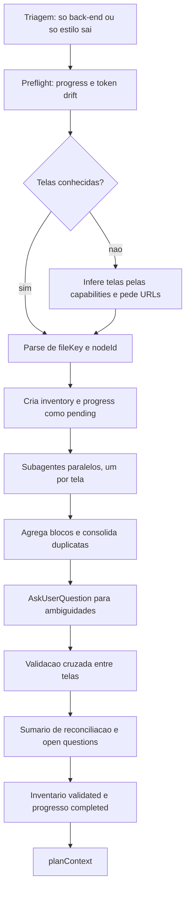

# Inventário de Telas

> [!summary] TL;DR
> - A skill `screen-inventory` transforma as telas do Figma em especificação operacional: cada componente classificado como Presentational, Local-interactive ou Server-connected, com verbos de intenção ligados às capabilities.
> - Começa pelo escopo funcional (capabilities da fase + TDs), não pelo layout; exige `/research` antes, de propósito.
> - Um subagente por tela extrai contexto e screenshot via Figma MCP; o agente principal consolida, pergunta ambiguidades e valida entre telas.
> - Consumido por `planContext` (digest de UI), `planBuild` (UI Contracts e matriz de rastreabilidade) e `/implement` (URL do Figma por tela).
> - Declarar explicitamente telas que NÃO existem, senão a IA fabrica.

## Conceitos-chave

- **Por que existe**: uma tela mistura elementos só visuais, interações locais e ações no servidor; sem intenções explícitas a IA faz implementação pela metade. O inventário é mais um ponto de revisão humana no [[Workflow RPI Research Plan Implement]].
- **Quando usar**: fase ou task com foco em front-end. Só back-end não precisa; só estilização (cópia, troca de tokens) basta auditar o Figma e atualizar tokens ([[Sincronização de Design Tokens]]); sem Figma ainda, resolver o gap de design antes.
- **Modos**: fase (slug da fatia ou número) ou task (exige `context.md` gerado pelo `planContext`). URL do Figma opcional se estiver no CLAUDE.md.
- **Presentational**: só exibe, sem estado e sem eventos (ex: card, inline-alert para "exibir o erro").
- **Local-interactive**: estado só no cliente, sem I/O com o back (validação, select, radio, dropdown, toggle de visibilidade de senha, back arrow com navegação via JS). Teste: "se o backend não existisse, o componente ainda funcionaria?"
- **Server-connected**: dispara efeito no servidor (submit de formulário, fetch, mutation). Formulário com validação local e submit é sempre Server-connected.
- **Verbos de intenção**: frase no infinitivo do que o usuário realiza ("submeter login", "validar os campos"), nunca contrato HTTP; cada verbo mapeia exatamente uma capability do project plan.
- **Reuse?**: path existente (`In DS? ✓`), `<path> (new)` para componente planejado (sinal usado pelo `planBuild` para gerar SIs de bootstrap) ou `new` para elemento DOM puro. Existência vem do filesystem, não do Code Connect.
- **Code Connect (Figma Enterprise)**: liga componente do Figma a arquivo real (ex: `components/ui/Button.tsx`), melhora a tradução, mas pode estar atrasado em relação ao repositório.
- **Preflight**: checa `progress.md` (retomada; permite usar modelos menores tela a tela) e token drift (advisory, recomenda rodar `figma-audit-tokens` mas nunca o invoca).
- **Índice do Figma no CLAUDE.md do Next** ("Figma File Structure and Keys"): File Key do arquivo e Frame Map (Components Library, páginas, typography, color main, radius, ícones Material Icons). Ter o MCP não basta, o agente precisa saber qual arquivo consultar (ver [[Figma MCP]]).
- **Research como pré-requisito**: sem as decisões técnicas a skill não identifica as capabilities (trava proposital). Para a fase 2 foi feito research só do front (7 TDs: BFF cookie-based, Iron Session, React Hook Form etc.; ver [[Skill de Research e Decisões Técnicas]]).
- **Token drift no inventário**: separar divergência real de padrões de mapeamento aceitos (ex: `text-font-N` não é drift).
- **Consumidores**: `planContext` via subagente Inventory Digest Reader (seção UI Inventory do `context.md`); `planBuild` gera UI Contracts e traceability; a implementação usa a skill `implement-design` com a URL da tela, sem reler o inventário (ver [[Planejamento de Fases com plan-phase]] e [[Implementação de Fases com implement-phase]]).

## Fluxograma / Processo



- Cada subagente recebe Node ID, tela, capabilities da fase e paths do design system existentes; chama `get_design_context` e `get_screenshot`, classifica, verifica reuso e devolve um bloco Markdown com questões. Subagentes não escrevem arquivos nem perguntam ao usuário (ver [[Subagentes e Tasks Ad Hoc]]).
- Documento final por tela: nome, rota, URL do Figma, capabilities cobertas, componentes com tipo e reuso, verbos de intenção, observações. Fica na pasta de inventários (fase) ou da task.

**Execução na fase 2 do StreamTube**
1. Chamar o screen inventory com o slug da fase 2 front-end; quando não achou o Figma, apontar a referência no CLAUDE.md.
2. Se o MCP do Figma quebrar, reautenticar com `/mcp` e fazer restore da conversa.
3. Responder que telas intermediárias não existem e recortar escopo para cadastro, login e reset (confirmação de conta e redefinição de senha ficaram como exercício).
4. Token drift, `inventory.md` pending com node IDs e progresso, subagente por tela, consolidação, validação cross-screen, sumário e open questions; depois rodar `planContext`.
5. Exemplo de classificação: signup form Server-connected, card Presentational (já existe no DS), back arrow Local-interactive; cada tela liga rota (`/signup`, `/login`), capability (cadastro de usuário com e-mail e senha) e componentes. 9 componentes novos detectados.

## Erros comuns / Cuidados

- Usar o melhor modelo disponível (mais reasoning): ele interpreta o design e detecta inconsistências, como placeholder "Enter your email" no campo de senha e footer "signup" no forgot password que deveria ser "signin".
- Não declarar telas inexistentes (intermediárias, estados de sucesso/erro) faz a IA inventá-las.
- Open questions geradas na fase 2: tela de confirmação de conta incompleta, logout inexistente nesta fase (fica no menu depois de logado), tela de nova senha ausente, links de termos e privacidade para rotas fora do escopo, falta de estados de loading e erro, texto suspeito no footer.
- Task só de lógica com TDs de front dispara UI scope signal; deixar claro que não há telas para não gerar inventário desnecessário.
- A skill é não orquestradora: nunca chama `planContext`, `planBuild` ou `/implement` por conta própria, nem escreve em `docs/decisions/`.

## Materiais complementares

### Prompts

**Ajuste de referência do Figma (narrado na aula)**
```text
Use a referência do Figma do next-frontend CLAUDE.md.
```

**Recorte de escopo das telas (narrado na aula)**
```text
Nós só vamos implementar as telas de cadastro da conta, tela de login e reset da senha. Pegue as telas no Figma. O restante não iremos implementar agora.
```

### Conteúdo extra

**Skill de inventário: frontmatter, validação do contrato, classificação, verbos e template (literal de `.claude/skills/screen-inventory/SKILL.md`, 515 linhas; o restante, com contexto a ler, progress file e retomada, extension run, coleta de URLs, prompt do subagente e regras de task mode, está no mesmo arquivo)**
````markdown
---
name: screen-inventory
description: "Generate a screen inventory for a project phase or task. Infers which screens need to be built or updated from the phase's capabilities (phase mode) or from the task's scope prose (task mode), asks the user for the corresponding Figma URLs, then extracts each screen's components via the Figma MCP, classifies them by behavior (Presentational / Local-interactive / Server-connected), and maps server-connected components to capabilities or scope. Use whenever the user asks to inventory screens, extract components from Figma for planning, or prepare the front-end inputs before /plan-context - including variations like 'inventariar as telas', 'inventário de telas da fase NN', 'screen inventory NN', 'screen inventory <task-slug>', 'extrair componentes do Figma', or any mention of connecting Figma screens to planning before plan-context runs. Accepts a phase number (integer) OR a task slug (string), optionally with an upfront list of Figma URLs."
disable-model-invocation: true
---

# Screen Inventory

Generate a screen inventory for a project phase. This document sits between the technical decisions and the implementation plan - it captures what exists visually in Figma, classifies each component's behavior, and ties server-connected components to capabilities in the project plan.

This skill is the front-end counterpart of `research`. It produces **verbs of intent** (e.g., "disparar upload de vídeo novo"), not HTTP specifications - which lets `plan-validate` reconcile the UI and API sources via the UIG-N check and catch gaps in either direction.

### Inventory Output Contract Validation (canonical)

Before marking `Status: Validated`, every inventory file must satisfy:

1. Every screen section has a `**Route:**` line immediately below `## Screen:`.
2. Every screen section has a `**Figma:**` line with a full URL including `?node-id=...`.
3. Component inventory tables have every row classified (no blank `Type` cells).
4. Every row has a `Reuse?` value matching one of the three canonical forms (per Output Contract item 4): a valid path (existing component), `<path> (new)` (planned target with suffix), or the literal `new` (pure-DOM, no path).
5. Verbs of intent tables are present even when empty (use `_No server-connected components in this screen._` inside a single row).
6. `### Observations` heading exists for every screen, even if empty.
7. `## Open questions` heading exists, even if empty.

Any violation → skill halts `Status: Pending` until fixed.

## Skip criteria (pre-flight abort)

Abort and tell the user when:

- The phase is purely back-end.
- The phase only changes existing screens in ways that do not introduce new verbs or new components (pure styling, copy, token swaps).
- There is no Figma source yet - resolve the design gap first, then come back.

## How to classify components

Every component in each screen falls into exactly one of three categories. Classification requires evidence from **both** the Figma structure **and** the project plan - Figma alone cannot tell you whether a button triggers a server action, and the project plan alone cannot tell you how it is expressed visually.

### Presentational

- Renders content, holds no state, reacts to no events.
- Receives props and shows them.
- Examples: `Avatar`, `Badge`, `Heading`, static `PageHeader`, the text block of an `EmptyState`.
- **Evidence:** the component has no interactive affordance in the Figma design (no pressed/hover variant with distinct behavior, no form field, no action icon) **and** no capability in the project plan implies it does anything.

### Local-interactive

- Holds UI state that lives entirely in the client.
- May react to events, but none of those events cause I/O to the backend.
- Examples: dropdown open/close, tabs, accordion, tooltip, password-visibility toggle, sort dropdown that reorders already-loaded data, a confirm dialog that wraps a server action but does not perform it itself.
- **Evidence:** the component has interactive states in Figma **but** removing the backend entirely would not break it. If in doubt, ask: "if the backend did not exist, would this component still function?" If yes, it is local-interactive.
- **Framework navigation note:** framework-provided client-side navigation links that just change route count as local-interactive unless the navigation itself is the server action (rare). E.g., Next.js `<Link>`, React Router `<Link>`, Vue Router `<router-link>`, SvelteKit `<a>` com prefetch.

### Server-connected

- Triggers I/O to the backend: reads data the screen did not start with, writes data, or depends on server state to decide what to render.
- Examples: `VideoCard` (displays data fetched from backend), `UploadButton` (dispatches a mutation), `LikeButton` (optimistic update + server call), `CommentList` (fetches + paginates from server), a `DeleteAction` inside a list item (server mutation).
- **Evidence:** the component's purpose requires the backend to function **and** the project plan has a capability that describes the action.

### When classification is ambiguous

Do not guess - the sub-agent fills the Type column with an inline `[DECISION: ...]` marker (see Sub-agent contract). One exception worth settling in advance: a form that combines local validation and server submission always classifies as **Server-connected**; the backend interaction dominates.

## How to derive verbs of intent

For every server-connected component, write one or more **verbs**. A verb is a short phrase in the infinitive that describes what the user is accomplishing through that component - not how the backend implements it.

**Good:** "Exibir lista paginada de vídeos do canal", "Disparar upload de vídeo novo".

**Bad:** "POST /videos com multipart/form-data" (API contract - `/plan-build`'s job in the final artifact), "Fetchar dados" (too vague - dados de quê, para quê?).

Each verb must map to exactly one capability in `docs/project-plan.md` (phase mode) or exactly one scope implication from the task's `## Scope` prose (task mode). Write the capability/scope's verbatim text (or a short quote) next to the verb. If no capability matches, fill the Capability column of that row with a `[DECISION: ...]` marker so the parent picks it up during the user-round batching step. Never guess.

## Output structure

The inventory is a single markdown file per phase. Follow this template.

> **Reading the template below:** text rendered as `_(italic in parentheses)_` is author guidance about when to include the surrounding section. Do **not** copy these parentheticals into the generated file - apply them as conditions.

```markdown
# {name} - Screen Inventory

> **Phase:** [Phase name] _(phase mode only)_
> **Task:** [Task slug] _(task mode only)_
> **Status:** Pending | Validated
> **Date:** [YYYY-MM-DD]
> **Screens in scope:** N

---

## Screen: [Screen name - human-readable display label]

**Route:** `/actual/next/route`
**Figma:** [URL] (node `fileKey:nodeId`)
**Purpose (from project-plan.md):** one-sentence quote of the capability this screen primarily serves.

### Component inventory

| Component (Figma node)  | Type              | In DS? | Reuse?                      | Notes |
|-------------------------|-------------------|--------|-----------------------------|-------|
| VideoCard (1234:10)     | Server-connected  | ✓      | `components/ui/video-card`  | -     |
| DeleteAction (1234:70)  | Server-connected  | ✗      | new                         | sub-component of VideoCard kebab |
| UploadButton (1234:20)  | Server-connected  | ✗      | new                         | -     |
| SortDropdown (1234:40)  | Local-interactive | ✓      | `components/ui/dropdown`    | operates on already-loaded data |
| PageHeader (1234:5)     | Presentational    | ✓      | `components/ui/page-header` | -     |

### Verbs of intent

| Verb                                       | Component                        | Capability (project-plan.md)    |
|--------------------------------------------|----------------------------------|----------------------------------|
| Exibir lista paginada de vídeos do canal   | VideoCard                        | "Users view their videos"        |
| Disparar upload de vídeo novo              | UploadButton                     | "Users can upload videos"        |
| Remover vídeo do usuário                   | DeleteAction in VideoCard kebab  | "Users can delete own videos"    |

### Observations

_(optional - anything that does not fit the tables: decision dependencies, open questions, reuse notes, accessibility concerns flagged by the designer. Omit this subsection if empty.)_

---

_(repeat for each screen)_

## Reconciliation summary

| Capability (project-plan.md)   | Covered by   | Screens     |
|--------------------------------|--------------|-------------|
| "Users view their videos"      | VideoCard    | /my-videos  |
| "Users can upload videos"      | UploadButton | /my-videos  |
| "Users can delete own videos"  | DeleteAction | /my-videos  |

_List every capability in the phase scope. For each, show which component(s) cover it and in which screen(s). A capability with no coverage is a gap - flag it during Validation, do not fabricate coverage here._

## Open questions

_(optional - decisions the inventory could not resolve that plan-validate / plan-resolve will need to handle. Omit if empty.)_

- Should `VideoCard` fetch its own data or receive it from the parent RSC?
- Is pagination cursor-based or offset-based? (Affects the shape of data `VideoCard` receives.)
```

## Output

Save to:

- Phase mode: `docs/inventories/screen-inventory-phase-NN-[name-slug].md`
- Task mode: `docs/tasks/task-{slug}/inventory.md`
````

## Tags de busca

`#dev-software-ia` `#screen-inventory` `#figma-mcp` `#classificacao-de-componentes` `#front-end`
