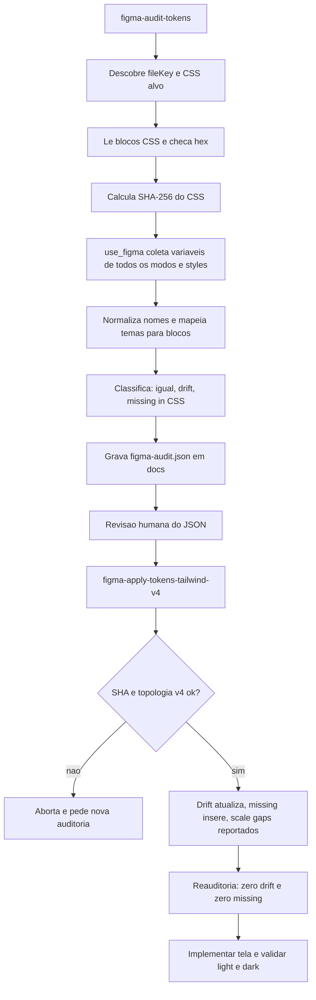

# Sincronização de Design Tokens

> [!summary] TL;DR
> - Pedir "puxe os tokens do Figma para o globals.css" falha: `get_variable_defs` só devolve o modo ativo, e o modelo colapsou light e dark.
> - Sincronização em duas skills independentes: `figma-audit-tokens` (só leitura, gera `docs/figma-audit.json`) e `figma-apply-tokens-tailwind-v4` (consome o JSON e edita o CSS via script Python).
> - O SHA-256 do CSS gravado na auditoria garante que o apply só escreve sobre o mesmo estado auditado.
> - Reauditar depois de aplicar é o teste de regressão: esperado zero drift e zero missing.
> - Sincronizar antes de implementar telas, e reauditar sempre que algo (como o shadcn) mexer no `globals.css`.

## Conceitos-chave

- **Separar extração de tokens da implementação de telas**: ponto de controle para validar nomes, cobertura de temas e local dos tokens; guard rail contra drift. Erros em tokens se multiplicam por componentes, páginas e temas.
- **Camada central**: valores recorrentes vão para `globals.css` e as classes reutilizam tokens; classes arbitrárias do Tailwind (`text-[#000000]`) resolvem valor pontual mas não constroem sistema. Documentar no CLAUDE.md onde escrever e onde não escrever (ver [[Fundação de IA do Next.js]]).
- **Tailwind v4 com `@theme inline`**: gera utilitários automaticamente; variáveis soltas fora dele não viram classe.
- **`get_variable_defs`**: retorna variáveis resolvidas só no MODO ATIVO do Figma.
- **`use_figma`**: escopo amplo (consulta, escrita, debug); aceita JavaScript como parâmetro e recupera variáveis de todos os modos e estilos, mas exige instruções melhores. A skill de auditoria é o guia para a LLM produzir o JS correto.
- **Auditar**: só leitura; compara Figma x CSS e gera JSON de diagnóstico; agnóstica de stack (Tailwind, Vanilla CSS etc.).
- **Aplicar**: acoplado à stack (Tailwind v4; Tailwind v3 usa config JS/TS; Vanilla CSS exige outra estratégia); consome o JSON como fonte de verdade.
- **Drift**: token existe nos dois lados com valores diferentes (dois hex diferentes).
- **Missing in CSS**: existe no Figma, ausente no código. Variável presente só no CSS não gera "delete" (componentes instalados podem usá-la).
- **Figma Styles**: text e effect styles; contexto adicional (agrupamentos), entram no JSON só como inventário.
- **Variáveis vs styles no Figma**: variáveis guardam primitivos e tokens de tema; styles guardam text styles e effect styles.
- **Normalização de nomes**: `colors/red/500` -> `--color-red-500` (lowercase, plural da categoria líder singularizado por allowlist, `/` vira `-`). Colisão após normalização aborta.
- **Mapeamento de temas**: light -> `:root`; dark -> `.dark` ou `@media (prefers-color-scheme: dark)`; pergunta ao usuário quando ambíguo.
- **Scale gaps**: styles compostos (tipografia InterDisplay = família + peso + tamanho + line-height; sombras) não viram classe utilizável como variáveis genéricas. Solução: prefixos que o Tailwind v4 reconhece (InterDisplay -> `--text-display` gera `text-display`; equivalente para sombras).
- **Script Python no apply**: determinístico e rápido para centenas ou milhares de tokens; o SKILL.md (~60 linhas) só diz quando chamar o script e como tratar cada erro; doctests embutidos (ver [[Criando Skills]]).
- **Formato de cor é decisão de projeto** (hex, rgb, oklch): o projeto mantém hex porque Figma e CSS já usam hex; a skill de auditoria poderia ser adaptada para converter formatos.
- **Tokens de link ambíguos**: `colors/link` com `link-light` e `link-dark` estavam invertidos (light usando `link-dark`). Correção: range primitivo `blue` e temas apontando para pontos da escala (Light 700, Dark 500); `color-link` continua como API estável.
- **Controle humano**: o dev define etapas, restringe escopo, escolhe tools e revisa antes de propagar.

## Fluxograma / Processo



**Números da aplicação no StreamTube**
- Auditoria inicial com ~150 itens.
- Apply em 19 segundos: 87 edições em `:root` e dark + 109 primitivos adicionados.
- Scale gaps: text styles (Display, H1, H3, Body LG/MD, Caption, Labels, Helper, Overline) sem `--text-*` correspondente e 5 shadow styles; resolvidos com prompt pedindo prefixos do Tailwind (a IA consultou as docs do Tailwind 4).
- Reauditoria final: zero drift, zero missing, JSON caiu para ~130 linhas; apply final com 18 escalas resolvidas. Sessão em ~11 a 12% de contexto (~100 mil tokens) com Opus.
- O apply não precisa de argumentos (o file key já está no JSON); reiniciar o Claude Code para a nova skill ser reconhecida.

**Ressincronização após instalar o shadcn**
1. Prompt de auditoria do `globals.css` pós-shadcn (hex -> oklch, variáveis novas, bloco `.dark`).
2. Revisar relatório: hex restaurado, `.dark` removido, custom variant removido, background/foreground restaurados; `:root` e `@media` dark simétricos.
3. Pontos de atenção: fonte (Geist -> Inter para `font-sans`, Geist pode ficar como mono), ring, radius.
4. Radius: remover a escala calculada do shadcn (sm/md/lg por porcentagem; `radius-medium` usado em 4 lugares no botão) e usar a faixa do Figma.
5. Manter `font-reading` (a IA removeu; componentes futuros podem usar).
6. Criar range `blue` nos primitivos e remapear link nos temas; a IA aplicou também no Figma via MCP quando recebeu o link.
7. Auditoria final: Figma e CSS 100% sincronizados, sem necessidade de apply.

## Erros comuns / Cuidados

- Erro real: arquivo Figma com tema dark ativo, o modelo leu só o dark, respondeu "Substituí o tema light padrão pelo tema dark do design. O Figma é dark only." e sobrescreveu o light no `globals.css`; também pegou só as cores em uso, não todos os primitivos.
- Referenciar o endereço do Figma sem instrução faz o modelo chamar tools que retornam árvore, metadados e imagens (`get_metadata` devolveu XML com a árvore inteira do frame): ruído, custo e perda de precisão. A skill Implement Design não resolve extração completa e auditável de tokens.
- Checklist de auditoria: todos os temas cobertos? todos os tokens esperados existem? valores no lugar certo? Sincronizar sem auditoria dá falsa sensação de sucesso.
- Não editar o `globals.css` entre auditoria e apply: o SHA diverge e o apply é interrompido (evita sobrescrever mudanças legítimas).
- A auditoria aborta se houver cores em oklch, hsl ou rgb, e em colisão de nomes após normalização (renomear no Figma; colisão é problema estrutural).
- A IA pode preferir classes nativas do Tailwind: criar guideline "usar primeiro classes do design system local, Tailwind padrão só sem equivalente" (virou regra em [[shadcn e Componentes do Design System]]).
- Implementar a tela revela problemas do design (padding do input 16 à esquerda e 8 à direita, simplificado pela IA para `px-4`; camada vazia "material state layer" herdada de import do Material UI removido); corrigir no Figma.
- Dark não aplicou por cache: apagar a pasta `.next` e rodar de novo; diferenças visuais podem vir de zoom/renderização, não dos tokens.
- Não aceitar cegamente mudanças da biblioteca ou da IA; alterar estrutura de tokens exige ajustar Figma e CSS juntos; preferir mandar a IA aplicar no design pelo MCP em vez de colar valores à mão.
- Agentes propagam inconsistências quando design e código já começam desalinhados; sincronizar antes de implementar novas telas (ex: login e cadastro) como preparação operacional do front.

## Materiais complementares

### Prompts

**Teste de extração ingênuo, Opus esforço alto (narrado na aula)**
```text
Quero puxar os tokens de design do Figma para o globals.css. O link do Figma é este: [URL do Figma]
```

**Correção após a IA colapsar os temas (narrado na aula)**
```text
Mas lá no Figma eu tenho os temas Light e Dark. Você fez essa implementação sem considerar outros temas.
```

**Resolver scale gaps com prefixos do Tailwind (narrado na aula)**
```text
Destes estilos que não corresponderam, eu quero criar variáveis usando os prefixos do Tailwind em que já são geradas classes para usarmos diretamente nas páginas.
```

**Reauditoria do globals.css após o shadcn (narrado na aula)**
```text
Depois da instalação do shadcn, ele modificou o globals.css alterando os valores das variáveis de hexadecimal para oklch. Eu quero manter o hexadecimal das variáveis, os valores já existentes, e para as variáveis adicionadas manter também o hexadecimal. Eu quero que você mantenha o @media do dark e não deixe o .dark adicionado. O :root e o @media dark precisam estar sincronizados, então faça uma auditoria para não acontecer drift entre os temas. Identifique possíveis discrepâncias na nova configuração do globals e faça um relatório de tudo.
```

**Correção dos tokens de link (narrado na aula)**
```text
Eu quero adicionar um range de blue nos primitivos do Figma e não teríamos mais a cor link e link-dark, mas no tema light/dark pegando do mesmo range.
```

**Aplicar a mudança no Figma via MCP (narrado na aula)**
```text
Aqui está o link. Aplique as mudanças no design.
```

### Conteúdo extra

**Skill de aplicação (literal de `.claude/skills/figma-apply-tokens-tailwind-v4/SKILL.md`)**
````markdown
---
name: figma-apply-tokens-tailwind-v4
description: Apply a Figma → CSS audit report to a Tailwind v4 project. Reads `docs/figma-audit.json` produced by `figma-audit-tokens`, validates the CSS file hasn't changed since audit, applies drift fixes and inserts missing tokens following Tailwind v4 conventions (`@theme inline` for primitives, theme selector blocks for multi-mode tokens), and runs scale-gap analysis. Invoke ONLY when the user explicitly asks to apply, sync, or commit the audit - phrases like "apply figma audit", "sync figma tokens to CSS", "aplica os tokens do figma", "atualiza o CSS com o audit". Requires `docs/figma-audit.json`; if missing, instruct the user to run `figma-audit-tokens` first.
disable-model-invocation: true
---

# Apply Figma Tokens (Tailwind v4)

The deterministic work of this skill lives entirely in `scripts/apply.py`. This file tells the agent **when to invoke it** and **what to do when it aborts**. For algorithmic detail (naming transform rules, family ordering, shadow normalization, hash check, scale-gap analysis), read the script - it's self-documenting via docstrings + doctests.

## Trigger

Invoke when ALL true:
- User explicitly asks to apply / sync / commit the audit (see `description` for phrasing).
- `docs/figma-audit.json` exists at the workspace root (or a path the user passes).

If the audit JSON is missing, do NOT improvise edits - instruct the user to run `/figma-audit-tokens` first and stop.

## Run

Single Bash invocation. The script does hash check, framework gate, edit planning, edit application, scale-gap analysis, and final report - all of it.

```bash
python3 ${CLAUDE_PLUGIN_ROOT:-.}/.claude/skills/figma-apply-tokens-tailwind-v4/scripts/apply.py \
  [--audit docs/figma-audit.json] \
  [--workspace .]
```

- `--audit` (default `docs/figma-audit.json`): path to the audit JSON, resolved relative to `--workspace`.
- `--workspace` (default `.`): root used to resolve `audit.css_file` and search for `package.json`.

**Exit 0:** echo stdout (markdown report with 4 sections) verbatim to the user.

**Exit 1:** read stderr - first colon-separated token is the error code. Map to user-facing recovery:

| Code | What to tell the user |
|---|---|
| `AUDIT_NOT_FOUND` | "Audit JSON missing. Run `/figma-audit-tokens` first to generate it, then re-invoke this skill." |
| `SCHEMA_VERSION_INVALID` | "Audit JSON has malformed `schema_version`. Re-run `/figma-audit-tokens` to regenerate." |
| `SCHEMA_MAJOR_UNSUPPORTED` | "Audit JSON major version doesn't match this skill. Either upgrade the apply skill or regenerate the audit with a compatible audit skill." |
| `CSS_NOT_FOUND` | "The CSS path recorded in the audit doesn't exist anymore. Re-run `/figma-audit-tokens` after restoring or relocating the file." |
| `SHA_MISMATCH` | "CSS file changed since audit was generated. Re-run `/figma-audit-tokens`, then re-invoke this skill." |
| `FRAMEWORK_GATE` | "Project doesn't appear to be Tailwind v4 (missing `@theme inline` block, or `tailwindcss` not at v4+ in package.json). This skill is Tailwind v4-specific." |
| `JSON_INCONSISTENT` | "Audit JSON has internal contradictions. Re-run `/figma-audit-tokens` and report the issue." |
| `BLOCK_NOT_FOUND` | "Audit references a destination block that doesn't exist (a CSS selector OR a conditional at-rule). The script's stderr message identifies the missing level and prints a copy-pasteable empty-block snippet - paste it into the CSS file, re-run `/figma-audit-tokens`, then re-invoke this skill." |
| `NAMING_COLLISION` | "Two Figma vars map to the same CSS name. Rename one in Figma, then re-run `/figma-audit-tokens`." |

In every recovery, propose the action and stop - do NOT improvise edits, fall back to manual `Edit` calls, or try to auto-fix the audit JSON.

## Out of scope (the script does NOT do these)

- Move existing token declarations from one block to another (e.g., relocate a declaration from `.dark` to `@media (prefers-color-scheme: dark) :root`). That's a refactor - separate operation. Apply only edits the block each item points to.
- Modify values not listed in `audit.items[]`. The audit decides; apply executes faithfully.
- Create new blocks (selector or conditional at-rule). The script aborts with `BLOCK_NOT_FOUND` and prints a copy-pasteable empty-block snippet when the destination is missing.
- Edit Figma. Apply is one-way: JSON → CSS.

## See also

- `/figma-audit-tokens` - prerequisite, generates the audit JSON.
- `scripts/apply.py` - full algorithmic detail + doctests. Run `python3 -m doctest scripts/apply.py -v` to validate after editing.
````

**Skill de auditoria: frontmatter e seções-chave (literal de `.claude/skills/figma-audit-tokens/SKILL.md`, 664 linhas; o restante, com parsing de blocos CSS, canonicalização de `@media`, captura de styles, regras de diff por bloco, schema completo do JSON e relatório final, está no mesmo arquivo)**
````markdown
---
name: figma-audit-tokens
description: Audit drift between a Figma variable collection and a project's CSS variables. Captures Figma variables (all modes) plus text/effect styles, parses the project's CSS variables wherever they live (`@theme inline`, `:root`, `.dark`, custom selectors), and emits a structured JSON report at `docs/figma-audit.json` with drift items, missing-in-CSS items, and raw style observations. Framework-agnostic for variable drift; styles are emitted raw for downstream apply skills to analyze. Invoke ONLY when the user explicitly asks to audit, compare, or check drift between Figma and CSS - phrases like "audit figma tokens", "figma vs CSS drift", "compare figma to CSS variables", "puxa o estado do figma", "compara tokens do figma com o css". Never trigger on ambient Figma mentions or design-to-code work - those belong to figma-implement-design.
disable-model-invocation: true
---

# Audit Figma Tokens → JSON Drift Report

Capture the truth from a Figma variable collection, parse the project's existing CSS variables, compute the diff per token per mode, and emit a structured JSON report. The skill produces no edits - its only output is `docs/figma-audit.json`. Downstream apply skills consume the JSON and apply edits with framework-specific conventions.

## Core contract

Unless the user overrides them, follow these rules strictly:

1. **No edits to the CSS file.** This skill writes only `docs/figma-audit.json`. The CSS file is read-only.
2. **Framework-agnostic for variable drift.** Compare CSS variables wherever they appear - any selector or at-rule block. Do not assume `@theme inline`, do not assume Tailwind, do not assume `:root` is the "default" theme.
3. **Hex is a hard pre-requisite for color comparison.** If the project's CSS has any non-hex color (e.g. `oklch(...)`, `hsl(...)`, `rgb(...)`, `color(display-p3 ...)`), abort early and tell the user to migrate to hex first. Do not produce a partial JSON.
4. **Do NOT emit "delete" intents.** Variables present in CSS but missing in Figma are no-ops - installed components may reference them. Removal is always a separate, explicit task.
5. **Styles are observed, not analyzed.** Text styles and effect styles are decomposed into raw normalized data and emitted in `figma_styles[]`. Do not compute scale gaps here - that's the apply skill's job (it requires framework knowledge of the type/shadow scale conventions).

## Prerequisites to load before running

1. **`figma:figma-use`** - load **once** at the start of the audit run, before the first `use_figma` call (Step 3). The loaded context applies to all subsequent `use_figma` calls in the same session, including Step 4's style capture; do not re-load before each call. Skipping the initial load causes silent failures around modes, fonts, and async ordering.

## Step 1 - Discover the Figma source

You need a `fileKey` and optionally a `nodeId`. Look in this order:

1. **Skill args.** If the user pasted a Figma URL, fileKey, or nodeId when invoking, parse it first. URL parsing: `figma.com/design/:fileKey/:name?node-id=1-2` → `fileKey` is `:fileKey`, `nodeId` is `1:2` (convert `-` to `:`). **Branch URLs:** `figma.com/design/:fileKey/branch/:branchKey/:name` → preserve BOTH: emit `fileKey` (the main file) AND `branchKey` (the branch) as distinct fields in the JSON. Use `branchKey` as the operative key for `use_figma` API calls (it routes to the branch), but record `fileKey` for provenance so a future re-audit can reproduce the same context.
2. **Project rules and docs.** Grep `.claude/rules/*.md`, any per-app `CLAUDE.md`, and the project README for a `figma.com/design/...` URL or an explicit `fileKey:` entry.
3. **Ask the user.** Only if the previous two turn up nothing.

### Compute file SHA

Compute SHA-256 of the file contents. Store as `css_file_sha` in the JSON output. Apply skills validate this hash before writing - if the file changed since audit, apply aborts.

## Step 3 - Pull the full variable collection with every mode

`get_variable_defs` returns one mode only. For full reconciliation, go through `use_figma` and `figma.variables.getLocalVariableCollectionsAsync()`.

### Critical gotcha - `modeId` vs `id`

`VariableCollection.modes[i]` exposes the key as **`.modeId`, NOT `.id`**. If you write `v.valuesByMode[m.id]`, every lookup silently returns `undefined` and you get empty `byMode` objects for every variable. This is the single most common way this step breaks. Always use `modeId` for collection modes. If your first run comes back structurally empty, this is always the cause.

### 5d - Diff per token, per selector

For each variable + selector combination:

- **Match** - values equal after normalization. No item emitted.
- **Drift** - CSS has the variable in this selector with a different value. Emit `kind: "drift"` item with `from` (current CSS value) and `to` (Figma value).
- **Missing in CSS** - CSS does not have the variable in **at least one** of the expected selectors (for multi-mode collections) OR has no entry anywhere (for single-mode collections). Emit `kind: "missing-in-css"` per the rules in 5d.i below.
- **Missing in Figma** - Figma has no equivalent. No-op (rule #4).

## Things that look like drift but aren't

- **Hex formatting differences** - uppercase vs lowercase, `#f00` vs `#ff0000`, fully-opaque alpha (`#ff0000ff` vs `#ff0000`), surrounding whitespace. Normalize both sides before flagging drift (Step 5e).
- **Numeric (FLOAT) unit differences** - Figma returns px, CSS uses rem. `8` (Figma) ↔ `0.5rem` (CSS) is a match.
- **External-library variable bindings** - if the Figma file references variables from an external published library, `getVariableByIdAsync` may return `null` for those aliases. Treat as "opaque value" and compare on the resolved hex if possible; otherwise emit them in `external_library_aliases[]` with `reason: "MISSING_TARGET"` and skip the drift comparison.

## What NOT to do

- Don't rely on `get_variable_defs` alone for reconciliation. It's a one-mode snapshot - Step 3's `getLocalVariableCollectionsAsync` traversal is the only complete source.
````

**Exemplos de itens do JSON de auditoria (literal do schema na skill de auditoria)**
```json
    {
      "kind": "drift",
      "token": "--background",
      "selector": ":root",
      "condition": "@media (prefers-color-scheme: dark)",
      "from": { "$value": "#0a0a0a" },
      "to":   { "$value": "#0f0f0f" },
      "figma_collection": "Theme",
      "figma_source": "Theme/background#Dark"
    },
    {
      "kind": "missing-in-css",
      "token": "--color-neutral-100",
      "figma_collection": "Primitives",
      "value": { "$value": "#f7f7f7" },
      "figma_source": "Primitives/colors/neutral/100"
    }
```

## Tags de busca

`#dev-software-ia` `#design-tokens` `#figma-audit` `#tailwind-v4` `#drift`
