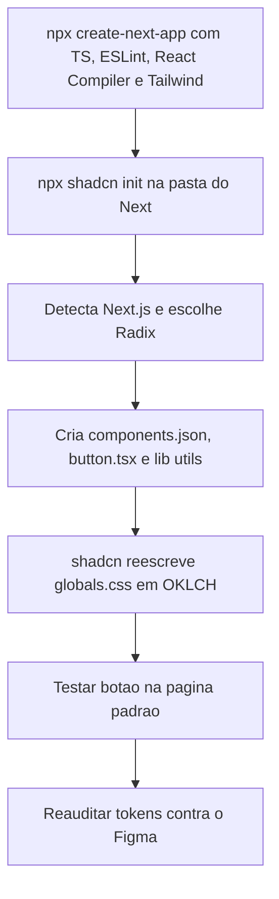
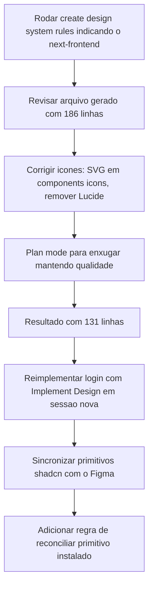

# shadcn e Componentes do Design System

> [!summary] TL;DR
> - Stack do front: Next.js (`create-next-app` com TypeScript, ESLint, React Compiler, Tailwind) + shadcn (Radix) + CVA + tailwind-merge; o Figma continua sendo a fonte da verdade.
> - O shadcn é base de componentes; o componente gerado não equivale ao design final e o `shadcn init` reescreve o `globals.css` (reauditar tokens depois).
> - Componente fiel exige apontar a skill Implement Design para o componente no Figma e para o arquivo alvo, preservando a base do shadcn e mudando só variantes e classes.
> - A skill oficial `create design system rules` gera as regras no CLAUDE.md do front; gerar só depois de ter tokens e um componente canônico (o botão), depois revisar e enxugar.
> - Toda classe customizada precisa ser registrada no `extendTailwindMerge`, senão o `cn()` descarta classes (bug do texto invisível).

## Conceitos-chave

- **AGENTS.md do template Next**: equivalente ao CLAUDE.md gerado pelo `create-next-app`; instrui a IA a consultar as docs embarcadas em `node_modules` porque o Next tem breaking changes entre versões e o modelo pode estar treinado em convenções antigas (ver [[CLAUDE.md e AGENTS.md (Instruções de Projeto)]]).
- **Tailwind CSS / Utility First**: classes pequenas, uma propriedade cada, no JSX; combina com geração por IA (decisões visuais serializadas em classes explícitas); reduz efeito cascata ao custo de `className` maior. Tailwind compila tokens e convenções em CSS final (prefixos reconhecidos viram classes no build).
- **Variáveis de tema em `:root`**: background e foreground via `var()`; `prefers-color-scheme` para light/dark, reaproveitável para seletor manual.
- **shadcn**: base de componentes reutilizáveis (usada antes e depois da IA). Tem servidor MCP opcional (busca e instala componentes), não configurado porque o design já tem tudo.
- **`components.json`**: centraliza arquivo CSS, estilo-base, cor base (neutral) e aliases de importação (`components/ui`, `lib`). No projeto: style `radix-nova`, baseColor `neutral`, `cssVariables: true`.
- **`cn` com tailwind-merge**: mescla classes dinamicamente sem conflitos; classes customizadas fora da escala padrão precisam entrar no `extendTailwindMerge` de `lib/utils.ts`.
- **CVA (class-variance-authority)**: organiza variantes; hover na camada superior incide em todas e cada variante pode sobrescrever.
- **Base do shadcn a preservar**: `asChild` e `Slot`; mudar só variantes e classes.
- **Tokens sincronizados não garantem componente fiel**: variantes, tamanhos, estados e interação precisam ser implementados (variantes próprias do design, ex: "XPTO", são manuais). Pré-requisito: [[Sincronização de Design Tokens]].
- **Regras de Design System no CLAUDE.md do subprojeto**: "CLAUDE.md do front-end", contrato operacional (estrutura, tokens, componentes, ícones, convenções). Figma é a fonte de verdade externa, `globals.css` a interna.
- **Skill oficial `create design system rules`**: rastreia o projeto e escreve as regras no CLAUDE.md (global ou do subprojeto). Gerada cedo demais, produz arquivo cru que precisará ser refeito.
- **Classes customizadas declaradas** (`text-display`, `text-body-large`, `text-body-medium`, `text-label`): competem com o viés do modelo pelo Tailwind nativo.
- **Regras globais vs rules com paths**: globais afetam qualquer implementação de tela; rules com `paths` (ex: `next-frontend/**`) carregam só ao ler/escrever esses arquivos (ver [[Rules do Claude Code]]). No refactor posterior, o conteúdo de tokens, primitivos shadcn e ícones foi para `.claude/rules/next-frontend-ui.md` (ver [[Fundação de IA do Next.js]]).
- **Botão como canonical primitive**: referência concreta para o agente comparar novas peças de UI.
- **Ícones**: o projeto usa SVG customizados como componentes em `components/icons`, sem biblioteca externa.

## Fluxograma / Processo

**Instalar o shadcn**



- Dependências instaladas: `class-variance-authority`, `tailwind-merge`, pacotes Radix, `lucide-react`. OKLCH é suportado pelos principais browsers desde 2023, mas o projeto mantém hexadecimal.

**Implementar o botão com o design system**

1. Confirmar sincronização: auditoria sem itens; Figma Apply Tokens Tailwind v4 retorna nada a aplicar, scale gaps ok.
2. Nova sessão.
3. No Figma, selecionar a hierarquia de botões em componentes (URL muda com Node ID).
4. Prompt direcionado com a URL do componente e o arquivo `Button.tsx`.
5. A IA leu 6 variantes (primary, secondary, destructive, link, outline etc.), 3 sizes e 6 estados; usou tokens como `radius-full` (999 definido no globals).
6. Testar light e dark; debug do texto invisível; limpar `.next` por cache ao validar temas.

**Gerar e curar as regras do design system**



- Conteúdo gerado: Figma MCP Integration Rules; stack (shadcn/ui, ícones, fontes); estrutura do projeto; config shadcn e aliases; design tokens (`:root` light, `@theme inline`, `@media` dark); "nunca use cores/spacing hardcoded"; "nunca adicione token novo em arquivo de componente"; registrar `text-*` no `extendTailwindMerge`; paletas (Red, Blue, Almost Black, Neutral, Status, Chart), typography, radius, spacing, shadow; padrão de componente com o botão como referência; assets via localhost do MCP e `next/image`; fluxo Figma -> código; qualidade de código; "em dúvida compare com o botão e o globals.css".
- A skill inferiu Lucide React pelo `components.json`; o projeto usa SVG próprios, então foi corrigido.
- Enxugamento: análise da IA indicou ~60% do conteúdo em nível de código (tende a divergir com o tempo); escolhido meio termo (~110 linhas pedidas em vez do mínimo ~50; resultado 131), removendo enumerações exaustivas de tokens e versões (o `package.json` é a fonte de verdade de versões) e preservando o padrão canônico do botão.
- Reimplementação do login (~3 minutos): a IA quebrou em microtarefas (instalar primitivos shadcn card/input/label, criar ícone StreamTube em `components/icons`, montar logo e auth footer, validar com lint e `tsc`) usando classes do sistema (`text-body-md`, `text-muted-foreground`, radius via `var`).

## Erros comuns / Cuidados

- A IA mapear valor do Figma para a classe Tailwind "mais próxima" em vez da correta gera drift (ex: font-size diferente); desvios se acumulam em espaçamento, tipografia, cores e responsividade.
- Dar nome claro ao diretório do Next evita comandos no projeto errado quando há vários.
- Botão renderizou despadronizado (outline/default errados) porque o shadcn alterou o `globals.css`; classes como `bg-background` só ficam certas se o token estiver mapeado no tema global; revisar se classes usadas (ex: texto extra small) são as do DS; `lucide-react` pode ser removido se o projeto já tem ícones.
- Prompt genérico ("implemente") pode alterar coisas fora do escopo mesmo com o botão selecionado.
- Bug real: background certo no light, texto sumiu. A classe `text-primary-foreground` conflitava no tailwind-merge (`lib/utils`); a correção foi estender a configuração do tailwind-merge com as classes customizadas, não mexer no `globals.css`.
- Resíduo de compilação do Next pode parecer erro de tema.
- Implementar componente por componente consome muitos tokens: escolher a granularidade.
- Erro real: o Tailwind rastreia qualquer texto parecido com classe, inclusive no CLAUDE.md; a menção `radius-*` gerou erro de CSS. Escrever regras com cuidado ou excluir o arquivo do scan.
- A IA instala primitivo mas não sincroniza com o Figma por conta própria; não é falha da IA, falta instrução (virou regra).
- Arquivo de regras longo custa contexto; ainda daria para listar menos classes e instruir a identificar classes customizadas no `globals.css` e registrá-las no tailwind-merge.
- Executar a skill sem indicar o subprojeto cria o arquivo na raiz.

## Materiais complementares

### Prompts

**Implementar o botão (narrado na aula, junto com a URL do componente no Figma)**
```text
[URL do componente Button no Figma] Use tudo já existente no globals.css, que já está sincronizado, para implementar o button, que está em Button.tsx.
```

**Debug do texto invisível (narrado na aula)**
```text
Ao renderizar o button no light, o background ficou correto, mas o texto não apareceu. Isto para o button que está no page.tsx.
```

**Gerar as regras do design system (literal de `_claude-sessions/11-criando-design-system-rules.txt`)**
```text
/figma:figma-create-design-system-rules para o projeto next-frontend
```

**Correção de ícones (narrado na aula)**
```text
Quero fazer uma melhoria para o CLAUDE.md do Next front-end. Na parte de ícones: não estamos utilizando o Lucide. Serão ícones personalizados, SVG sem biblioteca externa, e os ícones estarão dentro de components/icons, porque eles serão componentes também.
```

**Remover Lucide (narrado na aula)**
```text
Remova menções ao Lucide React. Não estamos utilizando ele.
```

**Enxugar regras em plan mode (narrado na aula)**
```text
Eu acho que este arquivo está muito grande. Poderíamos resumi-lo mantendo a mesma qualidade. Faça uma análise disso.
```

**Reimplementar login (com Implement Design + URL da tela, narrado na aula)**
```text
Implemente esta tela.
```

**Debug de erro de CSS (narrado na aula)**
```text
Ao rodar a página de login, aconteceu este erro: "<erro colado entre aspas>"
```

**Sincronizar primitivos shadcn com o Figma (narrado na aula)**
```text
Pegue os primitivos do shadcn e veja se eles estão condizentes com o Figma e faça as modificações necessárias.
```

**Nova regra de reconciliação (narrado na aula)**
```text
Eu quero adicionar no CLAUDE.md do Next front-end que toda vez que um primitivo do shadcn for instalado e tiver um correspondente no Figma, este precisa ser atualizado para estar condizente com o Figma.
```

**Resumir a regra (narrado na aula)**
```text
Eu quero que isto seja mais resumido e prático.
```

### Conteúdo extra

- ui.shadcn.com (citado na aula).
- Extensão Tailwind IntelliSense para inspecionar classes no editor (narrado).

**Regras de UI do front (literal de `.claude/rules/next-frontend-ui.md`)**
````markdown
---
paths:
  - 'next-frontend/components/**/*.tsx'
  - 'next-frontend/app/**/*.tsx'
  - 'next-frontend/app/**/*.css'
description: 'UI rules: design tokens (no hardcoding), shadcn primitive pattern, custom icon components'
---

# next-frontend - UI Rules

These rules govern how UI is written in this project: how tokens are consumed, how shadcn primitives are shaped, and how icons are authored. They apply whenever you edit a `.tsx` under `app/` or `components/`, or a `.css` under `app/`.

**Token registry exception.** `app/globals.css` IS the token registry - the "do not hardcode" rules below describe how to **consume** tokens elsewhere. When you're editing `app/globals.css` itself, you're allowed (and expected) to define raw values inside `:root { … }` / `@theme inline { … }` / dark-mode overrides. The "never add a new token in a component file" rule remains in force everywhere else.

## § Design tokens - consume, never hardcode

All design tokens live in **`app/globals.css`**, organized in three regions:

- `:root { … }` - light-mode semantic + theme values.
- `@theme inline { … }` - Tailwind v4 token mapping that exposes them as utility classes.
- `@media (prefers-color-scheme: dark) :root { … }` - dark-mode overrides.

Rules when **consuming** tokens in components:

- **NEVER hardcode** colors, radii, spacing, font sizes, shadows, or font weights. Always use the tokens defined in `app/globals.css`.
- **NEVER add a new design token in a component file.** If a token is missing, add it to `app/globals.css` first (both raw `:root` and the `@theme inline` block, plus dark mode if needed) and only then consume it.
- When extending Tailwind utilities that aren't in the default scale (e.g. custom `text-*` sizes), they **MUST** also be registered in the `extendTailwindMerge` config in `lib/utils.ts` (see the `font-size` group) so `cn()` dedupes them correctly.

### Semantic colors (preferred - use these first)

Use role-based classes whenever the Figma layer maps to a role: `bg-background`, `text-foreground`, `bg-card`, `bg-popover`, `bg-primary`, `bg-secondary`, `bg-muted`, `bg-accent`, `bg-destructive`, `bg-success`, `bg-warning`, plus paired `-foreground` variants; `border-border`, `border-input`, `ring-ring`, `text-link`, `bg-overlay`, `bg-input-background`, and `*-text` status variants. Sidebar role tokens (`bg-sidebar`, `text-sidebar-foreground`, `bg-sidebar-primary`, `bg-sidebar-accent`, `border-sidebar-border`, `ring-sidebar-ring`) are also defined. Full inventory in `app/globals.css`.

### Palette scales (fallback when no semantic token fits)

Scales available: `red`, `blue`, `almost-black`, `neutral` (each with `-100…-1000` steps plus `-alpha-*` variants), status (`error`, `warning`, `success` with `-100`/`-200`/`-alpha-10`/`-dark` where applicable), and `chart-1…chart-5`. Prefer the semantic name (`bg-primary`) over the raw scale (`bg-almost-black-1000`) unless Figma references a specific palette value.

### Typography utilities

Custom text styles (registered in `@theme inline` AND in `lib/utils.ts` tailwind-merge groups): `text-display`, `text-h1`, `text-h2`, `text-h3`, `text-body-lg`, `text-body-md`, `text-caption`, `text-label-md`, `text-label-lg`, `text-label-xl`, `text-label-2xl`, `text-helper`, `text-overlay`. Each carries its own `font-size`, `line-height`, and `font-weight` - **do NOT combine** with `leading-*` or `font-medium` / `font-semibold` unless Figma explicitly overrides. Standalone weights: `font-weight-{400,500,600,700}`.

For body copy / headings / labels use these utilities **instead of** raw `text-sm`, `text-base`, etc.

### Radius, Spacing, Shadows

- **Radius:** `rounded-[var(--radius-{0-5|1|1-5|2|3|4|5|6|full})]` - values in `app/globals.css`.
- **Spacing:** Tailwind v4 `--spacing-*` tokens registered in `app/globals.css`. Use standard utilities (`p-4`, `gap-6`, `mt-12`) which resolve through these tokens. **Do NOT use arbitrary values** like `p-[17px]`.
- **Shadows:** named tokens only - `shadow-card`, `shadow-drawer-left`, `shadow-button-focus`, `shadow-showcase-card`, `shadow-focus-ring`. **Do NOT compose shadow strings inline.**

### Dark mode

Driven by `prefers-color-scheme: dark` overriding `:root` semantic vars. Components using semantic tokens react automatically - **do NOT write `dark:` variants against raw hex values.** Use `dark:` only for asset swaps (e.g. inverting an SVG logo) or palette-scale tokens with no semantic equivalent.

---

## § Shadcn primitives - pattern (applies to `components/ui/**/*.tsx`)

The reference primitive is `components/ui/button.tsx`. Every shadcn-style primitive **MUST** follow it:

1. Define styles with `cva([...base], { variants, defaultVariants })`, base classes as an array joined with `.join(" ")`.
2. Plain function component (**no `forwardRef`, no `displayName`**) typed as `React.ComponentProps<"…">` & `VariantProps<typeof xVariants>`; accept `asChild` and use `radix-ui`'s `Slot.Root` (`import { Slot } from "radix-ui"`) when polymorphism is needed.
3. Set `data-slot="<component-name>"`, `data-variant={variant}`, `data-size={size}` on the root element. Compose classes with `cn(xVariants({ variant, size, className }))`. Export both component and variants object (e.g. `export { Button, buttonVariants }`).
4. State styling uses **ARIA / data attributes**, not boolean props: `disabled:…`, `aria-invalid:…`, `data-[loading=true]:…`, `[&_svg]:…` for descendant SVGs.

Workflow rules:

- **Do NOT install or scaffold shadcn primitives manually.** Run `npx shadcn@latest add <component>` so the install respects `components.json`. After install, replace any external icon imports the generator adds with the corresponding custom icon component from `@/components/icons/` (creating it if it doesn't exist) and remove the icon package from dependencies if it gets added.
- **After `shadcn add`, if the primitive has a Figma counterpart, reconcile it before use.** Fetch the Figma component (`get_design_context`) and rewrite the base classes in `components/ui/<name>.tsx` to use this project's tokens (`text-body-md`/`text-label-lg`, `rounded-[var(--radius-N)]`, `bg-input-background`, `border-border`, …). Drop `dark:` overrides that the semantic tokens already cover. Keep the API (props, `data-slot`, `asChild`) - only classes change. Do this once at install time, not via overrides at every call site.
- **Do NOT add primitives that already exist** in `@/components/ui`. Reuse and compose.
- All interactive components **MUST** handle `:hover`, `:focus-visible` (with `ring-ring` / `border-ring`), `:disabled`, and `aria-invalid` where applicable - see `components/ui/button.tsx` lines 13–16 for the reference shape.

---

## § Icons - pattern (applies to `components/icons/**/*.tsx`)

- **This project does NOT use any external icon library. Do NOT install one.**
- All icons are custom React components rendering inline `<svg>` and live under `@/components/icons/`. File naming: kebab-case (`play-icon.tsx`); export PascalCase (`PlayIcon`).
- Each icon component **MUST**:
  - be typed as `React.ComponentProps<"svg">`;
  - spread `...props` onto the root `<svg>` and merge `className` via `cn(...)`;
  - use `currentColor` for `stroke` / `fill` so it inherits `text-*` color;
  - set `viewBox` from the source SVG and **omit hardcoded `width`/`height`** (consumers size via `size-*` classes);
  - include `aria-hidden="true"` by default.
- Inside a `cva` primitive, size icons via the descendant selector pattern (`[&_svg:not([class*='size-'])]:size-5`), not by hand on each usage - works the same with these SVG components since they render a plain `<svg>`.
- When Figma returns an inline SVG or `localhost` asset URL, convert it to a new component under `@/components/icons/` following the rules above. **Do NOT inline raw SVG markup** inside feature components.
````

**Regras de integração com o Figma MCP (literal de `next-frontend/CLAUDE.md`, seção final)**
````markdown
# Figma MCP Integration Rules - next-frontend

These rules tell AI coding agents how to translate Figma designs into code for this project. They MUST be followed for every Figma-driven change.

## Figma Assets

- The Figma MCP server serves images and SVGs from a localhost endpoint embedded in the design payload.
- IMPORTANT: If the Figma MCP server returns a `localhost` source for an image or SVG, use that source directly.
- IMPORTANT: DO NOT install new icon packages - icons are custom SVG components under `@/components/icons/` (see the Icons section). Convert Figma SVG payloads into components there.
- IMPORTANT: DO NOT invent or insert placeholder images when a `localhost` source is provided.

## Required Figma-to-Code Flow

Follow this order for EVERY Figma-driven change. Do not skip steps.

1. **`get_design_context`** for the exact node(s). Primary input - returns React + Tailwind code, screenshots, and context hints.
2. If the response is too large or truncated, call **`get_metadata`** for a high-level node map, then re-fetch only the required node(s) with `get_design_context`.
3. **`get_screenshot`** for the node variant you are implementing. You MUST have both `get_design_context` and `get_screenshot` before writing code.
4. Download / inline any assets referenced in the payload (use the localhost sources).
5. **Translate**, do not transcribe. The MCP output is a REFERENCE - convert it to this project's conventions:
   - Replace raw hex colors with semantic tokens (`bg-primary`, `text-foreground`, …) or palette tokens.
   - Replace arbitrary spacing (`p-[17px]`) with the project's spacing scale.
   - Replace ad-hoc text classes (`text-base font-medium`) with the project's typography utilities (`text-label-md`, etc.).
   - Replace inline radii with `rounded-[var(--radius-*)]` tokens.
   - Swap absolute-positioned layouts for flex/grid where the design intent is a flow layout.
   - Reuse `@/components/ui/*` primitives (Button, etc.) instead of re-implementing them.
   - Server Components by default; add `"use client"` ONLY when the component uses state, effects, refs, or browser APIs.
6. **Validate** the rendered output against the Figma screenshot - pixel-level visual parity AND interactive states (hover, focus-visible, disabled, dark mode).
````

## Tags de busca

`#dev-software-ia` `#shadcn` `#design-system` `#tailwind-merge` `#design-system-rules`
