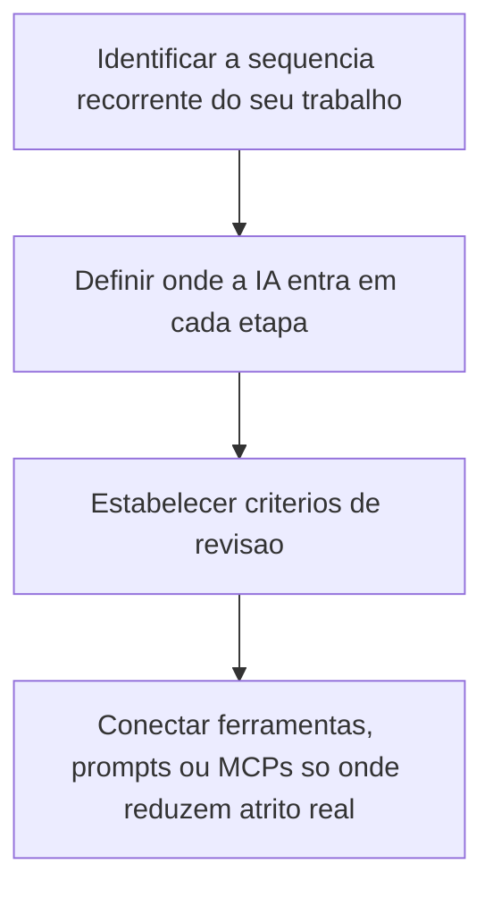
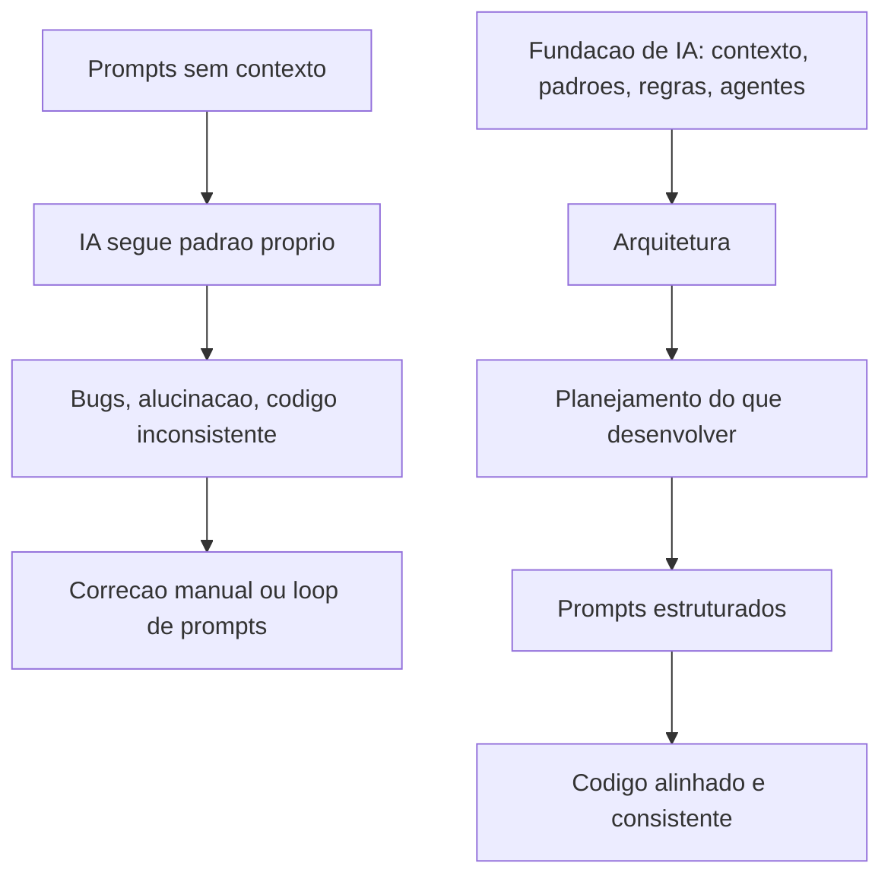

# Papel do Dev e Workflows com IA

> [!summary] TL;DR
> - O foco do dev sai de digitar código para orientar, revisar e estruturar a construção; o valor depende da qualidade das decisões, não da velocidade de escrita.
> - O que muda é o workflow, não a ferramenta: ferramentas convergem, padrões transferíveis permanecem.
> - Paralelização real com IA exige delegação por lotes e checkpoints, não microgerenciamento ("babá de IA").
> - Documentação e artefatos viram a principal fonte de verdade; revisar artefatos é mais crítico que revisar código.
> - Workflow com engenharia (fundação de IA antes do código) supera o workflow apressado, que começa por prompts soltos.

## Conceitos-chave

### Papel do dev

- **Redefinição da profissão**: o dev orienta, revisa e estrutura; a IA amplifica a execução dentro de um processo bem conduzido, sem substituir o raciocínio.
- **Produtividade com IA**: elevar qualidade, velocidade e segurança ao mesmo tempo, em vez de pedir código aleatório e aceitar a primeira resposta.
- **Produtividade sistêmica**: resultado melhor, menos atrito e mais entrega no sistema como um todo.
- **Responsabilidade humana**: escolher abordagens, avaliar riscos, decidir o que aceitar e manter coerência técnica.
- **Coautoria de código**: a IA executa, o dev mantém direção, revisão e qualidade.
- **Democratização da implementação**: não especialistas geram protótipos e MVPs, mas segurança e qualidade continuam problema; software crítico (escala, regras complexas, integração, segurança) exige profissional especializado.
- **Dev como arquiteto de software e de solução**: decide o encaixe em processos, plataformas e dependências externas; comunicação e resolução de problemas ganham centralidade.

### Workflow

- **Workflow como núcleo do processo**: define qual ferramenta, em que etapa e como encadear; torna a interação repetível e controlável.
- **Convergência de ferramentas**: concorrentes copiam features até novo equilíbrio, então o ativo é reconhecer padrões transferíveis, não fidelidade a vendor (detalhado em [[Pilares e Ferramentas de Desenvolvimento com IA]]).
- **Workflow como processo automatizável**: todo dev já segue uma sequência (model, repository, controller, commit); só se automatiza o que foi organizado.
- **Uso passivo vs uso estruturado**: passivo é pedir, esperar, rejeitar e pedir outra; estruturado é a IA executar partes com critérios de validação.
- **Babá de IA**: antipadrão de acompanhar cada geração em tempo real.
- **Formato de trabalho próprio**: kits e prompts de terceiros aceleram, mas não substituem entender a lógica; MCP, plugins, kits e spec-driven são peças de composição, não atalhos mágicos.
- **Aprender com os criadores**: seguir os criadores das ferramentas no Twitter/X (changelogs, decisões, como programam) antecipa o que a documentação ainda não cobre; assinar ferramentas é investimento de carreira para experimentar, comparar e refinar workflows.
- **Workflow apressado**: começa por prompts e "quer ver a IA gerar código" sem contexto, regras ou arquitetura; a IA segue padrão próprio, gera bugs, alucina e produz código inconsistente; termina em correção manual ou loop de prompts de conserto.
- **Workflow com engenharia**: a fundação de IA (contexto, padrões, regras, prompts, ferramentas, agentes, automações) sustenta a arquitetura; depois vêm planejamento, prompts estruturados e código alinhado e consistente. Custa mais no começo, com custo-benefício imenso, em Greenfield e Brownfield (ver [[Arquivos de Inicialização do Agente]], [[Rules do Claude Code]] e [[Workflow RPI Research Plan Implement]]).
- **IA amplia a importância de arquitetura**: design, escolha de componentes e boas práticas agora também guiam a IA.

### Paralelização

- **Paralelização não é multitarefa humana**: são múltiplas frentes reais executando ao mesmo tempo sem depender da atenção contínua do dev.
- **Delegação por lotes**: entregar um conjunto grande e bem delimitado, sair e voltar para revisar o consolidado; exige contexto, instruções claras e critérios de aceitação.
- **IA como equipe sob coordenação**: o dev vira coordenador técnico (limites, prioridades, critérios de validação).
- **Checkpoints**: substituem o microgerenciamento; são o momento de inspecionar saídas, corrigir desvios e decidir o próximo lote.
- **Clareza de escopo**: em paralelo a ambiguidade se multiplica.
- **Do serial ao paralelo**: o fluxo serial (feature, depois bugfix) dá falsa sensação de segurança; o alvo são múltiplos projetos e branches simultâneos, com código manual como exceção localizada.
- **Back-end vs front-end**: back-end permite delegação mais ampla (regras formalizáveis); front-end exige mais ajuste fino (ver [[Front-end na Era da IA]]).
- **Delegar e revisar como competências centrais**: delegar mal gera retrabalho em escala; revisar mal gera erro em escala.

### Documentação e artefatos

- **Documentação como fonte de verdade**: o trabalho técnico migra para produzir e revisar markdowns, tarefas e specs (base do [[Spec Driven Development]]).
- **Artefatos**: tarefas, especificações e registros de decisão.
- **Spec ruim**: gera implementação coerente com o texto e incoerente com o produto.
- **Efeito cascata do "next" sem revisão**: erros pequenos nas tarefas propagam para novas specs e execuções, gerando um sistema organizado porém errado.
- **Revisão de artefatos acima da revisão de código**: corrigir cedo custa menos, e agentes especializados podem refinar o código depois.
- **Qualidade de artefato**: aderência ao produto e ao domínio (guidelines, restrições arquiteturais, escopo, critérios de aceitação); o maior risco é modelar o problema errado, não um if errado.
- **Documentação para controle da IA**: progresso, listas de tarefas, estados de revisão e checkpoints (memória operacional).
- **Documentação para consumo humano**: produto, regras de negócio e contexto organizacional (exemplo: seguros e sinistros em banco).
- **ADR (Architecture Decision Record)**: registra contexto, escolha e implicações; ponte entre IA e pessoas (diretor, gerente, arquiteto). Aplicado no projeto em [[Skill de Research e Decisões Técnicas]].

### Arquitetura com IA

- **Novos eixos arquiteturais**: disponibilidade, segurança, uso de tokens, integrações com apps de IA, custo de operação e comportamento sob carga.
- **Prompt injection como problema arquitetural**: exige isolamento de contexto, validação de entrada, delimitação de permissões e contenção de efeitos colaterais quando o agente tem ferramentas ou dados sensíveis (ver [[Prompt Injection e Ataques Diretos]]).
- **Latência de LLM**: de segundos até cerca de 1 minuto; pede processamento assíncrono, filas, streaming, estados intermediários, timeout e retry.

## Fluxograma / Processo

Montagem de um workflow próprio com IA:

Workflow apressado vs workflow com engenharia:

## Erros comuns / Cuidados

- Tratar a IA como chat de dúvidas pontuais; sem desenho operacional ela gera frustração e retrabalho.
- Microgerenciar a IA desperdiça tempo cognitivo e impede escala.
- Copiar workflow de terceiros sem entender vira camada extra de complexidade e dificulta adaptar quando a ferramenta muda.
- Dar "next" sem revisar artefatos intermediários.
- Muito output e estrutura com pouco produto funcionando.
- Deixar a segurança dependente apenas de "prompts melhores".
- Fluxo síncrono simples com LLM pode ficar inviável pela latência.

## Tags de busca

`#dev-software-ia` `#workflow-ia` `#paralelizacao` `#artefatos` `#papel-do-dev`
