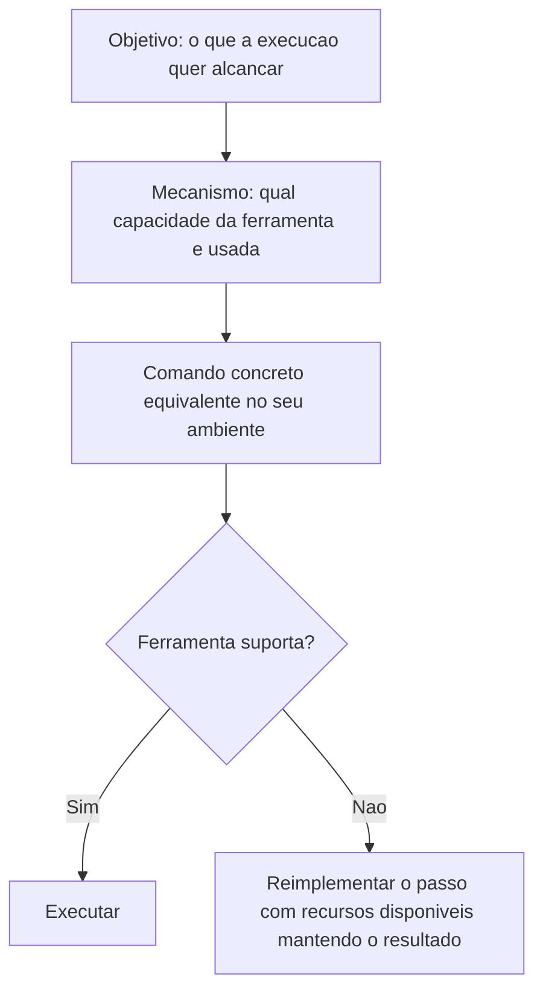

# Pilares e Ferramentas de Desenvolvimento com IA

> [!summary] TL;DR
> - Pilares: ferramenta, agentes, modelos, documentação, artefatos, skills, MCP e ambiente, que juntos formam a infraestrutura da delegação.
> - Ferramenta executa, agente opera, modelo define capacidade, documentação fixa direção, artefatos sustentam a tarefa, skills injetam competência, MCP conecta, ambiente hospeda.
> - Famílias de ferramentas: IDE nativa de IA, CLI, plugin em IDE generalista e agent-first; features se copiam rápido, importa o modelo mental.
> - Stack do curso: Cursor como ambiente principal e Claude Code CLI para execuções por terminal e agentes; workflows, prompts, agentes e skills são portáveis.
> - Modelo se escolhe por tarefa: caro onde o erro custa mais, barato onde o volume é alto.

## Conceitos-chave

### Pilares

- **Ferramentas**: IDE, CLI, comandos e prompts como superfície de acionamento do fluxo.
- **Agentes**: encapsulam a execução; a qualidade depende do modelo.
- **Modelos**: a escolha balanceia qualidade, latência e custo; modelo caro é desperdício em tarefa mecânica, modelo fraco compromete análise, planejamento e revisão.
- **Modelo por tarefa**: planejamento, execução, bugfix e mensagem de commit têm perfis diferentes.
- **Documentação**: formal e estável, diz o que o projeto é e deve respeitar, serve também a humanos; proporcional ao projeto (excesso custa contexto e tokens, falta reduz autonomia).
- **Artefatos**: mutáveis (listas, exemplos, assets, planos de ação, estruturas temporárias) para a IA se orientar e se autocontrolar; misturar com documentação prejudica a governança (ver [[Papel do Dev e Workflows com IA]]).
- **Skills**: pacotes de contexto e capacidade carregados sob demanda (scripts, docs, assets, instruções) que reduzem poluição de contexto; criar skills é engenharia de processo, e skill ruim só empacota contexto ruim (ver [[Fundamentos de Skills]] e [[Criando Skills]]).
- **Skills orientadas ao codebase**: memória operacional reutilizável que evita reler o codebase inteiro.
- **MCP**: camada de conexão externa (GitHub, Jira, Notion, Context7, WebCrawler); ver [[MCPs do Projeto Context7 e Postgres]] e [[MCP no Claude Code]].
- **Ambiente**: local e remoto; operar pelo celular (acionar comandos, acompanhar, coordenar agentes) é consequência de processo externalizado (base em [[Ambiente e Scripts de Inicialização]]).
- **Taxa de acerto dos agentes**: melhora com contexto operacional acumulado (instruções, artefatos auxiliares, especialização), não só trocando o modelo.
- **Extensões**: comandos simples para tarefas recorrentes, plugins para capacidades estruturadas reutilizáveis, extensões próprias alinhadas à empresa.

### Famílias de ferramentas

| Família | Exemplos | Característica |
|---|---|---|
| IDE nativa de IA | Cursor, Windsurf | IA no centro, IDE como superfície de coordenação; delegação perto do código, alterna instrução e edição manual |
| CLI | Claude Code, OpenAI Codex, Gemini CLI, Cursor CLI | terminal como lugar de delegação; scriptável, composicional, local ou remoto; bom para automação |
| Plugin em IDE generalista | VS Code e JetBrains com GitHub Copilot, Claude Code, Codex, Gemini, JetBrains AI Assistant | preserva ambiente e hábitos conhecidos, experiência menos integrada |
| Agent-first | Google Antigravity | gerenciador de agentes, workspaces e execuções paralelas; foco em revisar resultados e artefatos |
| Spec-driven | Amazon Kiro | spec como interface principal (ver [[Spec Driven Development]]) |

- **VS Code como base de convergência**: forks mantêm atalhos e layout.
- **Agent-first workflow**: o agente organiza a experiência e a unidade de trabalho passa do arquivo para a frente de trabalho; no Antigravity o Agent Manager é a tela principal, com múltiplos workspaces em paralelo ("qual frente eu delego agora e em que checkpoint eu reviso?").
- **Artefatos gerados pela própria IA**: passos, contexto e progresso exigem revisão para evitar erro em cascata.
- **Formas híbridas**: IDE principal mais CLIs e plugins conforme a tarefa.
- **Modelo mental acima da ferramenta**: delegação, revisão, especificação e composição de ambiente.

### Ferramentas do curso e dinâmica

- **Stack didático**: Cursor (inspeção, edição, debugging, chats rápidos, uso pontual do Agent Manager) e Claude Code CLI (execuções por terminal, agentes, instruções operacionais); apoio pontual de OpenAI Codex, Google Antigravity, interface web e celular.
- **Portabilidade**: workflows, prompts, agentes e skills valem entre ferramentas; recursos como a forma de invocar agentes são específicos do Claude Code, a ideia é transferível e a sintaxe pode mudar.
- **Ferramentas pagas não são obrigatórias**: o critério é adaptar o workflow à empresa e ao domínio, não decorar comandos.
- **Projetos práticos**: do zero (greenfield, ênfase em estruturação inicial, ver [[Bootstrap de Projetos Greenfield]]) e sobre codebase legado (interpretar restrições, preservar coerência).
- **Debugging como prática explícita**: observar, testar hipóteses, reproduzir falhas.
- **Testes gerados por IA**: quantidade não é cobertura; equilibrar básicos, regressão e edge cases (ver [[Testes Automatizados vs IA]] e [[Edge Cases e Test Guidelines]]).
- **Delegáveis à IA**: commit, PR e code review inicial, com rastreabilidade.
- **Subagentes**: janelas de contexto próprias reduzem interferência e degradação (ver [[Subagentes e Tasks Ad Hoc]]).
- **Progressão de workflow**: do básico ao avançado, quebrar, delegar, monitorar e consolidar.
- **Loop agents**: ciclos até um critério de parada, por exemplo rodar à noite e revisar de manhã (ver [[Loop]]).
- **Escala**: execução paralela e remota, múltiplas features no mesmo codebase, controle pelo celular.

## Fluxograma / Processo

Acompanhar o curso com outra ferramenta, abstraindo cada demonstração em 3 camadas:

## Erros comuns / Cuidados

- Agente gera centenas ou milhares de testes triviais em componentes React quando a instrução não delimita o que validar.
- Usar modelo caro em tarefa mecânica ou modelo fraco em planejamento e revisão.
- Misturar documentação estável com artefatos temporários.

## Tags de busca

`#dev-software-ia` `#pilares-ia` `#ferramentas-ia` `#ides` `#escolha-de-modelo`
