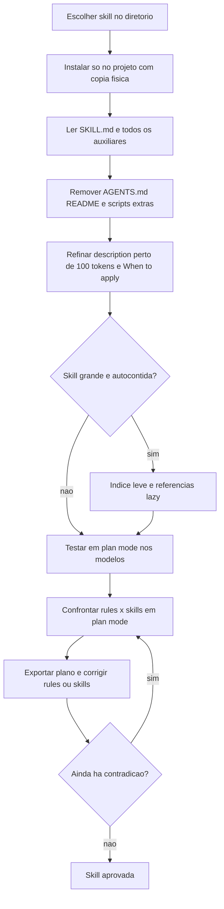

# Curadoria de Skills

> [!summary] TL;DR
> - CLAUDE.md e rules = o inegociável, sempre carregado; skills = guias de boas práticas, performance e ciladas, sob demanda.
> - Skill popular não é skill bem construída: ler tudo, ajustar a description e modularizar antes de confiar.
> - Meta de description: ~100 tokens, disparando no planejamento e na implementação, com cenários em que NÃO deve carregar.
> - Skill grande vira índice leve + referências lazy (TypeORM: SKILL.md de 600 para 72 linhas).
> - Confrontar rules x skills: repetição reforça, contradição altera o espaço de decisão do modelo e precisa ser resolvida.

## Conceitos-chave

- **Paradigma da fundação**: skills do projeto = boas práticas Nest, boas práticas TypeORM e guias de testes (um back, outro front); conceitos base em [[Fundamentos de Skills]] e fontes em [[Ecossistema de Skills]].
- **skills.sh**: diretório mantido pela Vercel, com várias skills de Nest e ~6 de TypeORM; padrão Skills aberto pela Anthropic em dezembro de 2025, ainda em evolução.
- **Skill popular mal construída**: a skill TypeORM mais instalada é autocontida com 668 linhas; o certo é índice leve + referências lazy em subarquivos (lazy loading vale também dentro da skill).
- **Description genérica não dispara**: "guia para desenvolvimento com TypeORM" falhou em vários momentos (testado); refatorar description e modularizar em vez de descartar.
- **Instalação**: via `npx`, só para Claude Code e só no projeto (não global). Instalação por link simbólico põe a skill em `.agents` com symlink em `.claude/skills`, e o Claude Code (na data da gravação) às vezes via a pasta skills vazia: preferir cópia física. `.agents` é um padrão tentado entre ferramentas (`.claude`, `.github` do Copilot).
- **Limpeza da skill instalada**: remover AGENTS.md, README e scripts que geram o AGENTS.md; deixar só SKILL.md e referências (ex: pasta `rules`) para o agente não ler arquivos desnecessários.
- **Referência lazy sem link**: o índice da skill Nest lista os documentos da pasta `rules` sem link markdown nem `@`; isso já funciona como referência lazy (índice de ~130 linhas por ter muitos arquivos).
- **Refino da description (Nest)**: a original ("boas práticas e padrões de arquitetura para aplicações prontas para produção... escrevendo, revisando, refatorando código NestJS") não tinha "planning". A IA exagerou na 1a proposta (description longa, artefatos demais, not-triggers irrelevantes como front-end, docs, git); chegou a ~92 tokens. Conferir tokens com `/skills`; às vezes é mais rápido editar um trecho à mão. Ajustar também a seção "When to apply".
- **Validação do disparo**: testar nos três modelos (Haiku, Sonnet, Opus); em [[Plan Mode]] com Opus a skill Nest carregou e leu referências de security com JWT, guards, validação de input, configuração de módulo e migrations; `Ctrl+O` mostra os detalhes.
- **Refatoração da skill TypeORM**: description para planejar e/ou implementar features com banco de dados, entidades, repositórios, migrations ("banco" sozinho é genérico demais), 87 tokens; subarquivos na pasta `rules` (não precisa se chamar references), cada um com front matter (título, impacto crítico/alto/médio, tags) e exemplos corretos vs incorretos; 16 regras + seção e template para adicionar outras. No teste carregou Nest e TypeORM juntas e leu só regras pertinentes (definição de entidade, integração com Nest/setup, migrações). Sem skills isso viraria rules e sobrecarregaria a janela de contexto.
- **Isolamento**: uma skill não referencia documentos de outra skill (portabilidade).
- **Confronto rules x skills**: 9 rules x 56 arquivos de skills deram 7 contradições e várias complementaridades. Decisões: primary key (rule exige UUID, skill mostra auto-increment, UUID, custom, composite: o autor manteve o exemplo da skill, porque a skill é guia e a estratégia de id pode mudar); eager loading (rule favorecia eager como default, skill explícito: alinhar a rule com a skill); erro em background (rule exigia rethrow sempre, skill corretamente diz que em background jobs, event handlers e cron relançar derruba o processo: rule refinada por escopo HTTP vs assíncrono, ver [[Rules do Claude Code]]); controller orquestrando três services (skill errada: corrigir a skill, regra de negócio fica no service); entity como response DTO (rule proíbe por segurança: reestruturar a skill); `synchronize: true` e `@Inject()` com string tokens também apareceram.
- **Hook de ativação de skills**: o projeto registra em `.claude/settings.json` um hook `UserPromptSubmit` que injeta a lembrança de ativar skills a cada prompt, reforçando a seção "Agent Skill Usage" do CLAUDE.md global ([[Arquivos de Inicialização do Agente]]).

## Fluxograma / Processo



## Erros comuns / Cuidados

- Confiar em popularidade de instalação como sinal de qualidade.
- Symlink em `.agents` pode fazer o Claude Code não enxergar a skill.
- Not-triggers irrelevantes inflam a description sem mudar o disparo.
- Agente leu a branch da IA crua durante o planejamento e contaminou a análise: proibir ler outras branches do git.
- Uma skill referenciar arquivos de outra quebra isolamento e portabilidade.
- Filosofias diferentes (ex: eager vs explicit loading) não podem coexistir como default entre rule e skill.

## Materiais complementares

### Prompts

**Refino da description da skill NestJS em plan mode (narrado na aula)**
```text
A skill NestJS de boas práticas deve ser chamada quando estivermos planejando e/ou implementando features que envolvem o NestJS. No momento, sua descrição é muito genérica. Analise a description da skill para ver o que é preciso melhorar. Também queremos continuar reforçando o fundamento da skill ser carregada on-demand, especificando cenários onde ela não deveria ser carregada. Também precisa mudar o "When to apply".
```

**Correção da proposta de description (narrado na aula)**
```text
A description precisa ter em média 100 tokens. E você colocou no not trigger questões não relevantes que não carregariam a skill. Pense novamente.
```
```text
Simplifique mais ainda a description para ficar menor que 100 tokens.
```

**Teste de carregamento em plan mode (narrado na aula)**
```text
Planeje a implementação da fase 2. Use as skills disponíveis.
```

**Refatoração da skill TypeORM em plan mode (narrado na aula)**
```text
A skill de TypeORM não está seguindo as boas práticas do padrão de skills do guia de skills da Anthropic. Ela tem 600 linhas, não tem estrutura modular, referências lazy, nem índice leve. Na description precisamos reforçar o que está sendo dito na outra skill que já construímos, sobre o que queremos que seja disparada quando estivermos planejando e/ou implementando features que envolvem banco de dados. E a description deve ter 100 tokens.
```

**Correção do plano de refatoração (narrado na aula)**
```text
Não podemos referenciar documentos em outras pastas que não sejam dentro da própria skill. Não use nada da skill de boas práticas.
```

**Teste com proibição de outras branches (narrado na aula)**
```text
Planeje a implementação da fase 2. Use as skills disponíveis. Não leia outras branches do git.
```

**Confronto rules x skills (sessão real do repositório, `_claude-sessions/01-correcao-contradicoes-rules-vs-skills.txt`)**
```text
confronte as rules com as skills disponíveis para ver se há contradição ou se
são complementares
```

**Decisões sobre as contradições encontradas (sessão real do repositório)**
```text
Para o  1. não quero mudar o exemplo da skill, pois podemos decidir usar
outra estratégia para os ids futuramente, e a skill é um guia

Para o 2. sim, alinhar com a skill

Para o 3. sim, alinhar com a skill

Para o 4. O exemplo na skill deve mudar. Isto de orquestração de service não é
necessário, o ponto é que
o controller deve apenas invocar a camada de serviços, as vezes ele pode usar
um ou mais serviços para
consultar alguma coisas e decidir invocar um service que vai mudar o estado do
sistema, não significa que
 ele tem que sempre chamar um service e responder alguma coisa, não é isto, mas
 todo cerne de regras de
negócio ficam no service. Então, precisamos corrigir a skill neste ponto.

Para o 5. Sim, não quero expor entities diretamente como DTO, isto serve para
segurança. Acho que reestruturar é melhor
```

**Hook que lembra de ativar skills `.claude/settings.json` (arquivo literal do repositório)**
```json
{
  "hooks": {
    "UserPromptSubmit": [
      {
        "hooks": [
          {
            "type": "command",
            "command": "echo 'Identify and activate relevant skills for this task.'"
          }
        ]
      }
    ]
  },
  "enabledPlugins": {
    "figma@claude-plugins-official": true
  }
}
```

### Conteúdo extra

> [!tip] Checklist de curadoria (skills de terceiros e próprias)
> - Li o SKILL.md e todos os arquivos auxiliares por completo?
> - A description é precisa, sem falsos positivos ou negativos?
> - A estrutura é modular (se grande, índice leve + referências lazy)?
> - O impacto na janela de contexto é aceitável (testar, planejar e implementar uma feature, analisar histórico da sessão e janela)?
> - Não há instruções suspeitas, prompt injection ou chamadas externas estranhas ([[Prompt Injection e Ataques Diretos]])?
> - Testei em cenários reais do projeto?
> - Testei em mais de um modelo (OpenAI, Anthropic)?
> - É compatível com minhas convenções/rules (pedir à LLM um cruzamento rules x skill)?
> - Não conflita com outras skills ativas?
> - Sei quem é o autor e se a skill está sendo mantida (licença, abandono)?

- https://skills.sh
- Criar skills próprias: [[Criando Skills]].

## Tags de busca

`#dev-software-ia` `#curadoria-de-skills` `#skill-description` `#rules-vs-skills` `#lazy-loading`
