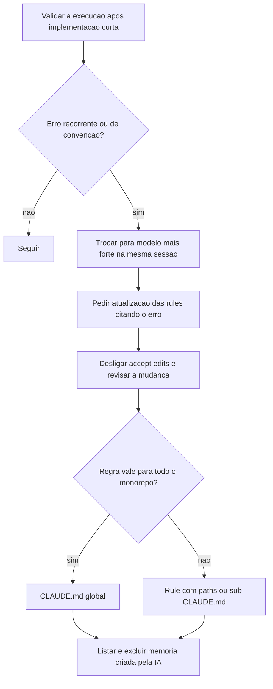

# Rules do Claude Code

> [!summary] TL;DR
> - Rules ficam em `.claude/rules/` e guardam o inegociável: convenções de código delimitadas a arquivos, pastas ou áreas.
> - Com front matter `paths`, a rule só carrega quando a IA lê/escreve arquivo que casa com o padrão; sem front matter é global como o CLAUDE.md.
> - Objetivo: reduzir janela de contexto e evitar "salada" arquitetural em Greenfield (IA alternando e misturando padrões).
> - Valem mais na execução do que no planejamento: o que precisa influenciar decisão antes do arquivo existir vai para o CLAUDE.md.
> - Erro recorrente não se resolve repetindo prompt: vira rule (ou regra no CLAUDE.md) na mesma sessão em que aparece.

## Conceitos-chave

- **Rule**: instrução delimitada (boas práticas de testes, como escrever a camada de serviços); parte da categoria "carregados automaticamente" da fundação ([[Arquivos de Inicialização do Agente]]).
- **Front matter `paths`**: lista de globs; a rule carrega só quando a IA mexe nesses arquivos. No repositório cada rule também tem `description`.
- **Rule global**: sem front matter; alguns projetos usam rules globais só para diluir o CLAUDE.md.
- **Nome "code-conventions"**: uso comum da comunidade; o que não é convenção de código tende a ir para skills ou CLAUDE.md.
- **Organização**: arquivos pequenos e segmentados, revisados periodicamente; em monorepo, prefixo por subprojeto/tecnologia (`nestjs-*`, `next-frontend-*`, `typeorm-*`).
- **Rules x skills**: rules = padrões obrigatórios sempre aplicados ao arquivo; skills = boas práticas sob demanda. Repetir orientação reforça; contradição é inaceitável ([[Curadoria de Skills]]).
- **Rules do NestJS criadas na aula**:
  - common conventions (`*.ts`): kebab-case em arquivos; DI via construtor, nunca `new` para serviço/repositório (força registro no módulo); `private readonly` por padrão, `protected` para subclasses; `@Inject` só com tokens; async/await em vez de then/catch; tipagem explícita; constantes para valores reutilizados; camelCase em variáveis e funções.
  - controllers: REST, decorators HTTP e de resposta, rotas no plural, sub-resources; erro sem esconder falha (bad: try/catch devolvendo "algo deu errado" sem log nem rethrow; good: só chamar o serviço e deixar propagar).
  - DTOs: nome por operação (`CreateUserDto`, `UpdateVideoDto`) e biblioteca de validação.
  - entities: decorators do TypeORM, convenções de colunas, unique em email e slug, relacionamentos padronizados.
  - layers (controllers, guards, interceptors, pipes, filters): regra de negócio só no service; controllers finos; artefatos auxiliares delegam.
  - services/modules: criação de módulos e serviços com o mesmo cuidado com erros.
  - tests: sufixos por tipo; unit, integração (banco real, limpeza entre execuções) e E2E; factories/builders para test data sem hardcoded; estrutura AAA ([[Testes Automatizados vs IA]]).
  - migrations (TypeORM/Postgres): nunca editar migração recém-criada, criar nova.
- **Rules adicionadas após o feedback da fase 2**: `typescript-strict.md` (`import type`, `ConfigType<typeof config>`, manter `tsc --noEmit` limpo), `auth-jwt.md` (`jti` com `crypto.randomUUID()`, rotação de refresh token com grace period), `typeorm-queries.md` (armadilhas de consulta, ex: `null` no where é ignorado, usar `IsNull()`), e a regra de `TypeOrmModule.forFeature` em `nestjs-modules.md` (bug que quebrou o app sem erro óbvio).
- **Limite do `paths`**: rule de testes cobria `*.spec.ts`, `*.e2e-spec.ts` e `test/`; a IA criou `*.integration-spec.ts`, a rule não carregou e ela montou os serviços à mão sem `Test.createTestingModule`. Convenção de nomes e execução de testes foram movidas para o CLAUDE.md do NestJS.
- **Regra transversal**: o erro de `localhost` dentro do container gerou a seção "Docker Networking" no CLAUDE.md global (vale para todo o monorepo), não uma rule do NestJS.
- **Memórias do Claude Code**: ficam na pasta do usuário, não são versionadas nem portáveis e nem toda ferramenta tem; a IA pode criar uma memória junto com a correção, que deve ser listada e excluída para manter a regra só no repositório.
- **Validação tipada no startup**: env validado (Joi, porta e `DB_PORT` como número) transforma erro de config em falha explícita e cedo.

## Fluxograma / Processo



## Erros comuns / Cuidados

- Não avaliar a execução, ou ver o erro e não mudar nada: o problema volta e culpa-se o modelo.
- `localhost` dentro de container aponta para o próprio container; usar o nome do serviço do docker-compose (ex: `db`).
- Rule com `paths` não entra no planejamento; regra que define nome ou local de arquivo precisa estar no CLAUDE.md.
- Salvar prompts problemáticos para revisar depois; uma skill que analisa histórico de conversas e propõe ajustes na fundação é uma possibilidade citada.

## Materiais complementares

### Prompts

**Transformar o erro de localhost em regra (sessão real do repositório, `_claude-sessions/03-atualizacao-claude-md-info-docker.txt`)**
```text
na sua última implementação, você usou localhost como host para conectar no
banco de dados, mas estamos em containers docker, o localhost diz respeito
somente ao próprio container.
quero atualizar as rules, para que você não cometa este mesmo erro
```

**Gerenciar a memória criada pela IA (sessão real do repositório)**
```text
me mostre as memorias que você tem
```
```text
liste o caminho do arquivo
```
```text
exclua esta memória
```

**Estrutura do front matter de uma rule (reconstituído a partir da aula)**
```markdown
---
paths:
  - "nestjs-project/src/**/*.ts"
---
# regras aqui (sem este front matter a rule é global)
```

**Front matters reais das rules do projeto (arquivos literais de `.claude/rules/`, só o cabeçalho)**
```yaml
# auth-jwt.md
paths:
  - 'nestjs-project/src/auth/**'
description: 'JWT and refresh-token rotation rules'
# nestjs-common-conventions.md
paths:
  - 'nestjs-project/src/**/*.ts'
description: 'NestJS common conventions'
# nestjs-controllers.md
paths:
  - 'nestjs-project/**/*.controller.ts'
description: 'Controller conventions - REST compliance, no silent errors, prefer exception filters over try/catch'
# nestjs-dtos.md
paths:
  - 'nestjs-project/**/*.dto.ts'
description: 'DTO conventions for input validation and data transfer'
# nestjs-entities.md
paths:
  - 'nestjs-project/**/*.entity.ts'
description: 'TypeORM entity conventions for database models'
# nestjs-layer-separation.md
paths:
  - 'nestjs-project/**/*.controller.ts'
  - 'nestjs-project/**/*.guard.ts'
  - 'nestjs-project/**/*.interceptor.ts'
  - 'nestjs-project/**/*.pipe.ts'
  - 'nestjs-project/**/*.filter.ts'
description: 'Layer separation - business logic belongs exclusively in services; controllers, guards, interceptors, pipes, and filters must delegate to services'
# nestjs-modules.md
paths:
  - 'nestjs-project/src/**/*.module.ts'
description: 'NestJS module structure conventions'
# nestjs-services.md
paths:
  - 'nestjs-project/**/*.service.ts'
description: 'Service layer error handling - errors must always propagate to upper layers'
# nestjs-testing.md
paths:
  - 'nestjs-project/**/*.spec.ts'
  - 'nestjs-project/**/*.integration-spec.ts'
  - 'nestjs-project/**/*.e2e-spec.ts'
  - 'nestjs-project/test/**'
description: 'Testing conventions for NestJS unit, integration, and e2e tests'
# typeorm-migrations.md
paths:
  - 'nestjs-project/**/migrations/**'
  - 'nestjs-project/**/*data-source.ts'
description: 'Database migration safety rules'
# typeorm-queries.md
paths:
  - 'nestjs-project/src/**/*.service.ts'
  - 'nestjs-project/src/**/*.repository.ts'
description: 'TypeORM query pitfalls - silent footguns when reading/writing through repositories'
# typescript-strict.md
paths:
  - 'nestjs-project/src/**/*.ts'
  - 'nestjs-project/test/**/*.ts'
description: 'TypeScript strictness rules - keep tsc --noEmit clean at all times'
```

**Rule `nestjs-common-conventions.md` (arquivo literal)**
```markdown
---
paths:
  - 'nestjs-project/src/**/*.ts'
description: 'NestJS common conventions'
---

# NestJS Standard Conventions

## Naming

| Artifact   | File Name              | Class Name          |
|---|---|---|
| Module     | `users.module.ts`      | `UsersModule`       |
| Service    | `users.service.ts`     | `UsersService`      |
| Controller | `users.controller.ts`  | `UsersController`   |
| Entity     | `user.entity.ts`       | `User`              |
| DTO        | `create-user.dto.ts`   | `CreateUserDto`     |
| Guard      | `auth.guard.ts`        | `AuthGuard`         |
| Constants  | `auth.constants.ts`    | (named exports)     |

- **Files:** kebab-case
- **Classes:** PascalCase
- **Modules:** pluralize (`UsersModule`); **Entities:** singularize (`User`)
- **Variables/Functions:** camelCase


## Dependency Injection

- Inject via constructor: `constructor(private readonly service: SomeService) {}`
- Never use `new` to instantiate services or repositories
- Use `private readonly` by default; `protected` only for subclasses
- Use `@Inject()` only when needed: for custom providers with string/symbol tokens (e.g., `@Inject('CONFIG')`) or NestJS symbols (e.g., `APP_GUARD`). For standard class-based providers, constructor injection without `@Inject()` is sufficient

## Async/Await

- Every I/O method: `async` with explicit `Promise<T>` return type
- Use `await`, never `.then()` / `.catch()`
- No un-awaited Promises

## Constants

- Repeated strings/numbers in `<module>.constants.ts` (e.g., `auth.constants.ts`)
- Always `as const` for literal types
- Group related constants: `AUTH_COOKIES = { ACCESS_TOKEN: '...', ... } as const`
- Never duplicate string literals across files
```

**Rule `nestjs-modules.md` (arquivo literal)**
```markdown
---
paths:
  - 'nestjs-project/src/**/*.module.ts'
description: 'NestJS module structure conventions'
---

# NestJS Module Structure

- `@Module()` property order: `imports` → `controllers` → `providers` → `exports`
- `TypeOrmModule.forFeature([...])` goes in domain module `imports`, never in `AppModule`
- **Every entity must be registered in `TypeOrmModule.forFeature([Entity])` of its owning module.** Even with `autoLoadEntities: true`, the entity is only discovered if some module imports it via `forFeature`. Forgetting this does not cause a clear error: the app starts, but any repository injection or query against the missing entity fails at runtime (or, worse, the entity is silently absent from migrations). When you create or move an entity, immediately update the owning module's imports.
- `AppModule` only contains global infrastructure (ConfigModule, TypeOrmModule) and domain modules - no business providers
- `exports` only for dependencies other modules need; don't export by default
- When a module exposes shared infrastructure (e.g., `JwtModule.registerAsync`, repository providers), it must `exports` them - and consumer test modules must include the same registration. Test modules are NestJS modules: missing imports here cause "Nest can't resolve dependencies" errors that look like production bugs but are test-setup bugs.
```

**Rule `nestjs-entities.md` (arquivo literal)**
```markdown
---
paths:
  - 'nestjs-project/**/*.entity.ts'
description: 'TypeORM entity conventions for database models'
---

# Entity Rules

## Naming and Structure

- Always pass an explicit table name to `@Entity('table_name')` - do not rely on auto-generated names
- Use UUID as primary key: `@PrimaryGeneratedColumn('uuid')`
- Always include timestamp columns: `@CreateDateColumn()` and `@UpdateDateColumn()`

## Column Conventions

- Sensitive fields (passwords, tokens) must use `{ select: false }` to exclude from default queries
- Use `{ unique: true }` for naturally unique fields (email, slug)
- Define explicit column types when the default mapping is ambiguous

## Relationships

- Always define both sides of a relationship (e.g., `@OneToMany` + `@ManyToOne`)
- Prefer explicit relation loading (`relations: [...]`) - load only what each query needs
- Use eager loading only for low-cardinality, always-needed relations (e.g., `user.role`)
- Use lazy loading only when the relation is rarely accessed and the `Promise<>` type is acceptable

## Schema Changes

- Never modify an entity without creating a corresponding migration
- Never use `synchronize: true` in production - only in early development if at all
- Generate migrations via TypeORM CLI, not by hand
```

**Rule `nestjs-services.md` (arquivo literal, já ajustada após o confronto com as skills: escopo HTTP vs background)**
````markdown
---
paths:
  - 'nestjs-project/**/*.service.ts'
description: 'Service layer error handling - errors must always propagate to upper layers'
---

# Service Error Handling Rules

## Never Swallow Errors

Services must never catch an error and silently ignore it. Every error must either:
1. **Propagate naturally** - don't catch it at all, let it bubble up
2. **Be re-thrown** - catch to add context or transform, then re-throw

A `try/catch` that logs and returns `null`, `undefined`, `false`, or an empty value instead of throwing is a silent failure. This hides bugs and makes debugging extremely difficult.

## Bad: swallowing the error

```typescript
async findById(id: string): Promise<User | null> {
  try {
    return await this.userRepository.findOneByOrFail({ id });
  } catch (error) {
    this.logger.error('User not found', error);
    return null; // caller has no idea something went wrong
  }
}
```

## Good: let it propagate or re-throw with context

```typescript
async findById(id: string): Promise<User> {
  const user = await this.userRepository.findOneBy({ id });
  if (!user) {
    throw new EntityNotFoundException('User', id);
  }
  return user;
}
```

## Good: catch, enrich, re-throw

```typescript
async createChannel(dto: CreateChannelDto): Promise<Channel> {
  try {
    return await this.channelRepository.save(dto);
  } catch (error) {
    if (error.code === '23505') {
      throw new DuplicateEntityException('Channel', 'name');
    }
    throw error; // unknown errors propagate as-is
  }
}
```

## The Rule

### Request lifecycle (services invocados por controllers)

- `catch` blocks must always end with a `throw` - either the original error or a more specific one
- The only exception is when the catch is intentionally converting an error into a valid domain result (e.g., `findOneBy` returning `null` is not an error - a `try/catch` that swallows `findOneByOrFail` is)
- Throw domain exceptions (custom `Error` subclasses) - never throw NestJS HTTP exceptions (`NotFoundException`, `ConflictException`, etc.) from services. Services must not be aware of the transport layer. Exception filters are responsible for mapping domain exceptions to HTTP responses
- Logging inside a catch is fine, but logging is not a substitute for throwing

### Background tasks, event handlers e cron jobs

- In these contexts, rethrowing would crash the process. `catch` blocks should log the error and optionally queue for retry or send to a dead letter queue
- These are the **only** contexts where catch-and-log without rethrowing is acceptable
````

### Conteúdo extra

- As demais rules (`nestjs-controllers`, `nestjs-dtos`, `nestjs-layer-separation`, `nestjs-testing`, `typeorm-*`, `typescript-strict`, `auth-jwt`) estão em `.claude/rules/` de https://github.com/devfullcycle/mba-ia-greenfield-project; as `next-frontend-*` são tratadas em [[Fundação de IA do Next.js]].

## Tags de busca

`#dev-software-ia` `#claude-rules` `#front-matter-paths` `#convencoes-de-codigo` `#nestjs`
