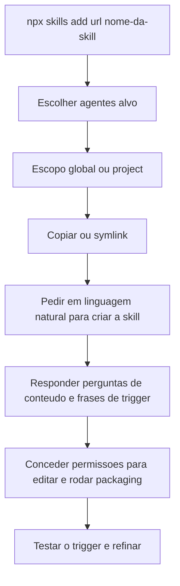
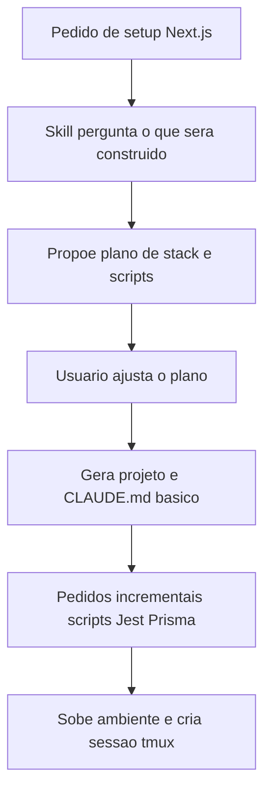

# Criando Skills

> [!summary] TL;DR
> - Forma mínima: pasta com o nome da skill em `.claude/skills` (ou `.agents`) contendo um SKILL.md com front matter e instruções.
> - Skill Creator (Anthropic) conduz a criação por perguntas e tem scripts `init_skill`, `package_skill` e `validate`; instalação via `npx skills add`.
> - Skill bem feita + modelo rápido e barato vira "receita de bolo" e muitas vezes entrega a mesma qualidade que o melhor modelo sem skill.
> - Exemplos da disciplina: MCP Builder em uso, design system da Full Cycle, Critical Review e Next.js Project Setup com scripts de ambiente para paralelismo.
> - Skill gerada é ponto de partida: refinar idioma, formato, detalhamento e agentes especialistas.

## Conceitos-chave

- **Instalação manual no Claude Code**: copiar a pasta da skill (ex: `mcp-builder` do clone do repo de skills da Anthropic) para `~/.claude/skills`. Carregada só pelo front matter, a MCP Builder consumia 72 tokens de descrição.
- **Skill acionada por one-shot**: prompt específico acionou a MCP Builder automaticamente ("Skill carregada MCP Builder") e o agente entrou em modo de planejamento sozinho (ver [[Plan Mode]]); a skill dá estrutura especializada ao planning (diretórios, uso do SDK, padrões, critérios de validação). O agente leu também arquivos de referência e conseguiu executar o script de evaluation da skill.
- **Fases do MCP Builder**: 1) pesquisa/planejamento (nomes de tools, discoverability, contexto, erros, estudo do protocolo); 2) setup e implementação; 3) review, code quality, build e testes; 4) evaluation. Cada fase define o que consultar e critério de saída.
- **Evaluation Guide do MCP Builder**: 10 questões em linguagem natural, compreensíveis para humanos, read-only, independentes, não destrutivas e estáveis; define formato de saída, complexidade, critérios de verificação e uso de tool calls. Em MCP o cliente precisa descobrir tools, combinar chamadas e processar respostas, então avalia-se o fluxo completo (`evaluation.xml`). Evaluation faz parte da definição de "servidor pronto".
- **Plano gerado no exemplo guides-mcp**: criar dentro da pasta guides (não no root); best practices TypeScript com pattern do SDK; fase 1 setup; fase 2 dependências e 3 tools (listar guias disponíveis, obter conteúdo, consultar); patterns de erro, configuração, build e test; evaluation com 10 perguntas. Execução de 3 a 4 minutos, cerca de 50% da janela de contexto.
- **Trade-off modelo vs skill**: projeto sem skill + melhor modelo demora mais e pode errar; skill bem feita + modelo mais rápido/barato sem thinking entrega rápido e muitas vezes com a mesma qualidade. Padrões da empresa (ex: iniciar projeto novo) podem virar skill.
- **Skill de design system da Full Cycle**: branding, tokens, componentes, layouts e variações reais de tela, framework agnostic. SKILL.md como resumo operacional: tema dark-first, marca com tom profissional, moderno, tech-oriented, logo em SVG (`assets/svgs`); design tokens em tabelas com anotações de uso (inputs, cards de subcategorias); typography (fonte primária, secundária, escala, pesos), espaçamento, bordas, status; componentes (botão submit, secundário, filtro, ghost); 16 regras gerais como checklist rápido que apontam para referências.
- **Referências da skill de design system**: screenshots (login, student card, documentos, portal home), SVGs, nodes/IDs do Figma para uso com o servidor MCP do Figma (pixel perfect, ver [[Figma MCP]]); referências por página (base layout, login, meus cursos, módulos, trilhas, lições, home do portal, progresso) e por componente (botões, bordas, cards e variações); variações de layout fora do padrão (páginas de documento, modals, login, vídeo em tela cheia).
- **Front matter da skill de design system (narrado)**: design system / visual guidelines para a Full Cycle learning platform, provê tokens, colors, typography, spacing, borders, components, patterns and page layouts, framework agnostic; usar ao criar ou modificar interfaces da Full Cycle Student Area, implementar componentes/páginas front-end em qualquer stack, revisar front-end para consistência visual, criar telas (cursos, listagem, módulos, lições, acessos do estudante, finanças, certificados); keywords: design system, component, layout, dark theme, student area.
- **Resultado com a skill de design system**: prompt curto, skill carregada automaticamente, logo SVG e screenshot aumentaram a fidelidade; saiu um único `index.html` (HTML + Tailwind) com logo, cores da plataforma, menu no topo, footer e animação no botão, servido por Python na porta 8822, em minutos, one-shot.
- **Skill Creator**: skill da Anthropic que ensina e ajuda a criar skills (guidelines, workflow, exemplos, referências, scripts Python). Scripts: `init_skill` (estrutura inicial), `package_skill` (zipa e gera arquivo `.skill` distribuível), `validate` (valida a skill). Front matter: guia para criar skill efetiva, usar "when users want to create a new skill or update a skill" que estenda capacidades do Claude Code com conhecimento específico, workflows ou integrações de ferramenta.
- **Instalação com escopo**: global (home do usuário, todos os projetos) ou project (pasta skills do projeto); copiar ou link simbólico (symlink propaga updates a todos os lugares). `/skills` no Claude Code lista plugin skills, user skills (globais) e project skills.
- **Critical Review (skill criada na aula)**: motivação: em [[Spec Driven Development]] a IA gera múltiplos documentos e ela mesma cria contradições. Classes de problema: contradição direta (código faz X, spec diz Y), ambiguidade (termos vagos, critérios indefinidos, múltiplas interpretações), lacuna lógica (passo a passo que pula etapa).
- **Saída da Skill Creator**: pacote `critical-review.skill` (zip para transportar) + `.claude/skills/critical-review/SKILL.md`. Reuso: copiar a pasta para `.claude/skills` de outro projeto. Gerada em português porque a conversa foi em português.
- **Conteúdo da Critical Review (narrado)**: description de revisão crítica de documentos, código e especificações para contradições, ambiguidades, inconsistências e lacunas lógicas; use para revisar documentos técnicos, PRDs, RFCs, especificações, comparar código com spec, revisar mudanças não commitadas; keywords. Workflow: 1) coletar material (arquivos apontados; pedido genérico usa `git diff HEAD` para staged + unstaged; código + spec lidos juntos); 2) analisar em 4 dimensões (contradições citando arquivo e linha, ambiguidades, inconsistências de nome/convenção, lacunas lógicas); 3) classificar severidade alta, média, baixa. Saída: resumo com contagem por criticidade, achados, recomendações. Diretrizes: ser específico, referenciar arquivo e linha, não inventar problemas, marcar dúvida como "possível", priorizar alta severidade, declarar explicitamente "nenhuma contradição" quando for o caso.
- **Resultado da Critical Review**: 48 documentos (PRD, high-level plan, high-level spec, issues, features) geraram 13 achados alta, 11 média, 4 baixa. Ex: JWT vs sessão em banco; prefixo duplicado 01 em issues; cor primária com valores diferentes para o mesmo token; dependência implícita não documentada entre issues; sessão de 7 dias (PRD) vs 30 dias; limite de caracteres PRD soft 10.000 / hard 65.000 vs spec 10 a 10.000; escopo de busca incluído no PRD e excluído na spec. Claude disparou 4 agentes em paralelo sozinho; a skill pode pedir agentes explicitamente (ex: "solte cinco agentes, um Haiku para ver o codebase...", ver [[Subagentes e Tasks Ad Hoc]]).
- **Ambiente local como arquitetura operacional**: com múltiplos agentes em paralelo, portas, env vars, banco, processos de teste e scripts de inicialização precisam ser previsíveis. `.env.example` copiado para `.env.local` em vários Git worktrees não isola (ver [[Working Directories]]); Next sobe em 3001 se 3000 ocupada, mas banco e Playwright continuam apontando para o original.
- **Scripts de ciclo de vida**: `init` (copia .env.example para .env.local, migrations, seed), `check.sh` (verifica migrations e servidor), `down` (desliga), `down --clean` (mata banco, .env.local, node_modules, zera a aplicação), `down --force` (mata processos em volta, inclusive processos fantasmas do Playwright). Detalhes em [[Ambiente e Scripts de Inicialização]].
- **Skill Next.js Project Setup**: pastas SKILL.md, scripts, references, assets; coleta decisões (tipo de app, banco, testes) e gera estrutura, scripts e CLAUDE.md operacional. Após o setup o ponto de entrada é o script `init`, não `npm run dev`/`next dev`. Extensão incremental: pedir Jest gera config, exemplos e seção testing no CLAUDE.md; pedir Prisma + Postgres gera config ORM, `DATABASE_URL` no .env.example, seção Database e dev workflow.
- **`SERVER_PORT` + `PORT_RANGE` (3000 a 3010)**: init procura porta livre e atualiza o `.env.local` (subiu em 3002 com 3000 ocupada).
- **tmux como observabilidade**: sessão com painéis de logs do servidor e processos (scripts watch); o desenvolvedor vira coordenador de 5 aplicações simultâneas, mão na massa só na last mile (corrigir 5% a 10%).
- **SKILL.md da Next.js Project Setup (cento e poucas linhas)**: front matter (setup de app Next.js para desenvolvimento, estrutura, convenções; usar ao criar projeto, setup, iniciar, scaffold project, gerar CLAUDE.md para Next.js; keywords). Regras: não fazer nada automaticamente, perguntar primeiro mesmo sabendo o que fazer; inferir escopo para sugerir; comandos principais (create-next-app); `assets/env.example` substitui o padrão do Next (mínimo `SERVER_PORT` e `PORT_RANGE`; banco se houver; `NEXTAUTH_SECRET` e URL se auth); `.env` e `.env.local` no .gitignore; `init` idempotente; checklist com itens condicionais (Prisma, auth, testes); atualizar o CLAUDE.md a cada script, pacote ou convenção nova.
- **References da Next.js Project Setup**: padrões de CLAUDE.md (overview, ambiente, tech stack, estrutura, testes, banco, padrões, worktrees, regras), estruturas mínimas de projeto Next.js, organização de componentes, rotas dinâmicas.
- **`scripts/verify-scripts`**: shell script que verifica se init, down, check e CLAUDE.md foram criados/copiados e devolve erro para a IA corrigir; a skill audita o próprio resultado.
- **Distribuição remota**: o autor tem script de setup web para baixar skills em ambientes remotos (Codex, Claude Code Web).

## Fluxograma / Processo

**Criar skill com a Skill Creator**



**Setup com a Next.js Project Setup**



## Erros comuns / Cuidados

- Haiku (rápido, barato, pensa menos) tende a gerar documentação e sumários em excesso (provavelmente metade dos tokens); ajustar no CLAUDE.md ("pare de ficar criando um monte de documento").
- Skill não elimina code review.
- Se a IA "apanha" repetidamente nos mesmos pontos, falta skill ou referência estruturada; a qualidade final ainda depende de condução, especificação e prompt.
- Agentes subindo e derrubando a aplicação em paralelo: um derruba, outro sobe na porta liberada e passa a acessar o banco do outro. O sintoma parece intermitência, a causa é falta de isolamento; teste conversa com processo válido do ambiente errado.
- Ambientes de IA na nuvem (ex: Codex) podem não permitir Docker nem conexão a Postgres: usar PGLite. "Adapte os seus projetos para uma realidade que facilite a vida do agente."
- Autor não gostou da referência a linha de arquivo na Critical Review (ajustável): a skill gerada é ponto de partida, refinar idioma, formato, detalhamento, agentes especialistas, validação da validação e plano de correção.
- Dica: criar link simbólico de CLAUDE.md para AGENTS.md para mudar num e valer em ambos.

## Materiais complementares

### Prompts

**One-shot para criar servidor MCP com a MCP Builder (narrado na aula)**
```text
Criar um servidor MCP em TypeScript, onde, dentro dessa pasta guides-mcp, eu crio guias de algumas linguagens de programação com boas práticas de desenvolvimento. O servidor vai ser capaz de localizar, listar, criar algumas tools para listar os guias disponíveis, fazer uma busca no conteúdo sobre um guia e fazer perguntas específicas sobre uma linguagem baseada no conteúdo daquele guia. Fazer uma evaluation de qualidade pra garantir que o servidor tá funcionando.
```

**Exemplo de uso da MCP Builder com chamada explícita da skill (narrado na aula)**
```text
crie um MCP para integrar com a API dos Correios
```

**Página de boas-vindas com a skill de design system (narrado na aula, digitado "de qualquer jeito")**
```text
Seu objetivo é criar uma página web de boas-vindas ao aluno que acessar a plataforma de cursos da Full Cycle. Use a identidade visual da plataforma para fazer isso. Mantenha um menu no topo, igual da plataforma, no centro uma página de mensagem linda de boas-vindas. Pode fazer normalmente usando HTML, Tailwind se você quiser, para facilitar. Disponibilize essa página em um servidor simples, em Python, na porta 8822, para eu visualizar, ou seja, localhost:8822. O arquivo é index.html.
```

**Pedido base para a Skill Creator criar a Critical Review (narrado/digitado na aula)**
```text
Eu gostaria de criar uma skill que valide inconsistências gerais dentro do codebase / docs dos nossos projetos.
Busque por contradições: por exemplo, o código faz X, mas a especificação diz que faz Y.
Identifique ambiguidades: termos vagos, critérios indefinidos ou múltiplas interpretações possíveis.
Busque lacunas lógicas: especialmente em explicações passo a passo que apresentem um buraco no meio do raciocínio.
```

**Exemplos de trigger fornecidos à Skill Creator (narrado na aula)**
```text
Revise esse documento / encontre problemas / compare o código com a especificação / Busque por contradições, ambiguidades ou qualquer coisa que gere inconsistência entre os arquivos.
```

**Pedido que acionou a Critical Review (narrado na aula)**
```text
Busque por contradições, ambiguidades nos documentos dentro da pasta @.codekit e verifique se ela não possui inconsistências, problemas, entre outros.
```

**Tradução da skill gerada**
```text
Traduza o @skill.md para inglês.
```

**Sequência de pedidos com a Next.js Project Setup (narrado na aula)**
```text
Gostaria de fazer o setup de um novo projeto em Next.js.
```
```text
Gostaria de ter scripts de inicialização para controlar melhor o projeto.
```
```text
Queria também poder trabalhar com o Jest para os meus testes.
```
```text
Quero trabalhar agora com Prisma e Postgres.
```
```text
Suba o ambiente.
```
```text
Crie uma tmux para mim.
```

### Conteúdo extra

- Comandos citados: `npx skills add <url> <nome-da-skill>`, `npm install skills` / `npx skills init`, `tmux attach -t supernext`.
- Agent Skills Directory (Vercel Labs): https://skills.sh/

## Tags de busca

`#dev-software-ia` `#skills` `#skill-creator` `#mcp-builder` `#critical-review`
